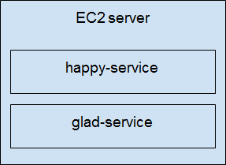
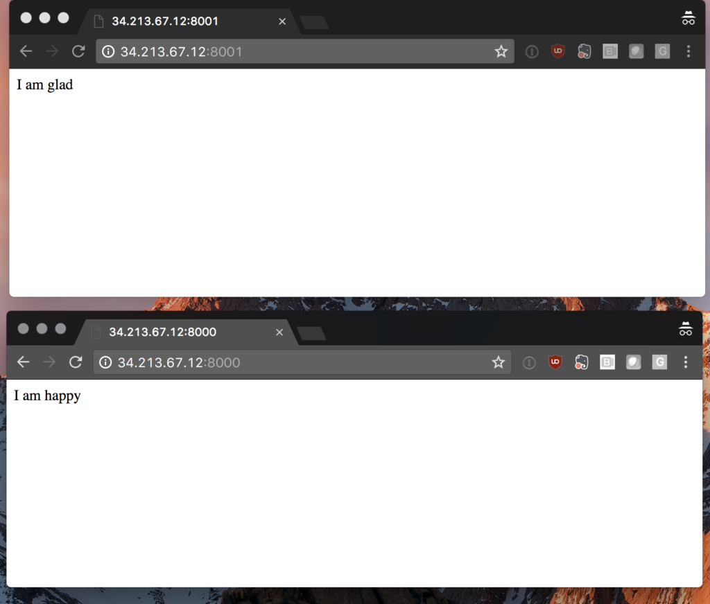

It’s 8:00 PM. I just deployed to production, but nothing’s working.
*Oh, wait. the production Kinesis stream doesn’t exist, because the
CloudFormation template for production wasn’t updated.* Okay, fix that.
9:00 PM. Redeploy. Still broken. *Oh, wait. The production config file
wasn’t updated to use the new database.* Okay, fix that. Finally, it
works, and it’s time to go home. Ever been there? How about the late
night when your provisioning scripts work for updating existing servers,
but not for creating a brand new environment? Or, a manual deployment
step missing from a task list? Or, a config file pointing to a resource
from another environment? Each of these problems stems from separating
the activity of provisioning infrastructure from that of deploying
software, whether by choice, or limitation of tools. The impact of
deploying should be to allow customers to benefit from added value or
validate a business hypothesis. In order to accomplish this,
infrastructure and software are both needed, and they normally change
together. Thus, a deployment can be defined as:

- reconciling the infrastructure needed with the infrastructure that
  already exists; and
- reconciling the software that we want to run with the software that
  is already running.

With Rancher, Terraform, and Drone, you can build continuous delivery
tools that let you deploy this way. Let’s look at a sample system:
 This simple
architecture has a server running two microservices,
[[happy-service](https://github.com/PelotonTechIO/happy-service)]
and
[[glad-service](http://lotonTechIO/glad-service)].
When a deployment is triggered, you want the ecosystem to match this
picture, regardless of what its current state is. Terraform is a tool
that allows you to predictably create and change infrastructure and
software. You describe individual resources, like servers and Rancher
stacks, and it will create a plan to make the world match the resources
you describe. Let’s create a Terraform configuration that creates a
Rancher environment for our production deployment:

```
provider "rancher" {
  api_url = "${var.rancher_url}"
}

resource "rancher_environment" "production" {
  name = "production"
  description = "Production environment"
  orchestration = "cattle"
}

resource "rancher_registration_token" "production_token" {
  environment_id = "${rancher_environment.production.id}"
  name = "production-token"
  description = "Host registration token for Production environment"
}
```

Terraform has the ability to preview what it’ll do before applying
changes. Let’s run `terraform plan`.

```
+ rancher_environment.production
    description:   "Production environment"
    ...

+ rancher_registration_token.production_token
    command:          "<computed>"
    ...
```

The pluses and green text indicate that the resource needs to be
created. Terraform knows that these resources haven’t been created yet,
so it will try to create them. Running `terraform apply` creates the
environment in Rancher. You can log into Rancher to see it. Now let’s
add an AWS EC2 server to the environment:

```
# A look up for rancheros_ami by region
variable "rancheros_amis" {
  default = {
      "ap-south-1" = "ami-3576085a"
      "eu-west-2" = "ami-4806102c"
      "eu-west-1" = "ami-64b2a802"
      "ap-northeast-2" = "ami-9d03dcf3"
      "ap-northeast-1" = "ami-8bb1a7ec"
      "sa-east-1" = "ami-ae1b71c2"
      "ca-central-1" = "ami-4fa7182b"
      "ap-southeast-1" = "ami-4f921c2c"
      "ap-southeast-2" = "ami-d64c5fb5"
      "eu-central-1" = "ami-8c52f4e3"
      "us-east-1" = "ami-067c4a10"
      "us-east-2" = "ami-b74b6ad2"
      "us-west-1" = "ami-04351964"
      "us-west-2" = "ami-bed0c7c7"
  }
  type = "map"
}

# this creates a cloud-init script that registers the server
# as a rancher agent when it starts up
resource "template_file" "user_data" {
  template = <<EOF
#cloud-config
write_files:
  - path: /etc/rc.local
    permissions: "0755"
    owner: root
    content: |
      #!/bin/bash
      for i in {1..60}
      do
      docker info && break
      sleep 1
      done
      sudo docker run -d  --privileged -v /var/run/docker.sock:/var/run/docker.sock -v /var/lib/rancher:/var/lib/rancher rancher/agent:v1.2.1 $${registration_url}
EOF

  vars {
    registration_url = "${rancher_registration_token.production_token.registration_url}"
  }
}

# AWS ec2 launch configuration for a production rancher agent
resource "aws_launch_configuration" "launch_configuration" {
  provider = "aws"
  name = "rancher agent"
  image_id = "${lookup(var.rancheros_amis, var.terraform_user_region)}"
  instance_type = "t2.micro"
  key_name = "${var.key_name}"
  user_data = "${template_file.user_data.rendered}"

  security_groups = [ "${var.security_group_id}"]
  associate_public_ip_address = true
}

# Creates an autoscaling group of 1 server that will be a rancher agent
resource "aws_autoscaling_group" "autoscaling" {
  availability_zones        = ["${var.availability_zones}"]
  name                      = "Production servers"
  max_size                  = "1"
  min_size                  = "1"
  health_check_grace_period = 3600
  health_check_type         = "ELB"
  desired_capacity          = "1"
  force_delete              = true
  launch_configuration      = "${aws_launch_configuration.launch_configuration.name}"
  vpc_zone_identifier       = ["${var.subnets}"]
}
```

We’ll put these in the same directory as environment.tf, and run
`terraform plan` again:

```
+ aws_autoscaling_group.autoscaling
    arn:                            ""
    ...

+ aws_launch_configuration.launch_configuration
    associate_public_ip_address: "true"
    ...

+ template_file.user_data
    ...
```

This time, you’ll see that `rancher_environment` resources is missing.
That’s because it’s already created, and Rancher knows that it
doesn’t have to create it again. Run `terraform apply`, and after a few
minutes, you should see a server show up in Rancher. Finally, we want to
deploy the happy-service and glad-service onto this server:

```
resource "rancher_stack" "happy" {
  name = "happy"
  description = "A service that's always happy"
  start_on_create = true
  environment_id = "${rancher_environment.production.id}"

  docker_compose = <<EOF
    version: '2'
    services:
      happy:
        image: peloton/happy-service
        stdin_open: true
        tty: true
        ports:
            - 8000:80/tcp
        labels:
            io.rancher.container.pull_image: always
            io.rancher.scheduler.global: 'true'
            started: $STARTED
EOF

  rancher_compose = <<EOF
    version: '2'
    services:
      happy:
        start_on_create: true
EOF

  finish_upgrade = true
  environment {
    STARTED = "${timestamp()}"
  }
}

resource "rancher_stack" "glad" {
  name = "glad"
  description = "A service that's always glad"
  start_on_create = true
  environment_id = "${rancher_environment.production.id}"

  docker_compose = <<EOF
    version: '2'
    services:
      glad:
        image: peloton/glad-service
        stdin_open: true
        tty: true
        ports:
            - 8000:80/tcp
        labels:
            io.rancher.container.pull_image: always
            io.rancher.scheduler.global: 'true'
            started: $STARTED
EOF

  rancher_compose = <<EOF
    version: '2'
    services:
      glad:
        start_on_create: true
EOF

  finish_upgrade = true
  environment {
    STARTED = "${timestamp()}"
  }
}
```

This will create two new Rancher stacks; one for the happy service and
one for the glad service. Running `terraform plan` once more will show
the two Rancher stacks:

```
+ rancher_stack.glad
    description:              "A service that's always glad"
    ...

+ rancher_stack.happy
    description:              "A service that's always happy"
    ...
```

And running `terraform apply` will create them. Once this is done,
you’ll have your two microservices deployed onto a host automatically
on Rancher. You can hit your host on port 8000 or on port 8001 to see
the response from the services:
 We’ve created each
piece of the infrastructure along the way in a piecemeal fashion. But
Terraform can easily do everything from scratch, too. Try issuing a
`terraform destroy`, followed by `terraform apply`, and the entire
system will be recreated. This is what makes deploying with Terraform
and Rancher so powerful - Terraform will reconcile the desired
infrastructure with the existing infrastructure, whether those resources
exist, don’t exist, or require modification. Using Terraform and
Rancher, you can now create the infrastructure and the software that
runs on the infrastructure together. They can be changed and versioned
together, too. In the future blog entries, we’ll look at how to
automate this process on `git push` with Drone. Be sure to check out the
code for the Terraform configuration are hosted on
[[github](https://github.com/PelotonTechIO/example-shared-infrastructure)].
The
[[happy-service]](https://github.com/PelotonTechIO/happy-service)
and
[[glad-service](https://github.com/PelotonTechIO/glad-service)]
are simple nginx docker containers. *Bryce Covert is an engineer at
[pelotech](https://www.pelo.tech). By day, he helps teams accelerate
engineering by teaching them functional programming, stateless
microservices, and immutable infrastructure. By night, he hacks away,
creating point and click adventure games. You can find pelotech on
Twitter at [@pelotechnology](https://twitter.com/pelotechnology).*
