Build a CI/CD Pipeline with Kubernetes and RancherRecorded Online Meetup of best practices and tools for building pipelines with containers and kubernetes.[Watch the training](https://rancher.com/events/2018/2018-08-07-onlinemeetup-building-a-cicd-pipeline-with-k8s/)

I had the pleasure of attending KubeCon 2017 last year and it was an amazing experience. There were many informative talks on various Kubernetes features, I got a chance to attend some talks and definitely learned a lot. I also had the great opportunity of speaking in the AppOps/AppDev track, and turned my lecture into this guide.

The aim of this article is to show how to use Webhooks to develop a continuous delivery pipeline to a Kubernetes cluster.

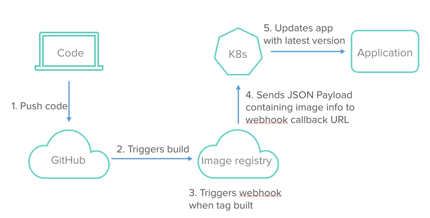

#### The diagram above is an example of how the continuous delivery pipeline will look. In this article we'll go over each of the different components involved in the pipeline and how they fit together.

Why should I care about continuous delivery at all?

If you have your app running in a Kubernetes cluster, the process of making code changes to your app and getting the new version running will look something like this:

1. Code review and merge
2. Building new image
3. Pushing the image to an image registry
4. Updating your deployment in cluster to use the new image

Implementing all these steps every time you need to update your application is necessary – but time consuming. Obviously, automating some of these steps would help.

Let’s categorize the steps we can automate into 2 parts.

**Part 1:** Building of images when code changes and pushing this image to a registry.

**Part 2:** Updating the k8s app through the automated build.

We’ll go over Part 1 first, which is automated builds.

## Part 1: Automated Builds

Automated builds can be achieved using an image registry that:

1. Provides automated builds, and;
2. A way of notifying when the build is finished.

These notifications are usually managed via webhooks, so we need to select an image registry that supports webhooks. But just getting notified via webhooks isn’t sufficient. Instead, we need to write some code that can receive and process this webhook, and, in response, update our app within the cluster.

We’ll also go over how to develop this code to process webhooks, and for the remainder of the article we’ll refer to this code as the webhook-receiver.

## Part 2: Choose Your Application Update Strategy

Different strategies can be used to update an application depending on the kind of application. Let’s look at some of the existing update strategies and see which ones we can use in a k8s cluster.

### A. Blue Green Strategy

The Blue Green Strategy requires an identical new environment for updates. First, we bring up the new environment to run the new version of our app.If that works as expected, we can take down the older version. The benefit of the Blue Green Strategy, therefore, is to guarantee zero downtime and provide a way to rollback.

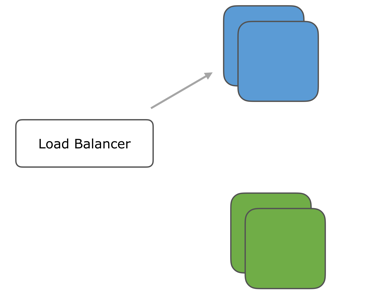

#### Blue env is running current code, green env is brought up for new code

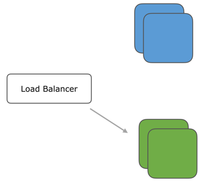

#### Start sending requests to green env

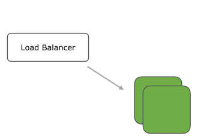

#### If green env works as expected, remove blue env. So now you're only using the latest version of the app.

### B. Recreate Strategy

In this strategy, we need to delete the older instances of our application and then bring up new ones. This strategy is a good choice for applications where the old and new versions of the application can’t be run together, for example, if some data transformations are needed. However, downtime is incurred with this strategy since the old instances have to be stopped first.

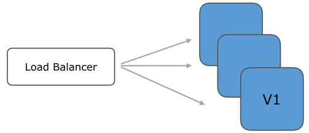

#### Multiple instances running the older version v1

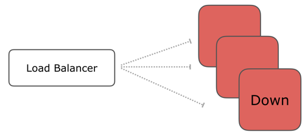

#### All instances undergoing update at same time

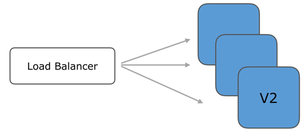

#### All instances are updated and running new version v2

### C. Rolling Update Strategy

The third and last strategy we’ll look at is Rolling Update. This strategy, like Blue Green, guarantees zero downtime. It does so by updating only a certain percentage of instances at a time. So at anytime there are always some instances with old code up and running. In addition, the Rolling Update strategy, unlike the Blue Green strategy, does not require an identical production environment.

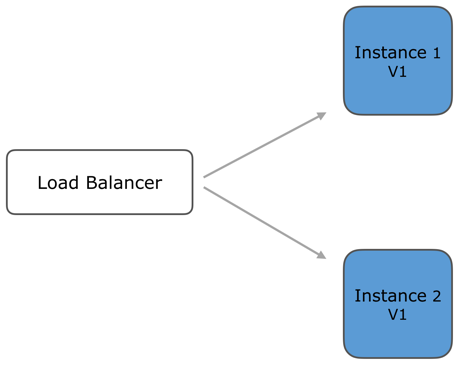

#### Both instances are running version v1

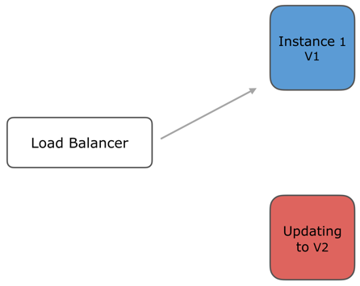

#### Instance 2 is updating to run v2. Instance 1 is still handling all requests.

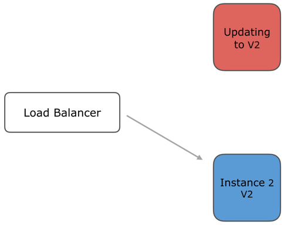

#### Instance 2 is running v2 now, update instance 1 to v2

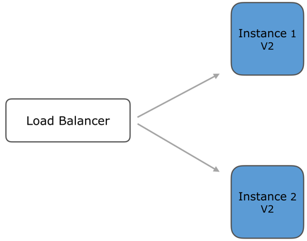

#### Both instances are running v2, no downtime

From among these, Kubernetes currently supports Rolling Update and Recreate Strategy. Rolling Update is the strategy selected by default, but we can explicitly specify which one to use through the spec of our deployment. Once we specify which strategy to use, Kubernetes handles all the orchestration logic for the update. I want to use Rolling Update for our continuous delivery pipeline.

### Selecting and Describing the Strategy Type

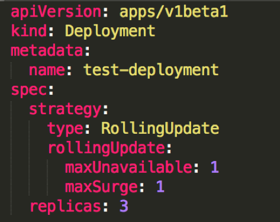

#### This is a sample manifest for a deployment. In the spec we have a field called strategy.

Over here we can provide the type of the strategy as rolling update. (That’s the strategy selected by default). We get to describe how it will work in terms of two more fields, maxUnavailable and maxSurge. As the name suggests, maxUnavailable is the number of pods allowed to be unavailable, and maxSurge is the number of pods allowed to be scheduled above the desired number, during the update.

### How do you trigger the rolling update?

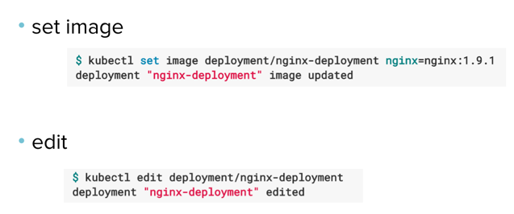

#### Here's an example of some commands we can run to trigger an update.

But manually running a command every time a new version is built will stand in the way of automating our continuous delivery pipeline. That’s why, we’re going to use the webhook-receiver to automate this process.

Now that we have covered bothPart 1 and Part 2 of automation in depth, let’s go back to the pipeline diagram and get the different components in place.

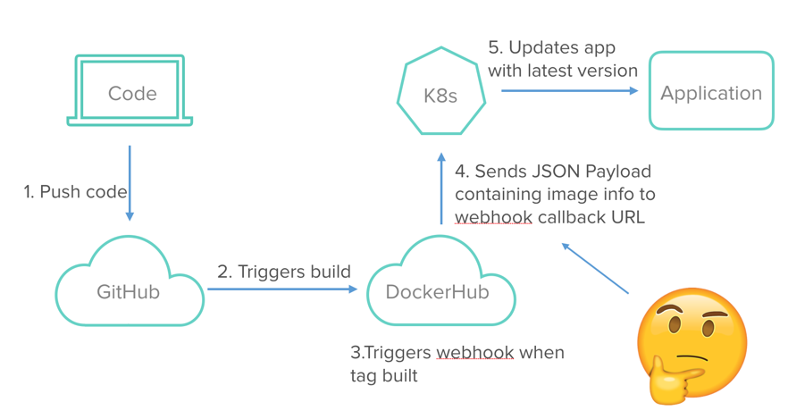

The image registry I’m using is Docker Hub, which has an automated builds feature. Plus, it comes with a webhooks feature, which we need to send the build completion notification to our webhook-receiver. So how does this webhook-receiver work, and where will it run?

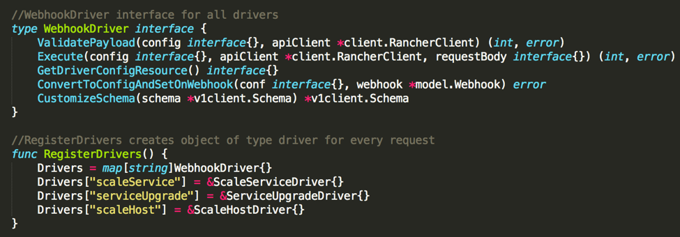

### How the Webhook-Receiver Works

The webhook-receiver will consume information sent by Docker Hub webhooks, and then take the pushed image tag and make k8s API call to the deployment resource.

The webhook-receiver can be placed anywhere, for example, lambda or run within the cluster. But Rancher 1.6 already has a webhook-receiver framework in place for such use cases. ( <https://github.com/rancher/webhook-service>) It is a micro service written in Golang. It provides webhook callback URLs. URLs are based on Rancher 1.6 API endpoints that can accept POST requests. When triggered, they perform pre-defined actions within Rancher.

### The webhook-service framework

In the webhook-service framework, the receivers are referred to as drivers. When we add a new one, each driver should implement this WebhookDriver interface for it to be functional.

I added a custom driver for Kubernetes clusters to implement our webhook.Here’s the link to the custom driver <https://github.com/mrajashree/webhook-service/tree/k8s>

With that custom driver in place, we can go back to the pipeline diagram again to get the whole picture.

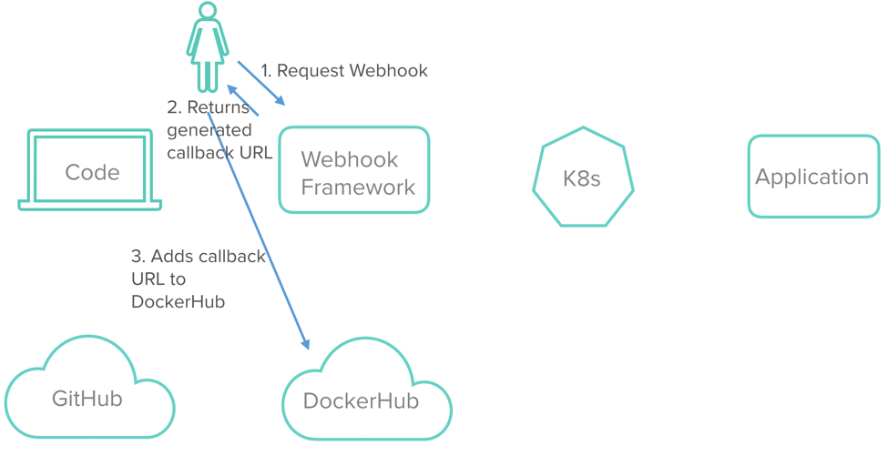

1. In this first step, the user creates a webhook and registers it with Docker Hub.This needs to be done only once for the deployment.
   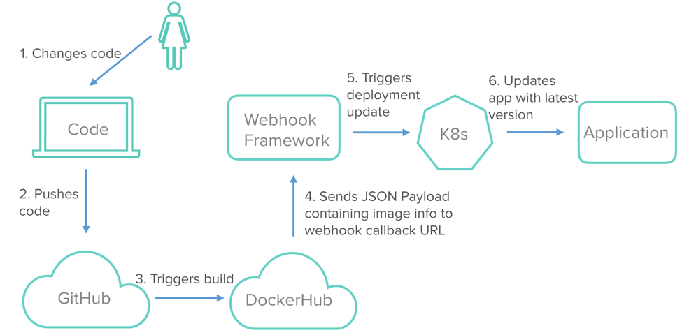
2. This second step shows the operation of the continuous delivery pipeline. Once the webhook is registered in the first step, users can keep working on the app and newer versions will continue to build because of the Docker Hub automated-builds feature. And the latest version will deploy on the cluster because of our webhook driver. Now the pipeline is in place and will update our app continuously.

## In Conclusion

Let’s review what we did to create our continuous delivery pipeline. First, we chose our application update strategy. Because Kubernetes supports the Rolling Updates Strategy, which also offers zero downtime and doesn’t require identical production environments, we chose this option. Next, we entered the strategy type and described the strategy in the manifest. Finally, we automated the build command using Docker Hub and our webhook-receiver. With these components in place, the pipeline will continue to update our application without any further instruction from the user. Now users can get back to what they like to do: coding applications.

Build a CI/CD Pipeline with Kubernetes and RancherRecorded Online Meetup of best practices and tools for building pipelines with containers and kubernetes.[Watch the training](https://rancher.com/events/2018/2018-08-07-onlinemeetup-building-a-cicd-pipeline-with-k8s/)
