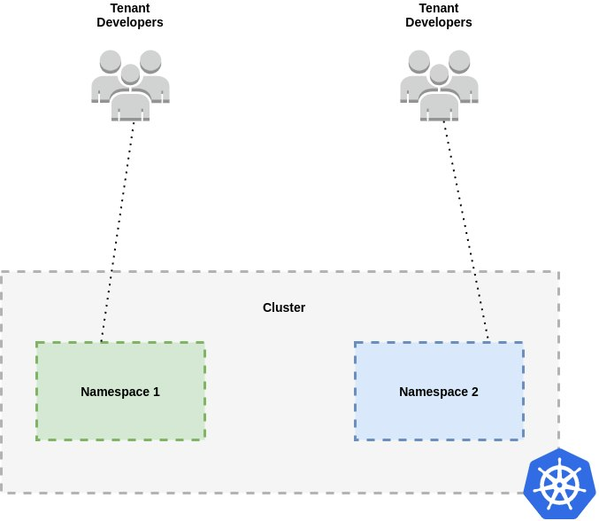
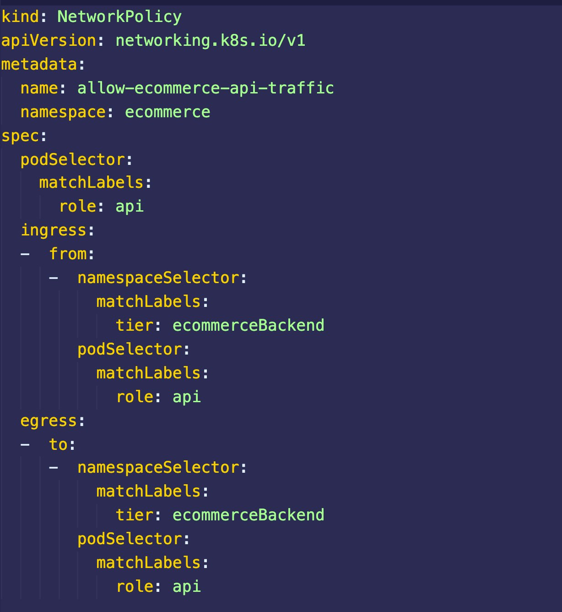
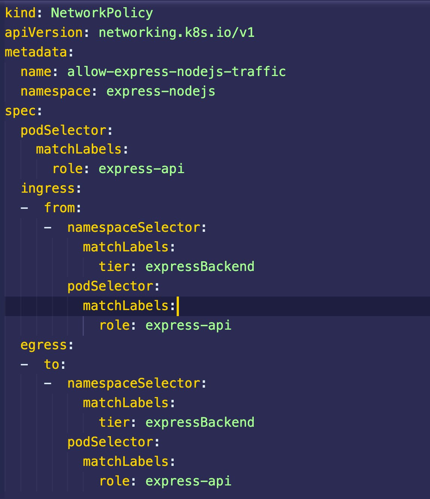
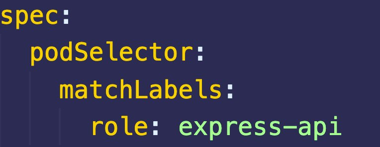
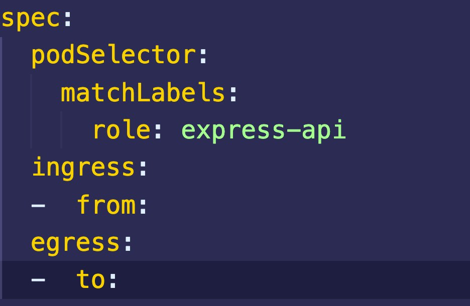
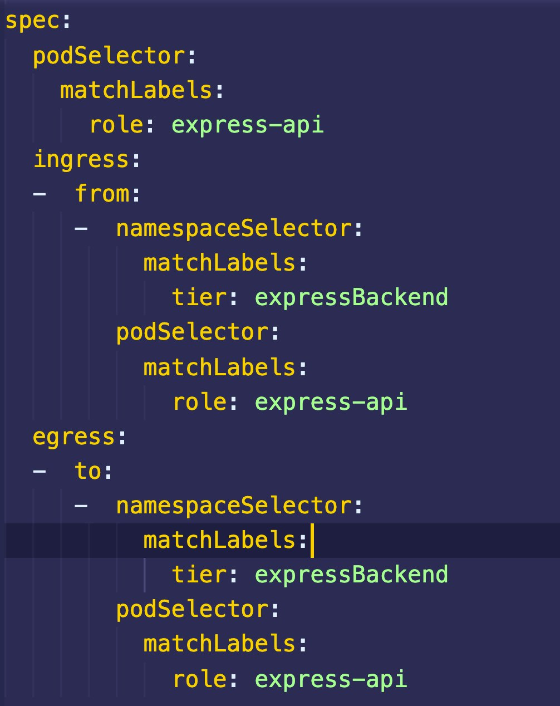

[](https://media1-production-mightynetworks.imgix.net/asset/29228699/shutterstock_389843077-2.jpg?ixlib=rails-0.3.0&fm=jpg&q=75&auto=format)Many large organizations opt for a model that consists of multiple workloads on a single Kubernetes cluster. A workload in K8s refers to an application comprising either a single resource or several resources working together. Namespaces typically separate these workloads to create a layer of isolation between the resources deployed in the respective namespaces. This can be beneficial in many use cases (e.g., running multiple incarnations of the same application or multiple unrelated apps). 

Having a shared cluster helps with managing costs and reduces the overhead of managing multiple clusters. However, it does increase the risks related to application security. Some organizations use shared clusters in a multi-cluster model while adopting a [cluster-per-application](https://learnk8s.io/how-many-clusters#3-cluster-per-application)approach. The challenges presented by these paradigms are curbed by using a [CNCF-certified Kubernetes installer](https://www.cncf.io/certification/software-conformance/) and a multi-cluster management platform like [Rancher](https://rancher.com/). Nonetheless, the challenge of isolation between application environments requires specific attention because of how the K8s network model works regarding pod behavior.

By default, all pods can communicate with each other regardless of the node or namespace that they reside in. They each have a unique IP address and are part of the same virtual network that allows for easy communication with each other. 

To achieve security isolation between your applications, you can use network security policies. This post will explain network security policies and how they can be used to secure the multiple workloads running on your Kubernetes cluster.

[](https://media1-production-mightynetworks.imgix.net/asset/29069128/multi-tenancy1.png?ixlib=rails-0.3.0&fm=jpg&q=75&auto=format)

## **What is a Network Security Policy?**

A Kubernetes network security policy is an object that allows you to control the ingress and egress of network traffic to and from pods in your workloads. Network policies create a more secure cluster network by keeping pods isolated from traffic that they don’t need.

To use network policies in your cluster, you must install a CNI plugin that supports this type of Kubernetes object. Some popular CNI plugins that support network policies include Calico, Weave, and Cilium.

## **Network Policy Example**

The best way to learn how to use network policies is to create them. In this section, you will deploy two applications consisting of network policies to control or restrict pod traffic. You may have guessed that you will need a Kubernetes cluster to work with. You can quickly get started with [Rancher Desktop](https://rancherdesktop.io/) or [create a cluster with RKE](https://github.com/LukeMwila/local-kubernetes-setup-with-rke-and-vagrant), [K3s](https://k3s.io/), or [K3d](https://k3d.io/v4.4.8/).

These applications are accessible in the following repositories:

1) [Mock E-Commerce application](https://github.com/LukeMwila/mock-ecommerce-backend) – This application has three microservices (graphql-bff, orders and products), each listening for traffic on ports 3003, 3004, and 3005.

Endpoints:

- graphql-bff – /v1/graphql
- orders – /v1/orders
- products – /v1/products

2) [Basic Node.js application](https://github.com/LukeMwila/mock-express-backend) – This is a basic Node.js application created with the express framework listening for traffic on port 8080 with a single endpoint (/test).

The first step will be to deploy the applications without their network policies. To test that the pods can communicate with each other from different namespaces, you can shell into any container and test the connection. If you are testing communication between pods in different namespaces, you must specify the namespace in the request to the service.

Connect to a container in the *ecommerce* namespace:

```
kubectl exec –stdin –tty <name-of-pod> --sh
```

Once you’ve shelled into the relevant container in the *ecommerce* namespace, you can test a connection to the containers in the *express-nodejs* namespace with the format service-name.namespace:port/endpoint:

```
wget express-service.express-nodejs:8080/test
```

You should get a positive response to your request. The response will be created as a file locally in your container. You can read the response by running the following command:

```
cat test
```

Now that you have confirmed the default non-isolation between the two workloads, you can create the network policies. Below are the network policies for each of the applications.

**Mock E-Commerce Application**

[](https://media1-production-mightynetworks.imgix.net/asset/29068845/Screenshot_2021-09-23_at_13.15.16.png?ixlib=rails-0.3.0&fm=jpg&q=75&auto=format)

**Basic Node.js Application**

[](https://media1-production-mightynetworks.imgix.net/asset/29189910/Screenshot_2021-09-26_at_23.48.32.png?ixlib=rails-0.3.0&fm=jpg&q=75&auto=format)

At first glance, these policies may appear to have a complex structure, but once you understand the main fields that determine how they function, they’re a lot simpler to work with. The main fields to understand are covered below.

### Pod Selector

The pod selector (podSelector) determines which pods in a namespace the network security policy applies to. Without the use of a network policy, all pods are non-isolated and open to all network communication. If a network policy selects a pod, the pod will be isolated and only be open to traffic allowed by the network policy definition.

[](https://media1-production-mightynetworks.imgix.net/asset/29189977/Screenshot_2021-09-26_at_23.49.32.png?ixlib=rails-0.3.0&fm=jpg&q=75&auto=format)

### Ingress and Egress

A network policy can apply to traffic about ingress, egress, or both.

- Ingress: Refers to incoming network traffic into the pod from another source.
- Egress: Refers to outgoing network traffic from the pod to another destination.

[](https://media1-production-mightynetworks.imgix.net/asset/29189981/Screenshot_2021-09-26_at_23.50.11.png?ixlib=rails-0.3.0&fm=jpg&q=75&auto=format)

Both the ingress and egress fields have a set of ‘*from’* and ‘*to’* properties that determine which traffic is allowed by the network policy.

- **From:** The ‘*from*’ field selects ingress (incoming) traffic that will be allowed.
- **To:** The ‘*to’* field selects egress (outgoing) traffic that will be allowed.

##### From/To Rules

- **PodSelector:** As detailed above, this field selects the pods to allow traffic from/to.
- **NamespaceSelector:** This field selects namespaces to allow traffic from/to.
- **IpBlock:** This field selects an IP range to allow traffic from/to.
- **ports:** This is used to specify one or more ports that will allow traffic.

[](https://media1-production-mightynetworks.imgix.net/asset/29189998/Screenshot_2021-09-26_at_23.51.39.png?ixlib=rails-0.3.0&fm=jpg&q=75&auto=format)

Once you apply them to your cluster, you can retest the same connection requests between pods in the different namespaces to make sure your applications are isolated as expected.

In case you missed it, I demonstrated usage of network policies as part of a multi-tenancy model in one of our Kubernetes Master Classes. You can watch the session here:Play Video
