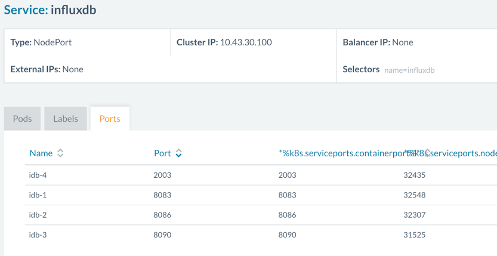

Prometheus is a modern and popular
monitoring alerting system, built at SoundCloud and eventually open
sourced in 2012 – it handles multi-dimensional time series data really
well, and friends at [InfinityWorks](https://www.infinityworks.com/)
have already developed a Rancher template to deploy Prometheus at click
of a button.

In hybrid cloud environments, it is likely that one might be using
multiple orchestration engines such as Kubernetes and Mesos, in which
case it is helpful to have the stack or application portable across
environments. In this short tutorial, we will convert the template for
Prometheus from Cattle format to make it work in a Kubernetes
environment. It is assumed that the reader has a basic understanding of
Kubernetes concepts such as pods, replication controller (RC), services
and so on. If you need a refresher on the basic concepts, the
[Kubernetes 101](http://kubernetes.io/docs/user-guide/walkthrough/) and
[concept guide](http://kubernetes.io/docs/user-guide/) are excellent
starting points.

## Prometheus Cattle Template Components

If you look at latest version of the [Prometheus template
here](https://github.com/rancher/community-catalog/tree/master/templates/Prometheus/1)
you will notice:

- docker-compose.yml – defines containers in docker compose format
- rancher-compose.yml – adds additional Rancher functionality to
  manage container lifecycle.

Below is a quick overview of each component’s role (Defined in
docker-compose.yml):

- Prometheus: is the core component which scrapes and stores data.
- Prometheus node exporter: gets host level metrics and exposes them
  to Prometheus.
- Ranch-eye: is an haproxy and exposes cAdvisor stats to Prometheus
- Grafana: visualization for data
- InfluxDB: Time series database specifically used to store data from
  Rancher server which is exported via Graphite connector
- Prom-ranch-exporter: is a simple node.js application which helps in
  querying rancher server for states of a stack or service.

You will also notice that the template uses two data containers,
prom-conf and graf-db, which are used to house the configuration/data
and then provide to respective app containers as volumes. Additional
behavior also defined in rancher-compose.yml about scaling, health
checks and upgrade strategy etc.

## Designing Kubernetes templates

We will define a pod for every component using replication controllers
and expose these pods using Kubernetes service objects. Let’s start
with the Prometheus service:

```
apiVersion: v1
kind: Service
metadata:
  name: prometheus
  namespace: "default"
spec:
  type: NodePort
  ports:
  - name: "prometheus"
    port: 9090
    protocol: TCP
  selector:
    name: prometheus
```

We have defined a service and exposed port 9090 through which then we
can stitch up other components. And finally, selector is Prometheus so
the service will pick up pods with Prometheus label.

## Data Containers and Volumes

Now let’s create a replication controller for Prometheus. As you might
have noticed, we will need to handle two containers here. One is the app
container and other is the data container for configuration file used by
Prometheus. However, Kubernetes does not support data containers (read
about the [issue
here](https://github.com/kubernetes/kubernetes/issues/831)) in same way
that Docker does.

So how do we have handle this? Kubernetes has volumes of different types
and for our purposes we can use EBS (*awsElasticBlockStore* in
Kubernetes) or Google Cloud disk (*gcePersistentDisk* type in
Kubernetes) and map those to the Prometheus pod on the fly. For this
article, let’s assume that we are not using a public cloud provider and
we need to make this work without cloud disk. Now we have two options:

- hostPath: It is possible to provide the data from hostPath by
  mapping the hostPath to a container path (much like native Docker).
  But this poses one potential issue – what if the pod moves to a
  different node during a restart and that host does not have hostPath
  files available? There is also cleaning up of files from a hostPath
  required if the container moves to a different node. So although
  this option is feasible, it is not clean in design. Let’s move on.

- gitRepo: is another type of volume that Kubernetes supports. All you
  have to do is map a Git repo as a volume for a container and the
  container will fetch it before running:

```
volumes:
- name: git-volume
gitRepo:
  repository: "git@somewhere:me/my-git-repository.git"
  revision: "22f1d8406d464b0c0874075539c1f2e96c253775"
```

Volume of type gitRepo is yet to be supported on Rancher in a Kubernetes
environment (See the [issue filed
here](https://github.com/rancher/rancher/issues/4976)). You can also
checkout the features of Kubernetes that are supported in the [issue
filed here](https://github.com/rancher/rancher/issues/4489). These
features will be supported in the next release of Rancher.

To move on and make this work without gitRepo, we will build new images
for the Prometheus and Grafana containers (because Grafana also needs
data). We will simply extend the official images and add additional
files to image itself. When gitRepo volume support is available, we can
simply switch to official Docker images and use volumes from gitRepo.
The Dockerfile for Prometheus looks like below:

```
FROM prom/prometheus:0.18.0
ADD prometheus.yml /etc/prometheus/prometheus.yml
ENTRYPOINT [ "/bin/prometheus" ]
CMD [ "-config.file=/etc/prometheus/prometheus.yml", 
"-storage.local.path=/prometheus", 
"-web.console.libraries=/etc/prometheus/console_libraries", 
"-web.console.templates=/etc/prometheus/consoles" ]
```

You can find both images on Docker hub, for [Prometheus
here](https://hub.docker.com/r/infracloud/prometheus/) and [Grafana
here](https://hub.docker.com/r/infracloud/grafana/)

## Back to Kubernetes Templates

With that, our final replication controller for Prometheus looks like
this:

```
apiVersion: v1
kind: ReplicationController
metadata:
  name: prometheus-rc
  namespace: default
spec:
  replicas: 1
  selector:
  template:
    metadata:
      labels:
        name: prometheus
    spec:
      restartPolicy: Always
      containers:
      - image: infracloud/prometheus
        command:
        - /bin/prometheus
          --alertmanager.url=http://alertmanager:9093
          --config.file=/etc/prometheus/prometheus.yml
          --storage.local.path=/prometheus -web.console.libraries=/etc/prometheus/console_libraries
          --web.console.templates=/etc/prometheus/consoles
        imagePullPolicy: Always
        name: prometheus
        ports:
        - containerPort: 9090
```

You can check out definitions of other services and replication
controllers at [this Github
repo](https://github.com/infracloudio/community-catalog/tree/master/kubernetes-templates/Prometheus/0).

## The Magic of Labels

Looking more closely, you’ll notice that the Cattle template for
Prometheus-rancher-exporter uses Rancher labels:

```
prometheus-rancher-exporter:
  tty: true
  labels:
    io.rancher.container.create_agent: true
    io.rancher.container.agent.role: environment
```

The labels create a temporary Rancher API key and exposes environment
variables to the container. In the case of the Kubernetes template,
CATTLE\_URL, CATTLE\_ACCESS\_KEY and CATTLE\_SECRET\_KEY are provided as
configuration options while launching the template. To get API keys –
head over to “API” the right most tab in Rancher UI. Copy the Endpoint
URL listed there, as it varies from one environment to another.
Also create an API key and copy both the access and secret keys. You
will be asked for these keys when you launch the catalog as shown in
screenshot below: [](images/rancher_blog_conf_options.png)
If you added the repo to your catalog, then you can click on “Launch”,
and in a few minutes you should have the cluster beating to life!
[](images/rancher_blog_prom.png)
Now let’s head over to the Grafana UI and check its stats – that will
serve as a test of what is working and what is broken. Grafana has five
dashboards; you will notice that “Rancher Stats” is not showing any data
at all: [](images/rancher_blog_stats_blank.png)

## Kubernetes Network & Graphite Port

The issue here is that the Rancher Statistics dashboard gets data from
InfluxDB – which in turn is sent data by the Rancher server through
Graphite connector. Since the Kubernetes cluster creates its own network
and assigns IPs and ports to containers dynamically, and is on a
different network than Rancher server, we have to configure this after
the Prometheus cluster is up. InfluxDB is running in a private network,
but it is exposing the ports on host network using port type as
NodePort:

```
spec:
  type: NodePort
  ports:
  - port: 2003
    protocol: TCP
    name: idb-4
```

This is visible if you click on Service: InfluxDB and open tab “Ports”.
Essentially, we have to configure the host machine’s IP and exposed port
to enable the Rancher server to talk to the InfluxDB graphite connector.

[](images/rancher_blog_influxdb.png)

Go to http://<RANCHER\_SERVER\_IP>:8080/v1/settings/graphite.host and
click on the edit button at top right. This will provide you a value
field – enter the IP of the host on which InfluxDB container is running
here and send the request. You’ll see the new IP if you refresh above
URL. Now go to the KUBERNETES console, Services and click on InfluxDB
service and find out the host port for 2003 – in our case 32435. Update
this port at URL:
http://<RANCHER\_SERVER\_IP>:8080/v1/settings/graphite.port

For above settings to take effect, you will have to restart the
rancher-server container. But once this is done, you’ll see stats
reported on Grafana UI, and when you query the InfluxDB UI:

[](images/rancher_blog_rancher_stats.png)

## Conclusion

In this article, we saw how the Prometheus template can be converted
from a Cattle format to a Kubernetes format. The networking model,
linking of containers, and semantics for data volumes in Kubernetes are
different than in Docker. Hence, while converting a Cattle template
which is in native Docker format, we need to apply these Kubernetes
semantics and redesign the template.
