A Detailed Overview of Rancher's ArchitectureThis newly-updated, in-depth guidebook provides a detailed overview of the features and functionality of the new Rancher: an open-source enterprise Kubernetes platform.[Get the eBook](https://more.suse.com/fy21-global-web-landing-page-rancher2-technical-architecture)

Rancher 2.0 is often said to be an enterprise grade management platform for Kubernetes, 100% built on Kubernetes. But what does that really mean?

This article will answer that question by giving an overview of Rancher management plane architecture, and explain how API resources are stored, represented and controlled utilizing Kubernetes primitives like CustomResourceDefinition(CRD) and custom controllers.

## Rancher API Server

While building Rancher 2.0, we went over several iterations till we set on the current docker architecture - in which the Rancher API server is built on top of an embedded Kubernetes API server and etcd database. The fact that Kubernetes is highly extendable as a development platform, where the API could be extended defining a new object as a CustomResourceDefinition (CRD), made adoption easy:

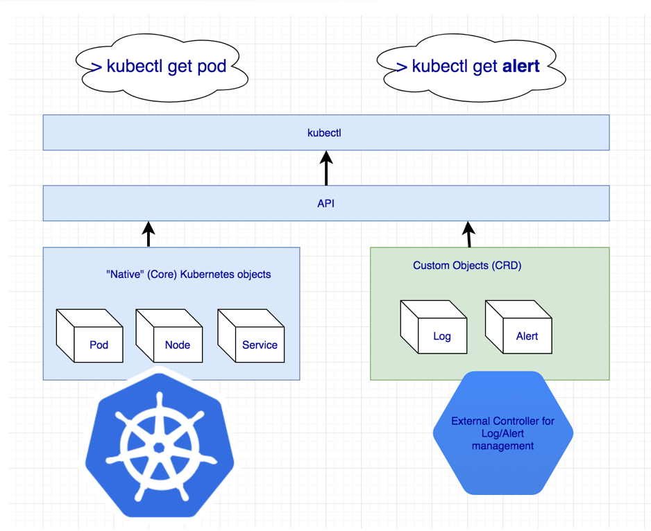

All Rancher specific resources created using the Rancher API get translated to CRD objects, with their lifecycle managed by one or several controllers that were built following Kubernetes controller pattern.

The diagram below illustrates the high-level architecture of Rancher 2.0. The figure depicts a Rancher server installation that manages two Kubernetes clusters: one cluster created by RKE (Rancher open source Kubernetes installer that can run anywhere, and another cluster created by a GKE driver.

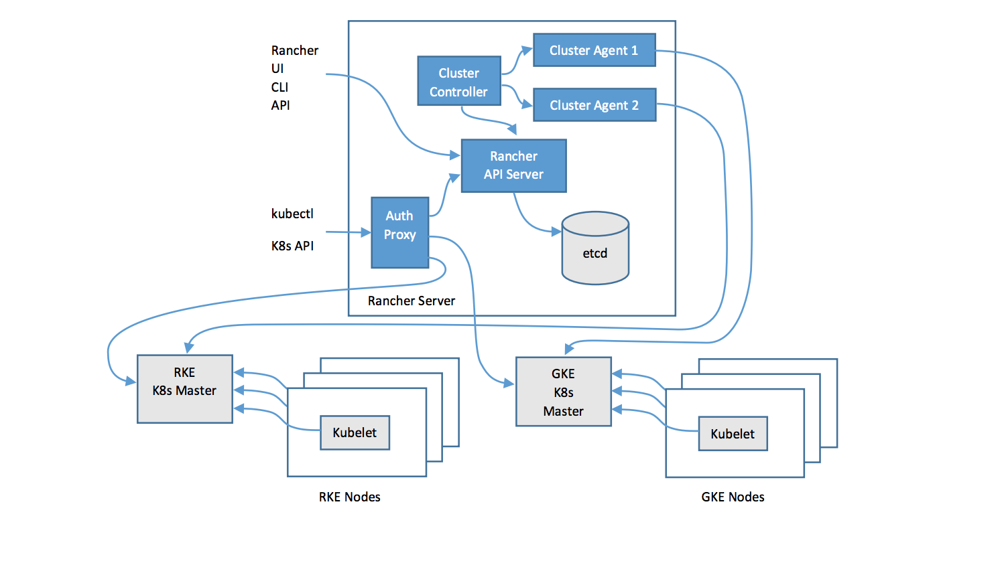

As you can see, the Rancher server stores all its resources in an etcd database, similar to how Kubernetes native resources like Pod, Namespace, etc. get stored in a user cluster. To see all the resources Rancher creates in the Rancher server etcd, simply ssh in to the Rancher container, and run `kubectl get crd`:

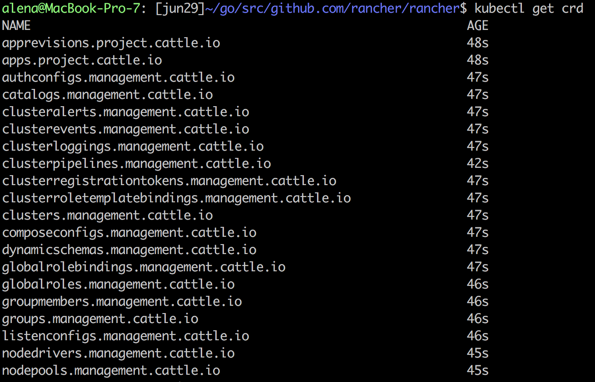

To see the items of a particular type, run `kubectl get <crd name>`:

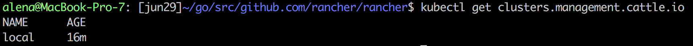

and `kubectl describe <crd name> <resource name>` to get the resource fields and their respective values.

Note that this is the internal representation of the resource, and not necessarily what the end user would see. Kubernetes is a development platform, and the structure of the resource is rich and nested, in order to provide a great level of flexibility to the controllers managing the resource. But when it comes to user experience and APIs, users prefer more flat and concise representation, and certain fields should be dropped as they only carry value for the underlying controllers. The Rancher API layer takes care of doing all that by transforming Kubernetes native resources to user API objects:

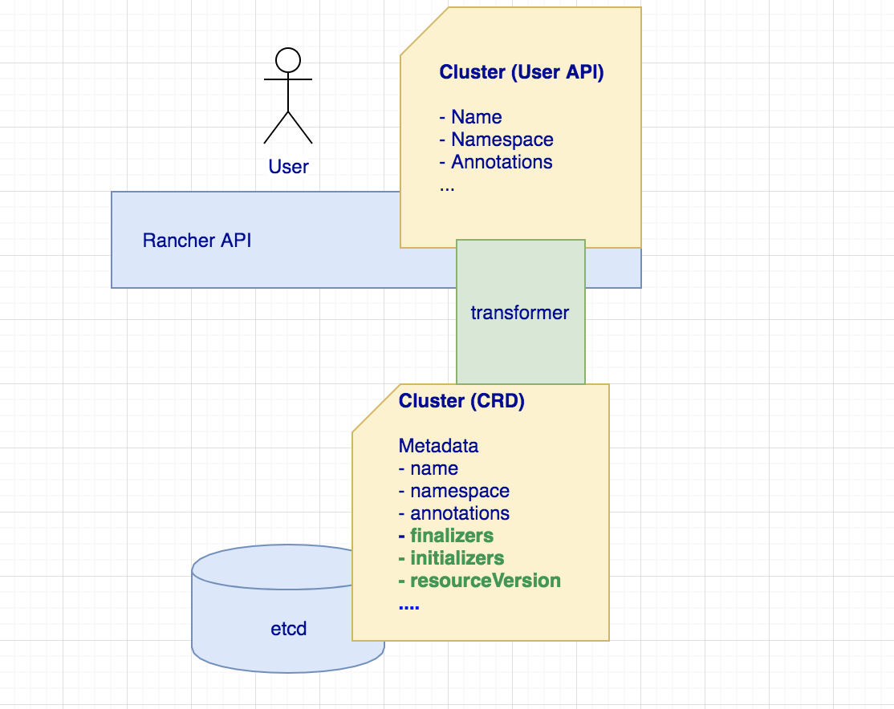

The example above shows how Cluster - a CRD Rancher uses to represent the clusters it provisions - fields get transformed at the API level. Finalizers/initializers/resourceVersion get dropped as this information is mostly used by controllers; name/namespace are being moved up to become a top level field to flatten the resource representation.

There are some other nice capabilities of the Rancher API framework. It adds features like sorting, object links filtering fields based on user permissions, pluggable validators and formatters for CRD fields.

## What makes a CRD?

When it comes to defining the structure of the custom resource, there are some best practices that are recommended to follow. Lets first look at the high level structure of the object:

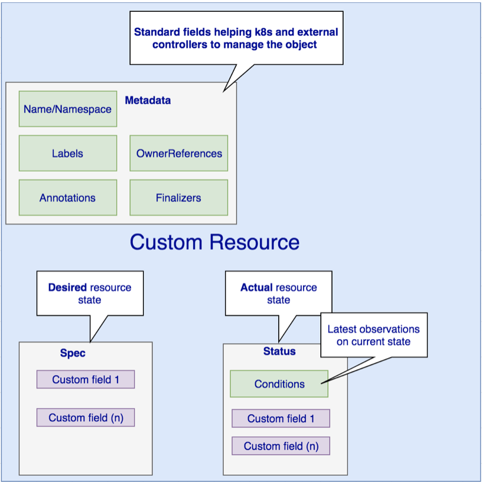

Let’s start with the **metadata** - a field that can be updated both by end users and the system. **Name** (and the **namespace**, if the object is namespace scoped) is used to uniquely identify the resource of a certain type in the etcd database. **Labels** are used to organize and select a subset of objects. For example, you can label clusters based on the region they are located in:

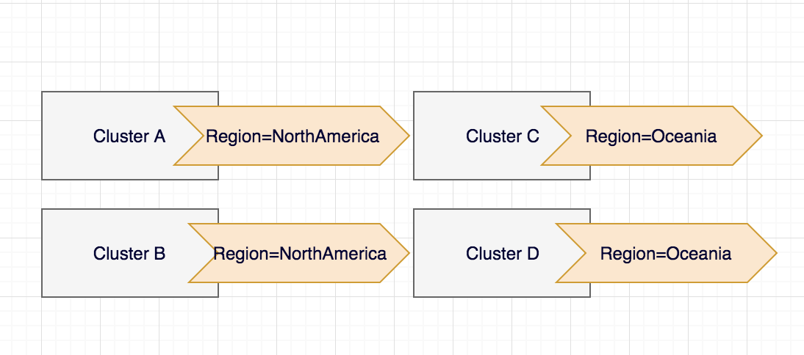

So later on you can easily select the subset of clusters based on their location `kubectl get cluster --selector Region=NorthAmerica`

**Annotations** is another way of attaching non-identifying metadata to the object. Widely used by custom controllers and tools, annotations is a way of storing controller specific details on the object. For example, Rancher stores creator id information as an annotation on the cluster, so custom controllers relying on the cluster ownership can easily extract this information.

**OwnerReferences** and **Finalizers** are internal fields not available via User APIs, but highly used by the Kubernetes controllers. **OwnerReference** is used to link parent and child object together, and it enbables a cascading dependents deletion. **Finalizer** defines pre-deletion hook postponing object removal from etcd database till underlying controller is done with the cleanup job.

Now off to the **Spec** - a field defining the desired resource state. For cluster, that would be: how many nodes you want in the cluster, what roles these nodes have to play (worker, etcd, control), k8s version, addons information, etc. Think of it as user defined cluster requirements. This field is certainly visible via API, and advisable to be modified only via API - controllers should avoid updating it. (The explanation for why is in the next section.)

**Status** in turn is the field set and modified by the controllers to reflect the actual state of the object. In the cluster example, it would carry the information about applied spec, cpu/memory statistics and cluster **conditions**. Each condition describes the status of the object reported by a corresponding controller. Cluster being an essential object with more than one controller acting on it, results in more than one condition attached to it. Here are a couple of self descriptive ones having Value=True indicating that the condition is met:

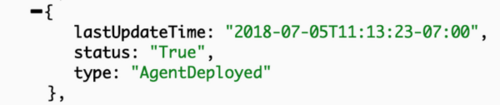

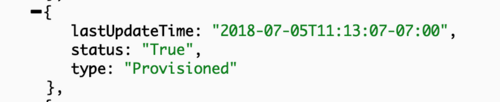

Such fine grained control is great from internal controllers stand point as each controller can operate based on its own condition. But as a user you might not care about each particular condition value. On Rancher API level, we have **State** field aggregating the condition values, and going into Active only when all conditions are met.

## Controller example

We’ve mentioned a controller several times; so what is its definition? The most common one is: “Code that brings current state of the system to the desired state”. You can write custom controllers that handle default Kubernetes objects, such as Deployment, Pod, or write a controller managing the CRD resource. Each CRD in Rancher has one or more controllers operating on it, each running as a separate Go routine. Lets look at this diagram, where cluster is the resource, and provisioner and cluster health monitor are 2 controllers operating on it:

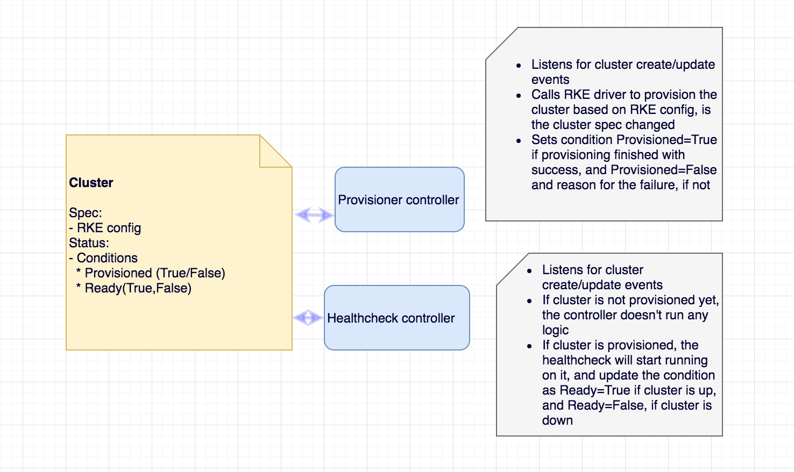

In a few words, controller:

- Watches for the resource changes
- Executes some custom logic based on the resource spec or/and status
- Updates the resource status with the result

When it comes to Kubernetes resources management, there are several code patterns followed by the Kubernetes open-source community developing controllers in the Go programming language, most of them involving use of the client-Go library (https://github.com/kubernetes/client-go ). The library has nice utilities like Informer/SharedInformer/TaskQueue making it easy to watch and react on resource changes as well as maintaining in-memory cache to minimize number of direct calls to the API server.

The Rancher framework extends client-Go functionality to save the user from writing custom code for managing generic things like finalizers and condition updates for the objects by introducing Object Lifecycle and Conditions management frameworks; it also adds better abstraction for SharedInformer/TaskQueue bundle using GenericController.

## Controller scope - Management vs User context

So far we’ve been giving examples using cluster resource - something that represents a user created cluster. Once cluster is provisioned, user can start creating resources like Deployments, Pods, Services. of course, this assums the user is allowed to operate in the cluster - permissions enforced by user project’s RBAC. As we’ve mentioned earlier, the majority of Rancher logic runs as Kubernetes controllers. Only some controllers monitor and manage Rancher management CRDs residing on a management plane etcd, and other do the same, but for the user clusters, and their respective etcds. It brings up another interesting point about Rancher architecture - Management vs User context:

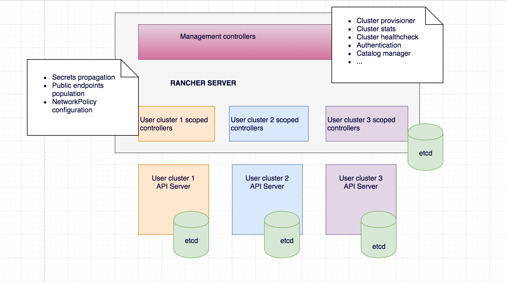

As soon as user a cluster gets provisioned, Rancher generates the context allowing access to the user cluster API, and launches several controllers monitoring resources of those clusters. The underlying user cluster controllers mechanism is the same as for management controllers (same third party libraries are used, same watch->process->update mechanism is applied, etc), and the only difference is the API endpoint the controllers are talking to. In management controllers case it’s Rancher API/etcd; in user controller case - user cluster API/etcd.

The similarity of the approach taken when working with resources in user clusters vs resources on the management side is the best justification for Rancher being 100% built on Kubernetes. As a developer, I highly appreciate the model as I don’t have to change the context drastically when switching from developing a feature for the management plane vs for the user. Fully embracing not only Kubernetes as a container orchestrator, but as a development platform helped us to understand the project better, develop features faster and innovate more.

### If you want to learn more about Rancher architecture, stay tuned

This article gives a very high level overview of Rancher architecture with the main focus on CRDs. In the next set of articles we will be talking more about custom controllers and best practices based on our experience building Rancher 2.0.

A Detailed Overview of Rancher's ArchitectureThis newly-updated, in-depth guidebook provides a detailed overview of the features and functionality of the new Rancher: an open-source enterprise Kubernetes platform.[Get the eBook](https://more.suse.com/fy21-global-web-landing-page-rancher2-technical-architecture)
