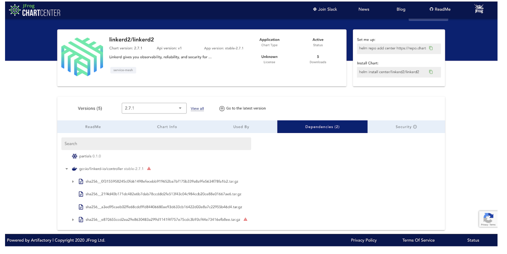
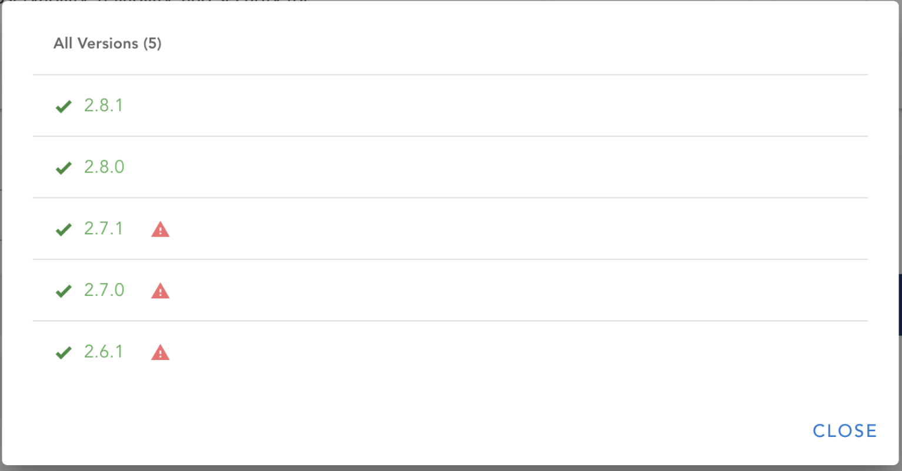
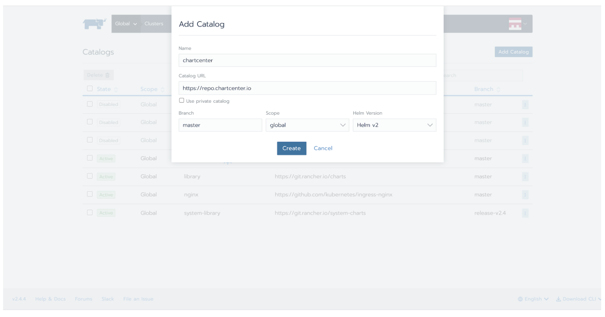

How Helm 3 and Helm Charts Create Reproducible Security[Tuesday, August 11 | 11am ET](https://info.rancher.com/kubernetes-master-class-aug11-2020)

With the growing popularity of containerized applications, organizations and startups at all levels need to manage their Kubernetes deployments more safely at scale. Today, there is an expanding list of tools and services that can help do this. One of these services is the package manager known as Helm. As a recent [graduate from incubation to a full-fledged project](https://www.cncf.io/announcement/2020/04/30/cloud-native-computing-foundation-announces-helm-graduation/) of the Cloud Native Computing Foundation, some estimate that Helm is used by more than 70 percent of Kubernetes developers and is building a fingerprint all its own in helping to secure containerized applications.

Many of the Helm community’s security best practices apply directly to how Kubernetes applications are managed but understanding each part of the puzzle requires guidance. Without the ability to understand each step of securing cloud software, organizations can open themselves up to vulnerabilities at different stages of the software development supply chain — especially when working across distributed development teams. Because Helm charts ensure that your environment settings remain the same across deployments, they provide a strong basis for reproducible security. In this blog post, we’ll look at how you can use Helm and Helm Charts to create reproducible security in your Kubernetes deployments.

## Secure Deployments with Helm

Helm is special because it’s so practical. Using Helm best practices, organizations do not have to replicate each security step when teams are distributed throughout the world and have multiple environments, such as test, QA, staging and production. Using Helm charts can make it even easier for your teams to consistently build and deploy secure software together. This really helps when building production-level code. Because at the end of the day, all you really want to do is deploy a Kubernetes app, get it working correctly, and be able to manage its lifecycle. Here are reasons Helm shines:

### Lifecycle Management

Helm has an important job to do in controlling the entire lifecycle of your K8s applications. When you deploy, when you upgrade, when you roll back a deployment – Helm can manage these for you and keep you up to date about the state of your software. For example, using a `helm get` on a deployed release gets you the full picture – all the metadata that helps you understand the actual state of the running application and the full manifest so you can easily figure out where issues started. That’s the big Helm security story: managing immutable configurations, managing the application lifecycle and having transparency with metadata.

### Immutable Configurations

Aimed at controlling application configurations, Helm can give you true configuration as code and immutable configurations put this all in one place. In the context of security, control is essential. When you publish a Helm chart, you’re supposed to take care of all the security issues beforehand. Helm shines here with its immutability, holding the final package with all of your previously approved configuration options and pieces in place and creating an immutable way to manage safety with each chart version and each build being tracked.

### Metadata and a Trusted Source

Control and transparency are important when you want to make sure your applications can be used safely. JFrog recently launched a new free initiative called [ChartCenter](https://chartcenter.io/) that helps provide Helm charts to the community. With ChartCenter, the team put Helm on steroids and created a universal aggregator of one big Helm repository and all the information you need around security in a chart’s dependencies. ChartCenter’s metadata gives teams the ability to get a recursive view of all the issues. Everything that is built up in different parts of a Kubernetes application is even easier to see, and as a central repository ChartCenter can be your single source of truth.

ChartCenter gives you visibility into dependencies and metadata. If someone were to install WordPress, for example, they could go to ChartCenter to really understand the state of the application. ChartCenter gives you a bill of materials, including a scan of the vulnerabilities that might be part of the application and its dependencies. You can aggregate all this data and use it to monitor Kubernetes application security.

### The Kubernetes Connection

Since Helm and Kubernetes security are interrelated, it’s critical to understand “[The 4C’s of Cloud Native Security](https://kubernetes.io/docs/concepts/security/overview/).”

- **Cloud:** Managed services provided by big cloud providers help with a lot of the hardening needs of Kubernetes. Attestation, digital signatures, managing access permissions at scale, encrypting secrets, cluster behavior and license compliance are areas where new tools are helping maintain the safe state of an application.
- **Cluster:** The desired state of each cluster and access privileges within each node is highly configurable. For example, namespaces and service accounts can be used to divide the cluster’s resources to multiple users and grant unique permissions within each group. Even pods have security features that can be activated with the admission controller and by assigning unique privileges to users and groups using Role-Based Access Control (RBAC).
- **Container:** While Docker is the most well-known container runtime, it wasn’t built for the increasingly complex monitoring needs of large-scale applications. Fortunately, new ways to enhance container security keep emerging. JFrog’s ChartCenter freely scans your container images and [provides vulnerability data on the security tab](https://chartcenter.io/stable/nginx-ingress?tab=security).
- **Code:** Best practices in code security include encrypting data in transit, rotating credentials frequently and reviewing third-party dependencies. With the growing reliance on open source packages, many developers often lack the tools to do proper security checks of their dependencies. This can open up applications to vulnerabilities from the start. With ChartCenter, organizations can ensure that developers are keeping Kubernetes managed applications secure from the beginning. ChartCenter scans your containers and sub-charts and provides important vulnerability information about your applications and dependencies. Here is an example:

## Checking the Security of your Helm Chart Dependencies

For this example, let’s say that I wanted to install Linkerd using their Helm chart.

If I install a somewhat old version, let’s say:
<https://chartcenter.io/linkerd2/linkerd2?version=2.7.1>

Chart version: Chart version: 2.7.1 | Api version: v1 | App version: stable-2.7.1

Using ChartCenter, I can catch that this specific chart version has a vulnerability in its dependencies.

The Linkerd chart version 2.7.1 has an issue inside the image: **gcr.io/linkerd-io/controller stable-2.7.1**, and on the dependency tab, we can see it has a high vulnerability.

Luckily, I can go to the Versions window by clicking on “View All” and I’m able to see that the latest versions of this chart are vulnerability free.

So, If I have my terminal open and I’m using this chart, I can hit `helm upgrade` and I’m finished. Or the best thing to do moving forward is use ChartCenter as my single source of truth.

So to do this, I’ll use the command:

`helm repo add center https://repo.chartcenter.io`

`helm repo update`

Now I can install the latest version of the Linkerd Helm chart and the UI shows me that it is now vulnerability free. [See it live here](https://chartcenter.io/linkerd2/linkerd2?version=2.8.1&tab=dependencies).

## More Reproducible Security Considerations with Helm 3

ChartCenter supports and provides metadata around Helm 2 and Helm 3, but Helm 3 has several updates that make Kubernetes applications more secure and make understanding the state of the application easier. By now, everyone knows that the removal of Tiller was the single biggest improvement to Helm overall. Tiller had a basic security issue with user privileges. It ran with root access and provided a way for unauthorized users to access your server. A few other callouts in Helm 3 security include:

### User Management with RBAC

With Tiller gone, Kubernetes now controls user permissions. Using Role-Based Access Control (RBAC), users can create two main types of roles. The first is service accounts, which manage other applications’ access to the Kubernetes API, and the second is user accounts, which represent humans who interact with the API. Rancher has added centralized authentication methods to help you manage RBAC, [outlined here](https://rancher.com/docs/rancher/v2.x/en/admin-settings/authentication/).

### Secrets Management

Many of the configuration options that help your chart manage API keys, OAuth, database and access credentials live in your values.yaml file. One major thing you need to pay attention to when working with these credentials in Helm charts is decoupling the secrets from the application completely or encrypting them. For example, many developers forget that secrets should never be kept and committed in source control without protection. Storing them in source means they’ll be available in the commit history and, if unencrypted, will open up the application to security issues for the lifetime of the chart. One solution is the [Helm Secrets plugin](https://medium.com/@Devopscontinens/encrypting-helm-secrets-7f37a0ccabeb).

### Chain of Custody and Provenance Files

Another concept in Helm security is making sure to verify the custody of charts. Helm includes the ability to use public-private keys to both sign and verify charts. Helm 3’s documentation recommends using keybase.io with GnuPG installation as one way to do this. Once you import and set up your keybase keys, you can then use `Helm package` to sign the chart. One other plugin that provides chart signing and verification with GnuPG is [Helm GPG (GnuPG) Plugin](https://github.com/technosophos/helm-gpg).

In turn, if you want to verify that a chart has been signed by someone else, you can use the keybase tool and `Helm verify` to check the signature. If there is a provenance file available (with a .prov extension), it will verify the integrity and origin of a package. Provenance means that you can track the full path and integrity of where these charts came from.

**Other helpful improvements in Helm 3:**

- Helm 3 can still render and deploy Helm 2 charts.
- Dependencies used to live in a requirements.yaml file, but are now part of the Chart.yaml file.
- A new type of chart called a library chart can hold attributes that can be shared across chart dependencies.
- A JSON Schema (values.schema.json) is used for validation in a chart’s values.yaml file.
- Three commands for monitoring metadata: Helm status [RELEASE], Helm list | Helm ls, and Helm history [RELEASE].

## Next Steps: Get Hands-on with Rancher and JFrog

Make sure to have [Helm installed](https://helm.sh/docs/intro/install/), then:

**Step 1: Configure ChartCenter as your Helm chart repository using the command:**

`helm repo add center https://repo.chartcenter.io`

**You’ll see:**

“center” has been added to your repositories

**You’re connected. Now, you’ll want to make sure you check and update the local cache. Run:**

`helm repo update`

**Next, you can use this command to see a list of all the charts available in ChartCenter:**

`helm search repo center/`

**To check a specific Helm repository, you can use something like this:**

`helm search repo center/rancher`

**Step 2: If you want to install the Rancher chart and get the application running, make sure you have these [prerequisites](https://chartcenter.io/rancher-stable/rancher).**

**Then, in this example, to install Rancher on a single-node Kubernetes Cluster, you’ll need to walk through some additional steps:**

First, specify the namespace for Rancher to cattle-system:

`kubectl create namespace cattle-system`

Then you’ll need to get a Rancher-generated TLS certificate by installing cert-manager:

Install the CustomResourceDefinition resources separately
`kubectl apply --validate=false -f https://github.com/jetstack/cert-manager/releases/download/v0.15.0/cert-manager.crds.yaml`

Create the namespace for cert-manager
`kubectl create namespace cert-manager`

Install the cert-manager Helm chart from ChartCenter
`helm install` 
`cert-manager center/jetstack/cert-manager` 
`--namespace cert-manager` 
`--version v0.15.0`

You can do a final rollout status check with:

`kubectl -n cert-manager rollout status deploy cert-manager`

Last, you can install Rancher with:

`helm install rancher center/rancher-stable/rancher` 
`--namespace cattle-system` 
`--set hostname=rancher.example.org`

*rancher.example.org* should be the name of where you want the installation to be accessed in your web browser.

Last, if you can check the rollout of your installation with:

`kubectl -n cattle-system rollout status deploy/rancher`

To follow along with each specific step and see other setup options, check out: [Install Rancher on the Kubernetes Cluster docs](https://rancher.com/docs/rancher/v2.x/en/installation/k8s-install/helm-rancher/). You can also find [troubleshooting documentation](https://rancher.com/docs/rancher/v2.x/en/installation/options/troubleshooting/).

Once you have Rancher installed locally, you’ll use admin as the login username and you will be walked through creating a password.

Once you’re set up with Rancher 2.0, you can navigate to the catalog where you can add other repos and charts. The catalog uses a questions.yaml file to provide enhancements to Helm and uses the GUI to configure other settings. These can all be configured in the UI and will provide additional ways to harden your application.

Additionally, we invite you to check out Rancher’s [security hardening guides](https://rancher.com/docs/rancher/v2.x/en/security/hardening-2.4/) to help provide additional guidance for hardening production-level installations and use [CIS benchmarks](https://rancher.com/docs/rancher/v2.x/en/security/benchmark-2.4/) to audit your applications for security.

## Join the Master Class for Reproducible Security

Rancher and JFrog are hosting a Master Class around Helm and Kubernetes application security that will show you the full scope of ChartCenter and Rancher and will put into practice many of the concepts outlined in this post.

During the Master Class, you’ll get a strong understanding of the power of Helm charts in the Kubernetes security ecosystem and the new tools being used with Helm 3. You’ll get to see how Helm charts can be deployed in production and get hands-on with how to inspect container processes, control your application state and manage reproducible security in your builds. We’ll also look at a new way to [manage security mitigations](https://github.com/jfrog/chartcenter/blob/master/docs/securitymitigationspec.md) with ChartCenter metadata and dive deep into:

- Security in Helm 3
- Why use trusted registries such as ChartCenter
- Vulnerabilities and mitigation in your chart’s dependencies
- More details around RBAC and cluster roles
- Certificates, signatures and verification
- Secrets management best practices and more

[Register now](https://info.rancher.com/kubernetes-master-class-aug11-2020) for the Master Class on August 11, 2020, at 11am ET.

How Helm 3 and Helm Charts Create Reproducible Security[Tuesday, August 11 | 11am ET](https://info.rancher.com/kubernetes-master-class-aug11-2020)
