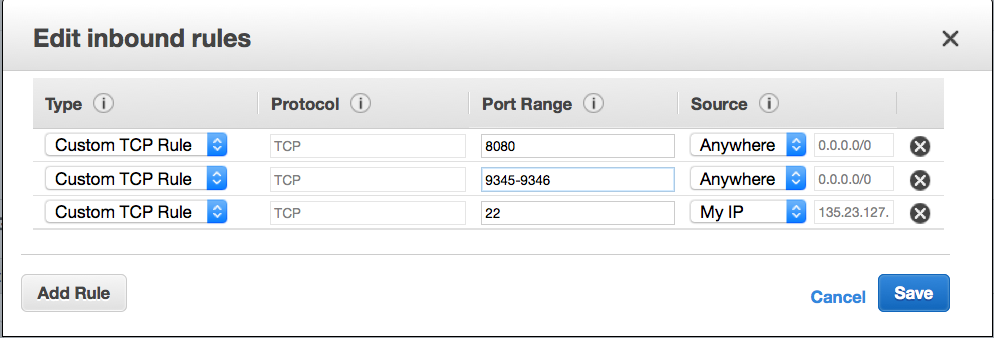
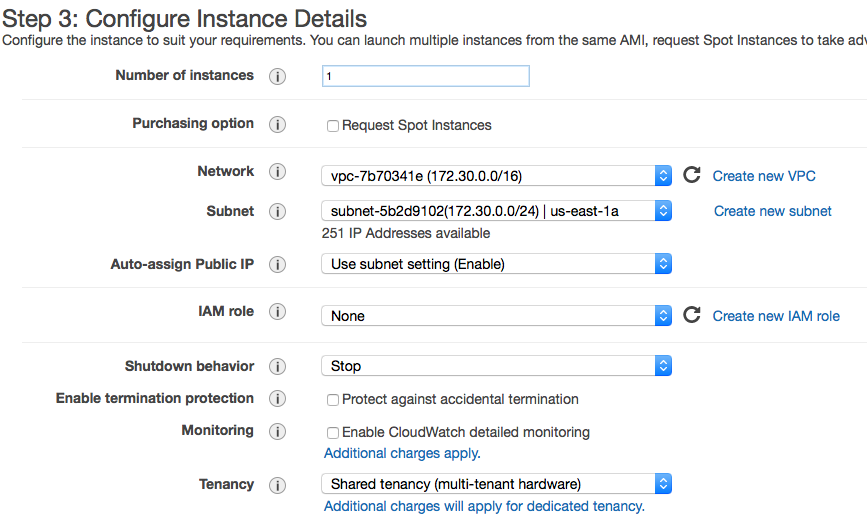
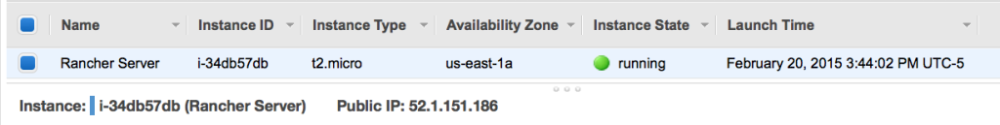
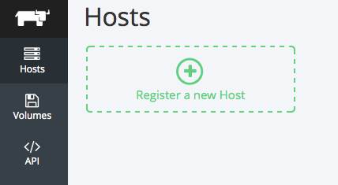
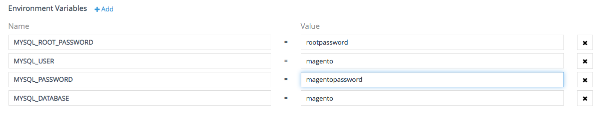
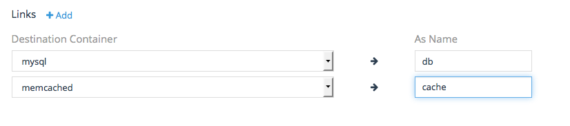
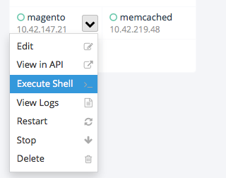
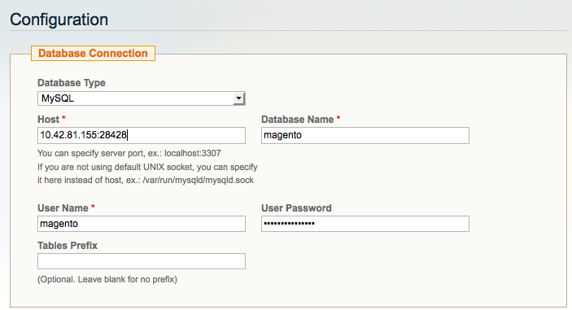

[](images/rancher_blog_magento-logo2.png)

*[Usman is a server and infrastructure engineer, with experience in
building large scale distributed services on top of various cloud
platforms. You can read more of his work at
[techtraits.com](http://techtraits.com/), or follow him on twitter
[@usman\_ismail](https://twitter.com/usman_ismail)or on
[GitHub](https://github.com/usmanismail).]*

[Magento](http://magento.com/) is an open-source content management
system (CMS) offering a powerful tool-set for managing eCommerce
web-sites. Magento is used by thousands of companies including Nike and
Office Max. Today we are going to walk through the process of setting up
a Magento cluster using Docker and Rancher on the Amazon Elastic Compute
Cloud (EC2). We use Docker because it makes deployments simple,
repeatable, and portable across cloud service providers and in-house
hardware. Using Rancher we can extend the Docker primitives across
multiple servers even if those servers are on different cloud providers.

We will be using the [Official MySQL
image](https://registry.hub.docker.com/_/mysql/), [Official Memcached
Image](https://registry.hub.docker.com/_/memcached/) and
a [Magento](https://registry.hub.docker.com/u/usman/magento/) image I
created. Despite its many benefits, one area where Docker is still
evolving is managing entire clusters. It is possible to have multi-node
deployments with Docker installed on each node, but you have to manage
the containers on each node independently by connecting through ssh.
Furthermore, we lose the ability to connect containers using Docker
linking. This is where Rancher comes in. Rancher creates a Virtual
Private Network (VPN) using IPSec between all Docker containers and
allows us to communicate between containers using standard Docker
primitives. Additionally, Rancher gives us a nice UI to launch and
manage containers without having to ssh into individual servers. We are
launching all nodes on EC2, however you could use any combination of
servers--some from EC2 or from in-house hardware or from Digital Ocean
if you choose.

The next sections walk through setting up the Amazon environment,
Rancher server, and a array of Rancher compute nodes. We will then use
those nodes to launch our Magneto deployment.

### Amazon Environment Setup

We are going to bring up our cluster on top of Amazon EC2, and for this
we need an [Amazon Web Services (AWS)](http://aws.amazon.com/) account
and some familiarity with the AWS Console.
If you need a refresher you can peruse the [AWS Console
Documentation](http://docs.aws.amazon.com/awsconsolehelpdocs/latest/gsg/getting-started.html).
Once you are signed into the console, click through to the *EC2* service
and from there select the *Key Pairs* menu item in the *Network and
Security* section of the side menu. Click *Create Key Pair* and specify
a name in the pop-up screen to create a key. When you click *Create,* a
pem file will be downloaded to your computer. Keep the key file
somewhere safe as it is needed to login to your servers and also allows
someone to access your servers if they gain access to it. We will also
need to setup a security group by selecting the *Security Groups* option
in the side menu and clicking the *Create Security Group* button. Select
the default Virtual Private Cloud (VPC) to create the security group in
and open; port 8080, 9345 and 9346 to the internet. You will also need
to expose port 22 so that you can ssh into your server if necessary. For
this port, you can select the \*My IP \*option instead of Anywhere if you
would like to keep login access to your nodes limited.

[](images/rancher_blog_racher-security-group.png)

### Rancher Server Launch

We are now ready to launch our Rancher server; for this we will Select
the *Instances* option from the side menu and then click *Launch
Instance*. This is a 7-step process beginning with Selecting an Amazon
Machine Image (AMI). We will just use the default Amazon Linux AMI. Step
two requires us to choose an instance size for the Rancher server. We
will use the \*t2.micro, \*the least expensive instance type but recommend
you use a larger instance type for a real deployment. In step three, we
have to specify instance details; you can leave most fields set to their
defaults values but make sure the *Auto-assign Public IP* setting is set
to enabled otherwise you will not be able to access your server.



Scroll to the bottom of the page and expand the *Advanced
Details* section and add the following code into the *User data* text
box. Amazon uses this as an initializer for your instance and will make
sure that Docker and the Rancher Server is installed and running. Note
that we are using the package manager yum to install Docker and then
overwriting the binary with the latest one from Docker.com. We do this
because Rancher requires Docker version 1.5 or higher but the
repositories have not been updated past version 1.3 as yet.

```
#!/bin/bash
yum install docker -y
wget https://get.docker.com/builds/Linux/x86_64/docker-latest -O docker
chmod +x docker
mv -f ./docker $(which docker)
service docker restart
docker run -d -p 8080:8080 rancher/server
```

You may select the defaults for all subsequent options other than
Security Group for which you should select the one we created earlier.
Similarly when asked to select ssh key select the one we created
earlier. A few minutes after you create your instance the Rancher server
should be up and running. You can find your servers Public IP by
selecting the server in the console and then browse to
http://RANCHER\_SERVER\_IP:8080/ in a browser of your choice and you
will see the Rancher web console. Also note the Private IP of Rancher
from the details section of the Amazon Console; we will need this later
on.

[](https://cdn.rancher.com/wp-content/uploads/2015/02/02162431/rancher-server.png)

### Rancher Compute Node Setup[](images/rancher_blog_rancher-ui.png)

The first step in creating your Rancher compute nodes is to get the
agent launch command from the Rancher server. To do this, open up your
Rancher server in a browser and click *Register a new host*. You will be
presented with a pop window with a Docker run command that you can use
to bring up a Docker agent. Copy that command, and replace the Public IP
of the Rancher Server with its private IP. This is so required because
Rancher uses the private network for inter-server communication and
hence is not blocked by the Security Groups. You will also have to
remove the ‘-it’ switch and replace it with ‘-d’ to reflect the fact
that we are running this container in a non-interactive shell. Also note
that the IP Address (52.1.151.186) and secret (6C97B49FE39413B…) shown
below are unique to each setup and will be different for you.

```
docker run --rm -it --privileged -v /var/run/docker.sock:/var/run/docker.sock
      rancher/agent http://52.1.151.186:8080/v1/scripts/6C97B49FE39413B2B76B:
      1424538000000:6UL0o28EXZIkjZbmPOYMGxmM9RU
```

With this command we can now create our array launch configuration. We
do this by selecting the *Launch Configurations* item from the side menu
and clicking \*Create Launch Configuration. *You will then be asked to
follow the same 7-step form that you followed for the Rancher Server
instance launch*. *As before*,\* select the Amazon Linux AMI, an instance
type of your choice, storage size, and the security group and ssh key we
created earlier. The only difference for the instance setup form is on
Step 3, *Configure Launch Configuration*. In the Advanced details
section you must select *“Assign a public IP to every instance”* to
every instance if you wish for your Docker containers to be publicly
accessible. In addition add the following lines into the User data text
box. This script is identical to the one we used to launch Rancher
server other than the last line. We replaced the Docker run for the
Rancher server command with the modified Docker run command for the
Rancher agent which we copied from the UI.

```
#!/bin/bash
yum install docker -y
wget https://get.docker.com/builds/Linux/x86_64/docker-latest -O docker
chmod +x docker
mv -f ./docker $(which docker)
service docker restart
docker run --rm -d --privileged -v /var/run/docker.sock:/var/run/docker.sock Rancher/agent http://172.30.2.200:8080/
```

Now that we have created the launch configuration we can create an
autoscaling array with our configuration. We select the *Auto Scaling
Groups* option of the side menu and click \*Create Auto Scaling
Group. \*In the first step we will be asked to specify the launch
configuration, select the launch configuration we just created in the
previous paragraph. In the second step specify a name for this auto
scaling group, set the group size to however many compute nodes you
require. Note that this value can be changed later if your needs
increase or decrease. We will be using two agents to illustrate the
network connectivity features of Rancher.
For *Network* and *Subnet* choose the default VPC and the same
availability zone you used for the Rancher server. The rest of the steps
can be left at default settings. Once you have created your auto scaling
group wait a few minutes for the instances to be launched and then
browse to the Rancher Server URL to see that the new agents have been
registered. Note that you can always add more agents to your cluster by
editing the Desired Nodes setting in the Auto scaling group
configuration. With our launch configuration setup all new nodes will
register themselves with the Rancher server automatically.

### Magento Setup

Now that we have our two node Rancher cluster launched we can setup our
Magento containers. However before we launch our Magento Cluster we must
first launch a MySQL container to serve as our database and a Memcached
cluster for caching. Let’s launch our MySQL container first on one of
the compute nodes. We do this by mouse hovering over the server in the
Rancher Server UI and clicking the plus icon. In the pop up menu we need
to specify a name for our container and *mysql* as the source image.
Select the \*Command \*tab in the menu to the left and add 4 Environment
Variables: mysql root password, mysql user, mysql password, and mysql
database. You may choose any values for these variables except mysql
database which must be set to Magento. After adding all of these
environment variables, hit create to create the container. Note that
mysql is official Docker mysql image and details of what is inside this
container can be found on
its [dockerhub](https://registry.hub.docker.com/_/mysql/) page.

[](images/rancher_blog_mysql_env.png)

Next we will create the Memcached container on the empty compute node by
hitting the plus icon. We again give the container a name and specify
its source image as *memcached.* The Memcached container does not
require any further configuration and therefore we can just click create
to setup the container. Details of the memcached official container we
use can be found on
its [dockerhub](https://registry.hub.docker.com/_/memcached/) page.
Lastly we will create the Magento container from an image I created
called [usman/magento](https://registry.hub.docker.com/u/usman/magento/).
Create the Magento container on the same compute node as the cache (so
that cache is accessible faster). Specify usman/magento as the source
image. In the ports section add a mapping from 8080 public to 80 in host
ports. Make sure that you select the*Managed Network on docker0* option
for both mysql and memcached containers so that we can connect to them
from our Magento container.

[](images/rancher_blog_links.png)

In the links section, add links to the mysql and memcached containers
that we just setup. It is important the mysql container be named db and
the memcached container be named cache as shown in the image to the
right. We need to choose these names because Rancher creates environment
variables in the Magento container telling it where to connect to MySQL
and Memcached. These variables are based on the name of the linked
container and hence we the need the values to remain the same. By
linking containers through Rancher the containers are able to
communicate even though we did not expose their ports. Rancher extends
Docker’s linking concept to support multiple nodes by providing
a virtual private network between the hosts using IPsec tunneling. We
will need to know the IP and Port at which MySQL is available to the
Magento container so that we can use it later when we configure Magento
through the web interface. So go head and hit create and wait for the
container to get into the Running state.

[](images/rancher_blog_Screen-Shot-2015-02-25-at-7.43.42-PM.png)

Once the container is running we can use another Rancher feature to open
a shell into containers directly from the UI to retrieve the network
information we require. Click the inverted chevron next to the Magento
container and select *Execute Shell*. You will be presented with pop up
window and an embedded shell connected to the container. In the shell
use the env command to list the environment variables and grep
for DB\_PORT\_3306\_TCP\_. This will list the IP, Port and Protocol at
which the DB is available. As an aside the ADDR will be the IP of the
Network Agent on the server that Magento is running. This is because the
network agent will be proxying traffic to the remote container.

```
env | grep DB_PORT_3306_TCP_
DB_PORT_3306_TCP_PORT=28428
DB_PORT_3306_TCP_PROTO=tcp
DB_PORT_3306_TCP_ADDR=10.42.81.155
```

The Magento container should be up by now and you can browse to port
8080 on the public interface of the Amazon server running Magento. Note
that the public IP is not shown inside Rancher as we used the private
interfaces to setup agents--you will have to lookup the IP from the
Amazon console. If everything is working correctly you should see the
Magento installation wizard that will guide you through the rest of the
process. The initial page will ask you to accept the Terms of Service,
and then subsequent pages will as ask for locale information and
database configuration. For database configuration enter the value of
the *$DB\_PORT\_3306\_TCP\_ADDR* that we looked up earlier followed by
a colon and *$DB\_PORT\_3306\_TCP\_PORT* in to the Host field. Also
specify the database name as \*magento *and username* \*and password to
match values you selected for *MYSQL\_USER* and *MYSQL\_PASSWORD*
respectively. Next you will be asked to create an administrator user and
password for Magento and with that you are done. You should have a fully
functional, albeit empty Magento website.

[](images/rancher_blog_Screen-Shot-2015-02-25-at-7.18.36-PM.png)

If you got this far, you have successfully launched a Rancher cluster on
the Amazon Compute Cloud and created a distributed Magento deployment
using Docker containers. We have also used two salient features of
Rancher--the VPN that allows private communication between containers
and the ability to manage containers on the entire cluster from a
web-UI. During this entire tutorial we never had to ssh into any of our
servers. Although the Magento cluster we setup was just meant to be an
example, with a few modifications such as using a replicated MySQL
database and a larger array of Rancher compute nodes, we could very
easily use Rancher for a production Magento deployment.

A word of caution if you do plan on using Rancher for large-scale
deployments: Rancher is still in its infancy, and there are some
features that have not been released yet. For example if we were to run
multiple Magento containers, we would need to setup our own
load-balancing solution to distribute traffic to the containers. Another
issue is that container configuration is stored on the agents where the
containers are running and hence losing an agent means not only losing
the containers running on it but also the configuration used to launch
them. The containers we launched today are fairly simple but this is not
always the case. Both ELBs and support for Docker Compose with some form
of templating are on the Rancher roadmap, so hopefully these items will
be addressed soon. I am not using Rancher on user-facing productions
systems just yet but it is going to be a larger and larger part of the
Docker based systems I manage.

If you would like to learn more about Rancher, please request a
one-on-one demo to get a better understanding of how the platform works.

*[Usman is a server and infrastructure engineer, with experience in
building large scale distributed services on top of various cloud
platforms. You can read more of his work at
[techtraits.com](http://techtraits.com/), or follow him on twitter
[@usman\_ismail](https://twitter.com/usman_ismail)or on
[GitHub](https://github.com/usmanismail).]*
