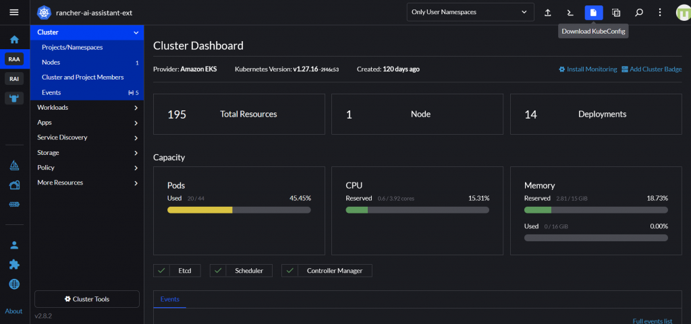

The advancements in GenAI technology are creating a significant impact across domains/sectors, and the Kubernetes ecosystem is no exception. Numerous interesting GenAI projects and products have emerged aimed at enhancing the efficiency of Kubernetes cluster creation and management. From simplifying application containerization for engineers to addressing complex Kubernetes-related queries or troubleshooting issues within a cluster, GenAI demonstrates immense potential.

One of the areas where DevOps engineers and beginner-level cluster operators often face challenges is in identifying, understanding, and resolving problems within a Kubernetes cluster. In this regard, k8sgpt, an open source GenAI project within the cloud native ecosystem, appears to offer a promising AI-driven solution.

Let us explore how to configure and utilize k8sgpt, open source LLMs via Ollama and Rancher Desktop to identify problems in a Rancher cluster and gain insights into resolving those problems the GenAI way.

## **Tools Setup**

### **Install k8sgpt CLI**

K8sGPT is a GenAI tool for scanning your Kubernetes clusters, diagnosing and triaging issues in simple English. Follow instructions at <https://docs.k8sgpt.ai/getting-started/installation/> to download and install the k8sgpt CLI tool on your machine.

### **Install Ollama and download an open-source LLM**

Ollama is a simple tool that gets you up and running with open source large language models (LLMs). You can download Ollama from <https://ollama.com/> and install it on your machine. Launch Ollama. Run the command given below to pull a LLM. Note that the mistral model requires ~ 4GB of disk space.

```
$ ollama pull mistral
```

### **Install Rancher Desktop**

Rancher Desktop is an open source application that provides all the essentials to work with containers and Kubernetes on the desktop. You can download Rancher Desktop from <https://rancherdesktop.io/> and install it on your machine. Launch Rancher Desktop application with the default configuration. Run the command below to ensure the app is running fine.

```
$ kubectl cluster-info
Kubernetes control plane is running at https://127.0.0.1:6443
CoreDNS is running at https://127.0.0.1:6443/api/v1/namespaces/kube-system/services/kube-dns:dns/proxy               
Metrics-server is running at https://127.0.0.1:6443/api/v1/namespaces/kube-system/services/https:metrics-server:https/proxy
```

### **Download the KubeConfig file of your Rancher Cluster**

You can download the KubeConfig file of your Rancher cluster from the Rancher UI. If you are trying the setup provided in this blog post on your local cluster provided by Rancher Desktop, then you can skip this step.



###

### **Configure k8sgpt to use Ollama backend**

You can use k8sgpt with a variety of backends such as OpenAI, Azure OpenAI, Google Vertex and many others. Run the command below to set up the local Ollama as the backend.

```
$ k8sgpt auth add --backend localai --model mistral --baseurl http://localhost:11434/v1
```

That’s all with the setup.

### **Analyze your cluster for issues**

Before trying the `k8sgpt analyze` command, let’s first introduce a problem in the Kubernetes cluster so k8sgpt has something to report on. The sample deployment is from the  GitHub repository [robusta-dev/kubernetes-demos](https://github.com/robusta-dev/kubernetes-demos) where you can find many interesting examples to mimic common problems that occur in a Kubernetes environment.

```
$ kubectl apply -f https://raw.githubusercontent.com/robusta-dev/kubernetes-demos/main/crashpod/broken.yaml
```

Run the command below to get GenAI-generated insights about problems in your cluster. Note that if you are analyzing the local cluster provided by Rancher Desktop, you can skip the `--kubeconfig` flag.

```
$ k8sgpt analyze --explain --backend localai --with-doc --kubeconfig C:\\path\\to\\your\rancher\\.kube\\config

100% |██████████████████████████████████████████████████████████████████████████████████████████████████████████████████████████████████████| (1/1, 958 it/s)

AI Provider: localai

0: Pod default/payment-processing-worker-74754cf949-srpbk(Deployment/payment-processing-worker)

- Error: the last termination reason is Completed container=payment-processing-container pod=payment-processing-worker-74754cf949-srpbk

Error: The container 'payment-processing-container' in the pod 'payment-processing-worker-74754cf949-srpbk' has completed.

Solution:

Check if the completion of the container is intended or not, as it might be due to a successful processing task.
If it's unintended, verify if there are any misconfigurations in the deployment or pod specification.
Inspect the logs of the container for any error messages leading up to its completion.
If necessary, restart the container or pod to ensure proper functioning.
Monitor the application to prevent similar issues in the future and ensure smooth operation.
```

As shown in the `k8sgpt analyze` command output, k8sgpt identified and flagged the problematic pod and also provided some guidance on potential steps you can take to understand and resolve the problem.

## **Bonus: Setting up the k8sgpt operator**

k8sgpt project also provides a Kubernetes operator that you can directly install in a Kubernetes cluster. The operator constantly watches for problems in the cluster and generates insights, which you can access by querying the operator's custom resource (CR).

Follow the steps below to install and set up the operator. Please note that the instructions provided here are for the local Kubernetes cluster provided by Rancher Desktop. However, you can use the same instructions for a remote Kubernetes cluster. For a remote cluster, you just need to point the configuration to an Ollama instance that is accessible to your cluster.

###

### **Install the k8sgpt operator**

Run the following commands

```
helm repo add k8sgpt https://charts.k8sgpt.ai/
helm repo update
helm install release k8sgpt/k8sgpt-operator -n k8sgpt-operator-system --create-namespace
```

### **Configure k8sgpt to use the Ollama backend**

Run the command below.

```
$ kubectl apply -n k8sgpt-operator-system -f - << EOF
apiVersion: core.k8sgpt.ai/v1alpha1
kind: K8sGPT
metadata:
  name: k8sgpt-ollama
spec:
  ai:
    enabled: true
    model: mistral
    backend: localai
    baseUrl: http://host.docker.internal:11434/v1
  noCache: false
  filters: ["Pod"]
  repository: ghcr.io/k8sgpt-ai/k8sgpt
  version: v0.3.8
EOF
```

That’s all with the operator setup. The operator will watch for problems in the cluster and generate analysis results that you can view using the command below. Depending on your machine's horsepower, it takes some time for the operator to call the LLM and generate the insights.

```
$ kubectl get results -n k8sgpt-operator-system -o json | jq .
    {
      "apiVersion": "v1",
      "items": [
        {
          "apiVersion": "core.k8sgpt.ai/v1alpha1",
          "kind": "Result",
          "metadata": {
            "creationTimestamp": "2024-08-09T23:05:29Z",
            "generation": 1,
            "labels": {
              "k8sgpts.k8sgpt.ai/backend": "localai",
              "k8sgpts.k8sgpt.ai/name": "k8sgpt-ollama",
              "k8sgpts.k8sgpt.ai/namespace": "k8sgpt-operator-system"
            },
            "name": "defaultpaymentprocessingworker74754cf949srpbk",
            "namespace": "k8sgpt-operator-system",
            "resourceVersion": "11274",
            "uid": "e9967f21-e62c-461b-8b36-908c1f852420"
          },
          "spec": {
            "backend": "localai",
            "details": " Error: The container named `payment-processing-container` in the pod named `payment-processing-worker-74754cf949-srpbk` is restarting repeatedly and failed. This failure is temporary and will back off for 5 minutes before retrying.\n\nSolution:\n1. Check the logs of the container using the command `kubectl logs payment-processing-worker-74754cf949-srpbk --container payment-processing-container` to determine the cause of the failure.\n2. If the issue persists, update the container definition in the Deployment or ReplicaSet to increase the number of `restartPolicy: Always`. This will ensure that the container respawns if it encounters an error.\n3. Investigate any underlying issues causing the repeated failures, such as insufficient memory or resources, incorrect configurations, or errors with dependent services.\n4. If necessary, make corrections to the application code, configuration files, or environment variables, as they may be directly influencing the performance of the container.\n5. Once the issue is resolved, check that the container does not restart again in the subsequent periods by reviewing the logs and verifying that the application functions correctly.",
            "error": [
              {
                "text": "back-off 5m0s restarting failed container=payment-processing-container pod=payment-processing-worker-74754cf949-srpbk_default(45b88d2e-a270-4dff-830e-57532d984a87)"
              }
            ],
            "kind": "Pod",
            "name": "default/payment-processing-worker-74754cf949-srpbk",
            "parentObject": ""
          },
          "status": {
            "lifecycle": "historical"
          }
        }
      ],
      "kind": "List",
      "metadata": {
        "resourceVersion": ""
      }
    }
```

Yay! You have set up a GenAI companion to help yourself investigate problems in your Kubernetes cluster using fully open source tools.
