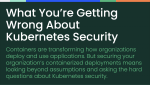
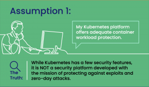
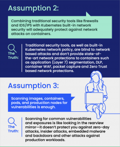
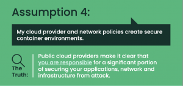

With Kubernetes, organizations can modernize, replacing their legacy monolithic infrastructures with new lightweight, efficient and agile container workloads. This provides developers the foundation to build, automate and ship applications faster and more reliably than ever before. But as more organizations continue to implement Kubernetes, the challenges and risks of security grow. So how can technology leaders ensure their teams are scaling securely without exposing the organization to additional threats? They need to equip their teams with the right tools and expertise to decipher the misconceptions around Kubernetes and container security.

 At SUSE, we’ve identified some of the common misconceptions around container security and what that means for organizations: 

##

## **Misconception #1: By maintaining the container environment with the latest Kubernetes-native security features, we have adequate security protection across our workloads.**

Although Kubernetes has a few security features, it is not a security-focused technology designed to detect and prevent exploits. In addition, like all new technologies, Kubernetes is not immune to security flaws and vulnerabilities. In 2018, a critical security hole was discovered that allowed attackers to send arbitrary requests over the network, exposing access to data and code. It’s important for users to ensure they are up to date with new Kubernetes releases, which often feature patches and upgrades to address any known risks from previous versions. 

 Organizations and users should simultaneously be proactive in ensuring that their wider ecosystem is secure and protected against exploitation with dedicated cloud native security solutions that provide the visibility, detection, and prevention security and DevOps teams required, from the container network to application workloads from day one.   

## **Misconception #2: Network-based attacks on containers and Kubernetes can be addressed by traditional security tools such as firewalls and IDS/IPS systems.**

It’s a common misconception that a container network is secure and insulated from attacks if surrounded by traditional data center security tools. The dynamic nature of containers and Kubernetes clusters across public, private and hybrid cloud environments renders traditional security tools useless for attacks against modern cloud environments. 

 

## **Misconception #3: Vulnerability scanning and remediation is the most effective way to prevent attacks.**

While removing critical vulnerabilities is an important aspect of every security and compliance program, it is not sufficient to prevent zero-day attacks, insider attacks, or exploits of user misconfigurations. A strong runtime security posture is the most effective way to combat the broad array of techniques used by hackers.

 

## **Misconception #4: By using a public cloud provider, containers should be secure enough.**

 

Though public cloud providers have in-built security tools to help protect data, containers are commonly dispersed across on-prem, multi-cloud, and variations of hybrid workloads, making cohesive data management difficult. Users, not cloud providers, are ultimately responsible for securing their applications, network, and infrastructure from malicious attacks, regardless of where they are hosted.  

There is no ‘one-size-fits-all’ strategy for developing a container security strategy since each environment is unique. However, by understanding the fundamentals and addressing the common misconceptions around container security, organizations can fast-track their security strategy to be fortified against any threats, from pipeline to production. Today there are multiple tools available on the market, including SUSE NeuVector, that can help technology leaders and their teams ensure they are equipped to tackle the challenges around container security with confidence.  

## Next Steps:

[Take a look at this infographic](https://more.suse.com/rs/937-DCH-261/images/SUSE_NeuVector_WhatYoureGettingWrongAboutKubernetesSecurity_Infographic.pdf) to learn more about the misconceptions around container security and what your team can do to overcome them.
