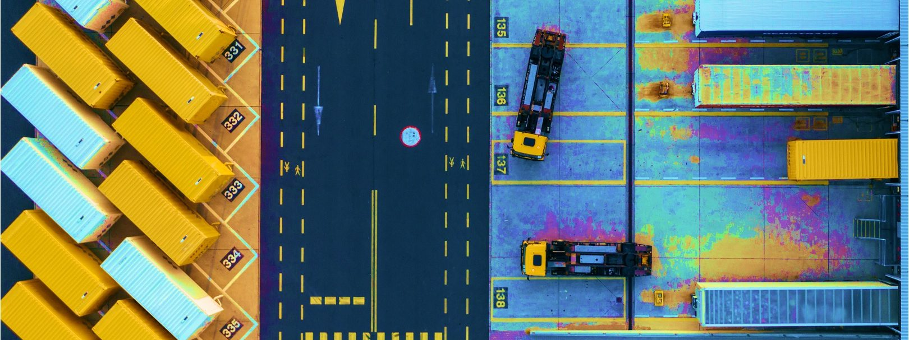

# Introduction

As organizations increasingly adopt containerized applications, it is essential to understand what container orchestration is. This guide delves into what container orchestration is, its benefits, and how it works, comparing popular platforms like Kubernetes and Docker. We will also discuss multi-cloud container orchestration and the role of Rancher Prime in simplifying container orchestration management.

# What is Container Orchestration?

Container orchestration is the process of managing the lifecycle of containers within a distributed environment. Containers are lightweight, portable, and scalable units for packaging and deploying applications, providing a consistent environment, and reducing the complexity of managing dependencies. Container orchestration automates the deployment, scaling, and management of these containers, ensuring the efficient use of resources, improving reliability, and facilitating seamless updates.

# How Does Container Orchestration Work?

Container orchestration works by coordinating container deployment across multiple host machines or clusters. Orchestration platforms utilize a set of rules and policies to manage container lifecycles, which include:

- Scheduling: Allocating containers to available host resources based on predefined constraints and priorities.
- Service discovery: Identifying and connecting containers to form a cohesive application.
- Load balancing: Distributing network traffic evenly among containers to optimize resource usage and improve application performance.
- Scaling: Dynamically adjusting the number of container instances based on application demand.
- Health monitoring: Monitoring container performance and replacing failed containers with new ones.
- Configuration management: Ensuring consistent configuration across all containers in the application.
- Networking: Managing the communication between containers and external networks.

# Why Do You Need Container Orchestration?

Container orchestration is essential for organizations that deploy and manage applications in a containerized environment. It addresses the challenges that arise when managing multiple containers, such as:

- Scaling applications efficiently to handle increased workloads.
- Ensuring high availability and fault tolerance by detecting and replacing failed containers.
- Facilitating seamless updates and rollbacks.
- Managing and maintaining container configurations.
- Optimizing resource usage and application performance.

# What are The Benefits of Container Orchestration?

Container orchestration offers several advantages, including:

- Improved efficiency: Container orchestration optimizes resource usage, reducing infrastructure costs.
- Enhanced reliability: By monitoring container health and automatically replacing failed containers, orchestration ensures application availability and fault tolerance.
- Simplified management: Orchestration automates container deployment, scaling, and management, reducing the manual effort required.
- Consistency: Orchestration platforms maintain consistent configurations across all containers, eliminating the risk of configuration drift.
- Faster deployment: Orchestration streamlines application deployment, enabling organizations to bring new features and updates to market more quickly.

# What is Kubernetes Container Orchestration?

Kubernetes is an open-source container orchestration platform developed by Google. It automates the deployment, scaling, and management of containerized applications. Kubernetes organizes containers into groups called "pods" and manages them using a declarative approach, where users define the desired state of the application, and Kubernetes works to maintain that state. Key components of Kubernetes include:

- API server: The central management point for Kubernetes, providing a RESTful API for communication with the system.
- etcd: A distributed key-value store that stores the configuration data for the Kubernetes cluster.
- kubelet: An agent that runs on each worker node, ensuring containers are running as defined in the desired state.
- kubectl: A command-line tool for interacting with the Kubernetes API server.

# What is Multi-Cloud Container Orchestration?

Multi-cloud container orchestration is the management of containerized applications across multiple cloud providers. Organizations often use multiple clouds to avoid vendor lock-in, increase application resilience and leverage specific cloud services or features. Multi-cloud orchestration enables organizations to:

- Deploy applications consistently across different cloud providers.
- Optimize resource usage and cost by allocating containers to the most suitable cloud environment.
- Enhance application resilience and availability by distributing workloads across multiple clouds.
- Simplify management and governance of containerized applications in a multi-cloud environment.

# Docker Container Orchestration vs. Kubernetes Container Orchestration

Docker and Kubernetes are both popular container orchestration platforms, each with its strengths and weaknesses.

Docker:

- Developed by Docker Inc., the same company behind the Docker container runtime.
- Docker Swarm is the native container orchestration tool for Docker.
- Easier to set up and manage, making it suitable for small-scale deployments.
- Limited scalability compared to Kubernetes.
- Lacks advanced features like auto-scaling and rolling updates.

Kubernetes:

- Developed by Google and now owned by the CNCF, with a large community and ecosystem.
- More feature-rich, including auto-scaling, rolling updates, and self-healing.
- Higher complexity, with a steeper learning curve than Docker Swarm.
- Highly scalable, making it suitable for large-scale deployments and enterprises.
- Widely adopted and supported by major cloud providers.

# Container Orchestration Platforms

Several container orchestration platforms are available, including:

- Kubernetes: An open-source, feature-rich, and widely adopted enterprise container orchestration platform.
- Docker Swarm: Docker's native container orchestration tool, suitable for small-scale deployments.
- Amazon ECS (Elastic Container Service): A managed container orchestration service provided by AWS.
- HashiCorp Nomad: A simple scheduler and orchestrator to deploy and manage containers and non-containerized applications across on-prem and clouds at scale.

# Considerations When Implementing Container Orchestration

Before implementing container orchestration, organizations should consider the following factors:

- Scalability: Choose an orchestration platform that can handle the anticipated workload and scale as needed.
- Complexity: Assess the learning curve and complexity of the orchestration platform, ensuring it aligns with the team's expertise.
- Integration: Ensure the orchestration platform integrates well with existing tools, services, and infrastructure.
- Vendor lock-in: Evaluate the potential for vendor lock-in and consider toolsets that support multi-cloud strategies to mitigate this risk.
- Support and community: Assess both enterprise support and community resources available for the chosen orchestration platform.
- Sustainability: Ensure the long-term sustainability of your chosen platform.
- Security: integrate proven security frameworks like Secure Software Supply Chain and Zero Trust early in the platform design process.

# How Rancher Prime Can Help

Rancher Prime is an [open-source container management platform](https://www.rancher.com/products/rancher) that simplifies Kubernetes management and deployment. Rancher Prime provides a user-friendly interface for securely managing container orchestration across multiple clusters and cloud providers. Key features of Rancher Prime include:

- [Centralized management](https://ranchermanager.docs.rancher.com/getting-started/overview): Manage multiple Kubernetes clusters from a single dashboard.
- [Multi-cloud support](https://www.suse.com/c/rancher_blog/a-guide-to-using-rancher-for-multicloud-deployments/): Deploy and manage Kubernetes clusters on various cloud providers and on-premises environments.
- [Integrated tooling](https://www.rancher.com/products/rancher): Rancher Prime integrates with popular tools for logging, monitoring, and continuous integration/continuous delivery (CI/CD).
- [Security](https://ranchermanager.docs.rancher.com/pages-for-subheaders/rancher-security): Rancher Prime provides built-in security features, including FIPS encryption, STIG certification, a centralized authentication proxy, role-based access control, pod security admission, network policies, enhanced policy management engine, ...
- [Enhanced security](https://www.suse.com/products/neuvector/): when Rancher Prime is combined with container native security by SUSE NeuVector, you can fully implement [Zero Trust](https://www.suse.com/campaigns/zero-trust/) for enterprise grade container orchestration hardening.
- [Simplified cluster operations](https://ranchermanager.docs.rancher.com/pages-for-subheaders/about-the-api): Rancher Prime simplifies cluster deployment, scaling, and upgrades, either through and easy to learn API or by leveraging industry standards like Cluster API.
- [Support and community](https://www.rancher.com/support): Since 1992 [SUSE](https://www.suse.com/company/history/) provide specialized enterprise support and it works closely with organizations like CNCF to provide community validated solutions. SUSE owns the Rancher Prime product suite and is an active contributor to the CNCF having donated projects like: [K3s](https://k3s.io/), [Longhorn](https://longhorn.io/) and [Kubewarden](https://www.kubewarden.io/).

# Conclusion

Container orchestration is a critical component for managing containerized applications in a distributed environment. Understanding the differences between platforms like Kubernetes and Docker, as well as the benefits of multi-cloud orchestration, can help organizations make informed decisions about their container orchestration strategy. [Rancher Prime](https://www.rancher.com/products/rancher) offers a powerful solution for simplifying the management and deployment of container orchestration in any scenario, making it easier for organizations to reap the benefits of containerization.
