[](images/rancher_blog_google-cloud-platform.jpg)Recently
Rancher provided a disk image to be used to deploy RancherOS v0.3 on
Google Compute Engine (GCE). The image supports RancherOS cloud config
functionality. Additionally, it merges the SSH keys from the project,
instance and cloud-config and adds them to the rancher user.

## Building The Setup

In this post, I will cover how to use the RancherOS image on GCE to set
up a MongoDB Replica Set. Additionally I will cover how to use one of
the recent features of Rancher platform which is the Load Balancer. In
order to make the setup more realistic, I created a simple python
application, that will count the number of hits on the website and save
this number on MongoDB database. The setup will include multiple servers
on different cloud hosting providers:

1. three (g1-small) servers on GCE to deploy the MongoDB replicaset.
2. one (n1-standard-1) server on GCE to install the Rancher platform.
3. one server on Digital Ocean to hold the application containers.
4. one server on Digital Ocean which will be used as a Load Balancer on
   Rancher platform.

## RancherOS On GCE

We will import RancherOS disk image on GCE to be used later in the
setup. To import the image you need to create a Google Cloud Storage
object which we will upload the RancherOS disk image. To create cloud
storage object, you can use the web UI:
[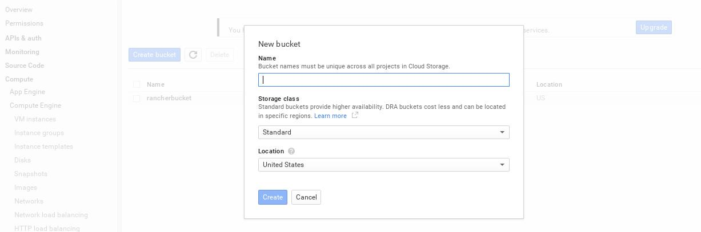](images/rancher_blog_1.jpg)
Or you can use **gsutil** tool that lets you access Google Cloud
Storage service from the command line, but first you need to
[authenticate](https://cloud.google.com/storage/docs/gsutil_install#authenticate)
gsutil to be able to create new storage object. Now you need to upload
the image to the newly created storage object:
[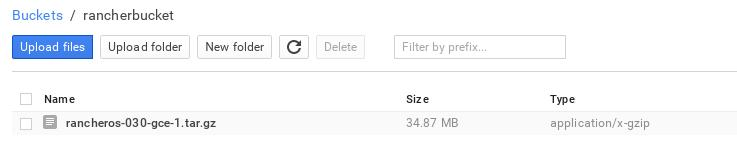](images/rancher_blog_2.jpg)
The only thing left to do is creating the RancherOS image which will be
used later, click on create new image under the Images section:
[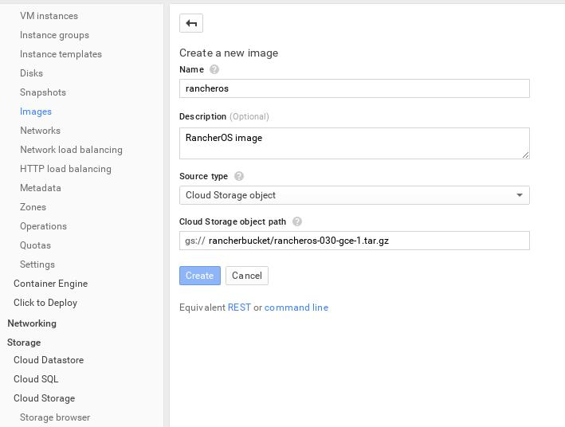](images/rancher_blog_3.jpg)

## Start RancherOS On GCE

After creating RancherOS image, create three machines that will be used
to set up a MongoDB replica set and select RancherOS as their image:
[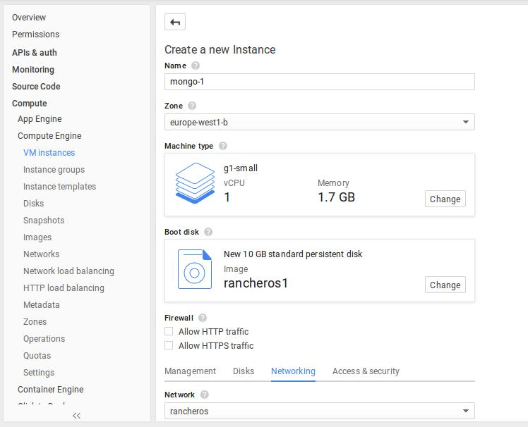](images/rancher_blog_5.jpg)
For the sake of this setup I created a Networking zone with one rule
that opens every TCP/UDP port on the server. Obviously, you shouldn’t do
that on a production server.

## Docker Images

Now since the RancherOS image is ready, we need to get the Docker images
ready too. We will be using a Docker image for MongoDB and for the
Python application. I will be using the [official
MongoDB](https://registry.hub.docker.com/_/mongo/) image, which will
simply run MongoDB server. However, to run the container as a part of
the replica set you need to add --replicaSet option to the running
command. And for the python application I will be using a Docker image
which will pull the Flask application from github and run it using
Gunicorn, of course if you need to add more sense of “production” to the
setup you will need to add more tweaks to the Docker image, but this
example is good enough to give you a good idea about the setup. The
Dockerfile of the python application:

```
FROM ubuntu:latest
MAINTAINER Hussein Galal

RUN apt-get -q update
RUN apt-get install -yqq python python-dev python-distribute python-pip python-virtualenv
RUN apt-get install -yqq build-essential git

RUN mkdir -p /var/www/app
ADD run.sh /tmp/run.sh
ADD gunicorn.py /var/www/app/
RUN chmod u+x /tmp/run.sh
EXPOSE 80
WORKDIR /var/www/app/
ENTRYPOINT /tmp/run.sh
```

The run.sh script will pull the [Flask
Application](https://github.com/galal-hussein/Flask-example-app.git)
from github and run Gunicorn:

```
git clone https://github.com/galal-hussein/Flask-example-app.git ../app

virtualenv venv
./venv/bin/pip install gunicorn
./venv/bin/pip install -r requirements.txt
./venv/bin/gunicorn -c gunicorn.py app:app
```

Let’s now build and push this image to Docker hub to be used later when
we deploy the applications:

```
~# docker build -t husseingalal/flask_app .
~# docker push husseingalal/flask_app
```

The flask application is very simple, it displays the number of
pageviews and the os hostname just to make sure that the load balancer
is working fine, here is a small snippet from the application:

```
@app.route('/')
 def cntr():
     mongo.db.rancher.update({"Project" : "Rancher"}, {"$inc" : {"pageviews" : 1}}, True)
     posts = mongo.db.rancher.find({"Project":"Rancher"})[0]
     return render_template('index.html', posts=posts, hostname=socket.gethostname())
```

## Rancher Platform

Rancher is a container management platform, that can connect containers
across different host and it provides a set of features including: load
balancing, monitoring, logging, and integration with existing user
directories (e.g., GitHub) for identity management. To deploy Rancher
platform on a machine, login to the machine and run this command:

```
~# docker run -d -p 8080:8080 rancher/server
```

This command will create a Docker instance with a Rancher server that
listens on port 8080 and proxy that port to port 8080 on the host. After
running that command wait a few minutes until the server is ready, and
then login to the server:
[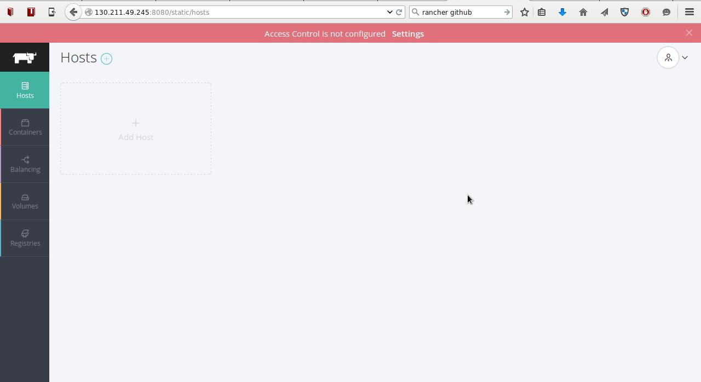](images/rancher_blog_6.jpg)
The next step is to register the machines with the Rancher platform,
on Rancher platform, click on “Add Host” to register the each machine.
On Rancher platform you have the option to use the Docker Machine
integration to directly create Digital Ocean, or Amazon EC2 machines, or
you can just copy the registering command to any server that has Docker
installed:
[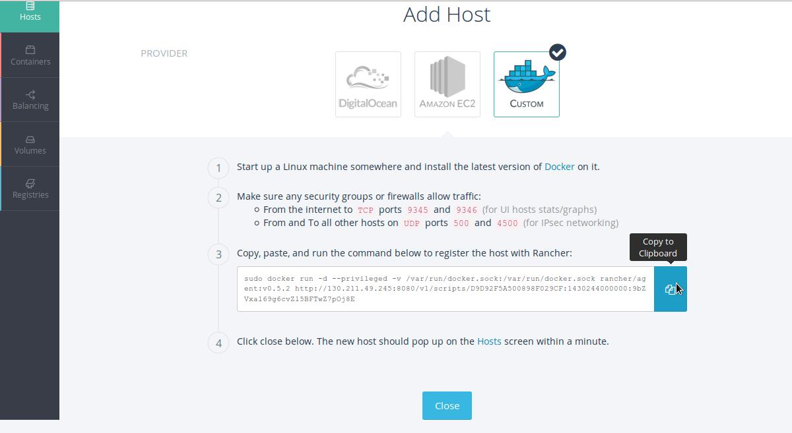](images/rancher_blog_7.jpg)
After running the command on the 3 MongoDB servers, you will see
something like that:
[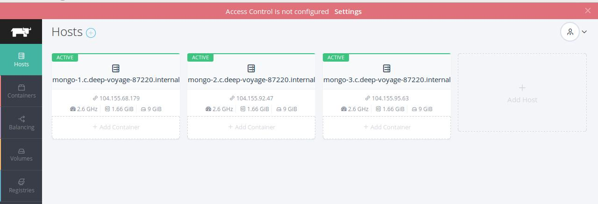](images/rancher_blog_8.jpg)

## MongoDB Replica Set

Replication ensures that your data will exist on different servers to
increase availability, in MongoDB you can set up replication by creating
replica set. Replica set is a group of MongoDB servers. A primary server
and multiple secondary servers that keep identical copies of the primary
server. MongoDB achieves that by keeping a log of operations called
oplog, that contain the write operations. The secondary servers also
maintain their own oplog, they fetch the operations from the member they
are syncing from. I ’ll create 3 MongoDB containers, each on different
host. Each container will run with --replSet option which specify a
name for the replica set:
[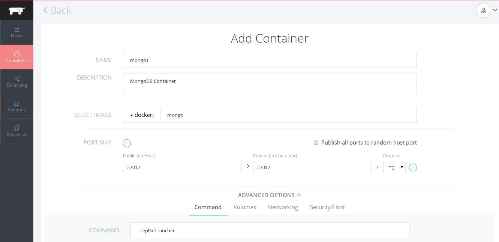](images/rancher_blog_9.jpg)
Create the rest of the MongoDB containers with the same option to be
part of the replication group. After creating the 3 containers you
should initiate the replication by connecting to the MongoDB instance
and run rs.initiate(config) in the MongoDB Javascript shell:

```
> config = {
"_id" : "rancher",
"members" : [
{"_id" : 0, "host" : "<ip-of-the-1st-container>:27017"},
{"_id" : 1, "host" : "<ip-of-the-2nd-container>:27017"},
{"_id" : 2, "host" : "<ip-of-the-3rd-container>:27017"}
]
}
> rs.initiate(config)

rancher:PRIMARY>
```

That means that this container is the primary server for the MongoDB
replica set.

## Deploy The App Containers

Now let’s deploy the application container that we created earlier,
we’ll create two app containers which we will load balancer between
them in the next section. To differentiate between each app container i
will specify the hostname of each container as an option when we create
the container:
[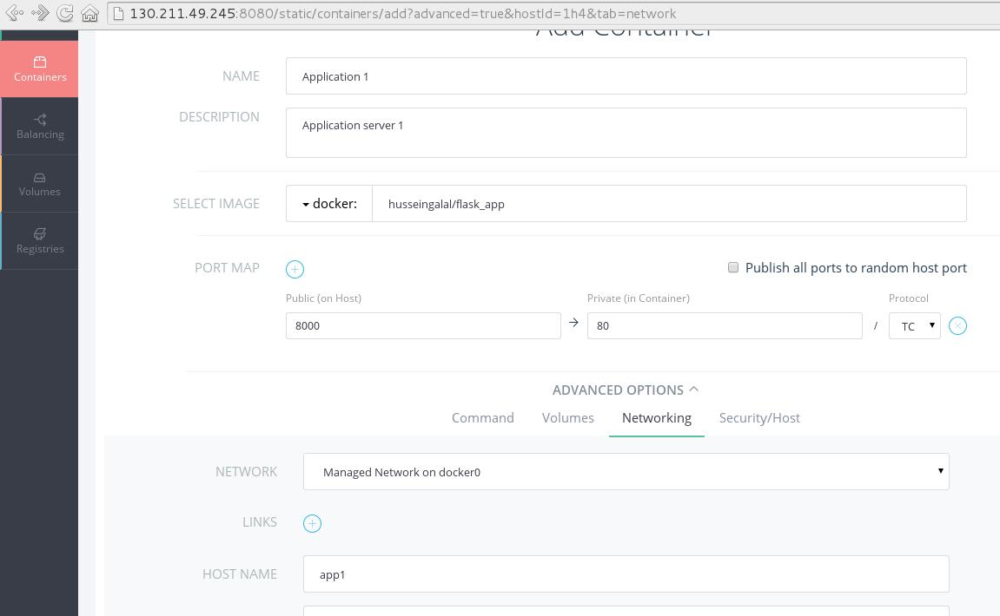](images/rancher_blog_10.jpg)
The second container will be created with the same options as the first
one, but we will map the port 80 to port 8001 to be able to test the
container separately.

## Rancher’s Load Balancer

The final step is to create a load balancer to bounce the requests
between the two app containers, Rancher’s Load Balancer distributes
network traffic across a number of containers. For each host that will
be selected to be a Load Balancer a Load Balancer Agent system container
is started and HAProxy software is installed in it. For more information
about [Rancher’s Load
Balancer.](https://rancher.com/load-balancing-support-for-docker-in-rancher/)
To create a Load Balancer using Rancher’s platform, make sure to select
the application containers, and select the port you will be receiving
and sending requests. Also note that we used round robin algorithm to
distribute the requests between the two app containers, the other
algorithms available to use are **leastconn**, and **source**.
[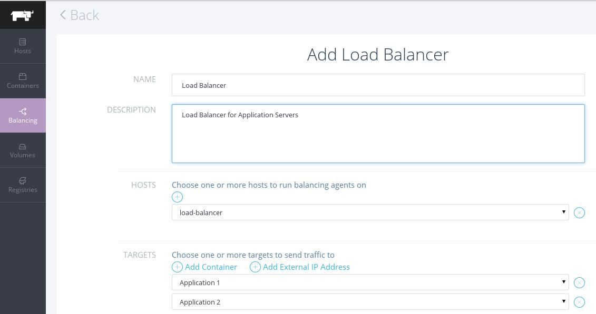](images/rancher_blog_11.jpg)
[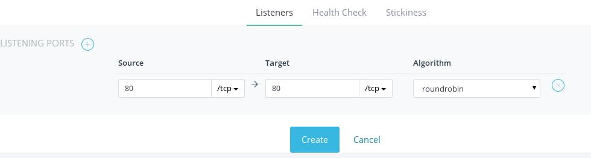](images/rancher_blog_12.jpg)
You can also configure Health Checks to monitor the availability of
the application containers, you can configure the health checks by using
GET, HEAD, POST, etc. In this example, i created an endpoint called
**/healthcheck** that will be used to check if the application server is
up and running:
[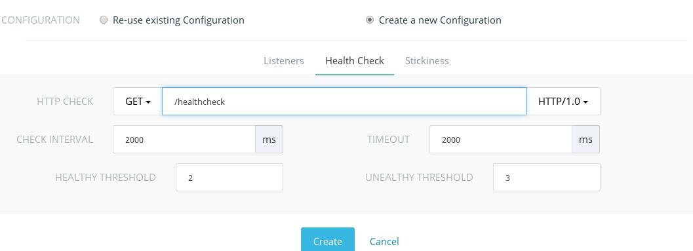](images/rancher_blog_13.jpg)
Now let’s test the setup, by access the url of the Load Balancer:
[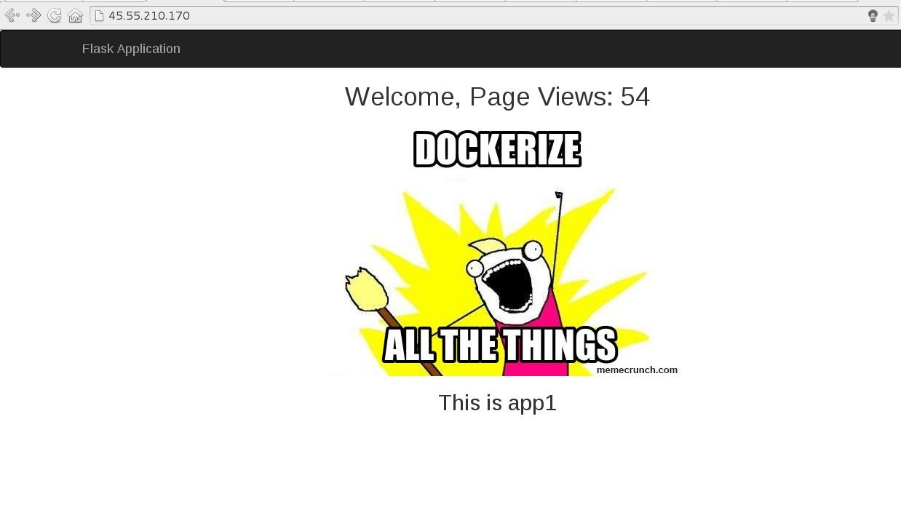](images/rancher_blog_14.jpg)
[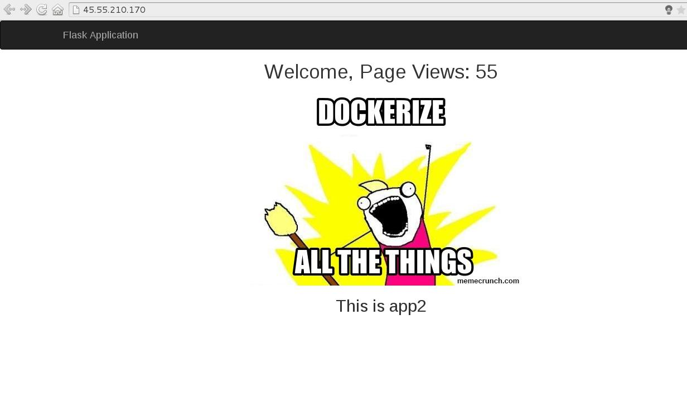](images/rancher_blog_15.jpg)
Also you can check the /healthcheck endpoint to check that the app is up
and running:

```
$ curl http://45.55.210.170/healthcheck
200 OK From app1

$ curl http://45.55.210.170/healthcheck
200 OK From app2
```

## Conclusion

Now RancherOS V0.3.0 can be deployed in Google Compute Engine (GCE).
Using RancherOS and Rancher platform you can put together a production
environment that uses the most recent features of Rancher platform like
load balancing which allow devs and ops to deploy large-scale
applications. Both Rancher and RancherOS are open source tools, and can
be downloaded from [Github](https://github.com/rancher). If you’re
interested in learning more, join our next Online Meetup to hear from
some of our developers, and see the latest features going into the
Rancher and RancherOS projects. You can register below:
