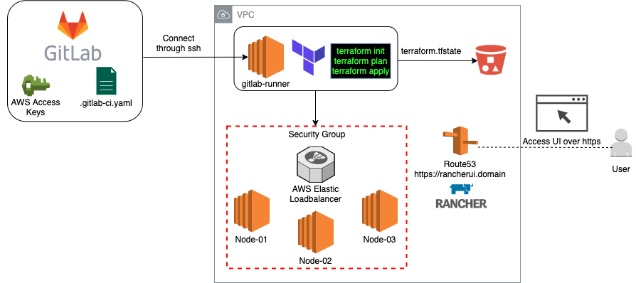

Read our free white paper: How to Build a Kubernetes Strategy[Download Now](https://more.suse.com/fy21-global-web-landing-page-how-to-build-enterprise-kubernetes-strategy)

## Introduction

In today’s ever-changing world of DevOps, it is essential to follow best practices. That goes for security, access control, resource limits, etc. One of the most important things in the world of DevOps is continuous integration and continuous delivery, or CI/CD. Continuous integration is a crucial part of an efficient deployment. We are all guilty of repeating manual steps over and over again – especially when it comes to node configuration. The “automate all things” mindset is required to keep us on track so we can perform as efficiently as possible and ensure that our applications will deploy and work efficiently as well. Through the GitLab CI/CD options, you get a user-friendly UI that allows you to configure your build and customize it as you see fit. This includes setting pipeline triggers, build variables, license compliance and more.

Viewing your build steps from one console is quite helpful, especially when attempting to troubleshoot builds. Each build step also displays the CLI output of the running commands. This gives you a perspective of what’s going on in the build, without actually SSHing into the runner node. CI/CD tools usually function with a build file, which determines the build steps. While using Gitlab CI/CD, the build file is called `.gitlab-ci.yaml`. In this article, you will get a glimpse into how this build file is put together and what it does.

How the GitLab CI tool communicates with Amazon Web Services (AWS) in order to trigger the launch of new resources is another important part of our deployment. Our deployment also consists of Terraform, RKE and Rancher2 provider. The main objective is to produce a pipeline that will deploy and destroy infrastructure on demand. The result is a highly available, consistent deployment that we could trigger with a click of a button. Or with a single CLI command (or two).

You can find the source code for this blog post [here](https://gitlab.com/iby.rancher/rancher-deploy).

## What the Deployment Looks Like

In this deployment model, there are a few moving parts that we need to keep in mind. Each component in this deployment has a specific purpose. The goal of the deployment is to deploy the minimal amount of resources required, following best practices for security, cost and high availability.

But first, what is a CI/CD pipeline? Conceptually a CI/CD pipeline should have three stages – source, build and deploy:

- **Source** - Every deployment uses a source control tool. Common tools include GitHub and GitLab. Bitbucket is also a good option.
  In this scenario, we chose GitLab because it also offers a built-in CI/CD functionality in addition to acting as our source control tool.
- **Build** - The stages mentioned in the `.gitlab-ci.yaml` will define the build steps. In this phase, the GitLab platform will `validate` the code and run a `terraform plan`.
  Within the stages, it is possible to pass commands, set variables, build docker images, create files, etc. This allows us to decouple the steps.
  That means that it will be easier to now remove stages and add new ones if we choose to.
- **Deploy** - In this phase, there are two manual actions. These two options were defined as a manual step in the build yaml file.
  The first action we can take is `deploy`. This option initiates the creation of the infrastructure using the Terraform code.
  Once this manual step is executed, GitLab will reach out to AWS, authenticate with access and secret keys and start deploying the infrastructure into the public cloud (in this case, AWS).
  Another component that plays a significant part is the `provider.tf` file. This file defines the cloud provider for the deployment.
  The second option we have is `destroy`. Just like `deploy`, it is triggered manually. In some scenarios, it is plausible to automate this step.
  But in most cases, we really want to be careful when either executing a deployment or destroying it. It is also recommended to limit the access to execute these stages.
  Security best practices include using a user database and applying permissions for the execution of these manual steps.

### Infrastructure Diagram

This diagram presents all the different tools used in this deployment:

- **GitLab** - Source control and CI/CD.
- **Amazon Web Services** - Elastic Computer Cloud (EC2), Simple Storage Service (S3), Route 53 (R53), Security groups, Elastic Load Balancing (ELB).
  - S3 - In this deployment, we need to manually create the S3 bucket.
    Before you start your deployment, make sure you create your bucket and specify it in the variables section.
    The S3 bucket will maintain the `terraform.tfstate` file. Learn more about managing Terraform state [here].(https://www.terraform.io/docs/state/index.html)
- **Terraform** - Infrastructure as code.
  \_ RKE Provider - Allows for Kubernetes cluster provisioning.
  \_ Rancher2 Provider - Allows for Rancher management cluster configuration from the Terraform code. \* Helm Provider - Allows the installation of helm charts and ultimately the installation of Rancher on the created infrastructure.



## How Does the CI/CD Pipeline Work?

### CI/CD Stages

The first part of the build file contains the stages that we’ll execute in this deployment.

```
stages:
  - validate
  - plan_before_apply
  - apply
  - destroy
```

### Before Script

The before script lays the building blocks for this deployment to succeed.
Two files are created in this process:

1. backend.ft - This file will be responsible for the s3 bucket that holds the ftstate.

   ```
       - |
       cat <<EOF > backend.tf
           terraform {
               backend "s3" {
               bucket     = "$BUCKET_NAME"
               key        = "$BUCKET_KEY"
               region     = "us-east-1"
               encrypt    = true
               }
           }
       EOF
   ```
2. variables.tf - This file will hold the credentials, VPC, K8s version, etc. These parameters are passed from the `settings` area of the GitLab dashboard.

   ```
       cat <<EOF > variables.tf
       variable "aws_access_keys" {
       type = map(string)
       description = "AWS Access Keys for terraform deployment"

           default = {
               access_key = "$AWS_ACCESS_KEY_ID"
               secret_key = "$AWS_SECRET_ACCESS_KEY"
               region = "us-east-1"
           }
       }
       variable "number_of_nodes" {
           type = string
           description = "Number of nondes"
           default = "$NUMBER_OF_NODES"
       }
   ```

### Build stages

1. **Validate** - Will validate the configuration files in the working directory.

   ```
       validate:
       stage: validate
       script:
           - terraform validate
   ```
2. **plan\_before\_apply** - Will run terraform plan and create an execution plan.

   ```
       plan_before_apply:
       stage: plan_before_apply
       script:
           - terraform plan
       dependencies:
           - validate
   ```
3. **Apply** - Will run terraform apply and execute the plan. This is a manual step.

   ```
       apply:
       stage: apply
       script:
           - apk update && apk add curl git
           - curl -LO https://storage.googleapis.com/kubernetes-release/release/`curl -s https://storage.googleapis.com/kubernetes-release/release/stable.txt`/bin/linux/amd64/kubectl
           - chmod u+x kubectl && mv kubectl /bin/kubectl
           - mkdir -p ~/.kube
           - echo '' >  ~/.kube/config
           - apk add --update --no-cache curl ca-certificates
           - curl -L https://get.helm.sh/helm-v3.1.2-linux-amd64.tar.gz |tar xvz
           - mv linux-amd64/helm /usr/bin/helm
           - chmod +x /usr/bin/helm
           - terraform apply --auto-approve
       dependencies:
           - plan_before_apply
       when: manual
   ```
4. **Destroy** - Will destroy all resources created in the apply stage. This is a manual step as well.

   ```
       destroy:
       stage: destroy
       script:
           - mkdir -p ~/.kube
           - echo '' >  ~/.kube/config
           - terraform state rm "helm_release.cert_manager"
           - terraform state rm "helm_release.rancher"
           - terraform destroy --auto-approve
       dependencies:
           - apply
       when: manual
   ```

### Apply

To execute `terraform apply`, navigate to the `CI/CD` section of your project. Click on `New Pipeline` and run a new pipeline.
Once the `validate` and `plan` stages have been completed, click on the `apply` step and run. You should be aware of commits to the repo.

### Destroy

To destroy the deployment, click on the `destroy` step in the CI/CD console and run. Terraform will destroy all the infrastructure previously created by the pipeline. The only thing that will be left behind is the s3 bucket that contains the terraform.tfstate. The Terraform state is crucial if you need to execute a destroy step.

### Variables

To set the number of nodes for the cluster, Kubernetes version, Rancher version, etc., navigate to the `Settings` page of the project and set your variables under `CI/CD`.

### Suggested values for environment variables:

| Var Name | Var Value | Var Type |
| --- | --- | --- |
| VPC | Your AWS VPC | String |
| AWS\_ACCESS\_KEY\_ID | Your AWS Access Key | String |
| AWS\_SECRET\_ACCESS\_KEY | Your AWS Secret Key | String |
| DOMAIN | Your domain name | String |
| EMAIL | Email of maintainer | String |
| INSTANCE\_TYPE | AWS EC2 Instance Type | String |
| K8S\_VERSION | Latest K8s version | String |
| NUMBER\_OF\_NODES | 3 | String |
| RANCHER\_VERSION | Latest Rancher version | String |
| UI\_PASSWORD | Password for Rancher UI | String |
| BUCKET\_NAME | Name of S3 bucket | String |
| BUCKET\_KEY | Path to tfstate file | String |

### AWS Cloud provider

We used the AWS Cloud provider in this deployment. Refer to the [AWS Provider documentation](https://www.terraform.io/docs/providers/aws/index.html) for more information about the provider and how it works.

The `provider.tf` file provides a good example of how to use the provider. This file will allow the Terraform code to interact with AWS and deploy resources (EC2, Security Groups, Load Balancer, etc).

```
provider "aws" {
region  = "us-east-1"
profile = "default"
access_key      = lookup(var.aws_access_keys, "access_key")
secret_key      = lookup(var.aws_access_keys, "secret_key")

}
```

### Rancher2 provider

The Rancher2 provider is a Terraform component and needs to be imported as a plugin in order to work. The `rancher-ha.tf` files provides a good example of how the provider is used.

```
resource "rancher2_bootstrap" "admin" {
provider = rancher2.bootstrap
depends_on = [null_resource.wait_for_rancher]
password = var.ui_password
}
```

We used the Rancher2 provider to create the Rancher UI Admin account. Learn more about the [Rancher2 Provider](https://www.terraform.io/docs/providers/rancher2/index.html).

### GitLab Runner

If you do not have a runner node configured, you can use [this repo](https://gitlab.com/iby.rancher/gitlab-runner-aws) to set up the runner with the proper configuration. Or follow the instructions in [GitLab docs](https://docs.gitlab.com/runner/install/) to set up a new runner.

If you already have a runner active, you can simply add this configuration:

```
#Register the runner
sudo gitlab-runner register 
--non-interactive 
--url "https://gitlab.com/" 
--registration-token "<Your project token>" 
--executor "docker" 
--docker-image hashicorp/terraform 
--description "docker-runner" 
--tag-list "" 
--run-untagged="true" 
--locked="false" 
--access-level="not_protected"
```

## Conclusion

There are a few takeaways from this blog post. We must always think with automation first mindset.

There are several benefits to CI/CD. Working with CI/CD tools will get rid of the overhead of managing infrastructure manually. CI/CD tools allow us to collaborate more efficiently. And CI/CD tools give us a deep insight into the build steps and the CLI output from the runner nodes.

Overall, using CI/CD helps us follow best practices in code integration, code build and code deployment stages. Along with Infrastructure as Code tools such as Terraform and the cloud providers for AWS, Azure and GCP, CI/CD tools allow you to deploy your code along with infrastructure easily.

Read our free white paper: How to Build a Kubernetes Strategy[Download Now](https://more.suse.com/fy21-global-web-landing-page-how-to-build-enterprise-kubernetes-strategy)
