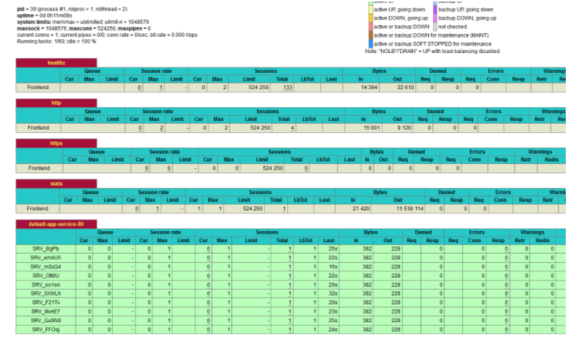

Read our free white paper: How to Build a Kubernetes Strategy[Download Now](https://more.suse.com/fy21-global-web-landing-page-how-to-build-enterprise-kubernetes-strategy)

In Kubernetes, [Ingress objects](https://rancher.com/docs/rancher/v2.x/en/k8s-in-rancher/load-balancers-and-ingress/ingress/) define rules for how to route a client’s request to a specific service running inside your cluster. These rules can take into account the unique aspects of an incoming HTTP message, including its Host header and the URL path, allowing you to send traffic to one service or another using data discovered in the request itself. That means you can use Ingress objects to define routing for many different applications.

While Ingress objects define routes, an Ingress Controller is the engine that powers them. An Ingress Controller is a proxy that sits between the client and services, relaying messages correctly. Several projects implement the Ingress Controller specification, each with its strengths. Rancher provides a default controller based on NGINX, but you’re not limited to this. Rancher Labs has partnered with HAProxy Technologies to give you the option to use the HAProxy Ingress Controller. We like to think of HAProxy Ingess Controller as a turbocharged engine perfect for Kubernetes.

## HAProxy Ingress Controller Features

You’ll find the HAProxy app in the Rancher catalog and details for installing it in the [HAProxy documentation](https://www.haproxy.com/documentation/hapee/latest/installation/rancher/). Once set up, HAProxy listens for and implements Ingress rules automatically. You have the option to disable the NGINX Ingress Controller or keep both Ingress controllers running and target one by name.

The features of HAProxy include:

### Zero Downtime Reloads

For many types of proxies, including the NGINX Ingress Controller, reloads can lead to short windows of time where the backend services are unavailable. In many cases, HAProxy avoids a reload altogether when it needs to refresh its configuration.

Its Runtime API allows changes to be implemented entirely in memory. However, due to HAProxy’s [hitless reloads](https://www.haproxy.com/blog/hitless-reloads-with-haproxy-howto/), changes that do require a reload cause no downtime. This means that whenever you add or remove a path from an Ingress rule, update a Secret, or change an annotation, there is zero impact on traffic.

### Supercharged Performance

This [third-party](https://events.static.linuxfound.org/sites/events/files/slides/DLB-LinuxConf-Berlin.pdf#page=18) benchmark and [our own](https://github.com/NickMRamirez/Proxy-Benchmarks) rank HAProxy as the world’s fastest load balancer. With HAProxy’s focus on performance, you will notice an immediate impact on the number of requests per second you can handle. In addition, with unique algorithms like [Elastic Binary Trees](http://wtarreau.blogspot.com/2011/12/elastic-binary-trees-ebtree.html), HAProxy uses fewer resources than other controllers.

### Observability

You can easily view the configured pods and associated backends, as well as their health, using the Stats page, Runtime API or raw configuration. The default Ingress controller requires you to install [krew](https://kubernetes.github.io/ingress-nginx/kubectl-plugin/) to view this information.

HAProxy provides a trove of metrics about the traffic flowing into your cluster. On the HAProxy Stats page, you’ll find statistics for tracking request rates, response times, active connections, success and error responses and the volume of data passing through. [This article](https://www.haproxy.com/blog/exploring-the-haproxy-stats-page/) describes all of the provided metrics, which are also exposed through a Prometheus endpoint.

HAProxy publishes detailed logs that contain request timing data, allowing you to pinpoint slowness within a request, disconnection codes that will indicate how and why a request was terminated and gauges showing the number of connections active in your entire cluster.

### Tunable Load Balancing

HAProxy offers more load balancing algorithms, including round robin, least connections and hash-based algorithms, than other Ingress controllers. This choice is important because different types of services excel with varying types of load distribution. For example, services that hold onto connections for longer do better with a least connections algorithm, which checks how busy a server is before sending it new clients. You can define this in your Ingress object by adding an annotation called haproxy.org/load-balance, using a value listed in the [balance documentation](https://www.haproxy.com/documentation/hapee/latest/onepage/#balance).

HAProxy enables end-to-end HTTP/2 automatically once you enable HTTPS. NGINX supports HTTP/2 on the client side, while HAProxy also supports connecting to your pods over HTTP/2. In addition, HAProxy supports end-to-end streaming for gRPC services.

### Enhanced Security

Security features, including the ability to whitelist IP addresses and enforce rate limiting, form a vital layer of protection. With HAProxy, these features are available right away, and you can tune them using annotations. Rate limiting is critical when your cluster hosts multiple services since you don’t want one service to hog all of the bandwidth, even if accidentally.

### Overload Protection with Queuing

HAProxy’s connection queuing provides protection against traffic spikes. By setting the [pod-maxconn annotation](https://github.com/haproxytech/kubernetes-ingress/blob/master/documentation/README.md#maximum-concurent-backend-connections) on a Kubernetes service, a group of pods gets a maximum concurrent connections limit and additional connections get queued, which prevents pods from becoming overloaded.

## Conclusion

The great thing about Rancher and the Apps Catalog is the ability to check out components like the HAProxy Kubernetes Ingress Controller. Try it out and see what it offers in terms of performance, observability and security for your Rancher-powered Kubernetes cluster.

Read our free white paper: How to Build a Kubernetes Strategy[Download Now](https://more.suse.com/fy21-global-web-landing-page-how-to-build-enterprise-kubernetes-strategy)
