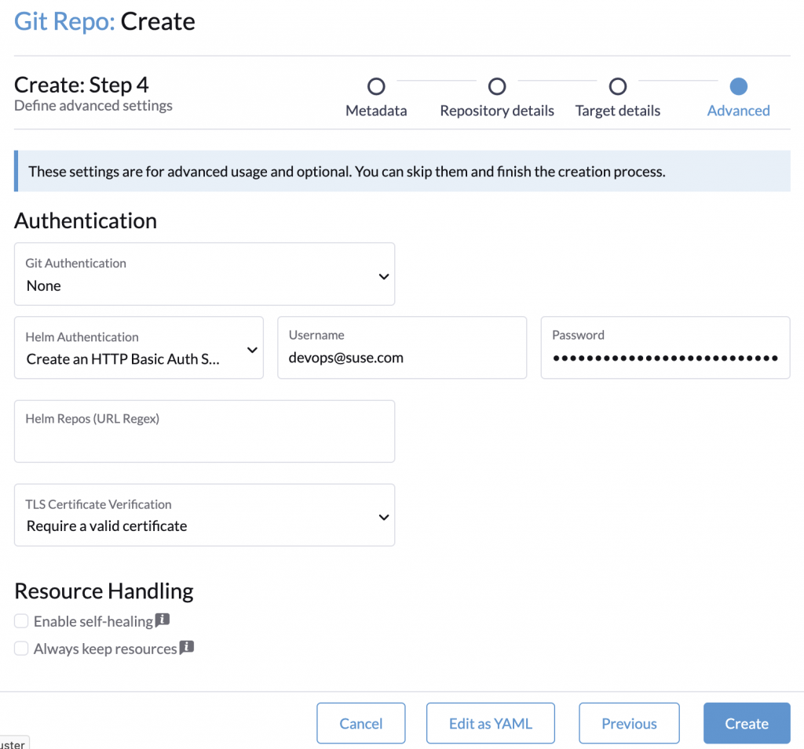

Managing and deploying applications across multiple Kubernetes clusters presents significant challenges, especially as the number of clusters grows.

Traditional methods, like manually applying Helm charts or manifests per cluster, become cumbersome, error-prone, and difficult to scale or maintain consistency for Day 2 operations.

While Rancher allows [managing Helm chart repositories](https://ranchermanager.docs.rancher.com/how-to-guides/new-user-guides/helm-charts-in-rancher#add-custom-git-repositories) and apps, this is done on a per-cluster basis via the UI. This approach lacks a centralized source of truth for managing application deployments across a fleet of clusters, making version tracking and consistent rollouts challenging.

Rancher Continuous Delivery (Fleet) deploys applications to managed clusters. We know of users who deploy to a thousand clusters and discussed measuring the [performance aspects in a previous blog post](https://www.suse.com/c/rancher_blog/optimizing-rancher-continuous-delivery-with-benchmarks/).

Fleet is a Continuous Delivery/Deployment open source tool built with a GitOps operator. It operates on a two-stage pull model: the controller pulls application configurations from a Git repository, and agents running on each downstream cluster pull those configurations from the management cluster. This architecture allows managed clusters to run on private networks or behind NATs, as communication is initiated from the agent in the managed cluster to the Fleet controller.

With [SUSE Application Collection](https://apps.rancher.io) added to Rancher, there is a vast source of trusted, curated and continuously updated applications available to be used in GitOps. All charts are built, packaged, tested and distributed by SUSE, the whole pipeline conforming to level 3 of the SLSA framework.

The integration is rather easy: Git repositories watched by Fleet are represented by the GitRepo custom resource. Creating a GitRepo resource pointing to a Git repository is the entry point for using Fleet.

For the next example, we deploy the popular Istio chart.

## Create the Git Repository

To deploy Istio, you create a Git repository containing its configuration and a single "fleet.yaml" file:

```
defaultNamespace: istio-system
helm:
  chart: oci://dp.apps.rancher.io/charts/istio
  version: 0.7.2
  values:
    global:
      imagePullSecrets: [ "application-collection" ]
```

The charts from the Rancher Application Collection need to know about the pull image secret, e.g. to use it in deployments. This information can be found in the [Istio Reference Guide](https://docs.apps.rancher.io/reference-guides/istio/).

The "fleet.yaml" can also be used to pass additional configuration values to the Istio chart.

## Create the Pull Secret

Before we add the repository, we need to create the pull secrets on every targeted cluster. Otherwise, the pods will not be ready until they are restarted and can pull their images. The instructions are the same as for Rancher Manager: either the [UI or kubectl can be used to create the secrets](https://docs.apps.rancher.io/howto-guides/integrate-with-rancher-manager/#configure-the-imagepullsecret).

However, it is recommended to use a [service account instead of a personal access token](https://docs.apps.rancher.io/get-started/authentication/) for GitOps. That way you are authenticating on behalf of your organization. Additionally, service accounts have a higher rate limit than personal access tokens and hence allow pulling a higher number of images in a given time frame.

Since Istio is installed into the “istio-system” namespace, we need to create the pull secret in the same namespace. When using the UI for every target cluster, select it, create the namespace, select the namespace and navigate to “Storage > Secrets” and click on the *Create* button. In the pop-up window, click on *Registry* type.

In the form, set the following values:

- **Name**: application-collection
- **Description**: Application Collection imagePullSecret
- **Registry Domain Name**: dp.apps.rancher.io
- **Username**: the Application Collection username or service account name
- **Password**: the Application Collection password or access token

## Add the Repository

Now that our git repository is ready and we have secrets in place to access it, let's create a GitRepo resource in the Fleet management cluster, pointing to your Git repository.

To download the charts from the Application Collection, authentication is required. Just as with any authenticated chart source, we need to create an access secret.

Filling out the form, creates the necessary Helm access secret to download the chart. You can use the same credentials as for the pull image secrets.


*Helm Authentication Options*

 

Now, the chart will be deployed to all downstream clusters.

## Ignoring the Modified Status

However, since Istio uses validating webhooks, which change after deployment, it will show up as “Modified”. The status of the GitRepo resource hints at the necessary “diff patch”. See [“Generating Diffs”](https://fleet.rancher.io/bundle-diffs) in the documentation for more details.

By adding the following block to the fleet.yaml, the deployment finally shows up as “Ready”:

```
diff:
  comparePatches:
  - apiVersion: admissionregistration.k8s.io/v1
    kind: ValidatingWebhookConfiguration
    name: istio-validator-istio-system
    operations:
    - {"op": "remove", "path":"/webhooks"}
  - apiVersion: admissionregistration.k8s.io/v1
    kind: ValidatingWebhookConfiguration
    name: istiod-default-validator
    operations:
    - {"op": "remove", "path":"/webhooks"}
```

## Using Istio Sidecars

You can now label each namespace that should add Istio sidecars to pods. However, pulling the sidecar image needs access to a pull secret. Create the pull secret as described above, in each namespace you label for injection.

## RKE2/K3S Without Pull Secrets

Adding pull secrets to each namespace can become cumbersome. If you are using RKE2 or K3s, those clusters can be configured with a global registry configuration. That way pull image secrets are not needed anymore. For K3s the registry.yaml would look like this:

```
configs:
  "dp.apps.rancher.io":
    auth:
      username: 
      password:
```

If you don't use RKE2 or K3s and don't want to use kubectl or the UI to create secrets, there are many Open Source tools you can use to copy secrets to another namespace. These tools include the external secrets operator, reflector or kubernetes-replicator.

However, Fleet itself is also working on better pulling secret support in upcoming releases.

## Continuous Fleet Journey

If you want to learn more about Rancher Continuous Delivery (Fleet), there's the excellent [docs site](https://fleet.rancher.io/). And if resources consumption and optimization are an important subject, we have you covered with [this blog](https://www.suse.com/c/rancher_blog/optimizing-rancher-continuous-delivery-with-benchmarks/).

Finally, you can follow and contribute to Fleet directly on the [GitHub repository](https://github.com/rancher/fleet).
