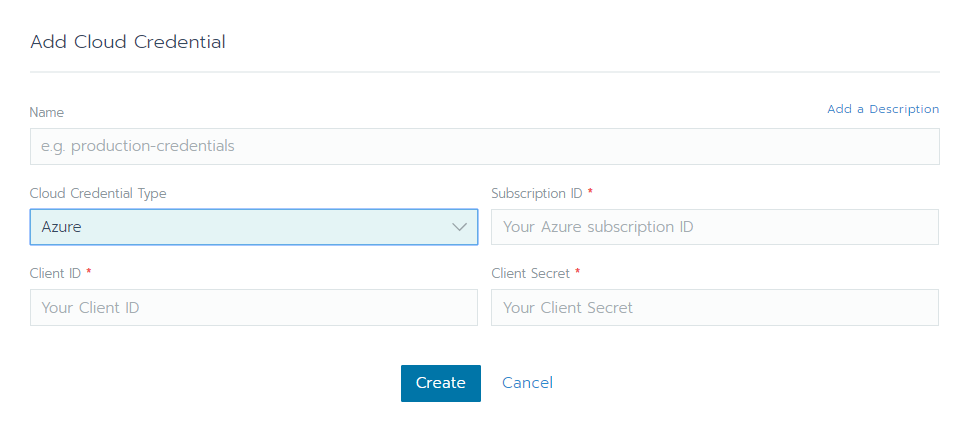
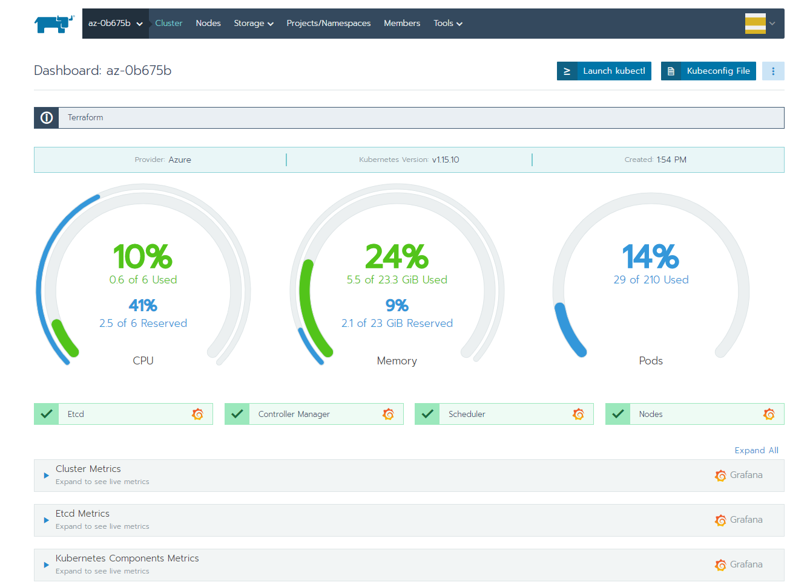

Read our free white paper: How to Build a Kubernetes Strategy[Download Now](https://more.suse.com/fy21-global-web-landing-page-how-to-build-enterprise-kubernetes-strategy)

## Introduction

If you’re in enterprise IT, you’ve probably already looked into Microsoft’s Azure public cloud. Microsoft Azure offers excellent enterprise-grade features and tightly integrates with Office 365 and Active Directory. It also provides a managed Kubernetes service, AKS, that you can provision from the Azure portal.

So, why would you want to add Rancher to the mix? In addition to the very slick and easy-to-use user interface, Rancher brings a lot of additional features to Kubernetes management. It includes integrated logging and monitoring and a built-in service mesh, plus a lot of features around hardening, governance and security. Rancher Labs recently added [CIS Scanning](https://ranchermanager.docs.rancher.com/) to the list of integrated tools, which lets you assess your RKE clusters against the 100+ tests of the CIS Benchmark for Kubernetes.

Rancher also has an outstanding [provider](https://www.terraform.io/docs/providers/rancher2/index.html) for Hashicorp’s Terraform infrastructure automation, allowing the creation of Rancher-managed Kubernetes clusters from the command line or directly from your source-code revision control system.

In this article, we’ll explore the benefits of using Rancher together with Terraform to deploy Kubernetes clusters on Azure.

Using infrastructure as code (Terraform) and templates (Rancher) for your Kubernetes cluster builds gives you the ability to provide guidelines for your teams and ensure overall consistency. It also allows you to treat your infrastructure as cattle, much like your deployments. Infrastructure as code paves the way to deploy a new cluster after every sprint, making testing so much easier, combatting break-ins and avoiding patching. Together with Rancher’s unique template feature, it offers an easy way to enforce corporate security guidelines and governance.

An added benefit is that you can turn cluster installation over to your development teams and offer true self-service.

## Background

Today, we’ll look at a scenario where a large enterprise customer is using Microsoft Azure through [T-Systems](https://www.t-systems.com/de/en#Cloud%20&%20Infrastructure), their Managed Cloud Service Provider (MCSP).[[1]](#tsystem)

To ensure the highest levels of security, operational stability, regulatory compliance and data protection, they made a couple of governance decisions. These included strict separation of networks between the various projects, stringent control on Internet access and limited access from the public Azure portal to running services.

That means all traditional and agile teams only need standard capabilities. Most admin rights are with T-Systems and controlled through ITIL processes, significantly limiting the attack vectors.

## Rancher Features

Fortunately, T-Systems offers Rancher as a managed service, with integration into the customer’s Active Directory for authentication and authorization.

Rancher offers three choices to create a Kubernetes cluster on Azure:

- custom node clusters, using pre-built infrastructure VMs
- node driver clusters, where Rancher creates the necessary infrastructure VMs using [docker-machine](https://docs.docker.com/machine/concepts/)
- Azure managed Kubernetes clusters (AKS)

In the first two options, the Kubernetes control plane and worker nodes are under your control. In contrast, in the third option, Microsoft manages the control plane and the control plane nodes are neither visible nor accessible. Using a custom node cluster gives you more granular control over the infrastructure VMs but will need a more complex setup. Furthermore, using the built-in node drivers allows you or Rancher to scale node pools as required.

In addition to these options, Kubernetes includes an Azure Cloud provider to give you access to Azure storage and network features.

For maximum flexibility and to ensure that the Kubernetes clusters will fit into the network restrictions of the customer’s setup, we decided to go with Kubernetes clusters based on Rancher’s node drivers.

## Prerequisites

For this setup, you will need:

- A Rancher login as a standard user
- Access to Rancher from your workstation
- An Azure Service Principal, with basic capabilities
- Access to an Azure Resource Group, Vnet and Subnet
- Optional: A Storage account (for the Azure File storage class)
- Azure Firewall port openings, to and from Rancher (Ports 22, 80, 443 and 2376)

## Preparing the Environment

### Terraform prerequisites

As a first step to use Terraform, you’ll have to [download](https://www.terraform.io/downloads.html) the latest version of the Terraform binary and place it somewhere in your path (/usr/local/bin/, for example).

Then you create a sub-directory to hold all your Terraform plan (.tf) files - that’s all!

### Creating the provider

To authenticate to Rancher, we’ll need an API Key from the GUI and the provider definition. It’s common practice to place these definitions in a separate plan file, provider.tf.

Grab the key from the API & Keys menu item on the right, under your avatar, and copy the URL and token to the provider plan:

```
# Rancher
provider "rancher2" {
  api_url = var.rancher-url
  token_key = var.rancher-token
  insecure = true
}
```

### Creating the credentials

To keep things simple, we’ll place all other definitions into a single plan file, main.tf. To access Azure and enable Rancher to create the infrastructure, we’ll need to define the access credentials:

```
# Azure Cloud Credentials
resource "rancher2_cloud_credential" "credential_az" {
  name = "Free Trial"
  azure_credential_config {
    client_id = var.az-client-id
    client_secret = var.az-client-secret
    subscription_id = var.az-subscription-id
  }
}
```

We’ll need these values again, in a minute, when we pass the Azure configuration to Kubernetes.

You could also define the credentials using the GUI:



### Creating the node template for the first node pool

We’ll need at least one node pool for a combined control plane and worker nodes.

In the node template, we’ll choose the Azure image name, the machine type and size and the Docker version:

```
# Azure Node Template
resource "rancher2_node_template" "template_az" {
  name = "RKE Node Template"
  cloud_credential_id = rancher2_cloud_credential.credential_az.id
  engine_install_url = var.dockerurl
  azure_config {
    disk_size = var.disksize
    image = var.image
    location = var.az-region
    managed_disks = true
    no_public_ip = false
    open_port = var.az-portlist
    resource_group = var.az-resource-group
    storage_type = var.az-storage-type
    size = var.type
    use_private_ip = false
  }
}
```

From the template, we create a node pool:

```
# Azure Node Pool
resource "rancher2_node_pool" "nodepool_az" {
  cluster_id = rancher2_cluster.cluster_az.id
  name = "nodepool"
  hostname_prefix = "rke-${random_id.instance_id.hex}-"
  node_template_id = rancher2_node_template.template_az.id
  quantity = var.numnodes
  control_plane = true
  etcd = true
  worker = true
}
```

It’s common practice to define Terraform variables in a separate plan file, variables.tf:

```
# Node image
variable "image" {
    default = "canonical:UbuntuServer:18.04-LTS:latest"
}
# Node type
variable "type" {
    default = "Standard_D2s_v3"
}
```

A note on Azure: With the selection of the machine type, you’ll also set access to storage. For premium disks, choose an “s”-type.

### Defining the cluster

Now that we have the node pool, it’s time to define the Kubernetes cluster itself:

```
# Rancher cluster
resource "rancher2_cluster" "cluster_az" {
  name         = "az-${random_id.instance_id.hex}"
  description  = "Terraform"

  rke_config {
    kubernetes_version = var.k8version
    ignore_docker_version = false
    cloud_provider {
      name = "azure"
      azure_cloud_provider {
        aad_client_id = var.az-client-id
        aad_client_secret = var.az-client-secret
        subscription_id = var.az-subscription-id
        tenant_id = var.az-tenant-id
        resource_group = var.az-resource-group
      }
    }
  }
}
```

Here we define the credentials a second time – this time to enable Kubernetes to access the Azure API directly.

### Optional: Creating a cluster template

Rather than defining the cluster in the plan file directly, we have the option to reference a cluster template, much like the node template above. Using a cluster template allows us to uniformly enforce hardening and set security standards for all Kubernetes cluster deployments.

## Creating the Cluster

### Applying the plan

To execute the Terraform plan, use the following sequence of commands:

- terraform init - to set up the environment and download the provider plugins
- terraform plan - to check the plan for syntax and consistency
- terraform apply - to execute the plan and instruct Rancher to create the cluster

### Following progress

To watch Rancher create the cluster, have a look at its log – this is the best place to catch any errors.

### Final result

If everything goes according to plan, we’ll have a working Kubernetes cluster in Rancher after a couple of minutes:



## Adding Storage Classes

### Azure Disk

To finish our cluster and enable stateful workloads, you’ll want to add the Azure Disk storage class:

```
apiVersion: storage.k8s.io/v1
kind: StorageClass
metadata:
  name: azure-disk
  annotations:
    storageclass.kubernetes.io/is-default-class: "true"
provisioner: kubernetes.io/azure-disk
parameters:
  storageaccounttype: Standard_LRS
  resourceGroup: az-cluster-1
  kind: Managed
```

### Azure File

For shared storage, you might also want to add the Azure file storage class:

```
kind: StorageClass
apiVersion: storage.k8s.io/v1
metadata:
  name: azure-file
provisioner: kubernetes.io/azure-file
parameters:
  skuName: Standard_LRS
  location: westeurope
  resourceGroup: az-cluster-1
```

## Conclusion

As we’ve seen, Rancher is an excellent choice to provision Kubernetes clusters in enterprise IT and has strong support for security, self-service and infrastructure as code.

RKE Cluster Templates enforce hardening. Your internal IT department or your MCSP can pre-create cluster templates, node templates and credentials to implement corporate security guidelines and standards. Regular CIS scans will show any deviations and alert you to possible errors.

In addition to providing an interface to standardize Kubernetes cluster deployments throughout your organization, Rancher also offers the following key benefits over a direct deployment from the Azure portal:

- Centralized user authentication (from Active Directory) and overall RBAC
- Intuitive user interface for all Kubernetes clusters
- A built-in and fully customizable catalog for applications

You can find all the plan files [here](https://github.com/chfrank-cgn/Rancher/tree/master/az-cluster-1).

[1]: T-Systems contact: [Patrick Schweitzer](mailto:patrick.schweitzer@t-systems.com)

Read our free white paper: How to Build a Kubernetes Strategy[Download Now](https://more.suse.com/fy21-global-web-landing-page-how-to-build-enterprise-kubernetes-strategy)
