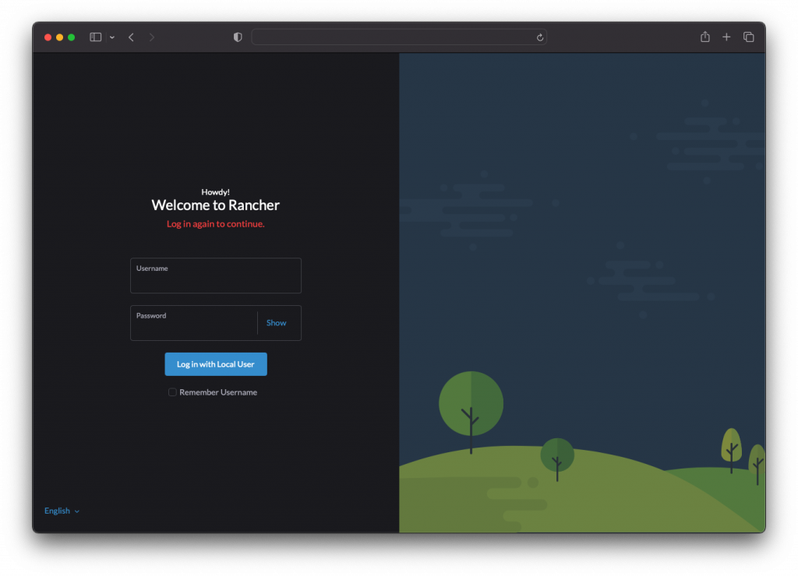
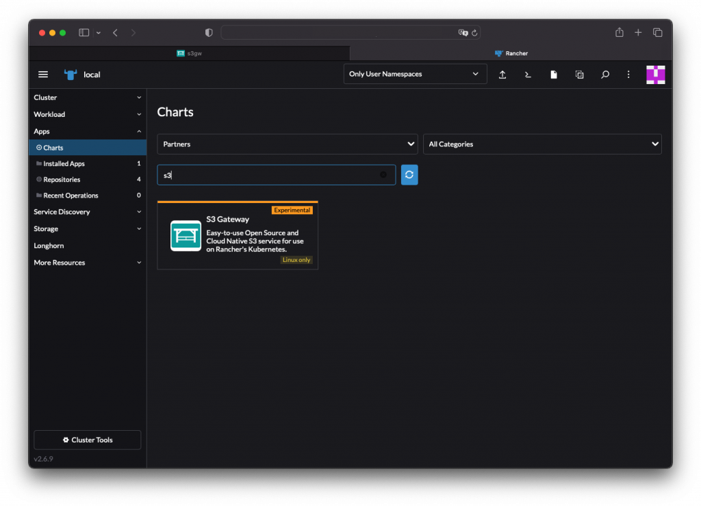
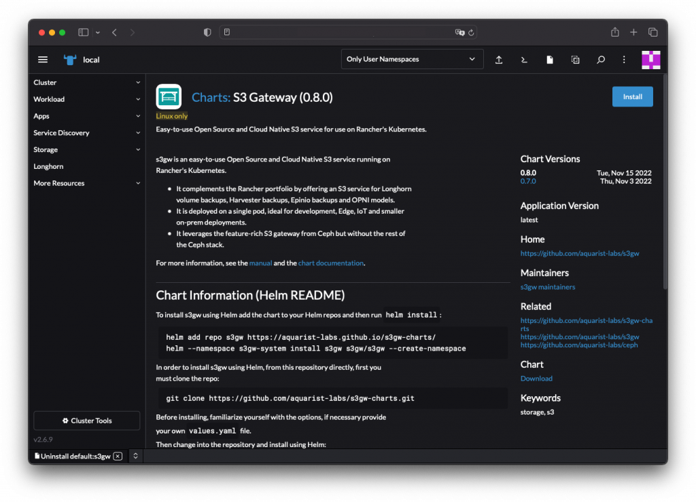
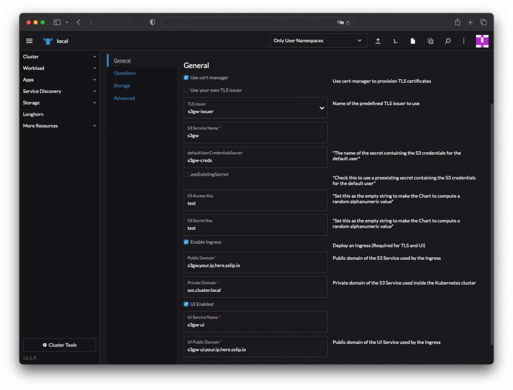
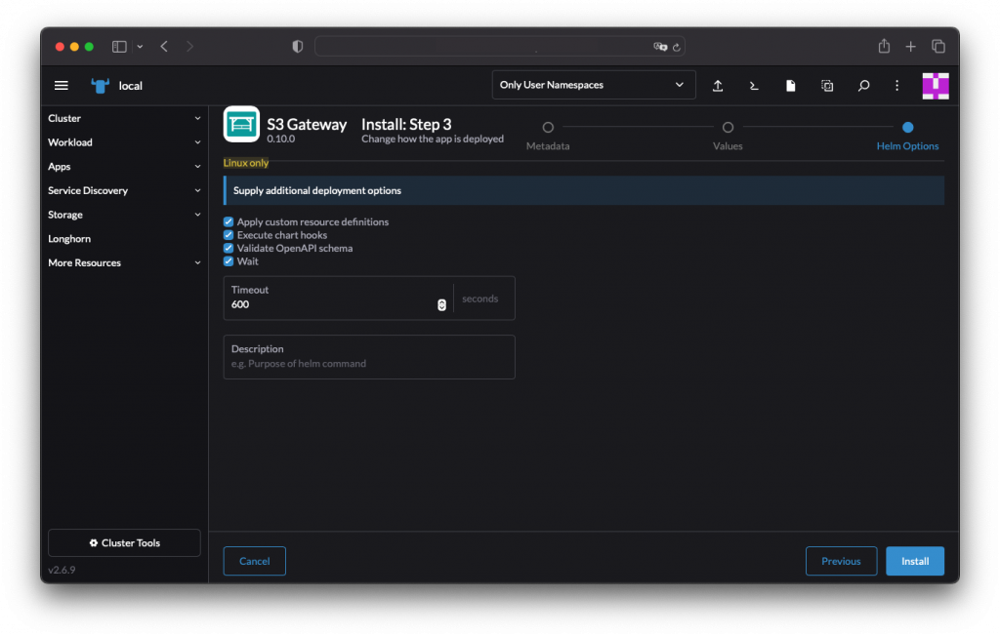
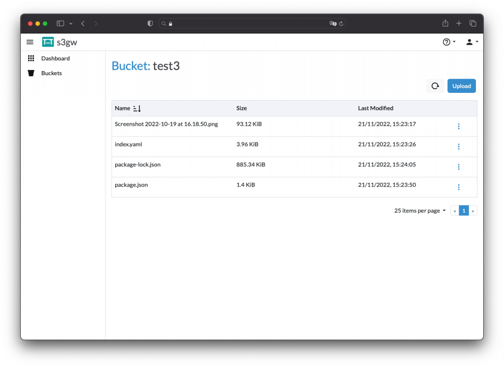

## Introduction

In this tutorial, we will walk through the setup of a single-node K3s Kubernetes cluster with Rancher, together with the S3 Gateway (s3gw) and a Longhorn PV (Persistent Volume). This guide will use Digital Ocean, but these instructions will likely work with other cloud providers as well. 

## Background

Before you begin, if you have not heard yet of the [s3gw](https://s3gw.io/) project, read this article first. The s3gw is a lightweight S3 service for Kubernetes users running on top of a Longhorn PV (and it comes with a nice user interface). 

For the purpose of this article, there is assumed knowledge of [K3s](http://k3s.io/), [Rancher](https://www.rancher.com/) and [Longhorn](http://longhorn.io/).  However, if you need more information, you will find plenty of useful information in this blog. 

## Prerequisites

You will need to have created a Droplet in Digital Ocean. For this specific tutorial, you will need the following: 

- OS: Ubuntu 20.04 (LTS) x64
- CPU Options: Regular Intel with SSD + 8 GB / 4 CPUs
- Add block storage: Leave as it is
- Datacenter region: Choose the datacenter region closer to you
- VPC Network: Leave as it is
- Authentication: via SSH, click the "new SSH Key", follow the instructions given (identify your ssh key properly) and after it is added, select it with the appropriate checkbox.
- Additional Options: Leave as it is
- Finalize and create: identify your droplet with a hostname (ex: <your name>-local-rancher).
- Hit Create Droplet

And there you go! You have a system ready to hack on!

## Prepare your system

Now we need to set up your droplet. Install Helm: 

```
$ ssh root@IP-ADDRESS
$ apt-get install open-iscsi
$ snap install --classic helm
```

**1. Install K3s**

Now, set up K3s: 

```
$ curl -sfL https://get.k3s.io | INSTALL_K3S_VERSION="v1.24.7+k3s1" sh -s - server --cluster-init 
$ export KUBECONFIG=/etc/rancher/k3s/k3s.yaml  
```

**2. Define a Kubernetes namespace**

Now, we need to define a Kubernetes namespace where the resources created by the chart should be installed: 

```
$ kubectl create namespace cattle-system 
```

 

**3. Set up certificate management**

Next, set up cert-manager: 

```
$ kubectl apply -f https://github.com/cert-manager/cert-manager/releases/download/v1.7.1/cert-manager.crds.yaml 

$ helm repo add jetstack https://charts.jetstack.io
$ helm repo update
$ helm install cert-manager jetstack/cert-manager \
  --namespace cert-manager \
  --create-namespace \
  --version v1.7.1 
```

 

**4. Install Rancher server**

Once you are done installing K3s, install Rancher through the helm chart: 

```
$ helm repo add rancher-latest https://releases.rancher.com/server-charts/latest 

$ helm install rancher rancher-latest/rancher \
  --namespace cattle-system \
  --set hostname= IP-ADDRESS.sslip.io \
  --set replicas=1 \
  --set bootstrapPassword=PASSWORD 
```

We are using sslip.io as the DNS service. The installation will take some time. Then you will be ready to access Rancher: 



 

**5. Retrieve the password**

Retrieve your password by running the following command: 

```
$ kubectl get secret --namespace cattle-system bootstrap-secret -o go-template='{{ .data.bootstrapPassword|base64decode}}{{ "\n" }}'
```

## Install s3gw using the Rancher UI

The s3gw can be found in the Rancher UI as a partner chart: 

To access, go to “Apps” and then “Charts”. Choose the partner charts drop-down and click on the s3gw partner chart: 



Click  “Install” and tick the “Customize Helm options before install”: 



Here are the remaining three steps: 

1. Set App Metadata: Select the project to install s3gw into.
2. Values: Here, you can set up access and secret keys, storage, etc. The chart sets up a Longhorn volume by default.  Update are the hostnames for the S3 service and the UI:



3. Finally, there are other options you can also set up additional deployment options:



And that’s it! You can now access the s3gw UI in https://s3gw-ui.your.ip.here.sslip.io) :


 

⚠️ “Network failure” issue 

When you try to log into the UI for the first time, you will find a “Network Failure” error. This is a [known issue](https://github.com/aquarist-labs/s3gw/issues/275). 

To work around this issue, access the S3 service URL first ([https://s3gw.your.ip.here.sslip.io](https://s3gw.your.ip.here.sslip.io/)). You will then be able to log into the UI:



 

## Conclusion

We hope that you have found this article helpful. The project is not production-ready; we are in the process of improving and adding features to each minor release.  

We would love to hear from you about what you want to see on our roadmap. What would enable you best to use s3gw in your environment?  

Reach out to us at [s3gw@suse.com](mailto:s3gw@suse.com) or our Rancher Users [Slack channel.](https://rancher-users.slack.com/archives/C04DCMUV8SE) You can also check our [website](https://s3gw.io/), join our mailing list or look at our [GitHub repository](https://github.com/aquarist-labs/s3gw) – feature requests are welcome! 🙂
