Rancher Server has recently [added Docker Machine
support](https://rancher.com/rancher-adds-support-for-docker-machine-provisioning/ "Rancher adds support for Docker Machine provisioning"),
enabling us to easily deploy new Docker hosts on multiple cloud
providers via Rancher’s UI/API and automatically have those hosts
registered with Rancher. For now Rancher supports DigitalOcean and
Amazon EC2 clouds, and more providers will be supported in the future.
Another significant feature of Rancher is its networking implementation,
because it enhances and facilitates the way you connect Docker
containers and those services running on them. Rancher creates a private
network across all Docker hosts that allows containers to communicate as
if they were in the same subnet. In this post we will see how to use the
new Docker Machine support and Rancher networking by deploying a Grafana
dashboard installation on Amazon EC2. We are creating EC2 instances directly from
Rancher UI and all our containers are being connected through the
Rancher network. If you have never heard of Grafana, it is an open
source rich metric web dashboard and graph editor for Graphite, influxDB
and OpenTSBD metric storages. To set this up we are using these docker
images:

- **tutum/influxdb** for storing metrics and grafana dashboards
- **tutum/grafana** for graphing influxDB metrics and serving
  dashboards
- a custom linux image that will send linux O.S. metrics to influxDB
  using sysinfo\_influxdb (CPU, memory, load, disks I/O, network
  traffic).

In a test environment you may want to deploy docker images in the same
host, but we are using a total of 4 AWS instances listed below in order
to mimic a large-scale production deployment and also to see how Rancher
networking works.

- 1 as a Rancher Server to provision and manage application stack AWS
  instances,
- 1 running influxDB docker image (tutum/influxdb)
- 1 running grafana docker image (tutum/grafana)
- 1 running sysinfo docker image (nixel/sysinfo\_influxdb)

## Preparing AWS Environment

First you will need to create the following in AWS Console: a Key Pair
for connecting to your servers, a Security Group to give you access to
Rancher Console, and a Access Key for Rancher to provision EC2
instances. **Creating a Key Pair** Enter AWS EC2 Console, go to *Key
Pairs* section, click *Create Key Pair* button and then enter a name for
your Key Pair. Once created, your browser downloads a pem certificate.
You will need it if you want to connect to your AWS instances.
**Creating a Security Group** First of all go to VPC Console and enter
*Subnets* section. You will get a list of available subnets in default
VPC, choose one for deploying AWS instances and copy its ID and CIDR.
Also copy VPC ID, you will need all this data later when creating Docker
hosts with Machine integration. I am using subnet 172.31.32.0/20 for
this tutorial.
[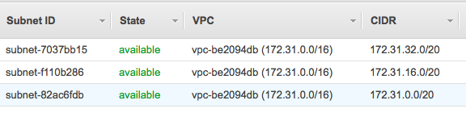](images/rancher_blog_AWS-VPC-Subnets.png)
Then enter AWS EC2 Console, go to *Security Groups* section and click
*Create Security Group* button. Enter the following data:

- **Security Group Name:** Rancher and Grafana
- **Description:** Open Rancher and Grafana ports
- **VPC:** select the default one
- Add a new inbound rule to allow 22 TCP port to be accessible only
  from your IP
- Add a new inbound rule to allow 8080 TCP port to be accessible only
  from your IP
- Add a new inbound rule to allow 9345-9346 TCP ports to be accessible
  from anywhere
- Add a new inbound rule to allow all traffic from your VPC network.
  In this case source is 172.31.32.0/20, change it accordingly to your
  environment.

[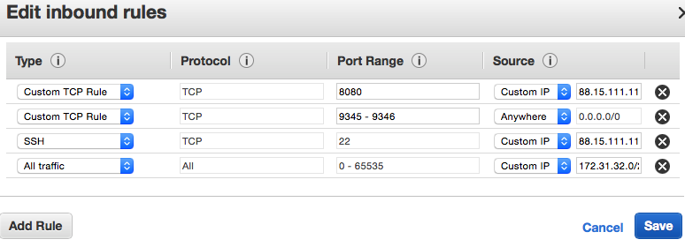](images/rancher_blog_AWS-Security-Group-RancherServer.png)
**Creating an Access Key** Enter EC2 Console and click your user name in
the top menu bar, click *Security Credentials* and then expand *Access
Keys* option. Click *Create New Access Key* button and after it has been
created you will click *Show Access Key* to get the ID and Secret Key.
Save them because you are needing them later to create Docker hosts.

## Rancher Server Setup

For launching Rancher Server you will need an AWS instance. I am using
the t1.micro instance for writing this guide, but it is recommended to
use a larger instance for real environments. Enter AWS EC2 Console and
go to *Instances* section, click *Launch Instance* button, click
*Community AMIs* and then search for RancherOS and select last version,
for example rancheros-v0.2.1. Choose an instance type and click *Next:
Configure instance details* button. In configuration screen be sure to
select the same subnet you chose for Security Group. Expand *Advanced
Details* section and enter this *user data* to initialize your instance
and get Rancher Server installed and running.

```
#!/bin/bash
docker run -d -p 8080:8080 rancher/server:v0.14.1
```

[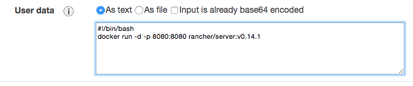](images/rancher_blog_AWS-RancherServer-userData.png)
You may keep default options for all steps excepting *Security Group*
(choose Security Group named *Rancher and Grafana*). When launching AWS
instance you are asked to choose a Key Pair, be sure to select the one
that we created before. Go to *Instances* section and click your Rancher
Server instance to know its private and public IPs. Wait a few minutes
and then browse to
[http://RANCHER\_SERVER\_PUBLIC\_IP:8080](http://rancher_server_public_ip:8080)
to enter Rancher Web Console and click *Add Host*. You will be asked to
confirm Rancher Server IP address, click *Something else* and enter
RANCHER\_SERVER\_PRIVATE\_IP:8080, finally click *Save* button.
[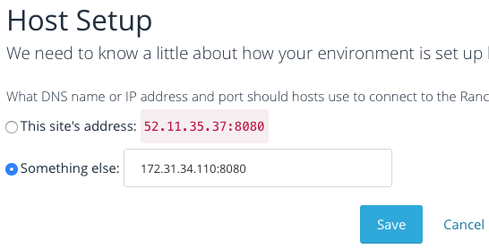](images/rancher_blog_AWS-RancherServer-Host-setup.png)

## Docker hosts setup

Go to Rancher Console, click *Add Host* and select *Amazon EC2*. Here
you will need to enter the new host name, the *Access Key* and the
*Secret Key*. Also be sure to set the same *Region*, *Zone*, and *VPC
ID* as those used by Rancher Server. Leave all other parameters with
their default values. Repeat this process to create our three Docker
hosts that will appear up and running after a while.
[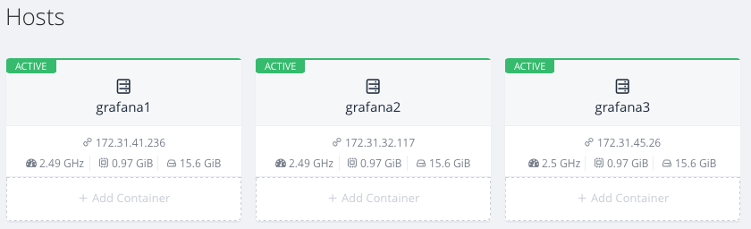](images/rancher_blog_AWS-DockerHosts.png)
**Security Group for grafana** Rancher Server has created a Security
Group named *docker-machine* for your Docker hosts. Now in order to be
able to connect to grafana you must go to VPC Console and add the
following Inbound rules:

- Add a new inbound rule to allow 80 TCP port to be accessible only
  from your IP
- Add a new inbound rule to allow 8083-8084 TCP ports to be accessible
  only from your IP
- Add a new inbound rule to allow 8086 TCP port to be accessible only
  from your IP
- Add a new inbound rule to allow all traffic from your VPC network.
  In this case source is 172.31.32.0/20, change it accordingly to your
  environment.

[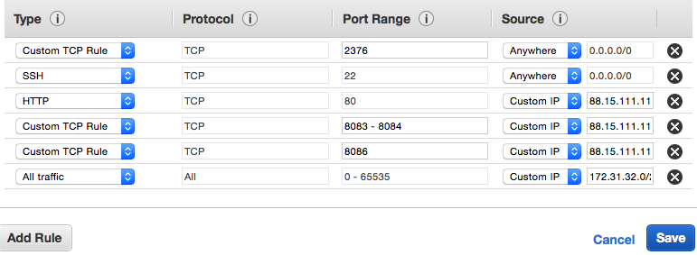](images/rancher_blog_AWS-DockerMachine-SecurityGroup.png)

## Installing application containers

This step consists of installing and configuring influxDB, grafana, and
an ubuntu container running sysinfo\_influxdb. This container will send
O.S. metrics to influxDB which will be graphed in grafana.
**Installing influxDB container** Go to Rancher Web Console and click *+
Add Container* button at your first host, enter a container name like
*influxdb* and ***tutum/influxdb*** in *Select Image* field. Add these
three port mappings, all of them are TCP:

- 8083 (on host) to 8083 (in container)
- 8084 (on host) to 8084 (in container)
- 8086 (on host) to 8086 (in container)

Expand *Advanced Options* section an add an environment variable named
**PRE\_CREATE\_DB** which value is **grafana**, so influxDB will create
an empty database for grafana metrics. Now go to *Networking* section
and enter a hostname like *influxdb* for this container. Be sure that
Network type is *Managed Network on docker0* so this container can be
reached by grafana and sysinfo\_influxdb. You can leave other options
with their default values. After a few minutes you will see your
influxDB container launched and running in your host. Note that influxdb
container has a private IP address, copy it to configure
sysinfo\_influxdb later. Copy also the public IP of host that is running
this container, you will need it later to configure grafana.
[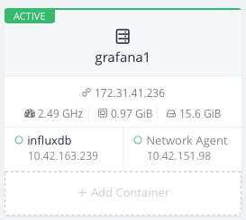](images/rancher_blog_AWS-grafana1-host.png)

**Installing grafana container** Go to Rancher Web Console and click *+
Add Container* button at your second host, enter a container name like
*grafana* and ***tutum/grafana*** in *Select Image* field. Add this TCP
port mapping:

- 80 (on host) to 80 (in container)

Expand *Advanced Options* section and enter the following environment
variables needed by grafana:

---

**Variable name** **Variable value** **Used for**
**HTTP\_USER** admin User login for grafana basic HTTP authentication
**HTTP\_PASS** Some password User password for grafana basic HTTP authentication
**INFLUXDB\_HOST** 52.11.32.51 InfluxDB host’s public IP. **Adapt this to your environment**
**INFLUXDB\_PORT** 8086 InfluxDB port
**INFLUXDB\_NAME** grafana Name of previously created database
**INFLUXDB\_USER** root InfluxDB user credentials
**INFLUXDB\_PASS** root InfluxDB user credentials
**INFLUXDB\_IS\_GRAFANADB** true Tell grafana to use InfluxDB for storing dashboards

---

[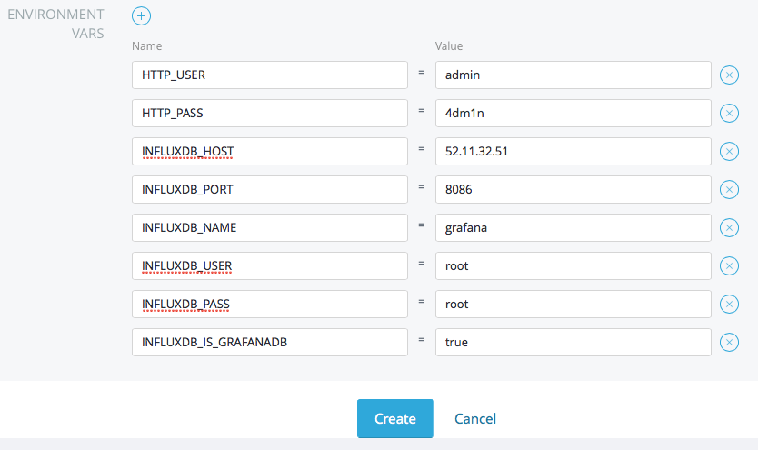](images/rancher_blog_AWS-Grafana-Env-Vars.png)
Grafana makes your browser to connect to influxDB directly. This is why
we need to configure a public IP in **INFLUXDB\_HOST** variable here. If
not, your browser could not reach influxDB when reading metric values.
Go to *Networking* section and enter a hostname like *grafana* for this
container. Be sure that Network type is *Managed Network on docker0* so
this container can connect to influxdb. You can leave other options with
their default values and after a few minutes you will see your grafana
container launched and running in your host.
[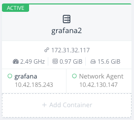](images/rancher_blog_AWS-grafana2-host.png)
Now go to Instances section in EC2 Console, click on the instance which
is running grafana container and copy its public IP. Type the following
url in your browser:
[http://GRAFANA\_HOST\_PUBLIC\_IP](http://grafana_host_public_ip), use
**HTTP\_USER** and **HTTP\_PASS** credentials to log in.
[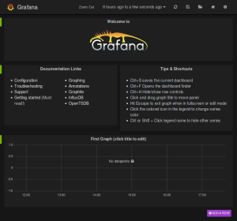](https://cdn.rancher.com/wp-content/uploads/2015/04/07185125/Grafana-Main-Page.png)
**Installing sysinfo\_influxdb container** Go to Rancher Web Console and
click *+ Add Container* button at your third host, enter *sysinfo* in
container name and ***nixel/sysinfo\_influxdb*** in *Select Image*
field. No port mapping is needed. Expand *Advanced Options* section and
enter these environment variables which are needed by this container:

---

**Variable name** **Variable value** **Used for**
**INFLUXDB\_HOST** 10.42.169.239 InfluxDB container private IP. **Adapt this to your environment**
**INFLUXDB\_PORT** 8086 InfluxDB port
**INFLUXDB\_NAME** grafana Name of previously created database
**INFLUXDB\_USER** root InfluxDB user credentials
**INFLUXDB\_PASS** root InfluxDB user credentials
**SYSINFO\_INTERVAL** 5m Sysinfo frequency to update metric values. Default is 5m

---

[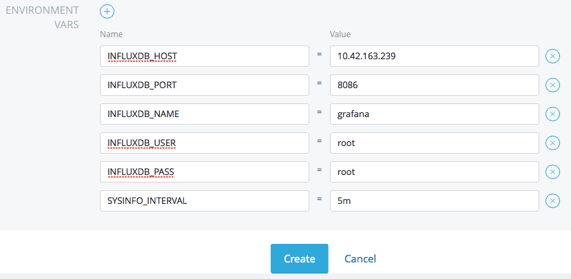](images/rancher_blog_Rancher-Sysinfo-Env-Vars.png)
Note that in this case **INFLUXDB\_HOST** contains influxDB container
private IP. This is because sysinfo\_influxdb will directly connect to
influxDB, using the VPN created by Rancher. Go to *Networking* section
and be sure the container hostname is *sysinfo* because you will later
import a sample grafana dashboard which needs this. Be sure that Network
type is *Managed Network on docker0* so this container can connect to
influxdb. You can leave other options with their default values and
after a few minutes you will see your sysinfo container launched and
running in your host.
[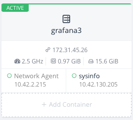](images/rancher_blog_AWS-grafana3-host.png)

## Graph metrics with grafana

At this point sysinfo container is collecting O.S. metrics and sending
them to influxDB every 5 minutes using Rancher networking. In this final
step we are graphing those metrics in grafana. First let’s import a
sample grafana dashboard that is already configured. Execute the
following command to download the dashboard definition:

```
curl -o https://raw.githubusercontent.com/nixelsolutions/sysinfo_influxdb/master/grafana_dashboard.json
```

Then open grafana web, browse
to [http://GRAFANA\_HOST\_PUBLIC\_IP](http://grafana_host_public_ip) and
click folder icon on top.
[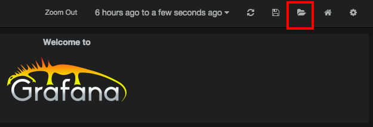](images/rancher_blog_Grafana-Import-dashboard.png)
Click import button and upload the file you have just downloaded. Click
save button on top and now you will be able to see CPU, Load Average,
RAM, Swap and Disks metrics that are being collected in your sysinfo
container.
[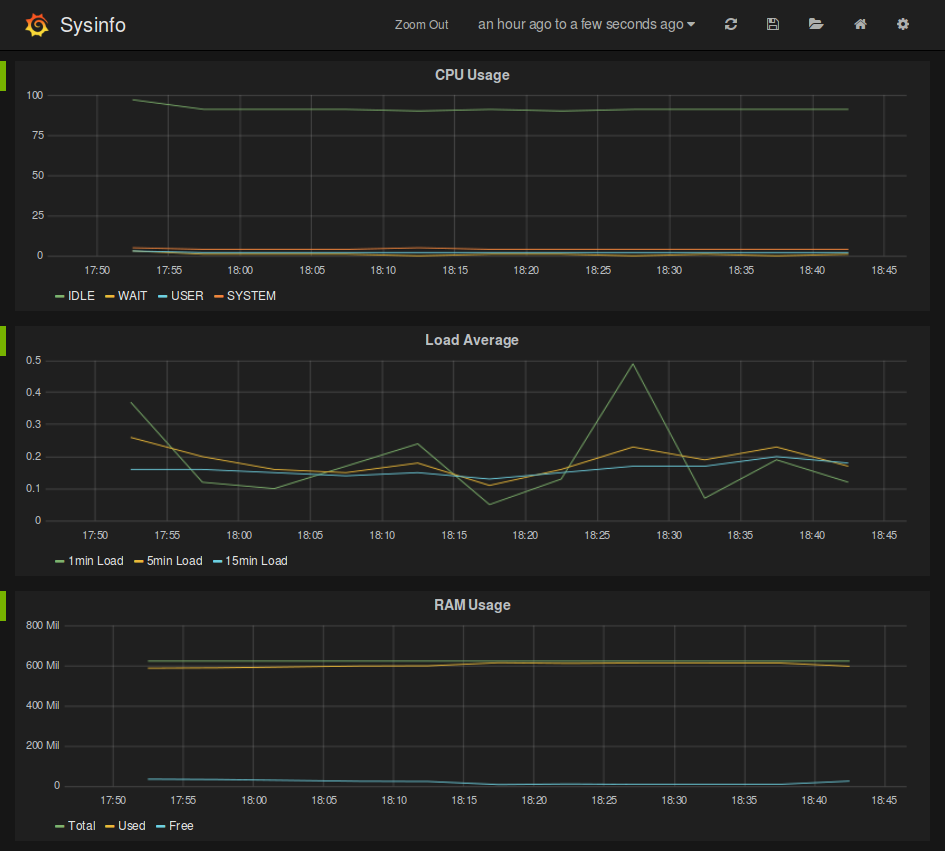](images/rancher_blog_Grafana-metrics.png)

## Conclusion

Rancher implements a networking solution that really simplifies the way
you bring connectivity to those services running in your containers.
Instead of managing port mappings it automatically puts all your
containers into the same network without requiring any configuration
from you. This is an important feature because, in fact, it brings
containers closer to enterprise production platforms because it makes
easier to deploy complex scenarios where some containers need to connect
with others. With Rancher you can deploy any container on any host at
any time without reconfiguring your environment, and there is no need to
worry about defining, configuring or maintaining port mappings when
interconnecting containers. To get more information on Rancher, feel
free at any time to request a [demonstration from one of our
engineers](https://more.suse.com/fy21-global-sales-call-request-schedule-a-rancher-demo), or sign up
for an upcoming online meetup.

*Manel Martinez
is a Linux systems engineer with experience in the design and management
of scalable, distributable and highly available open source web
infrastructures based on products like KVM, Docker, Apache, Nginx,
Tomcat, Jboss, RabbitMQ, HAProxy, MySQL and XtraDB. He lives in spain,
and you can find him on Twitter
[@manel\_martinezg](http://twitter.com/manel_martinezg).*
