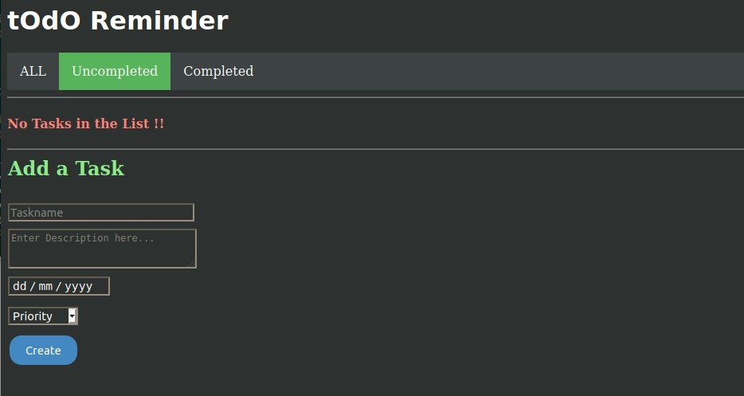
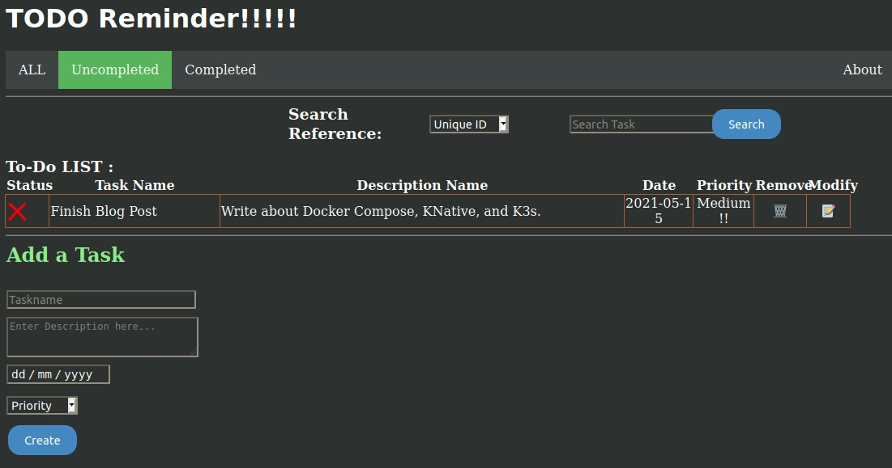

In this article, we will take a working TODO application written in Flask and JavaScript, with a MongoDB database, and learn how to deploy it onto Kubernetes. This post is geared toward beginners; if you do not have access to a Kubernetes cluster, fear not!


We'll use K3s, a lightweight Kubernetes distribution that is excellent for getting started quickly.

Let’s talk about what we want to achieve.

First, I’ll introduce the example application. This is kept intentionally simple but illustrates a common use case. Then we'll go through the process of containerizing the application. Before we move on, I’ll talk about how we can use containers to ease our development, especially if we work in a team and want to ease developer ramp-up time or when we are working in a fresh environment.

Once we have containerized the applications, the next step is deploying them onto Kubernetes. While we can create `Services`, `Ingresses` and `Gateways` manually, we can use Knative to stand up our application in no time at all.

## Setting up the app

We will work with a simple TODO application that demonstrates a front end, REST API back end and MongoDB working in concert. Credits go to [Prashant Shahi](https://github.com/prashant-shahi) for coming up with the example application. I have made some minor changes purely for pedagogical purposes.

First, `git clone` the repository:

```
git clone https://github.com/benjamintanweihao/Flask-MongoDB-K3s-KNative-TodoApp
```

Next, let’s inspect the directory to get the lay of the land:

```
% cd Flask-MongoDB-K3s-KNative-TodoApp
% tree
```

The folder structure is a typical Flask application. The entry point is `app.py` which also contains the REST APIs. The `templates` folder consists of the files that would be rendered as HTML.

```
├── app.py
├── requirements.txt
├── static
│   ├── assets
│   │   ├── style.css
│   │   ├── twemoji.js
│   │   └── twemoji.min.js
└── templates
    ├── index.html
    └── update.html
```

Open `app.py`and we can see all the major pieces:

```
mongodb_host = os.environ.get('MONGO_HOST', 'localhost')
mongodb_port = int(os.environ.get('MONGO_PORT', '27017'))
client = MongoClient(mongodb_host, mongodb_port)
db = client.camp2016
todos = db.todo

app = Flask(__name__)
title = "TODO with Flask"

@app.route("/list")
def lists ():
    #Display the all Tasks
    todos_l = todos.find()
    a1="active"
    return render_template('index.html',a1=a1,todos=todos_l,t=title,h=heading)

if __name__ == "__main__":
    env = os.environ.get('APP_ENV', 'development')
    port = int(os.environ.get('PORT', 5000))
    debug = False if env == 'production' else True
    app.run(host='0.0.0.0', port=port, debug=debug)
```

From the above code snippet, you can see that the application requires MongoDB as the database. With the `lists()` method, you can then see an example of how a route is defined (i.e. `@app.route("/list")`), how data is fetched from MongoDB and finally, how the template is rendered.

Another thing to notice here is the use of environment variables for `MONGO_HOST` and `MONGO_PORT` and Flask-related environment variables. The most important is `debug`. When set to `True`, the Flask server automatically reloads when it detects and changes. This is especially handy during development and is something we’ll exploit.

## Developing with docker containers

When working on applications, I spent a lot of time setting up my environment and installing all the dependencies. After that, I could get up and running by adding new features. However, this only describes an ideal scenario, right?

How often have you gone back to an application that you developed (say six months ago), only to find out that you are slowly descending into dependency hell? Dependencies are often a moving target; unless you lock things down, your application might not work properly. One way to get around this is to package all the dependencies into Docker containers.

Another nice thing that Docker brings is automation. That means no more copying and pasting commands and setting up things like databases.

### Dockerizing the flask application

Here’s the `Dockerfile`:

```
FROM alpine:3.7
COPY . /app
WORKDIR /app

RUN apk add --no-cache bash git nginx uwsgi uwsgi-python py2-pip \
    && pip2 install --upgrade pip \
    && pip2 install -r requirements.txt \
    && rm -rf /var/cache/apk/*

EXPOSE 5000
ENTRYPOINT ["python"]
```

We start with a minimal (in terms of size and functionality) base image. Then, the application's contents go into the container's directory. Next, we execute a series of commands to install Python, the Nginx web server and all the Flask application's requirements. These are exactly the steps needed to set up the application on a fresh system.

You can build the Docker container like so:

```
% docker build -t <yourusername>/todo-app .
```

You should see something like this:

```
# ...
Successfully built c650af8b7942
Successfully tagged benjamintanweihao/todo-app:latest
```

### What about MongoDB?

Should you go through the same process of creating a `Dockerfile` for MongoDB? The good news is that someone else has done it more often than not. In our case: <https://hub.docker.com/_/mongo>. However, now you have two containers, with the Flask container depending on the MongoDB one.

One way is to start the MongoDB container first, followed by the Flask one. However, let’s say you want to add caching and decide to bring in a Redis container. Then the process of starting each container gets old fast. The solution is Docker Compose, a tool that lets you define and run multiple Docker containers, which is exactly the situation that we have here.

### Docker compose

Here’s the Docker compose file, `docker-compose.yaml`:

```
services:
  flaskapp:
    build: .
    image: benjamintanweihao/todo-app:latest
    ports:
      - 5000:5000
    container_name: flask-app
    environment:
      - MONGO_HOST=mongo
      - MONGO_PORT=27017
    networks:
      - todo-net
    depends_on:
      - mongo
    volumes:
      - .:/app # <--- 
  mongo:
    image: mvertes/alpine-mongo
    ports:
      - 27017:27017
    networks:
      - todo-net

networks:
  todo-net:
    driver: bridge
```

Even if you’re unfamiliar with Docker Compose, the YAML file presented here isn’t complicated. Let’s go through the important bits.

At this highest level, this file defines `services`, composed of the `flaskapp` and `mongo`, and `networks`Specifying a bridged connection. This creates a network connection so that the containers defined in `services` can communicate with each other.

Each service defines the `image`, along with the port mappings, and the `network` defined earlier. Environment variables have also been defined in `flaskapp` (look at `app.py` to see that they are indeed the same ones.)

I want to call your attention to the `volumes` specified in `flaskapp`. What we are doing here is mapping the *current directory* of the *host* (which should be the project directory containing `app.py` to the `/app` directory of the container.)  Why are we doing this? Recall that in the `Dockerfile`, we copied the app into the `/app` directory like so:

```
COPY . /app
```

Now imagine that you want to make a change to the app. You wouldn’t be able to easily change `app.py` in the container. By mapping over the local directory, you are essentially overwriting the `app.py` in the container with the local copy in your directory. So assuming that the Flask application is in debug mode (it is if you have not changed anything at this point), when you launch the containers and make a change, the rendered output reflects the change.

However, it is important to realize that the `app.py` in the container is still the old version, and you will still need to remember to build a new image. (Hopefully, you have CI/CD set up to do this automatically!)

Enough talk; let’s see this in action. Run the following command:

```
docker-compose up
```

This is what you should see:

```
Creating network "flask-mongodb-k3s-knative-todoapp_my-net" with driver "bridge"
Creating flask-mongodb-k3s-knative-todoapp_mongo_1 ... done
Creating flask-app                                 ... done
Attaching to flask-mongodb-k3s-knative-todoapp_mongo_1, flask-app
# ... more output truncated
flask-app   |  * Serving Flask app "app" (lazy loading)
flask-app   |  * Environment: production
flask-app   |    WARNING: Do not use the development server in a production environment.
flask-app   |    Use a production WSGI server instead.
flask-app   |  * Debug mode: on
flask-app   |  * Running on http://0.0.0.0:5000/ (Press CTRL+C to quit)
flask-app   |  * Restarting with stat
mongo_1     | 2021-05-15T15:41:37.993+0000 I NETWORK  [listener] connection accepted from 172.23.0.1:48844 #2 (2 connections now open)
mongo_1     | 2021-05-15T15:41:37.993+0000 I NETWORK  [conn2] received client metadata from 172.23.0.1:48844 conn2: { driver: { name: "PyMongo", version: "3.11.4" }, os: { type: "Linux", name: "", architecture: "x86_64", version: "5.8.0-53-generic" }, platform: "CPython 2.7.15.final.0" }
flask-app   |  * Debugger is active!
flask-app   |  * Debugger PIN: 183-021-098
```

Now head to `http://localhost:5000` in your browser:

If you see this, congratulations! Flask and Mongo are working properly together. Feel free to play around with the application to get a feel of it.

Now let’s make a tiny change to `app.py`in the title of the application:

```
index d322672..1c447ba 100644
--- a/app.py
+++ b/app.py
-heading = "tOdO Reminder"
+heading = "TODO Reminder!!!!!"
```

Save the file and reload the app:

Once you are done, you can issue the following command:

```
docker-compose down
```

## Getting the application onto Kubernetes

Now comes the fun part. Up to this point, we have containerized our application and its supporting services (just MongoDB for now). How can we start to deploy our application onto Kubernetes?

Before that, let’s install Kubernetes. For this, I’m picking K3s because it’s the easiest way to install Kubernetes and super easy to get up and running.

```
% curl -sfL https://get.k3s.io | INSTALL_K3S_EXEC="server --no-deploy=traefik"  sh -s -
```

In a few moments, you will have Kubernetes installed:

```
[INFO]  Finding release for channel stable
[INFO]  Using v1.20.6+k3s1 as release
[INFO]  Downloading hash https://github.com/k3s-io/k3s/releases/download/v1.20.6+k3s1/sha256sum-amd64.txt
# truncated ...
[INFO]  systemd: Starting k3s
```

Verify that K3s has been set up properly:

```
% kubectl get no
NAME      STATUS   ROLES                  AGE     VERSION
artemis   Ready    control-plane,master   2m53s   v1.20.6+k3s1
```

### MongoDB

There are multiple ways of doing this. You could use the image we created, a MongoDB operator or Helm:

```
helm install mongodb-release bitnami/mongodb --set architecture=standalone --set auth.enabled=false
```

```
** Please be patient while the chart is being deployed **

MongoDB(R) can be accessed on the following DNS name(s) and ports from within your cluster:

    mongodb-release.default.svc.cluster.local

To connect to your database, create a MongoDB(R) client container:

    kubectl run --namespace default mongodb-release-client --rm --tty -i --restart='Never' --env="MONGODB_ROOT_PASSWORD=$MONGODB_ROOT_PASSWORD" --image docker.io/bitnami/mongodb:4.4.6-debian-10-r0 --command -- bash

Then, run the following command:
    mongo admin --host "mongodb-release"

To connect to your database from outside the cluster execute the following commands:

    kubectl port-forward --namespace default svc/mongodb-release 27017:27017 &
    mongo --host 127.0.0.1
```

### Install Knative and Istio

In this post, we will be using Knative. Knative builds on Kubernetes, making it easy for developers to deploy and run applications without knowing a lot of the gnarly details of Kubernetes.

Knative is made up of two parts: Serving and Eventing. In this section, we will deal with the Serving portion. With Knative Serving, you can create scalable, secure and stateless services in a matter of seconds, and that is what we will do with our TODO app! Before that, let's install Knative:

The following instructions were based on: <https://knative.dev/docs/install/install-serving-with-yaml/:>

```
kubectl apply -f https://github.com/knative/serving/releases/download/v0.22.0/serving-crds.yaml
kubectl apply -f https://github.com/knative/serving/releases/download/v0.22.0/serving-core.yaml
kubectl apply -f https://github.com/knative/net-istio/releases/download/v0.22.0/istio.yaml
kubectl apply -f https://github.com/knative/net-istio/releases/download/v0.22.0/net-istio.yaml
```

This sets up Knative and Istio. You might be wondering why do we need Istio. The reason is that Knative requires an Ingress controller so that it can perform things like traffic splitting (for example, version 1 and version 2 of the TODO app running concurrently) and automatic HTTP request retries.

Are there alternatives to Istio? At this point, I am only aware of one: [Gloo](https://docs.solo.io/gloo-edge/master/installation/knative/). Traefik is not supported now, so we had to disable it when installing K3s. Since Istio is the default and the most supported, we'll go with it.

Now wait till all the `knative-serving` pods are running:

```
kubectl get pods --namespace knative-serving -w
NAME                                READY   STATUS    RESTARTS   AGE
controller-57956677cf-2rqqd         1/1     Running   0          3m39s
webhook-ff79fddb7-mkcrv             1/1     Running   0          3m39s
autoscaler-75895c6c95-2vv5b         1/1     Running   0          3m39s
activator-799bbf59dc-t6v8k          1/1     Running   0          3m39s
istio-webhook-5f876d5c85-2hnvc      1/1     Running   0          44s
networking-istio-6bbc6b9664-shtd2   1/1     Running   0          44s
```

### Setting up a custom domain

By default, Knative Serving uses example.com as the default domain. If you have set up K3s as per the instructions, you should have a load balancer installed. This means that with some setup, you can create a custom domain using a "magic" DNS service like [sslip.io](https://sslip.io/).

sslip.io is a service that returns that IP Address when queried with a hostname with an embedded IP address. For example, a URL such as `192.168.0.1.sslip.io` will point to `192.168.0.1`. This is excellent for experimenting where you don’t have to go buy your own domain name.

Go ahead and apply the following manifest:

```
kubectl apply -f https://storage.googleapis.com/knative-nightly/serving/latest/serving-default-domain.yaml
```

If you open the  `serving-default-domain.yaml`, you will notice the following in the spec:

```
# other parts truncated      spec:
    serviceAccountName: controller
    containers:
        - name: default-doma
          image: ko://knative.dev/serving/cmd/default-domain
          args: ["-magic-dns=sslip.io"]
```

This enables the “magic” DNS that you will use in the next step.

###

### Testing that everything works

Download the `kn` binary. You can find the links here: <https://knative.dev/development/client/install-kn/>. Be sure to rename the binary  `kn` and place it somewhere in your `$PATH`. Once you get that sorted out, go ahead and create the sample Hello World service. I have already pushed the `benjamintanweihao/helloworld-python` image to Docker Hub:

```
% kn service create helloworld-python --image=docker.io/benjamintanweihao/helloworld-python --env TARGET="Python Sample v1"
```

This results in the following output:

```
Creating service 'helloworld-python' in namespace 'default':

  0.037s The Route is still working to reflect the latest desired specification.
  0.099s Configuration "helloworld-python" is waiting for a Revision to become ready.
 29.277s ...
 29.314s Ingress has not yet been reconciled.
 29.446s Waiting for load balancer to be ready
 29.605s Ready to serve.

Service 'helloworld-python' created to latest revision 'helloworld-python-00001' is available at URL:
http://helloworld-python.default.192.168.86.26.sslip.io
```

To list all the deployed Knative services in all namespaces, you can do:

```
% kn service  list -A
```

With `kubectl`, this becomes:

```
% kubectl get ksvc -A
```

To delete the service, it is as simple as:

```
kn service delete helloworld-python # or kubectl delete ksvc helloworld-python
```

If you haven’t done so, ensure the `todo-app` image has been pushed to DockerHub. (If you are unfamiliar with pushing images to DockerHub, then the [DockerHub Quickstart](https://docs.docker.com/docker-hub/) is a great place). Remember to replace `{username}` with your DockerHub ID :

```
% docker push {username}/todo-app:latest
```

Once the image has been pushed, you can then use the `kn` command to create the TODO service. Remember to replace `{username}` with your DockerHub ID:

```
kn service create todo-app --image=docker.io/{username}/todo-app --env MONGO_HOST="mongodb-release.default.svc.cluster.local"
```

If everything went well, you will see this:

```
Creating service 'todo-app' in namespace 'default':

  0.022s The Route is still working to reflect the latest desired specification.
  0.085s Configuration "todo-app" is waiting for a Revision to become ready.
  4.586s ...
  4.608s Ingress has not yet been reconciled.
  4.675s Waiting for load balancer to be ready
  4.974s Ready to serve.

Service 'todo-app' created to latest revision 'todo-app-00001' is available at URL:
http://todo-app.default.192.168.86.26.sslip.io
```

Now head over to `http://todo-app.default.192.168.86.26.sslip.io` (or whatever has been printed on the last line of the previous output) and you should see the application! Now take a step back and see what Knative has done for you.  Knative has spun up a service for you in a single command and given you a URL that you can access from your cluster.

I’ve barely scratched the surface with Knative, but I hope this motivates you to learn more about it! When I started looking at Knative, I didn’t quite understand what it did. Hopefully, the example sheds some light on the awesomeness of Knative and its convenience.

## Conclusion

In this article, we took a whirlwind tour of taking a web application built in Python and requiring MongoDB and learned how to:

1. Containerize the TODO application using Docker
2. Use Docker to alleviate dependency hell
3. Use Docker for development
4. Use Docker Compose to package multiple containers
5. Install K3s
6. Install KNative (Serving) and Istio
7. Use Helm to deploy MongoDB
8. Use Knative to deploy the TODO application in a single line

While migrating an application to Kubernetes is certainly not a trivial task, containerizing your application usually gets you halfway there. Of course, there are still many things that weren’t covered, such as security and scaling.

K3s is an excellent platform to test and run Kubernetes workloads and is especially useful when running on a laptop/desktop.

I’ve barely scratched the surface with Knative, but I hope this motivates you to learn more about it! When I started looking at Knative, I didn’t quite understand what it did. Hopefully, the example sheds some light on the awesomeness of Knative and its conveniences. Indeed, one of the highlights of Knative is to “Stand up a scalable, secure, stateless service in seconds.” And as you can see, Knative delivers on that promise.

I will cover more about Knative and go deeper into its core features in a future article. I hope you can take what you have read here and adapt it to your applications!
