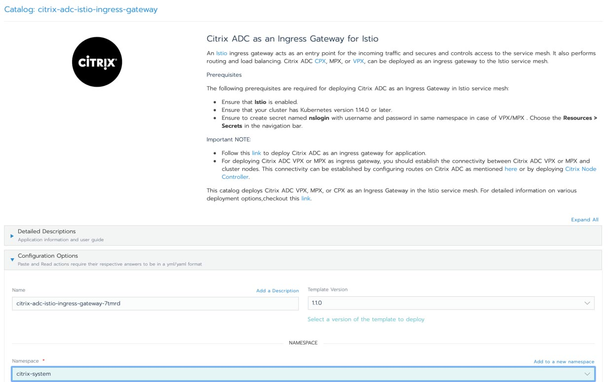
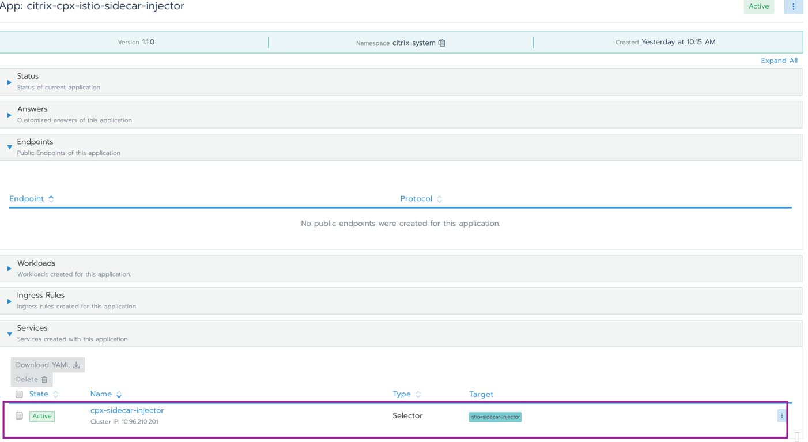

## Introduction

As a network of microservices changes and grows, the interactions between them can be difficult to manage and understand. That’s why it’s handy to have a service mesh as a separate infrastructure layer. A service mesh is an approach to solving microservices at scale. It handles routing and terminating traffic, monitoring and tracing, service delivery and routing, load balancing, circuit breaking and mutual authentication. A service mesh takes these components and makes them part of the underlying infrastructure layer, eliminating the need for developers to write specific code to enable these capabilities.

Istio is an popular open source service mesh that is built into the Rancher Kubernetes management platform. This integration allows developers focus on their business logic and leave the rest to Kubernetes and Istio.

[Citrix ADC](https://www.citrix.com/products/citrix-adc/platforms.html) is a comprehensive application delivery and load balancing solution for monolithic and microservices-based applications. Its advanced traffic management capabilities enhance application performance and provide comprehensive security. Citrix ADC integrates with Istio as an ingress gateway to the service mesh environment and as a sidecar proxy to control inter-microservice communication. This integration allows you to tightly secure and optimize traffic into and within your microservice-based application environment. [Citrix ADC’s Ingress deployment](https://www.citrix.com/blogs/2019/11/13/citrix-adc-as-an-istio-ingress-gateway-part-1-deployment/) is configured as a load balancer for your Kubernetes services. As a sidecar proxy, Citrix ADC handles service-to-service communication and makes this communication reliable, secure, observable and manageable.

In this blog post, we’ll discuss the integration of [Citrix ADC](https://www.citrix.com/en-in/products/citrix-adc/) as an [Istio](https://istio.io/) ingress gateway and sidecar proxy in Istio service mesh deployed on Rancher. We’ll introduce new catalog templates for deploying for Citrix ADC as an ingress gateway and as a sidecar proxy injector.

The [Rancher Apps Catalog](https://rancher.com/docs/rancher/v2.x/en/catalog/) provides a UI platform for DevOps engineers to deploy and run applications with out-of-the-box capabilities like monitoring, auditing and logging. You can find the Citrix Istio ingress gateway and sidecar injector in the Rancher catalog.


Figure 1 Rancher Catalog for Citrix ADC in Istio Service Mesh

## Citrix ADC as an Ingress Gateway for Istio

An [Istio](https://istio.io/) ingress gateway acts as an entry point for incoming traffic and secures and controls access to the service mesh. It also performs routing and load balancing. Citrix ADC [CPX](https://docs.citrix.com/en-us/citrix-adc-cpx), MPX or VPX can be deployed as an ingress gateway to control the ingress traffic to Istio service mesh.

### Citrix ADC MPX or VPX as Ingress Gateway


Figure 2 Citrix ADC VPX/MPX as Ingress Gateway in Rancher Catalog

When Citrix ADC MPX/VPX is deployed as an Ingress Gateway device, the Istio-adaptor container primarily runs inside a pod managed by the Ingress Gateway deployment.

### Citrix ADC CPX as an Istio Ingress Gateway

When Citrix ADC CPX is deployed as Ingress Gateway, both CPX and Istio-adaptor run as containers inside the Ingress Gateway Pod.


Figure 3 Citrix ADC CPX as ingress gateway in Rancher Catalog

### Citrix Istio Adaptor

[Citrix Istio Adaptor](https://github.com/citrix/citrix-istio-adaptor) is open source software written in Go. Its main job is to automatically configure the Citrix ADC deployed in the Istio service mesh. Components such as Istio Pilot, Citadel and Mixer make up the Istio control plane. The pilot is the control plane component that provides service discovery to proxies in the mesh. It’s essentially a [gRPC xDS](https://www.envoyproxy.io/docs/envoy/latest/api-docs/xds_protocol) server and is responsible for configuring proxies at runtime.

Istio-adaptor is a gRPC client to the xDS server and receives xDS resources such as clusters, listeners, routes and endpoints from the xDS server over a secure gRPC channel. After receiving these resources, the Istio-adaptor converts them to the equivalent Citrix ADC configuration blocks and configures the associated Citrix ADC using RESTful [NITRO](https://developer-docs.citrix.com/projects/netscaler-nitro-api/en/12.0/) calls. This [blog](https://www.citrix.com/blogs/2019/11/13/citrix-adc-as-an-istio-ingress-gateway-part-1-deployment/) talks about Citrix Istio Adaptor in detail.

In the next section, we’ll set up Citrix ADC as gateway and sidecar using the Rancher catalog. Ingress Gateway describes a load balancer operating at the edge of the mesh that receives incoming connections. Sidecar proxy is enforced for monitoring, security and resource distribution.

## Rancher Catalog for Citrix ADC as an Istio Ingress Gateway

### Prerequisites

In order to follow these steps, you will need to following:

- A Rancher deployment (check out the [quick start guide](https://rancher.com/quick-start/) to get Rancher up and running)
- A Kubernetes cluster, managed by Rancher (follow [this guide](https://rancher.com/docs/rancher/v2.x/en/cluster-provisioning/) to either import or provision a cluster)
- [Enable Istio](https://rancher.com/docs/rancher/v2.x/en/cluster-admin/tools/istio).
- Ensure that your cluster has Kubernetes version 1.14.0 or later and the admissionregistration.k8s.io/v1beta1 API is enabled.
- Create a Kubernetes secret for the Citrix ADC user name and password. Choose **Resources → Secrets** in the navigation bar.

### Steps:

1. Log in to Rancher.
2. Create a namespace named citrix-system.
3. Go to the cluster, then project and Navigate to App → Launch.
4. Search for citrix in search box.
5. Click on citrix-adc-istio-ingress-gateway catalog.

   

   Figure 4 Citrix ADC as Ingress Gateway for Istio in Rancher Catalog
6. Click on **launch** to deploy the Citrix ADC as ingress gateway.

a. For Citrix ADC CPX: Set the following environment variables with specified values:

i. Citrix ADC CPX – true

ii. ingressGateway EULA – true

iii. istioAdaptor.tag - 1.2.0

b. For Citrix ADC MPX/VPX: Set the following environment variables:

i. istioAdaptor version: 1.2.0

ii. netscalerUrl: Specify Citrix ADC IP in URL format (e.g. https://192.168.1.10)

iii. vServer IP: Specify yet to be used IP Address for Citrix ADC Virtual Server

1. Once you update values of required parameters, click on **launch**. Navigate to **Apps** and verify that **citrix-ingressgateway** is running.

   

   Figure 5 Service citrix-ingressgateway Running in Rancher Catalog

### Points to remember:

- If you want to expose multiple applications:

Set exposeMutipleApps variable to true.

- secretVolumes.name:
- secretVolumes.secretName:
- secretVolumes.mountPath:
- If You want to expose non-HTTP services (such as TCP-based apps):

Set the **exposeNonHttpService** variable to **true**.

- tcpPort.name:
- tcpPort.nodePort: . // applicable in case of Citrix ADC CPX
- tcpPort.Port:
- tcpPort.targetPort:

## Citrix ADC as a Sidecar for Istio

Citrix ADC [CPX](https://docs.citrix.com/en-us/citrix-adc-cpx) can act as a sidecar proxy to an application container in Istio. You can inject the Citrix ADC CPX manually or automatically using the Istio sidecar injector. [Automatic sidecar injection](https://istio.io/latest/docs/setup/additional-setup/sidecar-injection/) requires resources including a Kubernetes mutating webhook admission controller and a service. Using the Rancher catalog, you can create resources required for automatically deploying Citrix ADC CPX as a sidecar proxy.


Figure 6 Citrix ADC CPX as sidecar in Rancher Catalog

## Deploying Citrix ADC as a Sidecar for Istio using Rancher Catalog

### Prerequisites

The following prerequisites are required for deploying Citrix ADC as a sidecar in an application pod

- Ensure that Istio is enabled.
- Ensure that your cluster has Kubernetes version 1.14.0 or later and the admissionregistration.k8s.io/v1beta1 API is enabled.
- Create resources required for automatic sidecar injection by performing the following steps:

1. Download the webhook-create-signed-cert.sh script.

   `curl -L https://raw.githubusercontent.com/citrix/citrix-istio-adaptor/master/deployment/webhook-create-signed-cert.sh > webhook-create-signed-cert.sh`
2. Change permissions of the script to executable mode.

   `chmod +x webhook-create-signed-cert.sh`
3. Create a signed certificate, key pair and store it in a Kubernetes secret.

   ```
   ./webhook-create-signed-cert.sh

   --service cpx-sidecar-injector

   --secret cpx-sidecar-injector-certs

   --namespace citrix-system
   ```

**Important Note:**

**Do not enable** Istio Auto Injection on application namespace.

To automatically deploy Citrix ADC CPX as a sidecar in application pod, the application namespace must be labeled with cpx-injection=enabled.

`Kubectl label namespace <application_namespace> cpx-injection=enabled`

### Steps:

1. Log in to Rancher.
2. Create namespace named citrix-system.
3. Go to the cluster then project and Navigate to **Apps → Launch**.
4. Search for **citrix** into search box.
5. Click on **citrix-cpx-istio-sidecar-injector** catalog.

   

   Figure 7 Citrix ADC CPX as sidecar in Rancher Catalog
6. Set the environment variables:

a. istioAdaptor version: 1.2.0

b. cpxProxy.EULA : YES

1. Update the values of the required parameters, click **Launch**.
2. Navigate to **Apps** and verify that **`cpx-sidecar-injector`** is running.

   

   Figure 8 Service cpx-sidecar-injector Running in Rancher Catalog

## Accessing a Sample Application using Citrix ADC

You can find an example of deploying the sample bookinfo application [here](https://github.com/citrix/citrix-helm-charts/tree/master/examples/citrix-adc-in-istio).

- If Citrix ADC VPX/MPX is deployed as ingress gateway, the service will be accessible via vServer IP. (This detail is mentioned in step 6b of Citrix ADC VPX as ingress gateway deployment).
- If Citrix ADC CPX is deployed as ingress Gateway, then service will be accessible via Ingress IP and Port. Follow this [link](https://github.com/citrix/citrix-helm-charts/tree/master/examples/citrix-adc-in-istio#verification) for more information.

**Important Note:** For deploying Citrix ADC VPX or MPX as an ingress gateway, you should establish the connectivity between Citrix ADC VPX or MPX and cluster nodes. This connectivity can be established by configuring routes on Citrix ADC as mentioned [here](https://github.com/citrix/citrix-k8s-ingress-controller/blob/master/docs/network/staticrouting.md) or by deploying [Citrix Node Controller](https://github.com/citrix/citrix-k8s-node-controller).

Note: All images of the catalog were taken from Rancher version v.2.4.4, which supports Istio version 1.4.10 and Istio-adaptor with version 1.2.0. Learn more about the architecture [here](https://github.com/citrix/citrix-istio-adaptor/blob/master/docs/architecture.md).

## Conclusion

In this article, we have shown you how to configure ingress rules using Citrix ADC Istio ingress gateway and also sidecar proxy using Citrix CPX Istio Sidecar. The gateway allows external traffic to enter the service mesh and manage traffic for edge services. Citrix ADC as sidecar is used in service-to-service communication alongside each service through which all traffic is transparently routed.

Rancher’s catalog of Helm charts makes it easy to deploy and configure applications.

Learn how to run a multi-cluster service mesh in Rancher: watch our master class video.
