Read our free white paper: How to Build a Kubernetes Strategy[Download Now](https://more.suse.com/fy21-global-web-landing-page-how-to-build-enterprise-kubernetes-strategy)

[Citrix Ingress Controller](https://github.com/citrix/citrix-k8s-ingress-controller) is an emerging enterprise-grade ingress controller for load balancing microservices in the Kubernetes environment. It provides advanced load balancing, rewrite/responder policy support, advanced content routing, SSL/TLS support, TCP/UDP protocol support, [Canary deployment support](https://github.com/citrix/citrix-k8s-ingress-controller/blob/master/docs/canary/canary.md) and much more.

In this article, we will discuss different deployment modes for Citrix Ingress Controller and deploy it via the Rancher catalog.

You can deploy Citrix Ingress Controller in the following modes:

1. As a standalone pod. This mode is used when managing Citrix ADC’s flavors, such as MPX or VPX, that are outside the Kubernetes cluster.
2. As a sidecar in a pod along with the Citrix ADC CPX in the same pod. The controller is only responsible for the Citrix ADC CPX that resides in the same pod.

Citrix has partnered with Rancher to collaborate and simplify deploying Citrix Ingress Controller with Rancher catalog. You can find the Citrix Ingress Controller catalog in the default library of the [Rancher catalog](https://rancher.com/docs/rancher/v2.x/en/catalog/).

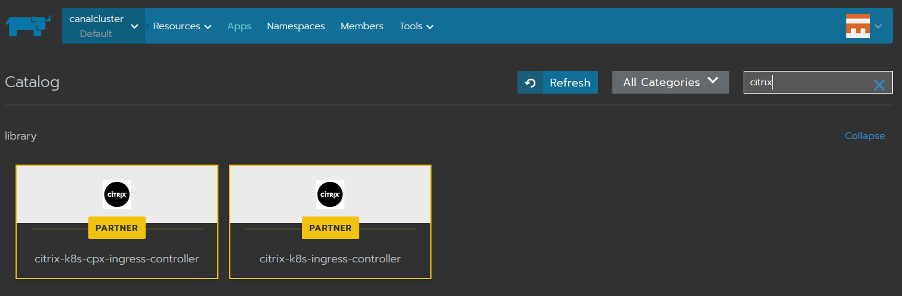
Citrix Ingress Controller charts in the default library of Rancher catalog

## Setting Up Citrix Ingress Controller

### Deploying Citrix Ingress Controller as sidecar

1. Select [citrix-k8s-cpx-ingress-controller](https://github.com/rancher/charts/tree/master/charts/citrix-k8s-cpx-ingress-controller) Rancher catalog for CIC running as sidecar with Citrix ADC CPX. You can customize the Citrix Ingress Controller’s pod-name and pod-namespace.
   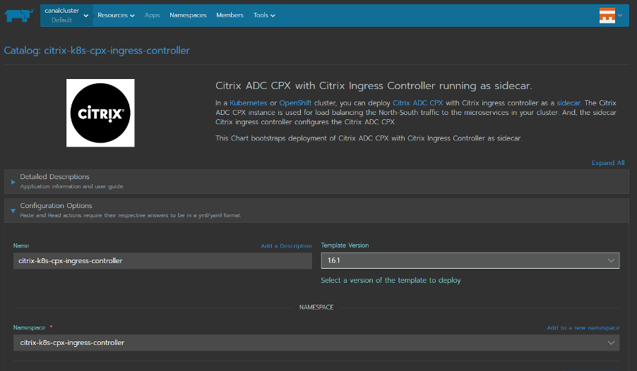
2. Configure the Citrix Ingress Controller settings via the Rancher catalog. These settings are divided into different subsections.

   **Note:** You can find detailed explanation of all the attributes used in these settings [here](https://github.com/rancher/charts/tree/master/charts/citrix-k8s-ingress-controller/v1.7.6#configuration).
3. Deployment Settings contain questions about your Kubernetes deployment. License settings contain questions about [Citrix Application Delivery Management](https://docs.citrix.com/en-us/citrix-application-delivery-management-software/13/licensing.html), which is used as a license server for CPX.

   **Note:** If you don’t provide Citrix Application Delivery Management information during installation, Citrix ADC CPX will come up with the default license.
   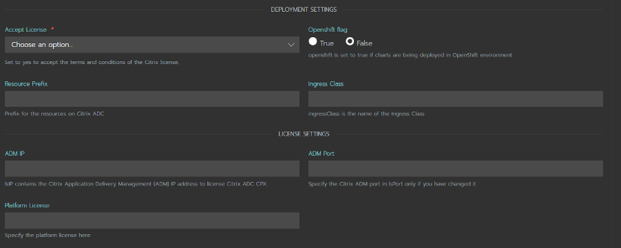
4. ADC Settings provide a default Non-SNI SSL certificate for the Kubernetes application on Citrix ADC. **CIC/CPX Image settings** are related to the default Image and Kubernetes Image Pullpolicy.
   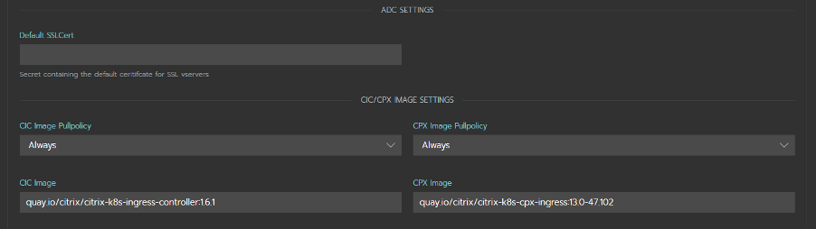
5. Exporter Settings provide information about [citrix-adc-metrics-exporter](https://github.com/citrix/citrix-adc-metrics-exporter). This exports ADC metrics to Prometheus, which can be used graphically via Grafana.
   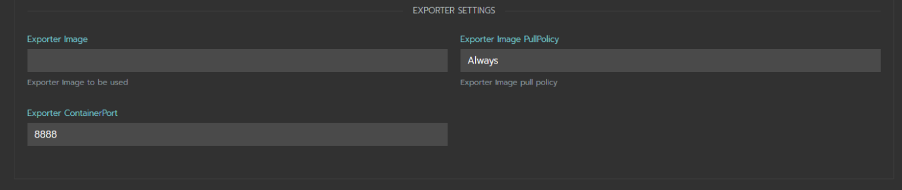
6. Once you provide all the necessary attributes, you can launch the catalog. This will create a single pod with three containers, Citrix ADC, Citrix Ingress Controller and Citrix ADC Metrix Exporter.
   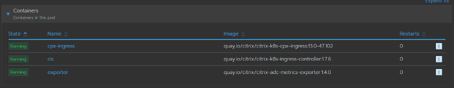

### Deploying Citrix Ingress Controller as standalone pod

1. Select [citrix-k8s-ingress-controller](https://github.com/citrix/citrix-adc-metrics-exporter) Rancher catalog for standalone Citrix Ingress Controller.
   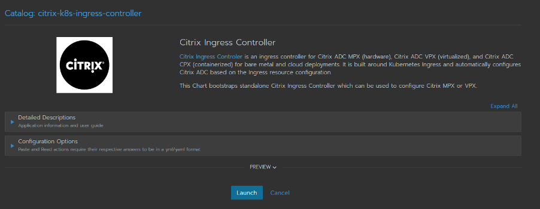
2. The catalog is split into questions similar to the citrix-k8s-cpx-ingress-controller catalog.
3. The Deployment Settings\*\* have a few additional questions compared to the previous catalog.
   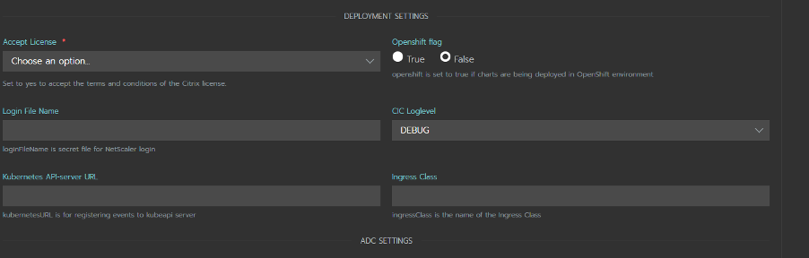
4. Standalone Citrix Ingress Controller is used to configure Citrix ADC, which is outside the Kubernetes cluster. It requires a few more attributes like Citrix ADC IP, Port, Protocol, etc.
   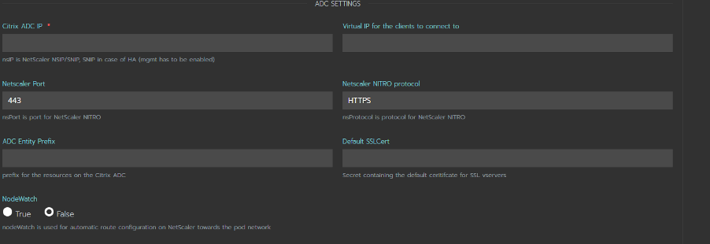
5. Image Settings and Exporter Settings remain the same.
6. Once you launch this catalog, a single pod with Citrix Ingress Controller and Citrix ADC Metric Exporter containers will be up and running.
   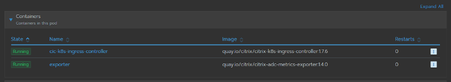

## Deploy a Sample Application from the Rancher UI

Now that we’ve set up Citrix Ingress Controller, we’ll deploy a sample application called guestbook. [Here](https://github.com/citrix/citrix-k8s-ingress-controller/tree/master/example/guestbook) are the Yaml files you’ll need.

1. From the top panel go to Resources > Workloads. Click the **Import YAML** button.
2. Copy-paste the contents from the YAML file of the [sample application](https://raw.githubusercontent.com/citrix/citrix-k8s-ingress-controller/master/example/guestbook/guestbook-all-in-one.yaml) as shown below (or see step 3).
   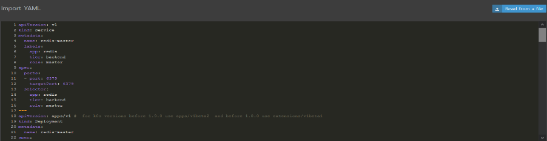
3. Alternatively, you can click on the **Read from a file** button and provide the [sample application link](https://raw.githubusercontent.com/citrix/citrix-k8s-ingress-controller/master/example/guestbook/guestbook-all-in-one.yaml) as File name.
4. [Sample application guestbook](https://raw.githubusercontent.com/citrix/citrix-k8s-ingress-controller/master/example/guestbook/guestbook-all-in-one.yaml) will deploy three services as shown below.
   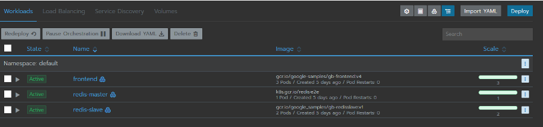
5. We’ll expose the frontend service via the Citrix Ingress Controller.

## Configuring Citrix ADC via Citrix Ingress Controller

### Set up Citrix ADC CPX running as sidecar with Citrix Ingress Controller

1. Create an ingress rule using the [guestbook-ingress.yaml](https://raw.githubusercontent.com/citrix/citrix-k8s-ingress-controller/master/example/guestbook/guestbook-ingress.yaml).
2. Once the ingress rule is applied, Citrix Ingress Controller configures the Citrix ADC CPX.
3. View the Citrix ADC CPX configurations via the shell of the Citrix ADC CPX from Resource > Workloads > cpx-ingress
   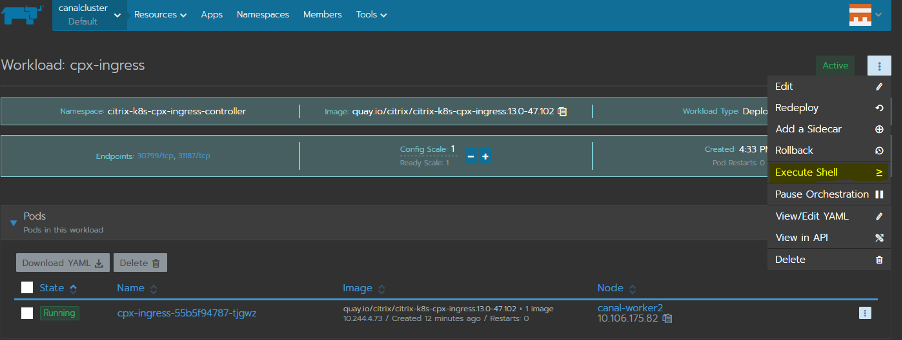
4. Once inside the shell of Citrix ADC CPX, you can view the configuration as shown below.
   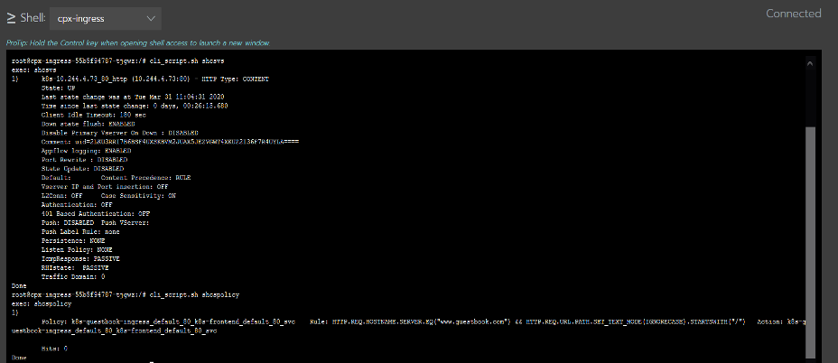

### Set up Citrix ADC VPX/MPX with Citrix Ingress Controller

1. Create an ingress rule using the [guestbook-ingress.yaml](https://raw.githubusercontent.com/citrix/citrix-k8s-ingress-controller/master/example/guestbook/guestbook-ingress.yaml). This time you’ll need a frontend-ip (VIP). It can either be provided via an annotation called ‘ingress.citrix.com/frontend-ip’ in the ingress YAML (more on [annotations](https://github.com/citrix/citrix-k8s-ingress-controller/blob/master/docs/configure/annotations.md)) …
2. or it can be provided when the catalog launches.
   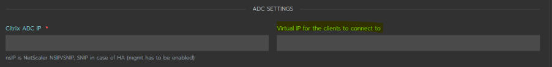
3. Check your configurations by logging into the VPX.

## Steps to Access the application via a Browser

### Accessing the application via Citrix ADC CPX

1. Ingress rule for Citrix ADC CPX looks like the image below.

   ```
   apiVersion: extensions/v1beta1
   kind: Ingress
   metadata:
       name: guestbook-ingress
       annotations:
           kubernetes.io/ingress.class: "citrix"
   spec:
       rules:
       -   host: www.guestbook.com
           http:
               paths:
               -   path: /
                   backend:
                       serviceName: frontend
                       servicePort: 80
   ```
2. To access the application via a browser, you need to send the request to cpx-service.
3. By default, [citrix-k8s-cpx-ingress-controller](https://github.com/rancher/charts/tree/master/charts/citrix-k8s-cpx-ingress-controller) catalog creates the cpx-service as type Nodeport.

   **Note:** You can change the service type to Loadbalancer by editing the service YAML in Rancher UI.
4. DNS mapping of NodeIP to hostname has to be added in the hosts file.

   **Note:** The location of hosts file differs based on the Operating System.
5. Access the sample application via http://www.guestbook.com:.
   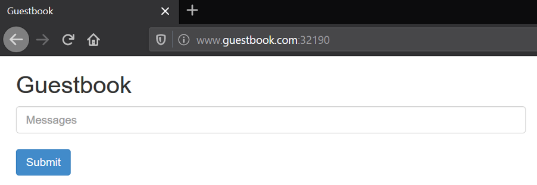

### Accessing the application via Citrix ADC VPX

1. Ingress rule for Citrix ADC VPX looks like the image below.

   ```
   apiVersion: extensions/v1beta1
   kind: Ingress
   metadata:
       name: guestbook-ingress
       annotations:
           kubernetes.io/ingress.class: "citrix"
           ingress.citrix.com/frontend-ip: “198.51.100.10”
   spec:
       rules:
       -   host: www.guestbook.com
           http:
               paths:
               -   path: /
                   backend:
                       serviceName: frontend
                       servicePort: 80
   ```
2. To access the application via the browser, add a DNS mapping of frontend-ip (VIP) to hostname in the hosts file.

   ```
   198.51.100.10 www.guestbook.com
   ```
3. Access the sample application via http://www.guestbook.com:.
   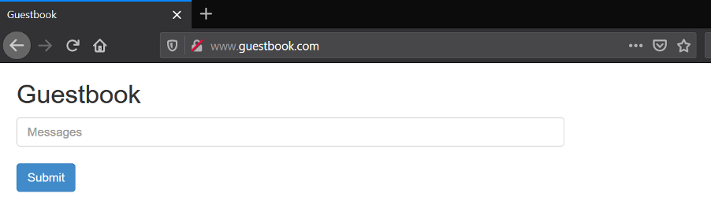

## Conclusion

In this article, we’ve shown you how to configure ingress rules using a simple demo. However, [Citrix Ingress Controller](https://github.com/citrix/citrix-k8s-ingress-controller/tree/master/example/guestbook) is capable of much more. It works seamlessly across multiple different deployment modes and platforms and can be used to configure Citrix API gateway.

Using [citrix-helm-charts](https://github.com/citrix/citrix-helm-charts/) to deploy applications provides a tested, standardized deployment method. With the Rancher catalog UI, Helm charts are even easier to use and configure. With the addition of the [citrix-k8s-ingress-controller](https://github.com/citrix/citrix-k8s-ingress-controller) chart to the Rancher catalog library, you can now access an enterprise-ready load balancer for microservices in a Kubernetes environment.

Read our free white paper: How to Build a Kubernetes Strategy[Download Now](https://more.suse.com/fy21-global-web-landing-page-how-to-build-enterprise-kubernetes-strategy)
