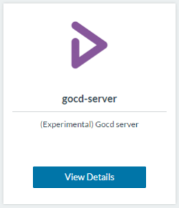

**** *Raul Sanchez is
a microservices and Dev0ps architect in the innovation department at
BBVA, exploring new technologies, bringing them to the company and the
production lifecycle. In his spare time, he is a developer who
collaborates on open source projects. He’s spent more than 20 years
working on GNU/Linux and unix systems in different areas and sectors.*
**Introduction** GoCD is a Java open source continuous delivery system
from [ThoughtWorks](https://www.go.cd/). Its purpose is to help define
and automate pipelines to provide continuous delivery of your software.
The image below from the go.cd website shows the concept of its
functionality.GoCD has basically two different pieces to deploy; the
GoCD server and GoCD agent. The GoCD server provides a user interface
(UI), an API, and a database to define and persist your pipelines. GoCD
agents execute the steps defined in your pipelines, to compile, build
and deploy your app. In this post, I’ll walk through how to deploy GoCD
using Docker on a Rancher environment using the template in the Rancher
Community Catalog. **[](https://cdn.rancher.com/wp-content/uploads/2016/04/06174916/Liebana-gocd-1.png)**

### **Deploying GoCD**

Deploying a GoCD environment from the Rancher catalog, is incredibly
easy. The community catalog template is built for Cattle environments,
and includes two basic components that are deployed as Docker services,
the first is the GoCD server and the other is the GoCD agent, which gets
deployed on one or more hosts. To get started, select the GoCD item it
in the Rancher community catalog, and define the parameter
configurations. Parameter definitions:

- Version: Select the version of GoCD server that you
  want to deploy.
- Name: Name of the rancher stack for GoCD server.
- Initial Memory: Initial memory of the GoCD server java
  process, equivalent to -Xms512m
- Max Memory: Max memory of the GoCD server java
  process, equivalent to -Xmx1024m
- Work Volume: Disk volume to persist GoCD server data.
- Driver Volume: Docker storage driver to use to provide
  work volume. Right now, local or convoy-cluster options are
  available.

**[](https://cdn.rancher.com/wp-content/uploads/2016/04/06174952/Liebana-GoCD-2.png)**
To gain access to the service, you only need to create a public Rancher
load balancer and configure an entry point to the GoCD server service at
port 8153. It’s not necessary but is recommended that the load balancer
would be configured with SSL. **IMPORTANT:** Work volume
(launched as a sidekick) is the disk where you persist all your GoCD
server data. You must ensure a correct backup and availability of this
volume so as not lose data. If you don’t have shared storage between
servers, put a label on them, to ensure that the service runs where the
storage is. To deploy GoCD agents, you have to deploy a GoCD server
first and then select the GoCD agent(s) in the Rancher community catalog
then define the needed parameters and click deploy. **[](https://cdn.rancher.com/wp-content/uploads/2016/04/06175019/Liebana-GoCD-3.png)**
Parameter definitions:

- Version: Select the version of GoCD agent that you
  want to deploy (must be the same version as the GoCD server)
- Name: Name of the Rancher stack for GoCD agent.
- Initial Memory: Initial memory of the GoCD server java
  process, equivalent to -Xms512m
- Max Memory: Max memory of the GoCD server java
  process, equivalent to -Xmx1024m
- GoCD server stack/service: Select the GoCD server
  stack/service running in Rancher.
- GoCD server port: TCP port that GoCD agent uses to
  connect to GoCD server.
- Instances: Number of GoCD agent
  instances that you want to deploy (You could scale that number when
  you need).

Once the GoCD agent is deployed, it connects automatically to the
server. However, you need to enable it. **TIP:** As the
package containers are configured with the “*retain\_ip*” command and
you have preserved its hostname, you can scale up the GoCD agents and
enable them on the server. If you scale down and up again, the agents
remain enabled on the server.

### **Basic Configuration**

This section describes the basic initial configuration, server and,
user management. To obtain more detailed instructions, go to the GoCD
docs at <https://docs.go.cd/current/> **[](https://cdn.rancher.com/wp-content/uploads/2016/04/06175038/Liebana-GoCD-4.png)**
Now, connect to the server config URL:
<https://goserver.rancher.dev/go/admin/config/server>

- Configure, site URL and secure site URL (if you enable SSL).
- Generate a password file on the server
- Open a shell in the server container, an exec the following command:

```
htpasswd -c -s /opt/go-server/work/<passwd_file> <username>
```

- Configure it as password file

**[](https://cdn.rancher.com/wp-content/uploads/2016/04/06175111/Liebana-GoCD-5.png)**
**Using Builders** GoCD agents are responsible for running pipeline
tasks. Because of this, it may be that your agents have dependencies to
install specific software in your pipelines, to compile and build you
app, e.g. Python, Maven, Ruby, etc. To avoid these potential software
dependencies, it’s recommended to use to compile and build your app with
what I call docker-builders. Docker builders aren’t docker images
prepared to ***run your app***. Instead, they are docker images prepared
to ***build your app***. A Docker builder is a docker image that has
installed all the software needed to build your app and provide a method
to get your code and a script to build your code. You need at least one
Docker builder for every programming language that you use. For example,
running “rawmind/alpine-go-builder” in a GoCD agent will build a golang
app:

```
docker run  -t --rm

-v <code-path>:/opr/src/<app>

-e GO_UID=$GO_UID

-e GO_GID=$GO_GID

-e GO_PIPELINE_COUNTER=$GO_PIPELINE_COUNTER

--name=${GO_PIPELINE_NAME}-${GO_PIPELINE_COUNTER}-${GO_STAGE_NAME}

rawmind/alpine-go-builder:<version> ./build.sh"
```

The current Rancher-goagent Docker image only has a git client and
Docker client installed and mounts volumes:
***”/var/run/docker.sock:/var/run/docker.sock.”*** Then, it’s able to
operate the git repos and execute Docker builders. If you don’t like the
builders idea, you have the option to install software in the agents,
fork the rancher-goagent repo and install all the software that you
need. It’s alpine based. You can find the Rancher go-agent at
<https://github.com/rawmind0/rancher-goagent>. To learn more about using
continuous delivery with containers, request your free copy of the
Getting Started with CI/CD with Docker and Rancher e-book.
