There are many different ways to run a Kubernetes cluster, from setting everything up manually to using a lightweight distribution like [K3s](https://k3s.io/). K3s is a Kubernetes distribution built for IoT and edge computing and is excellent for running on low-powered devices like Raspberry Pis. However, you aren’t limited to running it on low-powered hardware; it can be used for anything from a Homelab up to a Production cluster. Installing and configuring multinode clusters can be tedious, though, which is where [Ansible](https://www.ansible.com/) comes in.

Ansible is an IT automation platform that allows you to utilize “playbooks” to manage the state of remote machines. It’s commonly used for managing configurations, deployments, and general automation across fleets of servers.

In this article, you will see how to set up some virtual machines (VMs) and then use Ansible to install and configure a multinode K3s cluster on these VMs.

## What exactly is Ansible?

Essentially, Ansible allows you to configure tasks that tell it what the system’s desired state should be; then Ansible will leverage [modules](https://docs.ansible.com/ansible/latest/plugins/module.html) that tell it how to shift the system toward that desired state. For example, the following instruction uses the **ansible.builtin.file** module to tell Ansible that `/etc/some_directory` should be a directory:

```
- name: Create a directory if it does not exist
  ansible.builtin.file:
    path: /etc/some_directory
    state: directory
    mode: '0755'
```

If this is already the system’s state (i.e., the directory exists), this task is skipped. If the system’s state does not match this described state, the module contains logic that allows Ansible to rectify this difference (in this case, by creating the directory).

Another key benefit of Ansible is that it carries out all of these operations via the Secure Shell Protocol (SSH), meaning you don’t need to install agent software on the remote targets. The only special software required is Ansible, running on one central device that manipulates the remote targets. If you wish to learn more about Ansible, the [official documentation](https://docs.ansible.com/ansible/latest/user_guide/playbooks_intro.html) is quite extensive.

## Deploying a K3s cluster with Ansible

Let’s get started with the tutorial! Before we jump in, there are a few prerequisites you’ll need to install or set up:

- A hypervisor—software used to run VMs. If you do not have a preferred hypervisor, the following are solid choices:
  - [Hyper-V](https://docs.microsoft.com/en-us/virtualization/hyper-v-on-windows/quick-start/enable-hyper-v) is included in some Windows 10 and 11 installations and offers a great user experience.
  - [VirtualBox](https://www.virtualbox.org/wiki/Downloads) is a good basic cross-platform choice.
  - [Proxmox VE](https://www.proxmox.com/en/proxmox-ve) is an open source data center-grade virtualization platform.
- [Ansible](https://docs.ansible.com/ansible/latest/installation_guide/index.html) is an automation platform from Red Hat and the tool you will use to automate the K3s deployment.
- A text editor of choice
  - [VS Code](https://code.visualstudio.com/) is a good option if you don’t already have a preference.

### Deploying node VMs

To truly appreciate the power of Ansible, it is best to see it in action with multiple nodes. You will need to create some virtual machines (VMs) running Ubuntu Server to do this. You can get the Ubuntu Server 20.04 ISO [from the official site](https://ubuntu.com/download/server). If you are unsure which option is best for you, pick option 2 for a manual download.

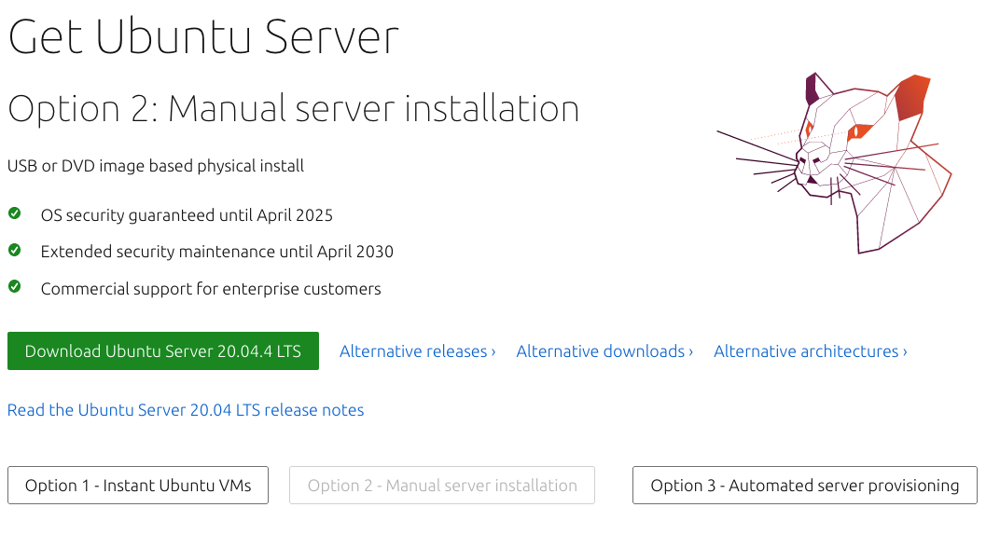

You will be able to use this ISO for all of your node VMs. Once the download is complete, provision some VMs using your hypervisor of choice. You will need at least two or three to get the full effect. The primary goal of using multiple VMs is to see how you can deploy different configurations to machines depending on the role you intend for them to fill. To this end, one “primary” node and one or two “replica” nodes will be more than adequate.

If you are not familiar with hypervisors and how to deploy VMs, know that the process varies from tool to tool, but the overall workflow is often quite similar. Below you can find some official resources for the popular hypervisors mentioned above:

- [Installing a new VM with VirtualBox](https://docs.oracle.com/cd/E26217_01/E26796/html/qs-create-vm.html)
- [Installing a new VM with Hyper-V](https://docs.microsoft.com/en-us/virtualization/hyper-v-on-windows/quick-start/quick-create-virtual-machine)
- [Creating a new VM with Proxmox](https://support.us.ovhcloud.com/hc/en-us/articles/360010916620-How-to-Create-a-VM-in-Proxmox-VE)

In terms of resource allocation for each VM, it will vary depending on the resources you have available on your host machine. Generally, for an exercise like this, the following specifications will be adequate:

- CPU: one or two cores
- RAM: 1GB or 2GB
- HDD: 10GB

This tutorial will show you the VM creation process using VirtualBox since it is free and cross-platform. However, feel free to use whichever hypervisor you are most comfortable with—once the VMs are set up and online, the choice of hypervisor does not matter any further.

After installing VirtualBox, you’ll be presented with a welcome screen. To create a new VM, click **New** in the top right of the toolbar:

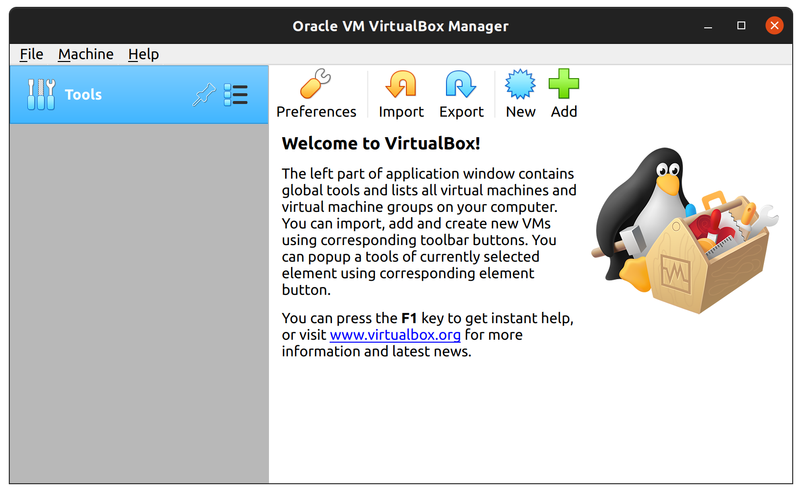

Doing so will open a new window that will prompt you to start the VM creation process by naming your VM. Name the first VM “k3s-primary”, and set its **type** as **Linux** and its **version** as **Ubuntu (64-bit)**. Next, you will be prompted to allocate memory to the VM. Bear in mind that you will need to run two or three VMs, so the amount you can give will largely depend on your host machine’s specifications. If you can afford to allocate 1GB or 2GB of RAM per VM, that will be sufficient.

After you allocate memory, VirtualBox will prompt you to configure the virtual hard disk. You can generally click **next** and **continue** through each of these screens, leaving the defaults as they are. You may wish to change the size of the virtual hard disk. A memory of 10GB should be enough—if VirtualBox tries to allocate more than this, you can safely reduce it to 10GB. Once you have navigated through all of these steps and created your VM, select your new VM from the list and click on **Settings**. Navigate to the **Network** tab and change the **Attached to** value to **Bridged Adapter**. Doing this ensures that your VM will have internet access and be accessible on your local network, which is important for Ansible to work correctly. After changing this setting, click **OK** to save it.

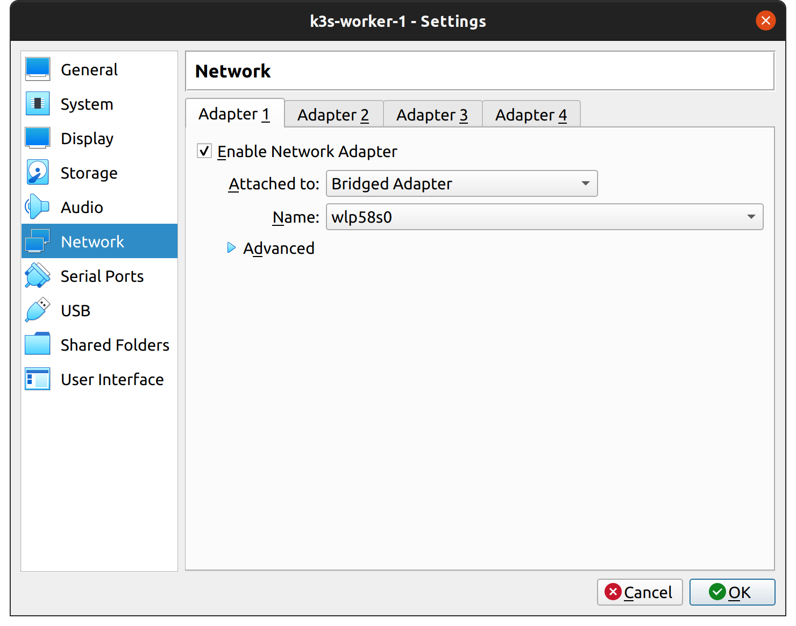

Once you are back on the main screen, select your VM and click **Start**. You will be prompted to select a **start-up disk**. Click on the folder icon next to the **Empty** selection:

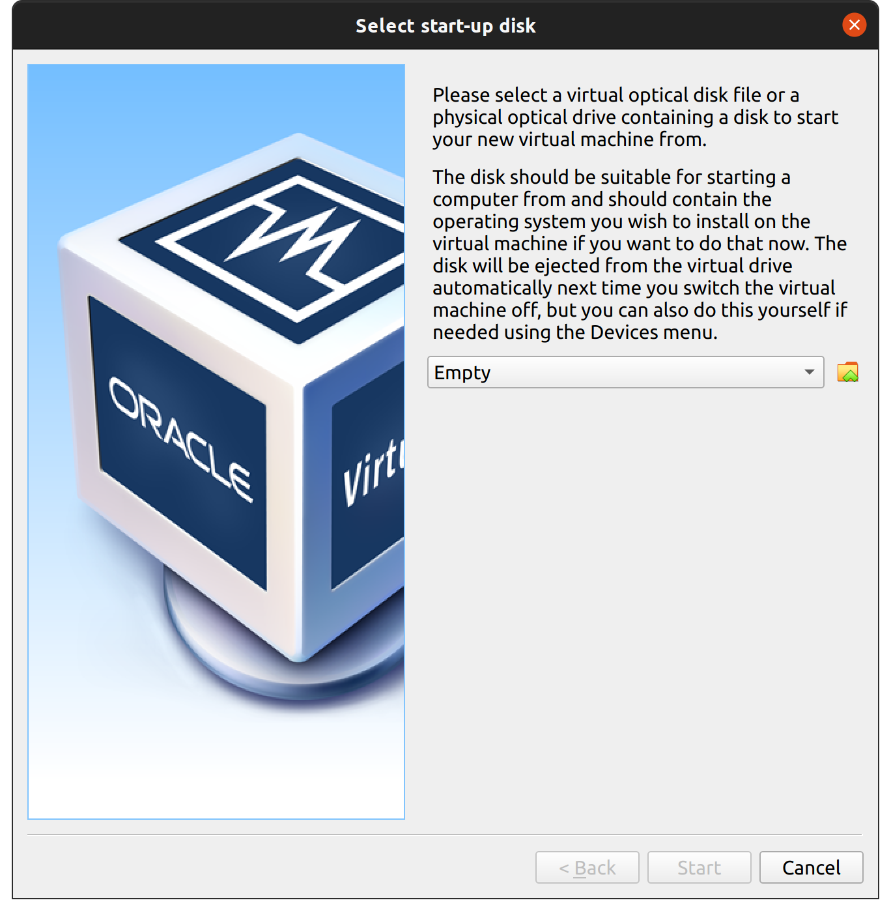

This will take you to the **Optical Disk Selector**. Click **Add**, and then navigate to the Ubuntu ISO file you downloaded and select it. Once it is selected, click **Choose** to confirm it:

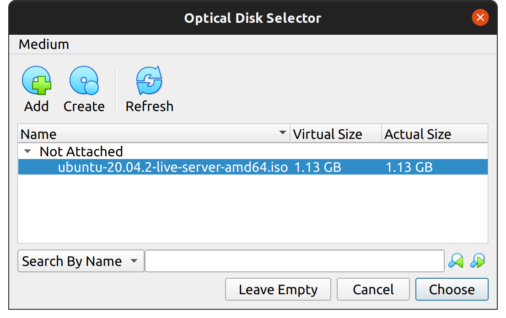

Next, click **Start** on the **start-up disk** dialog, and the VM should boot, taking you into the Ubuntu installation process. This process is relatively straightforward, and you can accept the defaults for most things. When you reach the **Profile setup** screen, make sure you do the following:

- Give all the servers the same username, such as “ubuntu”, and the same password. This is important to make sure the Ansible playbook runs smoothly later.
- Make sure that each server has a different name. If more than one machine has the same name, it will cause problems later. Suggested names are as follows:
  - k3s-primary
  - k3s-replica-1
  - k3s-replica-2

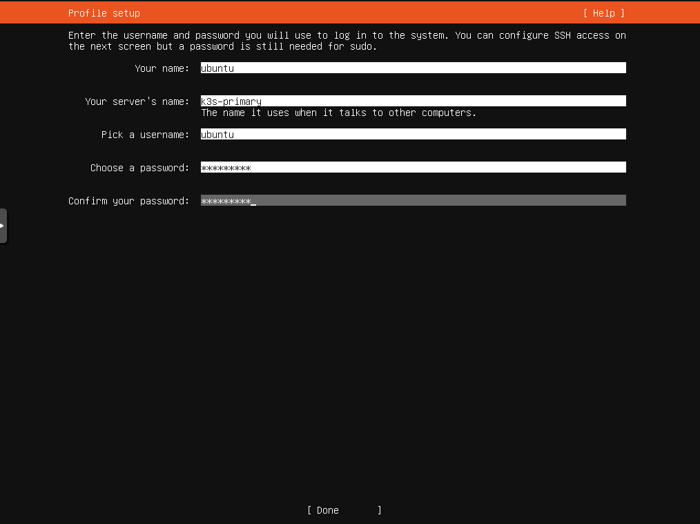

The next screen is also important. The Ubuntu Server installation process lets you import SSH public keys from a GitHub profile, allowing you to connect via SSH to your newly created VM with your existing SSH key. To take advantage of this, make sure you add an SSH key to GitHub before completing this step. You can find instructions for doing so [here](https://docs.github.com/en/authentication/connecting-to-github-with-ssh/adding-a-new-ssh-key-to-your-github-account). This is highly recommended, as although Ansible *can* connect to your VMs via SSH using a password, doing so requires extra configuration not covered in this tutorial. It is also generally good to use SSH keys rather than passwords for security reasons.

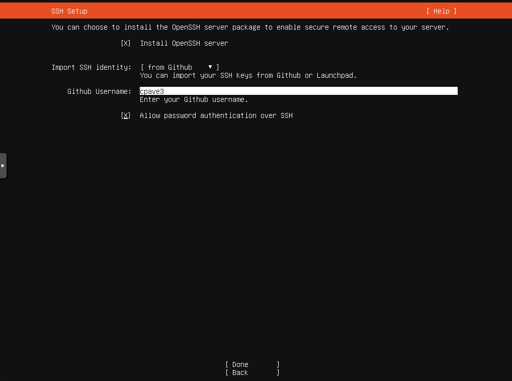

After this, there are a few more screens, and then the installer will finally download some updates before prompting you to reboot. Once you reboot your VM, it can be considered ready for the next part of the tutorial.

However, note that you now need to repeat these steps one or two more times to create your replica nodes. Repeat the steps above to create these VMs and install Ubuntu Server on them.

Once you have all of your VMs created and set up, you can start automating your K3s installation with Ansible.

### Installing K3s with Ansible

The easiest way to get started with K3s and Ansible is with the [official playbook](https://github.com/k3s-io/k3s-ansible) created by the K3s.io team. To begin, open your terminal and make a new directory to work in. Next, run the following command to clone the `k3s-ansible` playbook:

```
git clone https://github.com/k3s-io/k3s-ansible
```

This will create a new directory named `k3s-ansible` that will, in turn, contain some other files and directories. One of these directories is the `inventory/` directory, which contains a sample that you can clone and modify to let Ansible know about your VMs. To do this, run the following command from within the `k3s-ansible/` directory:

```
cp -R inventory/sample inventory/my-cluster
```

Next, you will need to edit **inventory/my-cluster/hosts.ini** to reflect the details of your node VMs correctly. Open this file and edit it so that the contents are as follows (where placeholders surrounded by angled brackets `<>` need to be substituted for an appropriate value):

```
[master]
<k3s-primary ip address>

[node]
<k3s-replica-1 ip address>
<k3s-replica-2 ip address (if you made this VM)>

[k3s_cluster:children]
master
node
```

You will also need to edit **inventory/my-cluster/group\_vars/all.yml**. Specifically, the `ansible_user` value needs to be updated to reflect the username you set up for your VMs previously (`ubuntu`, if you are following along with the tutorial). After this change, the file should look something like this:

```
---
k3s_version: v1.22.3+k3s1
ansible_user: ubuntu
systemd_dir: /etc/systemd/system
master_ip: "{{ hostvars[groups['master'][0]]['ansible_host'] | default(groups['master'][0]) }}"
extra_server_args: ''
extra_agent_args: ''
```

Now you are almost ready to run the playbook, but there is one more thing to be aware of. Ubuntu asked if you wanted to import SSH keys from GitHub during the VM installation process. If you did this, you should be able to SSH into the node VMs using the SSH key present on the device you are working on. Still, it is likely that each time you do so, you will be prompted for your SSH key passphrase, which can be pretty disruptive while running a playbook against multiple remote machines. To see this in action, run the following command:

```
ssh ubuntu@<k3s-primary ip address>
```

You will likely get a message like `Enter passphrase for key '/Users/<username>/.ssh/id_rsa':`, which will occur every time you use this key, including when running Ansible. To avoid this prompt, you can run `ssh-add`, which will ask you for your password and add this identity to your authentication agent. This means that Ansible won’t need to prompt you for your password multiple times. If you are not comfortable leaving this identity in the authentication agent, you can run `ssh-add -D` after you are done with the tutorial to remove it again.

Once you have added your SSH key’s passphrase, you can run the following command from the `k3s-ansible/` directory to run the playbook:

```
ansible-playbook site.yml -i inventory/my-cluster/hosts.ini -K
```

Note that the `-K` flag here will cause Ansible to prompt you for the `become password`, which is the password of the `ubuntu` user on the VM. This will be used so that Ansible can execute commands as sudo when needed.

After running the above command, Ansible will now play through the tasks it needs to run to set up your cluster. When it is done, you should see some output like this:

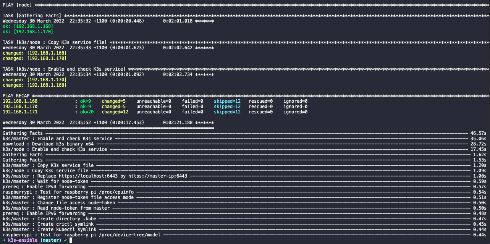

If you see this output, you should be able to SSH into your `k3s-primary` VM and verify that the nodes are correctly registered. To do this, first run `ssh ubuntu@<k3s-primary ip address>`. Then, once you are connected, run the following commands:

```
sudo kubectl version
```

This should show you the version of both the kubectl client and the underlying Kubernetes server. If you see these version numbers, it is a good sign, as it shows that the client can communicate with the API:

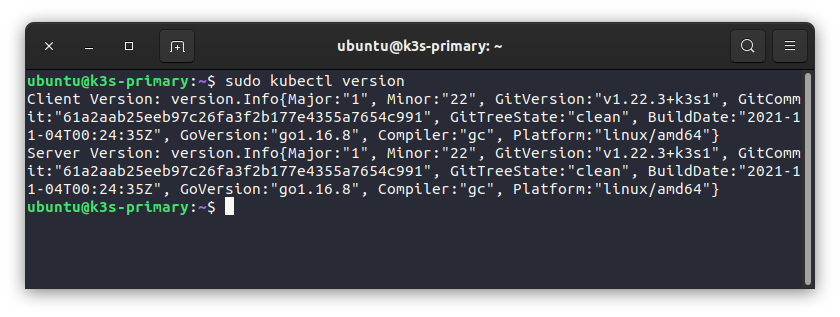

Next, run the following command to see all the nodes in your cluster:

```
sudo kubectl get nodes
```

If all is well, you should see all of your VMs represented in this output:

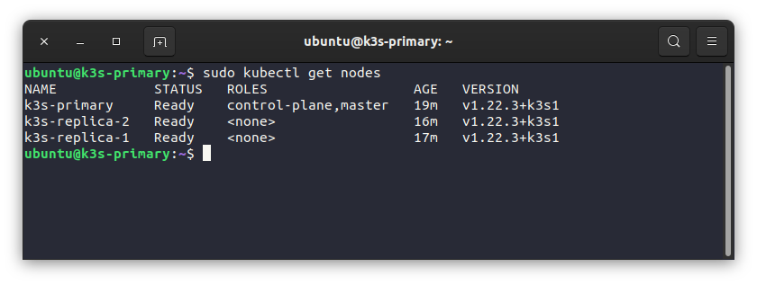

Finally, to run a simple workload on your new cluster, you can run the following command:

```
sudo kubectl apply -f https://raw.githubusercontent.com/kubernetes/website/main/content/en/examples/pods/simple-pod.yaml
```

This will create a new simple pod on your cluster. You can then inspect this newly created pod to see which node it is running on, like so:

```
sudo kubectl get pods -o wide
```

Specifying the output format with `-o wide` ensures that you will see some additional information, such as which node it is running on:

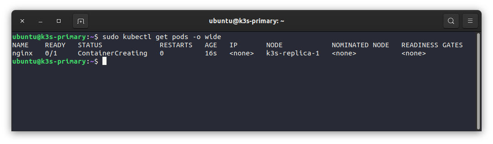

You may have noticed that the `kubectl` commands above are prefixed with `sudo`. This isn’t usually necessary, but when following the K3s.io installation instructions, you can often run into a scenario where sudo is required. If you prefer to avoid using sudo to run your `kubectl` commands, [there is a good resource here](https://0to1.nl/post/k3s-kubectl-permission/) on how to get around this issue.

## In summary

In this tutorial, you’ve seen how to set up multiple virtual machines and then configure them into a single Kubernetes cluster using K3s and Ansible via the official K3s.io playbook. Ansible is a powerful IT automation tool that can save you a lot of time when it comes to provisioning and setting up infrastructure, and K3s is the perfect use case to demonstrate this, as manually configuring a multinode cluster can be pretty time-consuming. K3s is just one of the offerings from the team at [SUSE](https://www.suse.com/), who specialize in business-critical Linux applications, enterprise container management, and solutions for edge computing.

### Get started with K3s

[Take K3s for a spin!](https://k3s.io/)
