A Detailed Overview of Rancher's ArchitectureThis newly-updated, in-depth guidebook provides a detailed overview of the features and functionality of the new Rancher: an open-source enterprise Kubernetes platform.[Get the eBook](https://more.suse.com/fy21-global-web-landing-page-rancher2-technical-architecture)

## A step-by-step guide

Rancher is now available for easy deployment from the [Amazon Web
Services (AWS)
Marketplace](https://aws.amazon.com/marketplace/pp/B072PSBJB2?ref=vdr_rf).
While Rancher has always been easy to install, availability in the
marketplace makes installing Rancher faster and easier than ever. In
the article below, I provide a step-by-step guide to deploying a working
Rancher environment on AWS. The process involves two distinct parts:

- In **part I** I step through the process of installing a Rancher
  management node from the AWS Marketplace
- In \*\*part II \*\*I deploy a Kubernetes cluster in AWS using the
  Rancher management node deployed in part I

From my own experience, it is often small details missed that can lead
to trouble. In this guide I attempt to point out some potential pitfalls
to help ensure a smooth installation.

## Before you get started

If you’re a regular AWS user you’ll find this process straightforward.
Before you get started you’ll need:

- **An Amazon EC2 account** – If you don’t already have an account,
  you can visit AWS EC2 (<https://aws.amazon.com/ec2/>) and select
  **Get started with Amazon EC2** and follow the process there to
  create a new account.
- **An AWS Keypair** – If you’re not familiar with Key Pairs, you can
  save yourself a little grief by familiarizing yourself with the
  topic. You’ll need a Key Pair to connect via ssh to the machine you
  create on AWS. Although most users will probably never have a need
  to ssh to the management host, the installation process still
  requires that a Key Pair exist. From within the *Network & Security*
  heading in your AWS account select Key Pairs. You can create a Key
  Pair, give it a name, and the AWS console will download a *PEM file*
  (a ASCII vase64 X.509 certificate) that you should keep on your
  local machine. This will hold the RSA Private Key that you’ll need
  to access the machine via *ssh* or *scp*. It’s important that you
  save the key file, because if you lose it, it can’t be replaced and
  you’ll need to create a new one. The marketplace installation
  process for Rancher will assume you already have a Key Pair file.
  You can more read about Key Pairs in the [AWS on-line
  documentation](https://docs.aws.amazon.com/AWSEC2/latest/UserGuide/ec2-key-pairs.html?icmpid=docs_ec2_console).
- **Setup AWS Identity and Access Management** – If you’re new to
  AWS, this will seem a little tedious, but you’ll want to create an
  IAM users account at some point through the AWS console. You don’t
  need to do this to install Rancher from the AWS Marketplace, but
  you’ll need these credentials to use the Cloud Installer to add
  extra hosts to your Rancher cluster as described in part II of this
  article. You can follow the [instructions to Create your Identity
  and Access Management
  Credentials](http://docs.aws.amazon.com/IAM/latest/UserGuide/id_users_create.html#id_users_create_console).

With these setup items out of the way, we’re ready to get started.

### Part I - Installing Rancher from the AWS Marketplace

## Step 1: Select a Rancher offering from the marketplace

There are three different offerings in the Marketplace as shown below.

- [**Rancher on
  RancherOS**](https://aws.amazon.com/marketplace/pp/B072PSBJB2?ref=vdr_rf)
  – This is the option we’ll use in this example. This is a single
  container implementation of the Rancher environment running on
  RancherOS, a lightweight Linux optimized for container environments
- [**RancherOS –
  HVM**](https://aws.amazon.com/marketplace/pp/B01AB05EEA?ref=vdr_rf)–
  This marketplace offering installs the RancherOS micro Linux
  distribution only without the Rancher environment. You might use
  this as the basis to package your own containerized application on
  RancherOS. HVM refers to the type of Linux AMI used – you can
  learn more about [Linux AMI Virtualization Types
  here](http://docs.aws.amazon.com/AWSEC2/latest/UserGuide/virtualization_types.html).
- [**RancherOS – HVM – ECS
  Enabled**](https://aws.amazon.com/marketplace/pp/B01AB05BFW?ref=vdr_rf)
  – This marketplace offering is a variant of the RancherOS offering
  above intended for use with Amazon’s [EC2 Container Service
  (ECS)](https://aws.amazon.com/blogs/aws/cloud-container-management/).

We’ll select the first option – Rancher on RancherOS:
\*\* [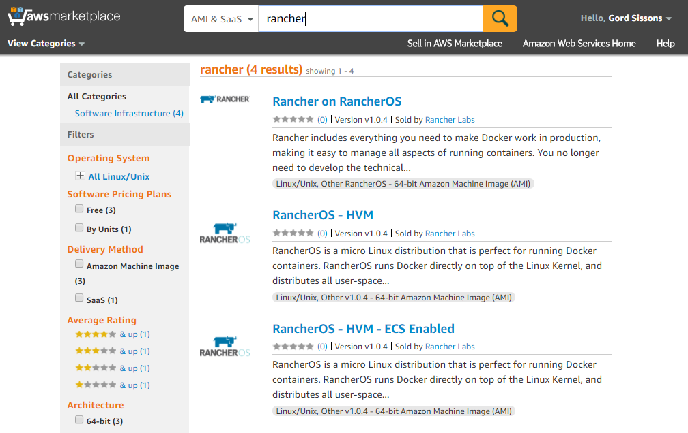](images/rancher_blog_2_AWS_Marketplace_updated.png)\*\*
After you select Rancher on RancherOS you’ll see additional
informational including pricing details. There is no charge for the use
of the software itself, but you’ll be charged for machine hours and
other fees like EBS magnetic volumes and data transfer at standard AWS
rates. Press **Continue** once you’ve reviewed the details and the
pricing.
[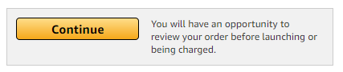](images/rancher_blog_3-Continue.png)
\*\* \*\* **Step2: Select an installation type and provide installation
details** The next step is to select an installation method and provide
required settings that AWS will need to provision your machine running
Rancher. There are three installation types:

1. **Click Launch** – this is the fastest and easiest approach. Our
   example below assumes this method of installation.
2. **Manual Launch** – this installation method will guide you through
   the process of installing Rancher OS using the EC2 Console, API
   or CLI.
3. **Service Catalog** – you can also copy versions of Rancher on
   RancherOS to a Service Catalog specific to a region and assign users
   and roles. You can learn more about AWS Service Catalogs
   [here](https://aws.amazon.com/documentation/servicecatalog/).

Select **Click Launch** and provides installation options as shown:
[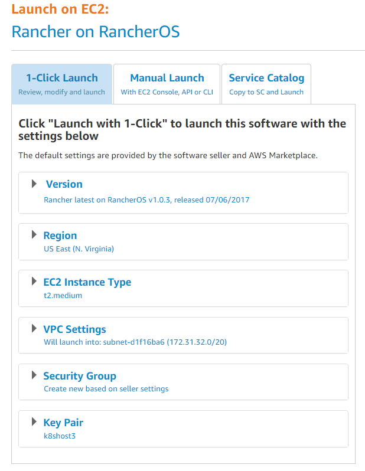](images/rancher_blog_4-Launch-on-EC2.png)

- **Version** – select a version of Rancher to install. By default
  the latest is selected.
- **Region** – select the AWS region where you will deploy the
  software. You’ll want to make a note of this because the AWS EC2
  dashboard segments machines by Region (pull-down at the top right of
  the AWS EC2 dashboard). You will need to have the correct region
  selected to see your machines. Also, as you add additional Rancher
  hosts, you’ll want to install them in the same Region, Availability
  Group and Subnet as the management host.
- **EC2 Instance Type** - t2.medium is the default (a machine with 4GB
  of RAM and 2 virtual cores). This is inexpensive and OK for
  testing, but you’ll want to use larger machines to actually run
  workloads.
- **VPC Settings (Virtual Private Cloud)** – You can specify a
  virtual private cloud and subnet or create your own. Accept the
  default here unless you have reason to select a particular cloud.
- **Security Group** – If you have an appropriate Security Group
  already setup in the AWS console you can specify it here. Otherwise
  the installer will create one for you that ensures needed ports are
  open including port 22 (to allow ssh access to the host) and port
  8080 (where the Rancher UI will be exposed).
- **Key Pair** – As mentioned at the outset, select a previously
  created Key Pair for which you’ve already saved the private key (the
  X.509 PEM file). You will need this file in case you need to connect
  to your provisioned VM using ssh or scp. To connect using ssh you
  would use a command like this: *ssh -i key-pair-name.pem
  <public-ip-address>*

When you’ve entered these values select “**Launch with 1-click**“

Once you launch Rancher,you’ll see the screen below confirming details
of your installation. You’ll receive an e-mail as well. This will
provide you with convenient links to:

- **Your EC2 console** – that you can visit anytime by visiting
  <http://aws.amazon.com/ec2>
- **Your Software page**, that provides information about your various
  AWS Marketplace subscriptions

[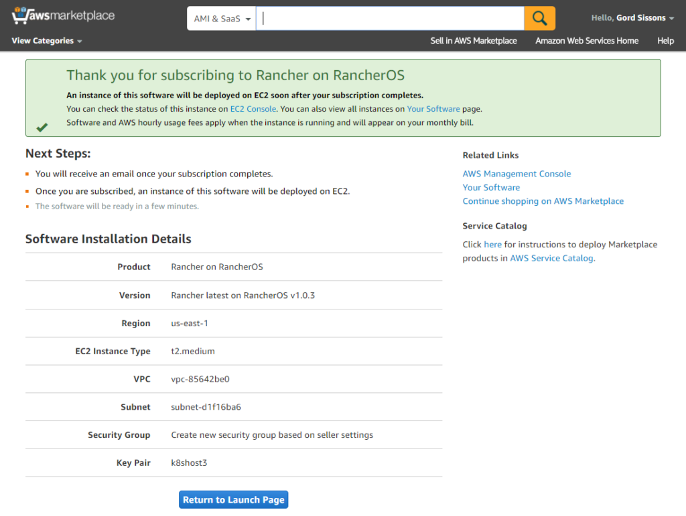](https://cdn.rancher.com/wp-content/uploads/2017/08/10121516/6-thank-you-for-subsbscribing.png)

## Step 3: Watch as the machine is provisioned

From this point on, Rancher should install by itself. You can monitor
progress by visiting the AWS EC2 Console. Visit
<http://aws.amazon.com>, login with your AWS credentials, and select EC2
under AWS services. You should see the new AWS *t2.medium* machine
instance initializing as shown below. Note the pull-down in the top
right of “North Virginia”. This provides us with visibility to machines
in the US East region selected in the previous step.
[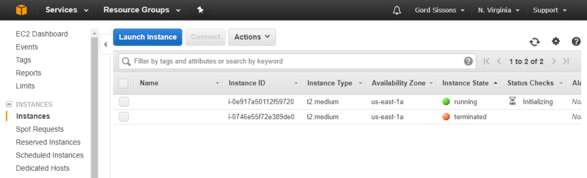](https://cdn.rancher.com/wp-content/uploads/2017/08/10121603/7-what-as-machine-provisioned.png)

## Step 4: Connect to the Rancher UI

The Rancher machine will take a few minutes to provision, but once
complete, you should be able to connect to the external IP address for
the host (shown in the EC2 console above) on port 8080. Your IP address
will be different but in our case the Public IP address was
54.174.92.13, so we pointed a browser to the URL
<http://54.174.92.13:8080>. It may take a few minutes for Rancher UI to
become available but you should see the screen below.
[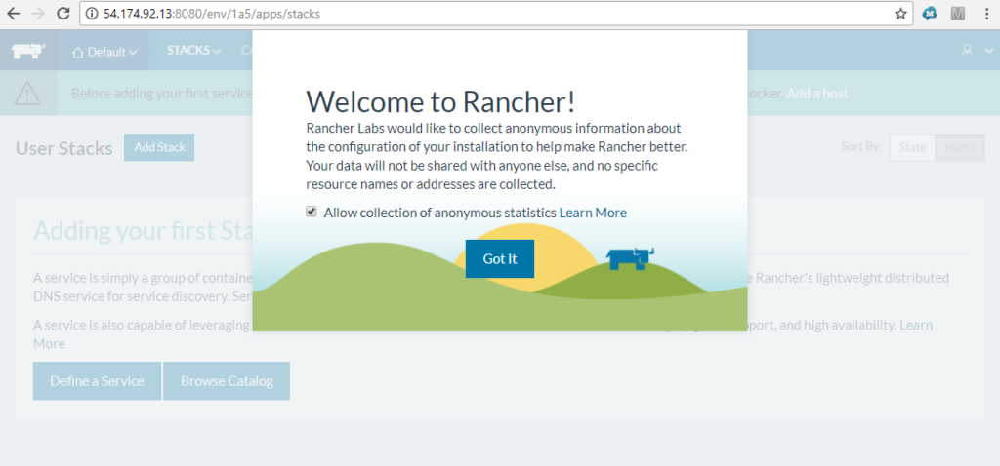](https://cdn.rancher.com/wp-content/uploads/2017/08/10121652/8-welcome-to-Rancher.png)
**Congratulations! If you’ve gotten this far you’ve successfully
deployed Rancher in the AWS cloud!** \*\* \*\*

### Part II – Deploying a Container Environment using Rancher

Having the Rancher UI up and running is nice, but there’s not a lot you
can do with Rancher until you have cluster nodes up and running. In
this section I’ll look at how to deploy a Kubernetes cluster using the
Rancher management node that I deployed from the marketplace in Part I.

## Step 1 – Setting up Access Control

You’ll notice when the Rancher UI is first provisioned, there is no
access control. This means that anyone can connect to the web
interface. You’ll be prompted with a warning indicating that you should
setup Authentication before proceeding. Select **Access Control** under
the ADMIN menu in the Rancher UI. Rancher exposes multiple
authentication options as shown including the use of external Access
Control providers. DevOps teams will often store their projects in a
GitHub repository, so using GitHub for authentication is a popular
choice. We’ll use GitHub in this example. For details on using other
Access Control methods, you can consult the [Rancher
Documentation](https://rancher.com/docs/rancher/v1.6/en/configuration/access-control/).
[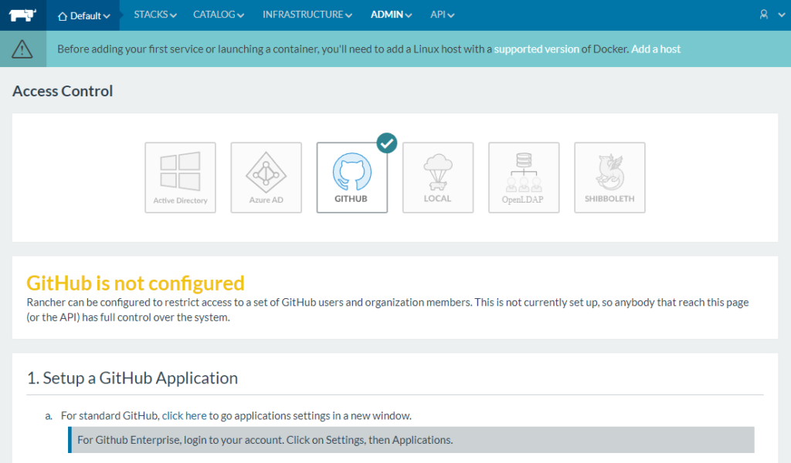](https://cdn.rancher.com/wp-content/uploads/2017/08/10121820/9-GitHub-not-configured.png)
GitHub users should follow the directions, and click on the link
provided in the Rancher UI to setup an OAuth application in GitHub.
You’ll be prompted to provide your GitHub credentials. Once logged into
GitHub, you should see a screen listing any OAuth applications and
inviting you to **Register a new application.** We’re going to setup
**Rancher** for Authentication with Git Hub.
[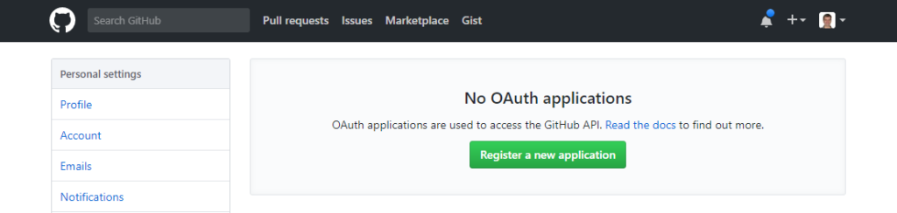](https://cdn.rancher.com/wp-content/uploads/2017/08/10121857/10.-No-Oauth-applications.png)
Click the **Register a new application** button in Git Hub, and
provide details about your Rancher installation on AWS. You’ll need the
Public IP address or fully qualified host name for your Rancher
management host.
[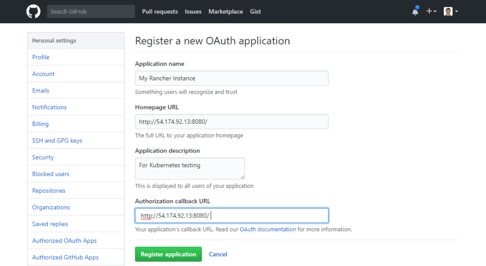](https://cdn.rancher.com/wp-content/uploads/2017/08/10121930/11.-Register-new-Oauth-application.png)
Once you’ve supplied details about the Rancher application to Git Hub
and clicked **Register application**, Git Hub will provide you with a
**Client ID** and a **Client Secret** for the Rancher application as
shown below.
[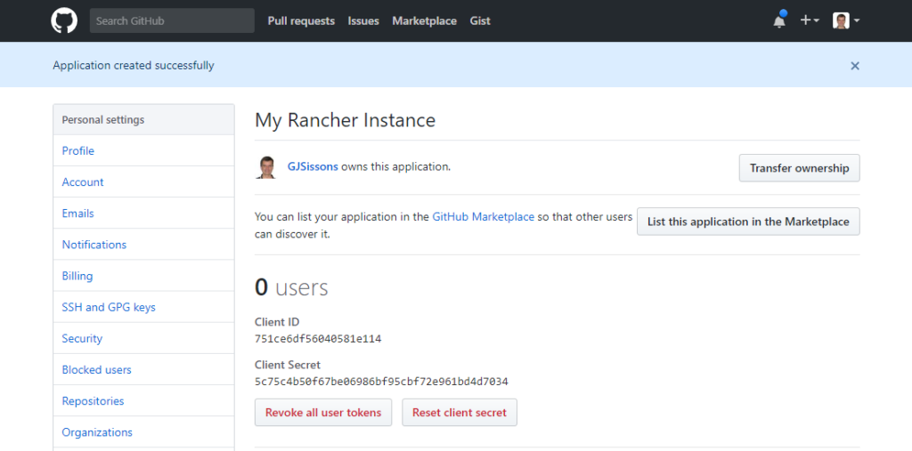](https://cdn.rancher.com/wp-content/uploads/2017/08/10122010/12.-My-Rancher-instance..png)
Copy and paste the Client ID and the Client Secret that appears in Git
Hub into the Rancher Access Control setup screen, and save these values.
[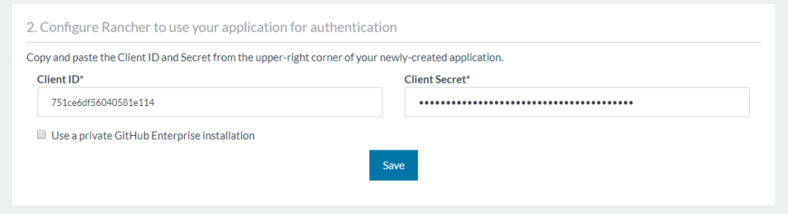](https://cdn.rancher.com/wp-content/uploads/2017/08/10122045/13.-Configure-Rancher.png)
Once these values are saved, click Authorize to allow Git Hub
authentication to be used with your Rancher instance.

If you’ve completed these steps successfully, you should see a message
that Git Hub authentication has been setup. You can invite additional
Git Hub users or organizations to access your Rancher instance as shown
below.
[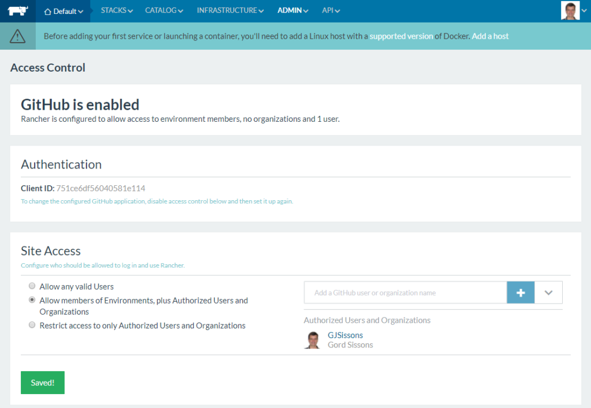](https://cdn.rancher.com/wp-content/uploads/2017/08/10122203/15-Access-control.png)

## Step 2 – Add a new Rancher environment

When Rancher is deployed, there is a single **Default** environment that
uses Rancher’s native orchestration engine called **Cattle**. Since
we’re going to install a Rancher managed Kubernetes cluster, we’ll need
to add a new environment for Kubernetes. Under the environment selection
menu on the left labelled **Default**, select **Add Environment.**
Provide a name and description for the environment as shown, and select
Kubernetes as the environment template. Selecting the Kubernetes
framework means that Kubernetes will be used for Orchestration, and
additional Rancher frameworks will be used including Network Services,
Healthcheck Services and Rancher IPsec as the software-defined network
environment in Kubernetes.
[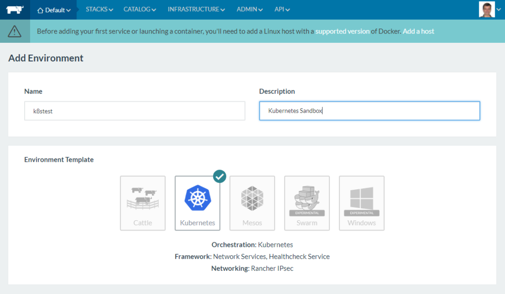](https://cdn.rancher.com/wp-content/uploads/2017/08/10122256/16-Add-environment.png)
Once you add the new environment, Rancher will immediately begin trying
to setup a Kubernetes environment. Before Rancher can proceed however a
Docker host needs to be added.
[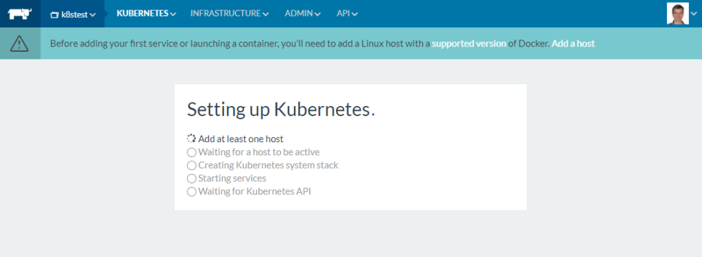](https://cdn.rancher.com/wp-content/uploads/2017/08/15054603/17-setting-up-Kubernetes.png)

## Step 3 – Adding Kubernetes cluster hosts

To add a host in Rancher, click on **Add a host** on the warning message
that appears at the top of the screen or select the **Add Host** option
under the **Infrastructure -> Hosts** menu. Rancher provides multiple
ways to add hosts. You can add an existing Docker host on-premises or in
the cloud, or you can automatically add hosts using a cloud-provider
specific machine driver as shown below. Since our Rancher management
host is running on Amazon EC2, we’ll select the Amazon EC2 machine
driver to auto-provision additional cluster hosts. You’ll want to select
the same AWS region where your Rancher management host resides and
you’ll need your AWS provided **Access key** and **Secret key**. If you
don’t have an AWS Access key and Secret key, the [AWS
documentation](http://docs.aws.amazon.com/general/latest/gr/managing-aws-access-keys.html)
explains how you can obtain one. You’ll need to provide your AWS
credentials to Rancher as shown so that it can provision machines on
your behalf.
[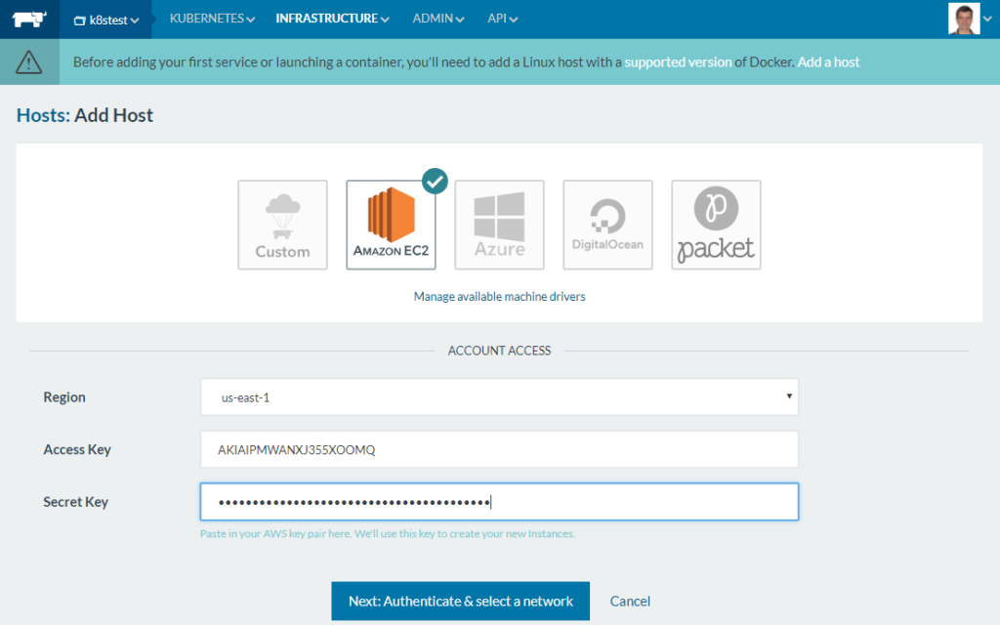](https://cdn.rancher.com/wp-content/uploads/2017/08/10122346/18-add-host.png)
After you’ve provided your AWS credentials, select the AWS Virtual
private cloud and subnet. We’ve selected the same VPC where our Rancher
management node was installed from the AWS marketplace.
[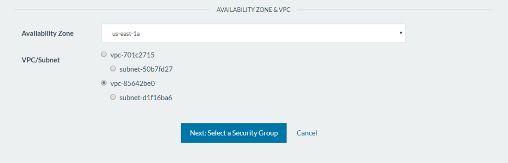](https://cdn.rancher.com/wp-content/uploads/2017/08/10122420/19-availability-zone.png)
Security groups in AWS EC2 express a set of inbound and outbound
security rules. You can choose a security group already setup in your
AWS account, but it is easier to just let Rancher use the existing
rancher-machine group to ensure the network ports that Rancher needs
open are configured appropriately.
[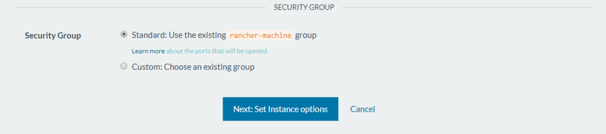](https://cdn.rancher.com/wp-content/uploads/2017/08/10122452/20-security-group.png)
After setting up the security group, you can set your instance options
for the additional cluster nodes. You can add multiple hosts at a time.
We add five hosts in this example. We can give the hosts a name. We use
**k8shost** as our prefix, and Rancher will append a number to the
prefix naming our hosts **k8shost1** through **k8shost5**. You can
select the type of AWS host you’d like for your Kubernetes cluster. For
testing, a **t2.medium** instance is adequate (2 cores and 4GB of RAM)
however if you are running real workloads, a larger node would be
better. Accept the default 16GB root directory size. If you leave the
AMI blank, Rancher will provision the machine using an Ubuntu AMI. Note
that the **ssh** username will be **ubuntu** for this machine type. You
can leave the other settings alone in case you want to change the
defaults.
[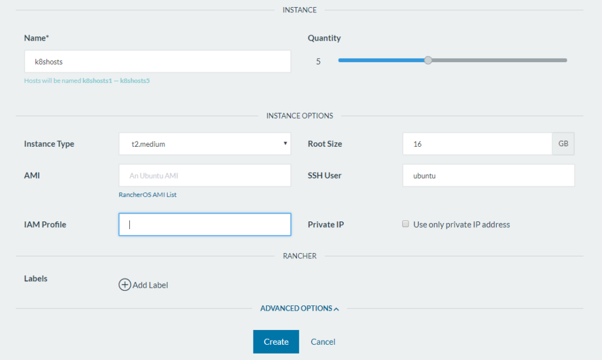](https://cdn.rancher.com/wp-content/uploads/2017/08/10122549/21-instance-group.png)
Once you click **Create**, Rancher will use your AWS credentials to
provision the hosts using your selected options in your AWS cloud
account. You can monitor the creation of the new hosts from the EC2
dashboard as shown.
[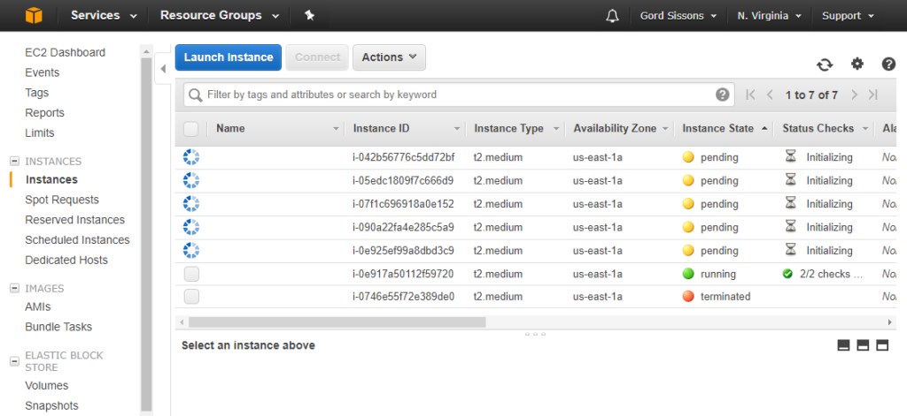](https://cdn.rancher.com/wp-content/uploads/2017/08/10122621/22-EC2-dashboard.png)
Progress will also be shown from within Rancher. Rancher will
automatically provision the AWS host, install the appropriate version of
Docker on the host, provide credentials, start a rancher Agent, and once
the agent is present Rancher will orchestrate the installation of
Kubernetes pulling the appropriate rancher components from the Docker
registry to each cluster host.
[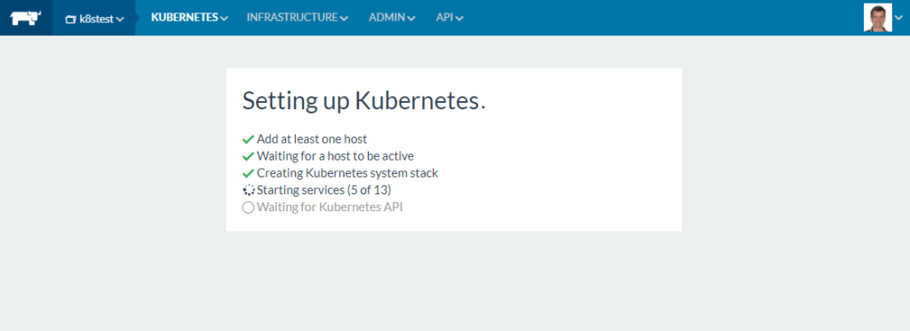](https://cdn.rancher.com/wp-content/uploads/2017/08/10122702/23-setting-up-K8s.png)
You can also monitor the step-by-step provisioning process by
selecting **Hosts** as shown below under the **Infrastructure menu**.
This view shows our five node Kubernetes cluster at different stages of
provisioning.
[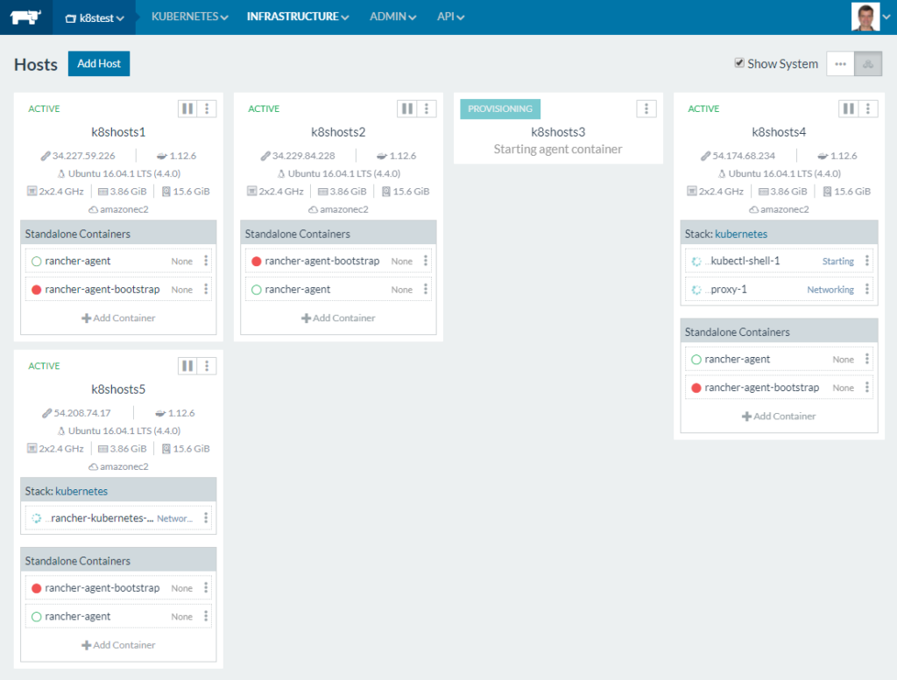](https://cdn.rancher.com/wp-content/uploads/2017/08/10122734/24-node-view-of-cluster.png)
It will take a few minutes before the environment is provisioned and up
and running, but when the dust settles, the **Infrastructure Stacks**
view should show that the Rancher stacks comprising the Kubernetes
environment are all up and running and healthy.
[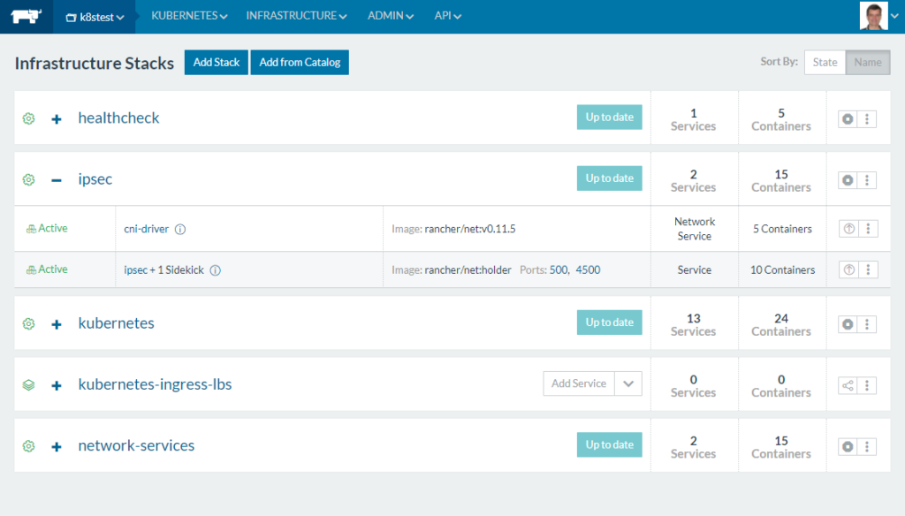](https://cdn.rancher.com/wp-content/uploads/2017/08/10122819/25-infrastructure-stacks.png)
Under the Kubernetes pull-down, you can launch a Kubernetes shell and
issue *kubectl* commands. Remember that Kubernetes has the notion of
namespaces, so to see the Pods and Services used by Kubernetes itself,
you’ll need to query the *kube-system* namespace. This same screen also
provides guidance for installing the kubectl CLI on your own local host.
[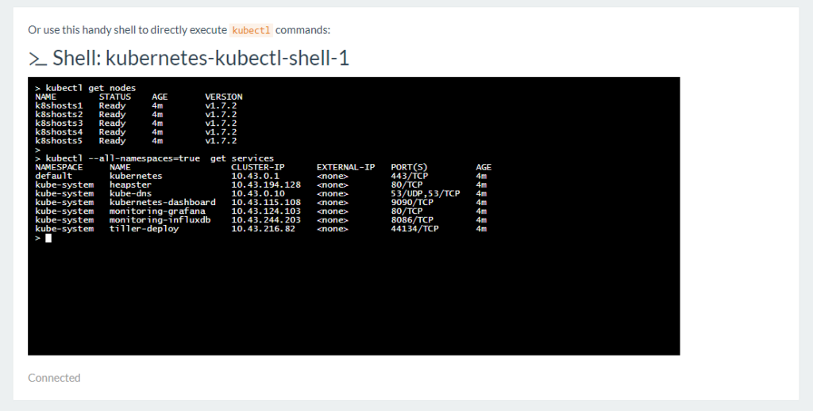](https://cdn.rancher.com/wp-content/uploads/2017/08/10122918/27-Shell-Kubernetes.png)
Rancher also provides access to the Kubernetes Dashboard following the
automated installation under the Kubernetes pull-down.
[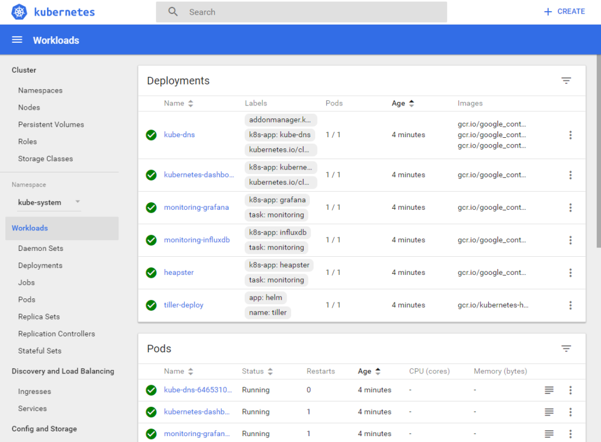](https://cdn.rancher.com/wp-content/uploads/2017/08/10122945/28-Kubernetes-workloads.png)
Congratulations! If you’ve gotten this far, give yourself a pat on the
back. You’re now a Rancher on AWS expert!

A Detailed Overview of Rancher's ArchitectureThis newly-updated, in-depth guidebook provides a detailed overview of the features and functionality of the new Rancher: an open-source enterprise Kubernetes platform.[Get the eBook](https://more.suse.com/fy21-global-web-landing-page-rancher2-technical-architecture)
