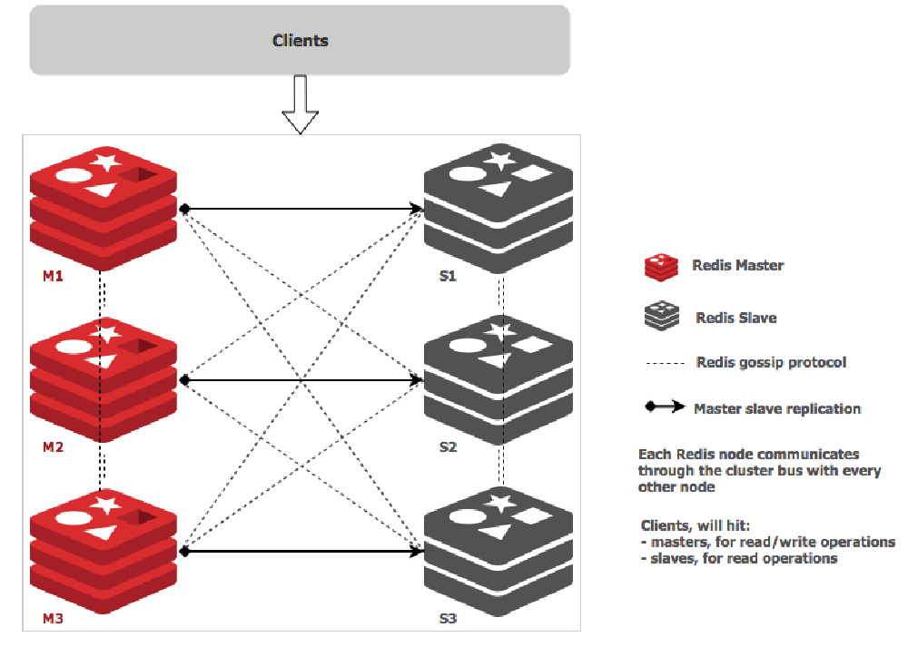
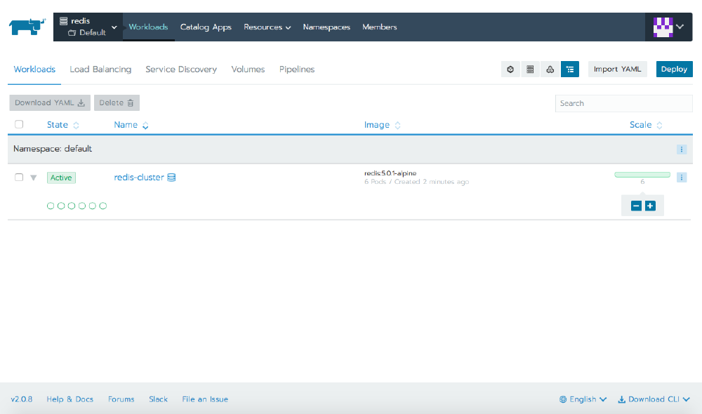
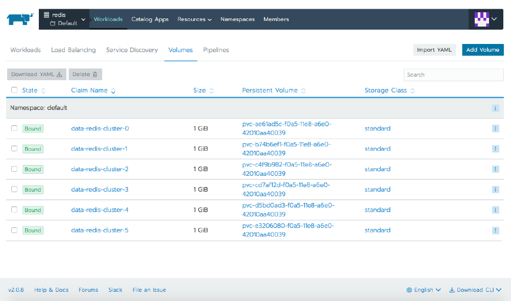
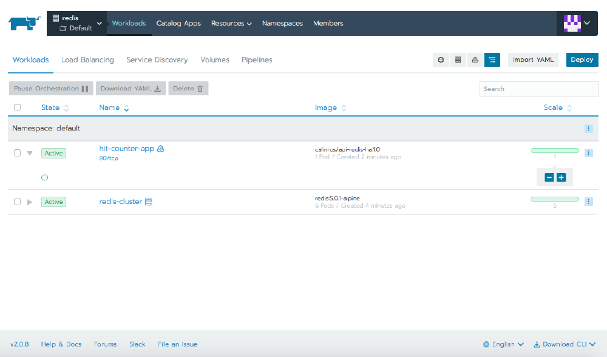
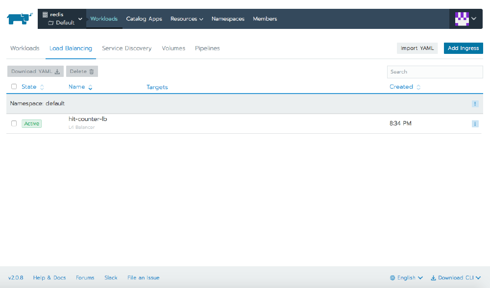
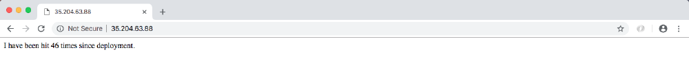
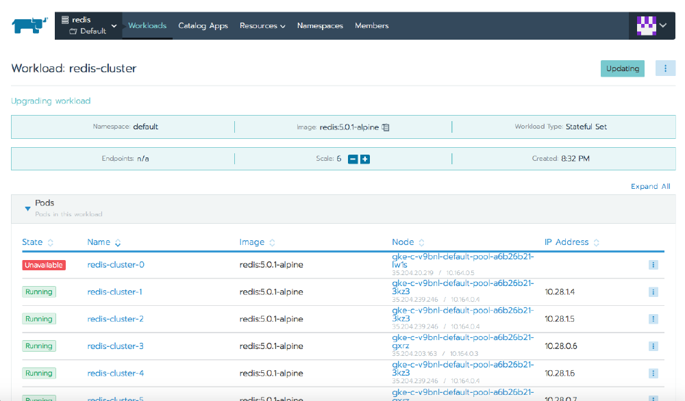
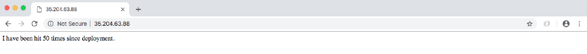

Continue your education with Kubernetes Master ClassesLearn to navigate the modern development landscape with confidence and get started without leaving home.[Learn More](https://rancher.com/kubernetes-master-class/)

## Introduction

[Redis](https://redis.io) (which stands for REmote DIctionary Server) is an open source, in-memory datastore, often used as a database, cache or message broker. It can store and manipulate high-level data types like lists, maps, sets, and sorted sets. Because Redis accepts keys in a wide range of formats, operations can be executed on the server, which reduces the client’s workload. It holds its database entirely in memory, only using the disk for persistence. Redis is a popular data storage solution and is used by tech giants like GitHub, Pinterest, Snapchat, Twitter, StackOverflow, Flickr, and others.

### Why Use Redis?

- It is incredibly fast. It is written in ANSI C and runs on POSIX systems such as Linux, Mac OS X, and Solaris.
- Redis is often ranked the most popular key/value database and the most popular NoSQL database used with containers.
- Its caching solution reduces the number of calls to a cloud database backend.
- It can be accessed by applications through its client API library.
- Redis is supported by all of the popular programming languages.
- It is open source and stable.

### Redis Use in the Real World

- Some Facebook online games have a very high number of score updates. Executing these operations is trivial when using a Redis sorted set, even if there are millions of users and millions of new scores per minute.
- Twitter stores the timeline for all users within a Redis cluster.
- Pinterest stores the user follower graphs in a Redis cluster where data is sharded across hundreds of instances.
- Github uses Redis as a queue.

## What is Redis Cluster?

[Redis Cluster](https://redis.io/topics/cluster-tutorial) is a set of Redis instances, designed for scaling a database by partitioning it, thus making it more resilient. Each member in the cluster, whether a primary or a secondary replica, manages a subset of the hash slot. If a master becomes unreachable, then its slave is promoted to master. In a minimal Redis Cluster made up of three master nodes, each with a single slave node (to allow minimal failover), each master node is assigned a hash slot range between 0 and 16,383. Node A contains hash slots from 0 to 5000, node B from 5001 to 10000, node C from 10001 to 16383. Communication inside the cluster is made via an internal bus, using a gossip protocol to propagate information about the cluster or to discover new nodes.



## Deploying Redis Cluster in Kubernetes

Deploying Redis Cluster within [Kubernetes](https://kubernetes.io/docs/concepts/overview/what-is-kubernetes/) has its challenges, as each Redis instance relies on a configuration file that keeps track of other cluster instances and their roles. For this we need a combination of Kubernetes [StatefulSets](https://kubernetes.io/docs/concepts/workloads/controllers/statefulset/) and [PersistentVolumes](https://kubernetes.io/docs/concepts/storage/persistent-volumes/).

### Prerequisites

To perform this demo, you need the following:

- [Rancher](https://rancher.com)
- A Google Cloud Platform or other cloud provider account. The examples below use GKE, but any other cloud provider will also work.

### Starting a Rancher Instance

If you do not have an instance of Rancher, launch one with the instructions in the [quickstart](https://rancher.com/quick-start/).

### Use Rancher to Deploy a GKE Cluster

Use Rancher to set up and configure your Kubernetes cluster, following the [documentation](https://rancher.com/docs/rancher/v2.x/en/cluster-provisioning/hosted-kubernetes-clusters/gke/).

When the cluster is ready, we can check its status via `kubectl`.

```
$ kubectl get nodes
NAME                                     STATUS   ROLES    AGE   VERSION
gke-c-8dcng-default-pool-08c0a15c-2gpw   Ready    <none>   1h    v1.11.2-gke.18
gke-c-8dcng-default-pool-08c0a15c-4q79   Ready    <none>   1h    v1.11.2-gke.18
gke-c-8dcng-default-pool-08c0a15c-g9zv   Ready    <none>   1h    v1.11.2-gke.18
```

### Deploy Redis

Continue to deploy Redis Cluster, either by using `kubectl` to apply the YAML files or by importing them into the Rancher UI. All of the YAML files that we need are listed below.

```
$ kubectl apply -f redis-sts.yaml
configmap/redis-cluster created
statefulset.apps/redis-cluster created

$ kubectl apply -f redis-svc.yaml
service/redis-cluster created
```

Click for YAML content

#### `redis-sts.yaml`

```
---
apiVersion: v1
kind: ConfigMap
metadata:
name: redis-cluster
data:
update-node.sh: |
    #!/bin/sh
REDIS_NODES="/data/nodes.conf"
sed -i -e "/myself/ s/[0-9]\{1,3\}\.[0-9]\{1,3\}\.[0-9]\{1,3\}\.[0-9]\{1,3\}/${POD_IP}/" ${REDIS_NODES}
exec "$@"
redis.conf: |+
    cluster-enabled yes
cluster-require-full-coverage no
cluster-node-timeout 15000
cluster-config-file /data/nodes.conf
cluster-migration-barrier 1
appendonly yes
protected-mode no
---
apiVersion: apps/v1
kind: StatefulSet
metadata:
name: redis-cluster
spec:
serviceName: redis-cluster
replicas: 6
selector:
matchLabels:
app: redis-cluster
template:
metadata:
labels:
app: redis-cluster
spec:
containers:
- name: redis
image: redis:5.0.1-alpine
ports:
- containerPort: 6379
name: client
- containerPort: 16379
name: gossip
command: ["/conf/update-node.sh", "redis-server", "/conf/redis.conf"]
env:
- name: POD_IP
valueFrom:
fieldRef:
fieldPath: status.podIP
volumeMounts:
- name: conf
mountPath: /conf
readOnly: false
- name: data
mountPath: /data
readOnly: false
volumes:
- name: conf
configMap:
name: redis-cluster
defaultMode: 0755
volumeClaimTemplates:
- metadata:
name: data
spec:
accessModes: [ "ReadWriteOnce" ]
resources:
requests:
storage: 1Gi
```

#### `redis-svc.yaml`

```
---
apiVersion: v1
kind: Service
metadata:
name: redis-cluster
spec:
type: ClusterIP
ports:
- port: 6379
targetPort: 6379
name: client
- port: 16379
targetPort: 16379
name: gossip
selector:
app: redis-cluster
```

### Verify the Deployment

Check that the Redis nodes are up and running:

```
$ kubectl get pods
NAME                               READY   STATUS    RESTARTS   AGE
redis-cluster-0                    1/1     Running   0          7m
redis-cluster-1                    1/1     Running   0          7m
redis-cluster-2                    1/1     Running   0          6m
redis-cluster-3                    1/1     Running   0          6m
redis-cluster-4                    1/1     Running   0          6m
redis-cluster-5                    1/1     Running   0          5m
```

Below are the 6 volumes that we created:

```
$ kubectl get pv
NAME                                       CAPACITY   ACCESS MODES   RECLAIM POLICY   STATUS   CLAIM                          STORAGECLASS   REASON   AGE
pvc-ae61ad5c-f0a5-11e8-a6e0-42010aa40039   1Gi        RWO            Delete           Bound    default/data-redis-cluster-0   standard                7m
pvc-b74b6ef1-f0a5-11e8-a6e0-42010aa40039   1Gi        RWO            Delete           Bound    default/data-redis-cluster-1   standard                7m
pvc-c4f9b982-f0a5-11e8-a6e0-42010aa40039   1Gi        RWO            Delete           Bound    default/data-redis-cluster-2   standard                6m
pvc-cd7af12d-f0a5-11e8-a6e0-42010aa40039   1Gi        RWO            Delete           Bound    default/data-redis-cluster-3   standard                6m
pvc-d5bd0ad3-f0a5-11e8-a6e0-42010aa40039   1Gi        RWO            Delete           Bound    default/data-redis-cluster-4   standard                6m
pvc-e3206080-f0a5-11e8-a6e0-42010aa40039   1Gi        RWO            Delete           Bound    default/data-redis-cluster-5   standard                5m
```

We can inspect any of the Pods to see its attached volume:

```
$ kubectl describe pods redis-cluster-0 | grep pvc
Normal  SuccessfulAttachVolume  29m   attachdetach-controller                          AttachVolume.Attach succeeded for volume "pvc-ae61ad5c-f0a5-11e8-a6e0-42010aa40039"
```

The same data is visible within the Rancher UI.




### Deploy Redis Cluster

The next step is to form a Redis Cluster. To do this, we run the following command and type `yes` to accept the configuration. The first three nodes become masters, and the last three become slaves.

```
$ kubectl exec -it redis-cluster-0 -- redis-cli --cluster create --cluster-replicas 1 $(kubectl get pods -l app=redis-cluster -o jsonpath='{range.items[*]}{.status.podIP}:6379 ')
```

Click for full command output.

```
>>> Performing hash slots allocation on 6 nodes...
Master[0] -> Slots 0 - 5460
Master[1] -> Slots 5461 - 10922
Master[2] -> Slots 10923 - 16383
Adding replica 10.60.1.13:6379 to 10.60.2.12:6379
Adding replica 10.60.2.14:6379 to 10.60.1.12:6379
Adding replica 10.60.1.14:6379 to 10.60.2.13:6379
M: 2847de6f6e7c8aaa8b0d2f204cf3ff6e8562a75b 10.60.2.12:6379
slots:[0-5460] (5461 slots) master
M: 3f119dcdd4a33aab0107409524a633e0d22bac1a 10.60.1.12:6379
slots:[5461-10922] (5462 slots) master
M: 754823247cf28af9a2a82f61a8caaa63702275a0 10.60.2.13:6379
slots:[10923-16383] (5461 slots) master
S: 47efe749c97073822cbef9a212a7971a0df8aecd 10.60.1.13:6379
replicates 2847de6f6e7c8aaa8b0d2f204cf3ff6e8562a75b
S: e40ae789995dc6b0dbb5bb18bd243722451d2e95 10.60.2.14:6379
replicates 3f119dcdd4a33aab0107409524a633e0d22bac1a
S: 8d627e43d8a7a2142f9f16c2d66b1010fb472079 10.60.1.14:6379
replicates 754823247cf28af9a2a82f61a8caaa63702275a0
Can I set the above configuration? (type 'yes' to accept): yes
>>> Nodes configuration updated
>>> Assign a different config epoch to each node
>>> Sending CLUSTER MEET messages to join the cluster
Waiting for the cluster to join
....
>>> Performing Cluster Check (using node 10.60.2.12:6379)
M: 2847de6f6e7c8aaa8b0d2f204cf3ff6e8562a75b 10.60.2.12:6379
slots:[0-5460] (5461 slots) master
1 additional replica(s)
S: 47efe749c97073822cbef9a212a7971a0df8aecd 10.60.1.13:6379
slots: (0 slots) slave
replicates 2847de6f6e7c8aaa8b0d2f204cf3ff6e8562a75b
M: 754823247cf28af9a2a82f61a8caaa63702275a0 10.60.2.13:6379
slots:[10923-16383] (5461 slots) master
1 additional replica(s)
M: 3f119dcdd4a33aab0107409524a633e0d22bac1a 10.60.1.12:6379
slots:[5461-10922] (5462 slots) master
1 additional replica(s)
S: e40ae789995dc6b0dbb5bb18bd243722451d2e95 10.60.2.14:6379
slots: (0 slots) slave
replicates 3f119dcdd4a33aab0107409524a633e0d22bac1a
S: 8d627e43d8a7a2142f9f16c2d66b1010fb472079 10.60.1.14:6379
slots: (0 slots) slave
replicates 754823247cf28af9a2a82f61a8caaa63702275a0
[OK] All nodes agree about slots configuration.
>>> Check for open slots...
>>> Check slots coverage...
[OK] All 16384 slots covered.
```

### Verify Cluster Deployment

Check the cluster details and the role for each member.

```
$ kubectl exec -it redis-cluster-0 -- redis-cli cluster info
```

Click for full command output

```
cluster_state:ok
cluster_slots_assigned:16384
cluster_slots_ok:16384
cluster_slots_pfail:0
cluster_slots_fail:0
cluster_known_nodes:6
cluster_size:3
cluster_current_epoch:6
cluster_my_epoch:1
cluster_stats_messages_ping_sent:41
cluster_stats_messages_pong_sent:41
cluster_stats_messages_sent:82
cluster_stats_messages_ping_received:36
cluster_stats_messages_pong_received:41
cluster_stats_messages_meet_received:5
cluster_stats_messages_received:82
```

```
$ for x in $(seq 0 5); do echo "redis-cluster-$x"; kubectl exec redis-cluster-$x -- redis-cli role; echo; done
```

Click for full command output

```
redis-cluster-0
1) "master"
2) (integer) 56
3) 1) 1) "10.60.1.13"
2) "6379"
3) "56"

redis-cluster-1
1) "master"
2) (integer) 70
3) 1) 1) "10.60.2.14"
2) "6379"
3) "70"

redis-cluster-2
1) "master"
2) (integer) 70
3) 1) 1) "10.60.1.14"
2) "6379"
3) "70"

redis-cluster-3
1) "slave"
2) "10.60.2.12"
3) (integer) 6379
4) "connected"
5) (integer) 84

redis-cluster-4
1) "slave"
2) "10.60.1.12"
3) (integer) 6379
4) "connected"
5) (integer) 98

redis-cluster-5
1) "slave"
2) "10.60.2.13"
3) (integer) 6379
4) "connected"
5) (integer) 98
```

## Testing the Redis Cluster

We want to use the cluster and then simulate a failure of a node. For the former task, we’ll deploy a simple Python app, and for the latter, we’ll delete a node and observe the cluster behavior.

### Deploy the Hit Counter App

We’ll deploy a simple app into our cluster and put a load balancer in front of it. The purpose of this app is to increment a counter and store the value in the Redis cluster before returning the counter value as an HTTP response.

Deploy this using `kubectl` or the Rancher UI.

```
$ kubectl apply -f app-deployment-service.yaml
service/hit-counter-lb created
deployment.apps/hit-counter-app created
```

Click for YAML content.

#### `app-deployment-service.yaml`

```
---
apiVersion: v1
kind: Service
metadata:
name: hit-counter-lb
spec:
type: LoadBalancer
ports:
- port: 80
protocol: TCP
targetPort: 5000
selector:
app: myapp
---
apiVersion: apps/v1
kind: Deployment
metadata:
name: hit-counter-app
spec:
replicas: 1
selector:
matchLabels:
app: myapp
template:
metadata:
labels:
app: myapp
spec:
containers:
- name: myapp
image: calinrus/api-redis-ha:1.0
ports:
- containerPort: 5000
```

Rancher shows us the resources that we created: a Pod containing the Python app, and the Service of type LoadBalancer. The details of the Service will show us its public IP address.




At this point, we can start hitting the IP with a browser to generate some values for the hit counter.



### Simulate a Node Failure

We can simulate the failure of a cluster member by deleting the Pod, either via `kubectl` or from within the Rancher UI. When we delete `redis-cluster-0`, which was originally a master, we see that Kubernetes promotes `redis-cluster-3` to master, and when `redis-cluster-0` returns, it does so as a slave.



#### Before

```
$ kubectl describe pods redis-cluster-0 | grep IP
IP:                 10.28.0.5
POD_IP:   (v1:status.podIP)

$ kubectl describe pods redis-cluster-3 | grep IP
IP:                 10.28.0.6
POD_IP:   (v1:status.podIP)

$ kubectl exec -it redis-cluster-0 -- redis-cli role
1) "master"
2) (integer) 1859
3) 1) 1) "10.28.0.6"
2) "6379"
3) "1859"

$ kubectl exec -it redis-cluster-3 -- redis-cli role
1) "slave"
2) "10.28.0.5"
3) (integer) 6379
4) "connected"
5) (integer) 1859
```

#### After

```
$ kubectl exec -it redis-cluster-0 -- redis-cli role
1) "slave"
2) "10.28.0.6"
3) (integer) 6379
4) "connected"
5) (integer) 2111

$ kubectl exec -it redis-cluster-3 -- redis-cli role
1) "master"
2) (integer) 2111
3) 1) 1) "10.28.2.12"
2) "6379"
3) "2111"
```

We see that the IP for `redis-cluster-0` has changed, so how did the cluster heal?

When we created the cluster, we created a ConfigMap that in turn created a script at `/conf/update-node.sh` that the container calls when starting. This script updates the Redis configuration with the new IP address of the local node. With the new IP in the confic, the cluster can heal after a new Pod starts with a different IP address.

During this process, if we continue to load the page, the counter continues to increment, and following the cluster convergence, we see that no data has been lost.



## Conclusion

Redis is a powerful tool for data storage and caching. Redis Cluster extends the functionality by offering sharding and correlated performance benefits, linear scaling, and higher availability because of how Redis stores data. The data is automatically split among multiple nodes, which allows operations to continue, even when a subset of the nodes are experiencing failures or are unable to communicate with the rest of the cluster.

For more information on Redis Cluster, please visit the [tutorial](https://redis.io/topics/cluster-tutorial) or [specification documentation](https://redis.io/topics/cluster-spec).

For more information on Rancher, please visit [our main website](https://rancher.com/) or [our documentation](https://rancher.com/docs/).

Continue your education with Kubernetes Master ClassesLearn to navigate the modern development landscape with confidence and get started without leaving home.[Learn More](https://rancher.com/kubernetes-master-class/)
