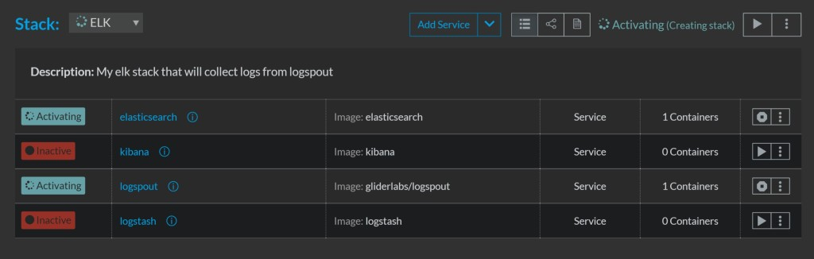
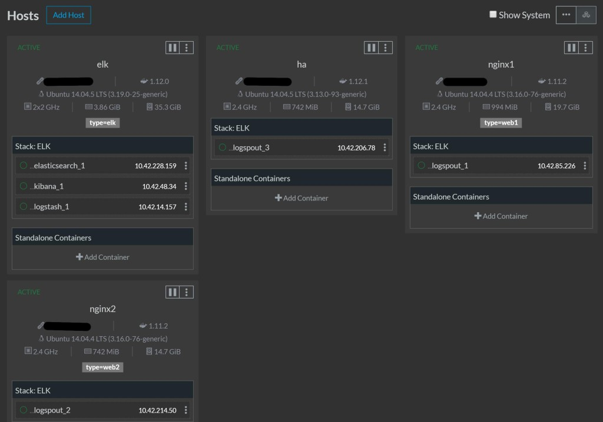
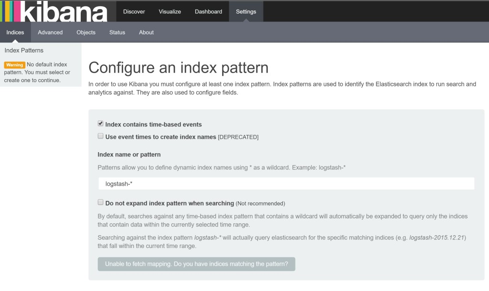
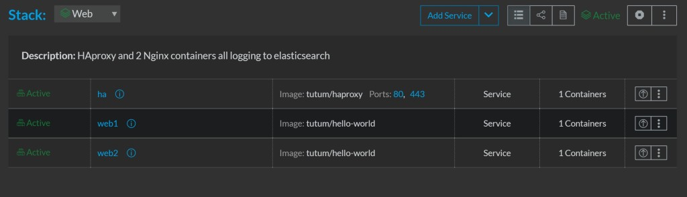
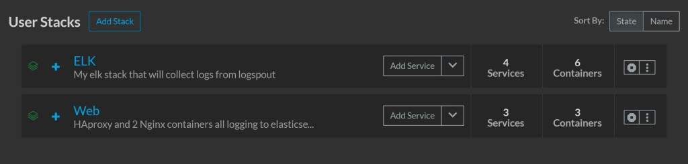
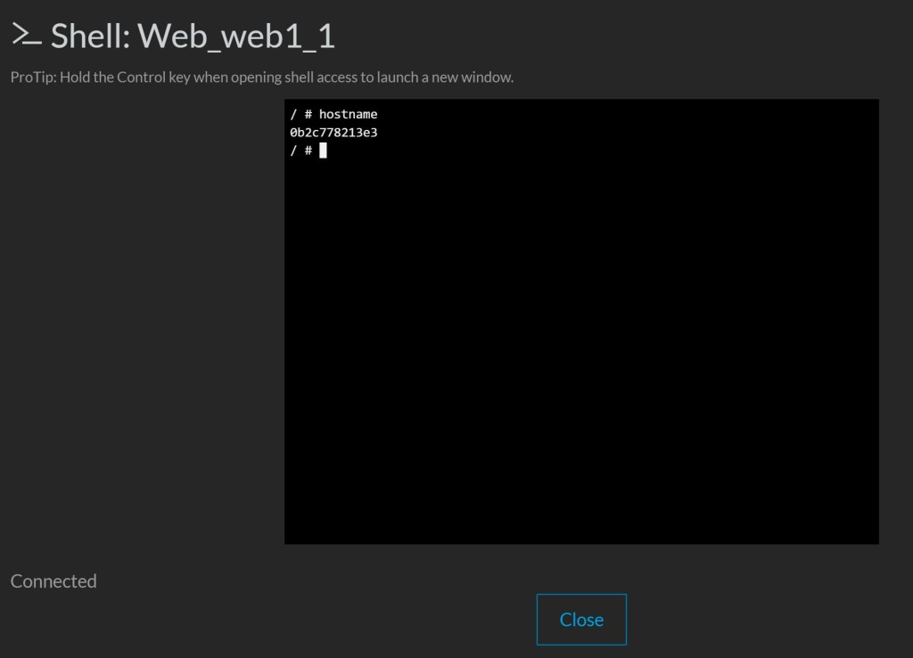
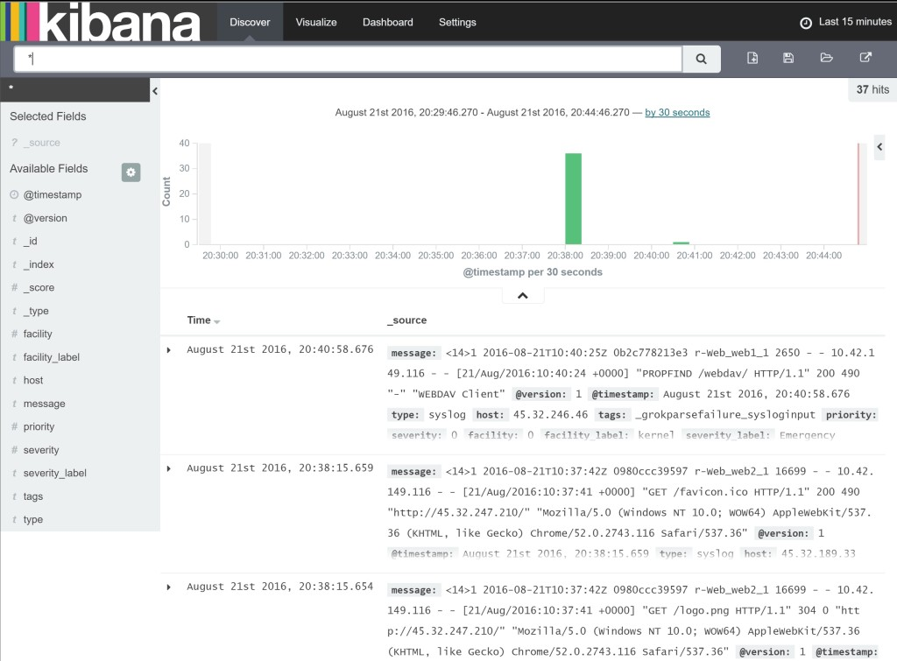

*Note: you can read the [Part
1](https://rancher.com/preparing-a-micro-service-release-using-rancher/)
and [Part
2](https://rancher.com/create-a-private-docker-registry-to-integrate-with-rancher/)
of this series, which describes how to deploy service stacks from a
private docker registry with Rancher.* This is my third and final blog post,
and follows [part
2](https://rancher.com/create-a-private-docker-registry-to-integrate-with-rancher/),
where I stepped through the creation of a private, password-protected
Docker registry. and integrated this private registry with Rancher. In
this post, we will be putting this registry to work (although for speed,
I will use public images). We will go through how to make stacks that
reference public containers and then use them in Rancher to deploy your
product. So let’s get started! First, we should understand the anatomy
of a Rancher stack. It isn’t that difficult if you are familiar with
Docker Compose YAML files. A Rancher stack needs a docker-compose.yml
file, which is a standard Docker Compose formatted file, but you can add
in Rancher-specific items, like targeting servers via
[labels](https://docs.rancher.com/rancher/latest/en/cattle/labels/). The
[rancher-compose.yml](https://docs.rancher.com/rancher/latest/en/cattle/rancher-compose/)
file is specific to Rancher. If it doesn’t exist, then Rancher will
assume that each container that is specified in the docker-compose.yml
file will have a scaling factor of 1. It is good practice to detail a
rancher-compose.yml file. So we will attempt to do the following, and
make extensive use of Rancher labels. (1) Create a stack that deploys
out a simple haproxy + 2 nginx servers (2) Create an ELK stack to
collect logs (3) Deploy a Logspout container to collate and send all
Docker logs to our ELK stack. Here are the characteristics of each of
our containers, and the Rancher-specific labels that help us achieve our
goals:

---

**Containers** \*\*Host Label \*\* **Rancher Labels**
ElasticSearch + Logstash + Kibana Deploy only onto a specific host with label “type=elk” io.rancher.container.pull\_image: always io.rancher.scheduler.affinity:host\_label: type=elk
Logspout Deploy onto all hosts unless labeled “type=elk” io.rancher.container.pull\_image: always io.rancher.scheduler.global: true io.rancher.scheduler.affinity:host\_label\_ne: type=elk
HAProxy + 2 nginx containers Deploy onto any host NOT labeled “type=elk” or “type=web1” or “type=web2” io.rancher.container.pull\_image: always io.rancher.scheduler.affinity:host\_label\_ne: type=elk,type=web1,type=web2
nginx 1 Deploy onto the host labeled “type=web1” io.rancher.container.pull\_image: always io.rancher.scheduler.affinity:host\_label: type=web1
nginx 2 Deploy onto the host labeled “type=web2” io.rancher.container.pull\_image: always io.rancher.scheduler.affinity:host\_label: type=web2

---

We will need 4 hosts in total for this and will deploy 2 stacks.

### Stack 1: ELK + Logspout

ELK will be running without persistence. For me, that isn’t important
as any logs that are older than a day are not very useful; if needed I
can get the logs direct via the ‘docker logs’ command. The Logspout
container will be required for every host, so we will use the Rancher
label ‘io.rancher.scheduler.global: true’ to perform this. The
‘global: true’ should be pretty straightforward - it instructs Rancher
to deploy this container to every available host in the environment.
Below is the logspout definition. Alter the logspout command to the IP
of your ELK host. Also provide the labels in the below screen to each of
the hosts. Stack name: ELK Stack Description: My elk stack that will
collect logs from logspout Docker-Compose.yml

```
elasticsearch:
  image: elasticsearch
  ports:
    - '9200:9200'
  labels:
    io.rancher.container.pull_image: always
    io.rancher.scheduler.affinity:host_label: type=elk
  container_name: elasticsearch
logstash:
  image: logstash
  ports
    - 25826:25826
    - 25826:25826/udp
  command: logstash agent --debug -e 'input {syslog {type => syslog port => 25826 } gelf {} } filter {if "docker/" in [program] {mutate {add_field => {"container_id" => "%{program}"} } mutate {gsub => ["container_id", "docker/", ""] } mutate {update => ["program", "docker"] } } } output { elasticsearch { hosts => ["elasticsearch"] } stdout {} }'
  links:
    - elasticsearch:elasticsearch
  labels:
    io.rancher.container.pull_image: always
    io.rancher.scheduler.affinity:host_label: type=elk
  container_name: logstash
kibana:
   image: kibana
   ports:
     - 5601:5601
   environment:
     - ELASTICSEARCH_URL=http://elasticsearch:9200
   links:
     - elasticsearch:elasticsearch
   labels:
     io.rancher.container.pull_image: always
     io.rancher.scheduler.affinity:host_label: type=elk
   container_name: kibana
logspout:
  labels:
    io.rancher.container.pull_image: always
    io.rancher.scheduler.global: true
    io.rancher.scheduler.affinity:host_label_ne: type=elk
  image: gliderlabs/logspout
  volumes:
    - /var/run/docker.sock:/tmp/docker.sock
  container_name: logspout
  command: "syslog://111.222.333.444:25826"
```

Now click ‘Create’ and after a few seconds you will see the containers
being created. After a few minutes, all containers will have been
downloaded to the correct hosts as defined in the docker-compose YAML.
At the end of this process, we should see that all hosts have been
activated:
[](https://cdn.rancher.com/wp-content/uploads/2016/08/31144711/stacks3.jpg)
Now we can verify that the containers are distributed to the correct
hosts and that the logspout contianer is on all hosts apart from the elk
host.
[](https://cdn.rancher.com/wp-content/uploads/2016/08/31144747/hosts-2.jpg)
So everything looks good. Let’s visit our kibana frontend to ELK @
144.172.71.84:5601
[](https://cdn.rancher.com/wp-content/uploads/2016/08/31144647/kibana.jpg)
All looks good. Now let’s get our next stack set up:

### Stack 2: HAproxy + 2 Nginx containers

Stack name: Web Stack Description: HAProxy and 2 nginx containers, all
logging to Elasticsearch Docker-Compose.yml

```
web1:
 image: tutum/hello-world
 container_name: web1
 labels:
 io.rancher.container.pull_image: always
 io.rancher.scheduler.affinity:host_label: type=web1
web2:
 image: tutum/hello-world
 container_name: web2
 labels:
 io.rancher.container.pull_image: always
 io.rancher.scheduler.affinity:host_label: type=web2
ha:
 image: tutum/haproxy
 ports:
 - 80:80
 - 443:443
 container_name: ha
 labels:
 io.rancher.container.pull_image: always
 io.rancher.scheduler.affinity:host_label_ne: type=elk,type=web1,type=web2
 links:
 - web1:web1
 - web2:web2
```

Now hit ‘Create’, and after a few minutes you should see the hello
world nginx containers behind an HAProxy.
[](https://cdn.rancher.com/wp-content/uploads/2016/08/31144736/ha2.jpg)
If we look at our stacks page, we will see both stacks with green
lights:
[](https://cdn.rancher.com/wp-content/uploads/2016/08/31144739/ha3.jpg)
And if we hit the ha IP on port 80 or 443, we will see the hello world
screen.
[](https://cdn.rancher.com/wp-content/uploads/2016/08/31144742/ha4.jpg)
We can then hit refresh a few times and the second hostname will
appear. You can then validate the hostnames by opening up the container
name and executing the shell.
[](https://cdn.rancher.com/wp-content/uploads/2016/08/31144722/web1.jpg)
We should do a final check of our hosts to see if we have distributed
all of our containers as intended. Has our Elasticsearch instance
received any logs from our Logspout containers? (You might have to
create an index in Kibana first)
[](https://cdn.rancher.com/wp-content/uploads/2016/08/31144655/kibana2.jpg)
Yay! Looks like we have been successful. To recap, we have deployed 2
stacks, and 9 containers across 4 hosts in a configuration that suits
our requirements. The result is a service that ships all the logs of any
new container automatically back to the ELK stack. You should now have
enough know-how in Rancher to be able to deploy your own service stacks
from your private registry. Good luck!
