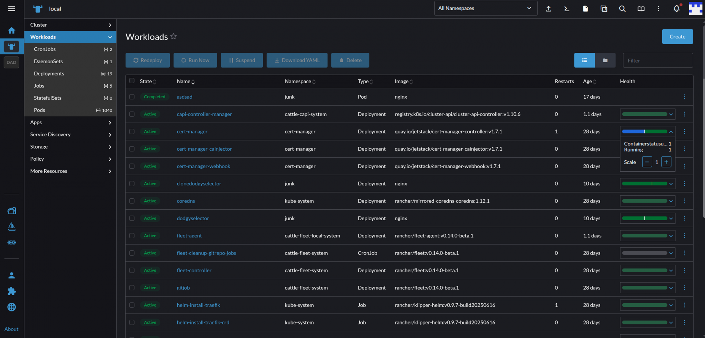
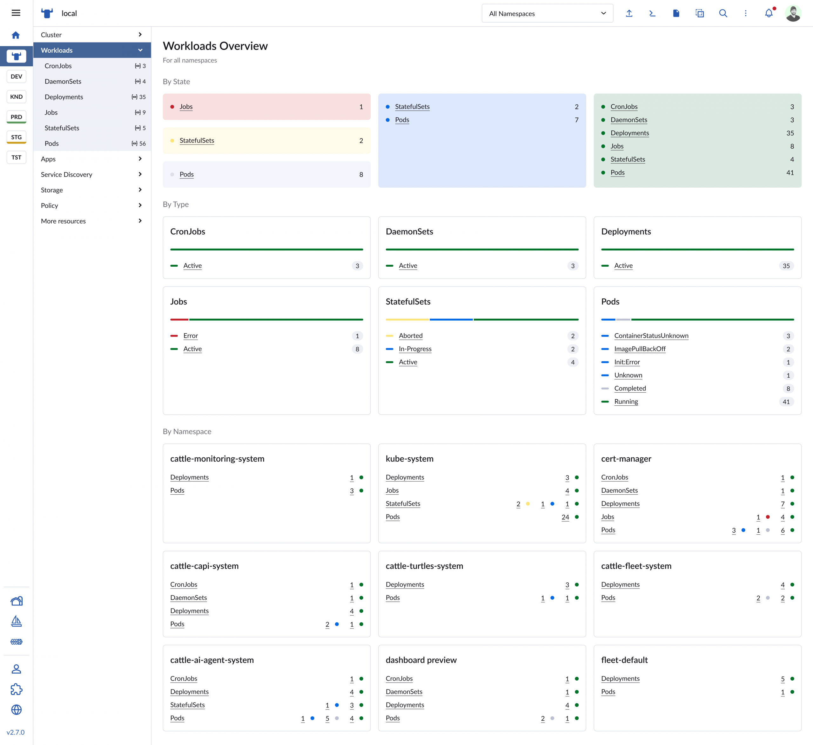
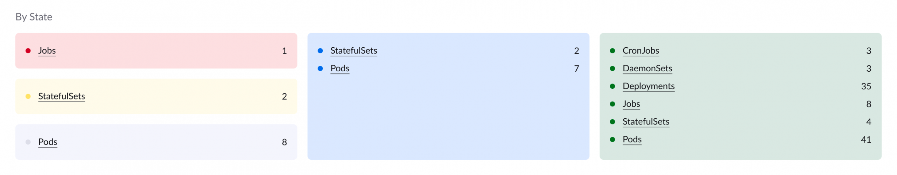
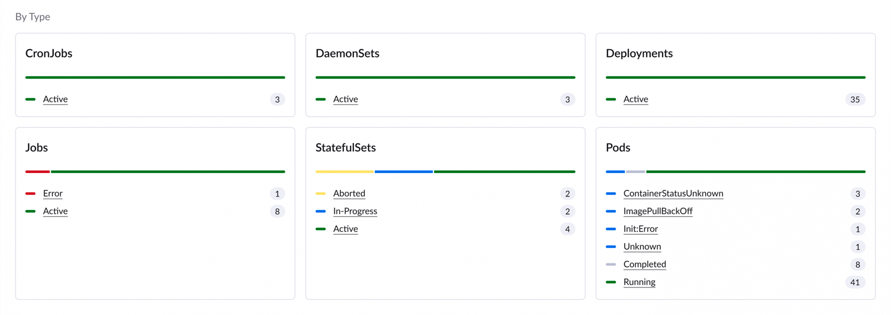
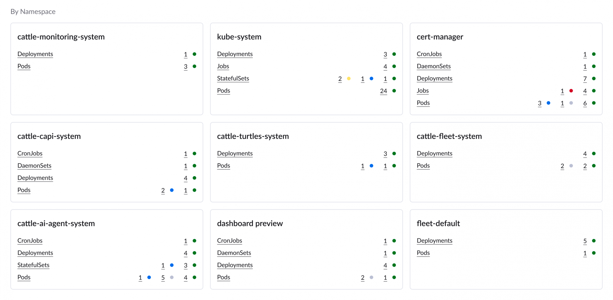
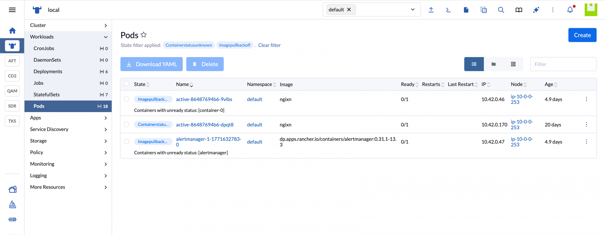

### *Summary*

*To meet community demand, we have restored the global workload overview in Rancher Manager. After previously removing the feature due to performance constraints, we prioritized user feedback and rebuilt it from the ground up. Powered by a new, optimized API, the updated UI is both highly scalable and resilient.*

*The solution balances high-level metrics with rapid drill-down features, grouping data by type, state, and individual namespace. Built using uniform design system components, the interface introduces advanced filter querying and deep linking. This allows users to instantly isolate critical errors (like timeout failures) and share exact interface contexts with teammates, significantly lowering interaction costs and diagnostic guesswork.*

--

As Kubernetes environments scale, the operational complexity of managing them multiplies exponentially. Engineers know the pain of moving across distributed clusters to piece together an understanding of application health.

Today, we want to peel back the curtain on how we applied this exact philosophy - eliminating fragmented workflows and bringing immediate context to your fingertips—to redesign the fundamental developer experience inside **Rancher Manager**.

This is the journey behind the design and implementation of Rancher's brand-new **Workloads Dashboard**.

## **The Challenge: Bringing Back Visibility Without the Bottlenecks**

Rancher previously featured a global resource view in the Workloads section. As our users scaled into massive enterprise deployments, the sheer volume of data created performance limitations, leading us to temporarily pause the feature. This challenge drove us to completely re-engineer how Rancher visualizes data at scale.

Additionally to the performance hit, our community users and enterprise customers alike voiced a clear requirement: they needed an immediate, high-level overview of their cluster workloads without navigating a maze of separate menu trees.

In order to address all the points, and ensure we came up with the best solution, our UX, Product and Engineering teams got together and immediately defined explicit guardrails, so we could focus on the exact challenges at hand:

- **User Intent:** Provide a fast-loading, macro-to-micro view of workload states, call out critical failures demanding action, and allow namespace breakdown filtering.
- **Business Drivers:** Directly respond to user requests, enhance product quality to meet evolving market expectations, and optimize application retention KPIs.
- **Technical Constraints:** The solution must be **performant** (zero noticeable regression in load times), **scalable** (built to support future widgets), and **reusable** (leveraging unified frontend components across the Rancher platform).

## **The Evolution of the Process**

Good design is iterative, contextual and continuously evolves. Designing the new workloads dashboard was no exception. We began under strict technical constraints, developing the user interface in parallel with a brand-new API engineered from the ground up to handle large-scale queries. This required us to work through early data limitations, ensuring the final product was perfectly optimized for performance.

To ensure the best collaboration, we established a phased, user centric design process, aiming to release early and add value with each step we took:  *[Feature Request]  →  [Brainstorm Workshop] →  [Short-term "Health" Fix] →  [New API & Proof of Concept] →  [Figma Iterations] →  [Deep Linking QA & Review].*

Our cross-functional team operated as a single, unified unit, bringing collective problem-solving to every phase of the project:

1. **The Tactical Stopgap:** We first optimized the existing view by restoring a streamlined "Health" column and rolling out minor enhancements utilizing the legacy data layers. Although not ideal, this solution partially solved the need for transparency and visibility into the health of all workloads.
2. **The API Breakthrough:** Once the backend team launched the performant new API, a Proof of Concept (POC) was generated showcasing all the rich data metrics now available. But having lots of data doesn’t necessarily mean we should show it all in the UI - doing this may result in a high cognitive load for the user and / or an overwhelming UI, often leading to a higher interaction cost, a higher time spent on tasks or a lower task completion rate.
3. **The UX Slicing & Dicing:** With data flowing quickly, we pushed into Figma to map out exactly how to group, filter, and interact with information to maximize day-to-day user value and improve the metrics mentioned at the previous point.

## **Inside the Design: The Anatomy of the New Workloads Dashboard**

*The primary visual layout of the new dashboard balances high-level metrics with instant drill-down capabilities.*

### **1. High-Level Health Summary**

At the top of the interface, the dashboard provides a rapid visual aggregation of key health  states for all the workloads  across your chosen context (e.g. all  the namespaces / projects you’ve selected  within the  current cluster).

### **2. Breakdown By Workload Type**

The next section of the dashboard provides instant visibility into the state and quantity of each individual workload type across your chosen context:  **Deployments, Jobs, StatefulSets, DaemonSets, CronJobs,** and **Pods**.

### **3. Breakdown By Namespace**

In the last section, the focus shifts from the  workloads to the namespaces as a primary segmentation criteria, showing health states relative to workloads in every selected  namespace within your chosen context. This matrix flags precisely which logical segment of your infrastructure houses an active issue, drastically lowering the interaction cost and number of clicks needed to identify a failing pod for example.

### **4. Advanced Filter Querying & Deep Linking**

The latest design refinements focused heavily on the **Filter Query functionality**. We didn't want the dashboard to be a static information wall. Instead, if a user clicks an "Error" chunk inside the summary or selects specific filtering parameters, the system preserves that state and dynamically updates the resource rows below.

More importantly, it supports **deep linking**. You can filter down to specific criteria, share that URL with a teammate, and they will land on the exact same context—showing precisely the same errors (such as a ReplicaSet ... has timed out progressing) without losing time recreating filters from scratch.

## **Putting everything together**

To ensure engineering and UX consistency across Rancher Manager, we leveraged existing  components from the new Rancher Design System (summary cards, health state indicators, segmentation bars, etc) and interaction patterns we already use across the platform - besides speeding up the implementation process and improving our main qualitative KPIs, this approach also builds up and consolidates the user’s trust in a system that looks and behaves in a familiar way.

## **We'd love your feedback**

Looking back, the new Workloads Dashboard project  successfully satisfies our core objectives: reducing the time spent tracking down errors, decreasing user interaction costs, and improving overall customer satisfaction. This demonstrates once again that **combining a performant backend architecture with a flexible front-end approach and a  powerful user-centric design process, often results in a highly successful outcome**.

Keep an eye out for these dashboard updates in upcoming Rancher Manager releases and let us know your thoughts.
