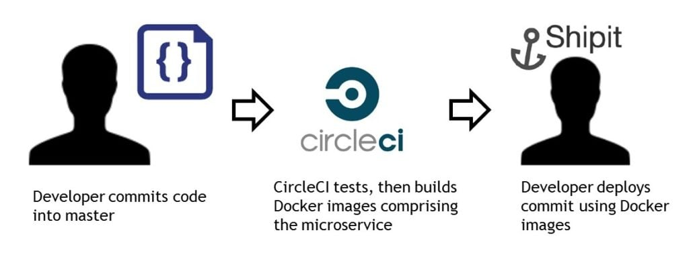
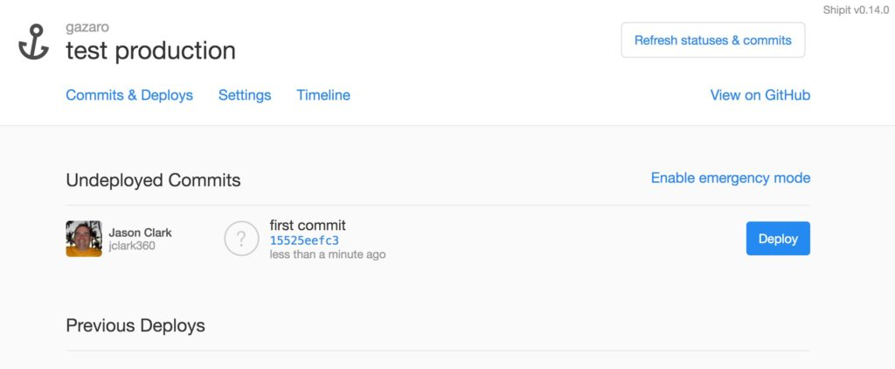

At [**360pi**](http://www.360pi.com), we deliver commerce analytics that

enable retailers to make sense of retail and shopper big data, which

will then be used to improve their commerce strategy. Our infrastructure

is all in Amazon Web Services, and up until now, was simply Ec2

instances built with our own AMIs. We used to maintain the traditional

dev/test/master branch hierarchy in GitHub for our monolithic Python

application, and we deployed those branches with Jenkins and Ansible

scripts. Recently, performance, reliability, and ease of use drove us to

rethink our platform architecture, and devise a more streamlined

approach to the development and deployment of our application. A

microservices architecture would give each of our developers a small

enough piece of the system to deploy, which reduces the footprint of

failure when something goes wrong. Things always break; it’s how quickly

you can react and move on that’s key.

#### Goals for Re-architecting

We had a few key goals for this effort, but our main goal was to have

everyone who checks into the master repository own the deployment of his

or her changes to production. To do this well, you first need to give

developers complete control of the deployment of the code commit.

Secondly, you need to instill the mindset that a developer owns his or

her changes from merge to master until they are running in production.

First up, we built an easy-to-manage-and-maintain Docker environment

with a good management UI, which Rancher provided for us. We decided to

use Rancher’s orchestrator, since its UI at the time was the most

mature, and we don’t yet have the scale that would require Kubernetes.

Our infrastructure is all in AWS, so we deployed three instances with

the Rancher stack on it, and some instances for our Rancher hosts.

#### Transitioning to Microservices

We had already started development of our microservices, which are

effectively the main areas of concern for our application. Each

microservice is self-contained, with its own database, RESTful API, and

deployment scripts. We use CircleCI at 360pi, which made it quite

straightforward to run tests. We then packaged these as Docker images -

if the build was good, we uploaded them to our Docker repository. So

now, we have small, composable pieces of our system, all using Docker.

We have a way to test the code, and to build Docker images that

represent each microservice. The key point here is this: **every successful merge into master results in a new Docker image, which is tagged with the commit SHA for that change**.



#### Deployment Time

[](https://info.rancher.com/cicd-with-docker-ebook) Our

newly-updated eBook walks you through incorporating containers into your

CI/CD pipeline The most important piece left was actually

deploying the changes. For this, we turned to an awesome open source

project called [Shipit](https://github.com/Shopify/shipit-engine),

created and maintained by the folks over at Shopify. Shipit is a Rails

project that allows you to deploy in pretty much anyway you want, but

does so on a commit-by-commit basis. Every commit is a shippable piece

of code; for us, every commit was a shippable Docker image (you can read

more on Shipit in [this excellent write up](https://engineering.shopify.com/blogs/engineering/introducing-shipit)). Since

all Shipit does is call shell scripts to do the deploy, it’s quite

simple to bring Rancher into the picture. We create a

`docker_compose.yml` file, and in some cases, a `rancher_compose.yml`

file in each microservices project. We then installed the [Rancher CLI](https://rancher.com/docs/rancher/v1.6/en/cli/) on our Shipit

environment so we could manipulate Rancher from our Shipit instances in

AWS. Each microservice has a deploy folder with a few shell scripts,

which simply contain Rancher CLI calls that instruct the Rancher API to

deploy new images to the stack in Rancher. From the Shipit UI, the

developer simply clicks the deploy button next to the commit they want

to deploy; that person watches their deployment happen, and is

responsible for ensuring that it completes properly. The magic here is

that Shipit sets an environment variable with the current commit SHA

being deployed, so we just read that environment variable in the Docker

Compose file (shown below) to know which image to deploy.  ShipIt UI

**Shipit deploy.sh sample**

```
rancher --environment MyEnvironment up my-service --stack 360-micro-service --force-upgrade --batch-size 1 -d
```

**Rancher docker\_compose.yml sample**

```
my-service:
  labels:
    io.rancher.container.pull_image: always
  tty: true
  image: my_repo/360_service:${REVISION}  # this is the Shipit commit SHA environment var
  stdin_open: true
```

#### Rolling Back

Sometimes, things go wrong (welcome to building and shipping software).

Luckily, since we’re using Docker images, getting back to sanity is

easy. Shipit supports rollbacks, which is again just a call to the

deploy shell script that uses the Rancher CLI. The script tells Rancher

to deploy a different Docker image version, this time using the prior

commit SHA. To handle database changes and our reliance on them, we

require our code to be compatible at least one version back, which means

schema changes must be deployed without code changes so that rollback is

possible. So there you have it: a complete CI/CD scenario, made possible

by the power of Rancher and its wonderful API. *Jason Clark is a Systems Architect at 360pi who is passionate about efficient, lean systems architecture. Follow Jason on Twitter @jclarknet.*
