Build a CI/CD Pipeline with Kubernetes and RancherRecorded Online Meetup of best practices and tools for building pipelines with containers and kubernetes. [Watch the training](https://rancher.com/events/2018/2018-08-07-onlinemeetup-building-a-cicd-pipeline-with-k8s/) [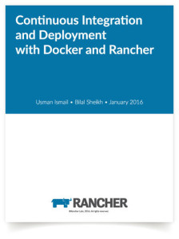](https://cdn.rancher.com/wp-content/uploads/2016/01/12074936/ebookcover_500.jpg)In

previous articles we have seen [how to setup a Jenkins CI system on top of docker](https://rancher.com/deploying-a-scalable-jenkins-cluster-with-docker-and-rancher/)

and [leverage docker in order to create a continuous integration pipeline](https://rancher.com/docker-based-build-pipelines-part-1-continuous-integration-and-testing/).

As part of that we used docker to create a centrally managed build

environment which can be rolled out to any number of machines. We then

setup the environment in Jenkins CI and automated the continuous

building, packaging and testing of the source.

In this article we will take the pipeline further (shown below) and see

how we can continuously deploy the project to a long-running testing

environment. This will allow manual human testing of the code in

addition to automated acceptance testing. This environment will also

allow you to get your customers’ or QA’s eyes on the latest changes

before they hit production. Further, this will give you a good idea of

how to build and deploy to production environments which we will cover

in the next article. You can download the entire series in our eBook

”[Continuous Integration and Deployment with Docker and Rancher](https://info.rancher.com/cicd-with-docker-ebook).”

[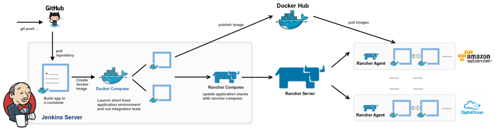](https://cdn.rancher.com/wp-content/uploads/2015/11/18175745/cd_flow.png)

[toc]

## Creating long running application environments with Docker and Rancher

After we’ve built and tested our application, we can now deploy it to a

long running, potentially externally facing environment. This

environment will allow Quality Assurance (QA) or customers to see and

test the latest changes before they make their way to production. This

environment is an important step on the road to production as it allows

us to unearth bugs that are only seen with real-world use and not

automated integration tests. We normally call this environment the QA or

Integration environment. Like our [previous article](https://rancher.com/docker-based-build-pipelines-part-1-continuous-integration-and-testing/), we’ll be

using the go-auth component of

our [go-messenger](https://github.com/usmanismail/go-messenger) project

to demonstrate how to create a test environment. We’ll go through the

steps below for creating our integration environment:

1. Create an Integration environment in Rancher
2. Define Docker Compose and Rancher Compose templates
3. Create application stack with Rancher
4. Manage DNS records with Rancher and AWS Route53
5. Add support for HTTPS

### **Create an Integration environment in Rancher**

In the Rancher UI, go to the top right corner and select *Manage Environments* and *Add Environment*. In the resulting screen (shown

below) add the Name (Integration) and optionally a description for each

of the environments. You also need to select a list of users and

organizations that have access to the environments.

[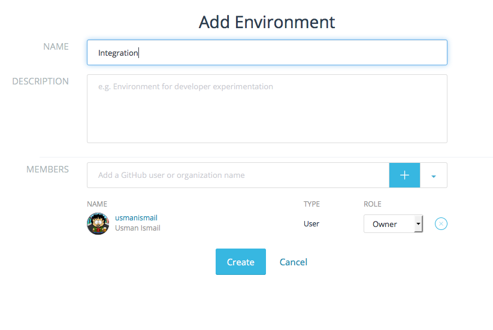](images/rancher_blog_Screen-Shot-2015-10-26-at-10.33.44-PM.png)Once

you have your environment setup, select the *Integration* environment

from the drop down in the top left corner of the screen. We can now

create the application stack for the integration environment. Also from

the menu in the top right corner select *API & Keys* and *Add API Key*. This will load a pop-up screen which allows you to create a named

API Key pair. We need the key in subsequent steps to to use Rancher

Compose to create our test environments. We will create key pair named

*JenkinsKey* to run rancher compose from our Jenkins instance. Copy the

key and secret for use later as you will not be shown these values

again. Note that API keys are specific to the environment and hence you

will have to create a new key for each environment.

[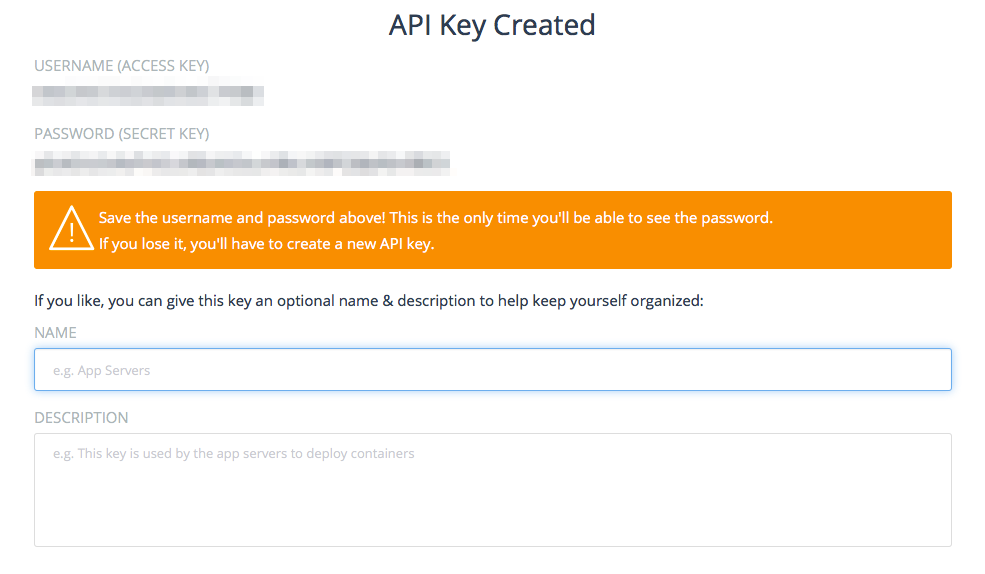](images/rancher_blog_api_keys.png)

### **Define Docker Compose and Rancher Compose templates**

In our [[previous article](https://rancher.com/docker-based-build-pipelines-part-1-continuous-integration-and-testing/)]

we created a docker compose template to define the container types

required for our project. The compose template (docker-compose.yml) is

shown below. We will be using the same docker compose template as before

but with the addition of auth-lb service. This will add a load-balancer

in front of our go-auth service and split traffic across all the

containers running the service. Having a load balancer in front of our

service is essential to insure availability and scalability, as it

continues to serve traffic even if one (or more) of our service

containers die. Additionally, it also spreads the load on multiple

containers which may be running on multiple hosts.

```
mysql-master:
 image: mysql
 environment:
   MYSQL_ROOT_PASSWORD: rootpass
   MYSQL_DATABASE: messenger
   MYSQL_USER: messenger
   MYSQL_PASSWORD: messenger
 expose:
 - "3306"
 stdin_open: true
 tty: true
auth-service:
  tty: true
  command:
  - --db-host
  - mysql-master
  - -p
  - '9000'
  image: usman/go-auth:${auth_version}
  links:
  - mysql-master:mysql-master
  stdin_open: true

auth-lb:
  ports:
  - '9000'
  expose:
  - 9090:9000
  tty: true
  image: rancher/load-balancer-service
  links:
  - auth-service:auth-service
  stdin_open: true
```

[We are using Rancher Compose to launch the environment in a multi-host

environment, this more closely mirrors production and also allows us to

test integration with various services, e.g. Rancher and Docker Hub etc.

Unlike our previous docker compose based environment which was

explicitly designed to be independent of external services and launched

on the CI server itself without pushing images to dockerhub.

]

Now that we are going to use Rancher compose to launch a multi-host test

environment instead of docker compose, we also need to define a rancher

compose template. Create a a file called *rancher-compose.yml* and add

the following content. In this file we are defining that we need two

containers of the auth service, one container running the database and

another running the load-balancer container.

```
auth-service:
  scale: 2
mysql-master:
  scale: 1
auth-lb
  scale: 1
```

Next we will add a health check to the auth-service to make sure that we

detect when containers are up and able to respond to requests. For this

we will use the /health URI of the go-auth service. The auth-service

section of rancher-compose.yml should now look something like this:

```
auth-service
  scale: 1
  health_check:
    port: 9000
    interval: 2000
    unhealthy_threshold: 3
    request_line: GET /health HTTP/1.0
    healthy_threshold: 2
    response_timeout: 2000
```

We are defining a health check on port 9000 of the service container

which is run every 2 seconds (2000 milliseconds). The check makes a http

request to the /health URI and 3 consecutive failed checks mark a

container as unhealthy whereas 2 consecutive successes mark a container

as healthy.

### **Create application stack with Rancher Compose**

Now that we have our template defined we can use Rancher compose to

launch our environment. To follow along, simply checkout the

[go-messenger project](https://github.com/usmanismail/go-messenger) and

download the rancher-compose CLI from rancher UI. To setup

rancher-compose on your development machine, follow the instructions. Once you have

rancher-compose setup you can use the create command shown below to

setup your integration environment.

```
git clone https://github.com/usmanismail/go-messenger.git
cd go-messenger/deploy

#replace rancher-compose with the latest version you downloaded from rancher UI
./rancher-compose  --project-name messenger-int 
    --url http://YOUR_RANCHER_SERVER:PORT/v1/   
    --access-key <API_KEY>                      
    --secret-key <SECRET_KEY>                   
    --verbose create
```

In the UI, you should now be able to see the stack and services for your

project. Note that “create” command only creates the stack and

doesn’t start services. You can either start the services from the UI

or use the rancher-compose start command to start all the services.

[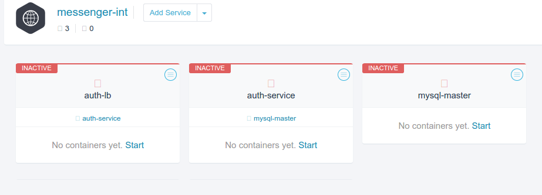](images/rancher_blog_messenger-int-stack-not-started1.png)Let’s

use rancher-compose again to start the services:

```
./rancher-compose  --project-name messenger-int 
    --url http://YOUR_RANCHER_SERVER:PORT/v1/   
    --access-key <API_KEY>                      
    --secret-key <SECRET_KEY>                   
    --verbose start
```

To make sure everything is working, head over to the public IP for the

host running the “auth-lb” service and create a user using the command

shown below. You should get a 200 OK. Repeating the above request should

return a 409 error indicating a conflict with an existing user in the

database. At this point we have a basic integration environment for our

application which is intended to be a long running environment.

```
curl -i -silent -X PUT -d userid=<TEST_USERNAME> -d password=<TEST_PASS> <HOST_IP_FOR_AUTH_LB>:9000/user
```

### **Manage DNS records with Rancher and AWS Route53**

Since this environment is meant to be long running and externally

facing, we are going to be using DNS entries and HTTPS. This allows us

to distribute the application outside corporate firewalls securely and

also allows more casual users to rely on persistent DNS rather than IPs

which may change. You may use a DNS provider of your choice, however, we

are going to illustrate how to setup DNS entries in Amazon Route53. To

do so go to [AWS Console > Route 53 > Hosted Zones](https://console.aws.amazon.com/route53/home?region=us-east-1#hosted-zones:)

and *Create Hosted Zone*. In the hosted zone you will have to specify a

domain name of your choice e.g. gomessegner*.com*. While you are in the

AWS console you can also create a user for Rancher to use to make

Route53 updates. [Go to AWS Console > IAMS > Users](https://console.aws.amazon.com/iam/home#users) and select *Create New Users*. Keep the the Access Key and Secret Key of this user handy as

you will need a little later on. Once you have created the user account

you must add the AmazonRoute53FullAccess policy to the user so that it

can make updates to route53.

Now that we have our Hosted Zone and IAMs user setup we can add the

Route53 integration to our Rancher Server. The detailed instructions on

how to do so can be found

[here.](https://rancher.com/introducing-rancher-service-discovery-integration-with-amazon-route53/)

In short you need to browse to *Applications > Catalog* on your rancher

server and select Route 53 DNS. You will be asked to specify the Hosted

Zone that you setup earlier as well as the AWS Access and Secert Keys

for you Rancher IAMs user with Route53 access. Once you enter the

required information and click create, you should see new stack created

in your environment with a service called route53.

[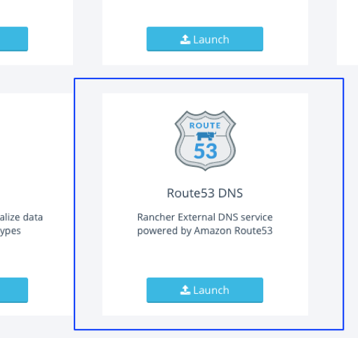](images/rancher_blog_Screen-Shot-2015-11-12-at-10.40.51-PM.png)

This service will listen for Rancher events and catch any load balancer

instance launches and terminations. Using this information it will

automatically create DNS entries for all the Hosts on which your

loadbalancer containers are running. The DNS entries are of the form

[Loadbalancer].[stack].[environment].[domain], e.g.

goauth.integration.testing.gomessenger.com. As more containers are

launched and taken down on your various Rancher compute nodes the

Route53 service will keep your DNS records consistent. This is essential

for our integration test environments because as we will see later we

need to relaunch the environment containers in order to push updates as

part of continuous deployment. With Route53 DNS integration we do not

have to worry about getting the latest hostnames to our clients and

testers.

### **Add support for HTTPS**

Now that we have DNS records for our environment it is a good idea to

support HTTPS. To do that, first, we need an SSL certificate for our

domain. You can purchase a root SSL certificate for your domain from one

the many trusted certificate authorities such as

[Comodo](https://ssl.comodo.com/). If you don’t have a certificate you

can generate a self-signed certificate to complete the setup and replace

it with a trusted one at a later time. The implication of a self-signed

certificate is that any user will get a “This connection is untusted”

warnings in browsers, however, the communication is still encrypted. In

order to generate the self-signed certificate you will first need to

generate the ssl key which you can do using the genrsa command of

openssl. Then you can use the key file to generate the certificate using

the req command. The steps to do so are listed below. Its also a good

idea to print and store the sha256 finger print of the certificate so

that you can manually ensure that the same certificate is presented to

you when making HTTPS requests. In the absence of a trusted certificate

manually matching fingerprints is the only way to ensure that there

aren’t any man-in-the-middle attacks.

```
openssl genrsa -out integration.gomessenger.com.key 2048
openssl req -new -x509                   
    -key integration.gomessenger.com.key   
    -out integration.gomessenger.com.crt  
    -days 365 -subj /CN=integration.gomessenger.com
openssl x509 -fingerprint -sha256 -in integration.gomessenger.com.crt
SHA256 Fingerprint=E2:E5:86:09:F0:91:F4:3C:C2:DE:D1:40:9C:DD:AF:A2:0A:88:EE:19:0C:C5:A6:03:C9:9B:17:6E:8F:58:D2:C3
```

Now that you have the certificate and the private key file we need to

upload these into Rancher. We can upload certs by clicking the *Add Certificate* button in the *Certificates* Section of the

*Infrastructure* tab in the Rancher UI*.* You need to specify a

meaningful name for your certificate and optionally a description as

well. Copy the contents of *integration.gomessenger.com.key* and

\*integration.gomessenger.com.crt \*into the *Private Key* and

\*Certificate \* fields respectively (or select Read from File and select

the respective files). Once you have completed the form click save and

wait a few moments for the certificate to become active.

\* [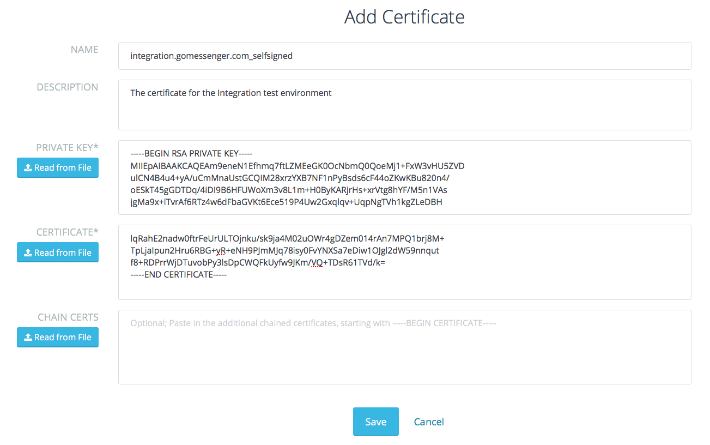](images/rancher_blog_Screen-Shot-2015-10-31-at-9.32.22-AM.png)\*Once

the certificate is active we can add the HTTPS endpoint to our

environment. In order to do so we have to modify our docker-compose file

to include the SSL port configuration. We add a second port (9001) to

the *ports* section to make it accessible outside the load balancer

container and we use the *io.rancher.loadbalancer.ssl.ports* label to

specify that ‘9001’ will be the public load balancer port with SSL

termination. Furthermore since we are terminating SSL at the load

balancer we can route requests to our actual service container using

plain HTTP over the original 9000 port. We specify this mapping from

9001 to 9000 using the *io.rancher.loadbalancer.target.auth-service*

label\*. \*

```
auth-lb:
 ports:
 - '9000'
 - '9001'
 labels:
 io.rancher.loadbalancer.ssl.ports: '9001'
 io.rancher.loadbalancer.target.auth-service: 9000=9000,9001=9000
 tty: true
 image: rancher/load-balancer-service
 links:
 - auth-service:auth-service
 stdin_open: true
mysql-master:
  environment:
  ...
  ...
```

We also need to update the rancher-compose file to specify the SSL

certificate we should use in the load balancer service for SSL

termination. Add the *default\_cert* parameter with the name of the

certificate we uploaded earlier. After these changes you will need to

delete and recreate your stack as there is currently no way to add these

properties to a deployed stack.

```
auth-lb:
  scale: 1
  default_cert: integration.gomessenger.com_selfsigned
  load_balancer_config:
    name: auth-lb config

mysql-master:
  scale: 1
auth-service:
  scale: 1
```

Now to make sure everything is working, you can use the following curl

command. When you try the same command with the https protocol specifier

and the 9001 port you should see a failure complaining about the use of

an untrusted certificate. You can use the *--insecure* switch to turn

of trusted certificate checking and use https without it.

```
# Http Request
curl -i -silent -X PUT            
    -d userid=<TEST_USERNAME>     
    -d password=<TEST_PASS>       
    http://integration.gomessenger.com:9000/user

# Https Request with secure checking
# Note Http(s) and 900(1)
curl -i -silent -X PUT            
 -d userid=<TEST_USERNAME>        
 -d password=<TEST_PASS>          
 https://integration.gomessenger.com:9001/user
curl: (60) SSL certificate problem, verify that the CA cert is OK. Details: error:14090086:SSL routines:SSL3_GET_SERVER_CERTIFICATE:certificate verify failed

# Https Request with insecure checking
curl -i -silent -X PUT            
 --insecure                       
 -d userid=<TEST_USERNAME>        
 -d password=<TEST_PASS>          
 https://integration.gomessenger.com:9001/user
```

## Creating Continuous Deployment pipelines with Rancher and Jenkins

Now that we have created our test environment we can finally get back to

the original intent of this article and build out a docker continuous

deployment pipeline by extending our [Jenkins CI pipeline](https://rancher.com/docker-based-build-pipelines-part-1-continuous-integration-and-testing/) which built

the application, packaged it into a container and ran integration tests

against it.

### **Publishing Docker images**

We’re going to start by publishing the packaged image to a docker

repository. For simplicity we are using a public

[DockerHub](https://hub.docker.com/) repository, however, for actual

development projects you would want to push your docker images to a

private repository. Let’s create a new *Free Style Project* job in

Jenkins by clicking the *New Item* button and name our job

*push-go-auth-image.* Once you do so, you will be taken to the Jenkins

job configuration page where you can define the steps required to push

your go-auth image up to Dockerhub.

Since this is a continuation of the pipeline we built in our [previous article](https://rancher.com/docker-based-build-pipelines-part-1-continuous-integration-and-testing/), the

job will have similar configuration to *go-auth-integration-test* job.

The first setting you need is to make it \*parameterized build \*and

adding the GO\_AUTH\_VERSION parameter.

[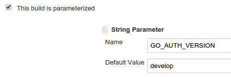](images/rancher_blog_go_auth_parameter.png)

In order to actually push the image we will select the *Add build step*

drop down and then the *Execute shell* option. In the resulting text box

add the commands shown below. In the commands we are going to log in to

docker hub and push the image we built earlier. We’re pushing to the

*usman/go-auth* repository, however, you will need to push to your own

DockerHub repository.

As covered in the [previous article](https://rancher.com/docker-based-build-pipelines-part-1-continuous-integration-and-testing/),

we’re using git-flow branching model where all feature branches are

merged into the ‘develop’ branch. To continuously deploy changes to

our integration environment we need a simple mechanism to generate the

latest image based off of develop. In our package job we tagged the

docker container using the GO\_AUTH\_VERSION (e.g., docker build -t

usman/go-auth:${GO\_AUTH\_VERSION} .…). By default the version will

be develop, however, later in this article we’ll create new releases

for our application and use the CI/CD pipeline to build, package, test

and deploy them to our integration environment. Note that with this

scheme, we’re always overwriting the image for our develop branch

(usman/go-auth:develop) which prevents us from referencing historical

builds and do rollbacks. One simple change that you can make to the

pipeline is to attach the Jenkins build number to the version itself,

e.g., usman/go-auth:develop-14.

Note that you will need to specify your DockerHub username, password and

email. You can either use a parameterized build to specify these for

each run or use the [Jenkins Mask Passwords Plugin](https://wiki.jenkins-ci.org/display/JENKINS/Mask+Passwords+Plugin)

to define these securely, once in the main Jenkins configuration and

inject them into the build. Make sure to enable ‘Mask passwords (and

enable global passwords)’ under \*Build Environment \*for your job.

```
echo ${GO_AUTH_VERSION}
docker login -u ${DOCKERHUB_USERNAME} -p ${DOCKERHUB_PASSWORD} -e ${DOCKERHUB_EMAIL}
docker push usman/go-auth:${GO_AUTH_VERSION}
```

Now we have to make sure that this job is triggered after our

integration test job. To do that we need to update our integration test

job to trigger *parameterized build* with \*current build

parameters. \*This means that after each successful run of the

integration test job we will push the tested image up to Dockerhub.

[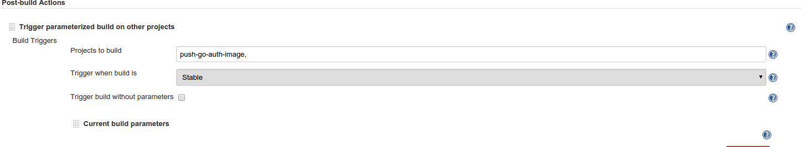](images/rancher_blog_trigger_image_push_job.png)

Lastly, we need to trigger the deployment job once the image is

successfully pushed to DockerHub. Again, we can do that by adding a

post-build action as we did for other jobs.

### **Deploying to Integration environment**

For this we will use the Rancher compose CLI to; stop the running

environment, pull latest images from DockerHub, and restart the

environment. A brief word of caution, the Updates API is under heavy

development and may change. There will certainly be newer features added

in the coming weeks and months so check the Documentation

to see if there are updated options. Before we create a Jenkins job to

achieve continuous deployment let’s first go through the steps

manually.

A simple approach would be to stop all services (auth service, load

balancer and mysql), pull the latest images and start all services. This

however would be less than ideal for long running environments where we

only want to update the application. To update our application, we’re

first going to stop auth-service. You can do this by using the stop

command with Rancher Compose.

```
# If you not have already done so
# git clone https://github.com/usmanismail/go-messenger.git
# cd go-messenger/deploy

rancher-compose --project-name messenger-int      
    --url http://YOUR_RANCHER_SERVER:PORT/v1/     
    --access-key <API_KEY>                        
    --secret-key <SECRET_KEY>                     
    --verbose stop auth-service
```

This will stop all containers running for auth-service which you can

verify by opening the stack in the Rancher UI and verifying that the

status of the service is set to *Inactive.* Next, we’ll tell rancher to

pull the image version we want to deploy. Note that the version we

specify here will be substituted in our docker compose file for the auth

service ( *image: usman/go-auth:${auth\_version}* ).

```
auth_version=${version} rancher-compose --project-name messenger-int 
 --url http://YOUR_RANCHER_SERVER:PORT/v1/   
 --access-key <API_KEY>                      
 --secret-key <SECRET_KEY>                   
 --verbose pull auth-service
```

Now that we have pulled the image we want, all that is needed is

to start the application.

```
auth_version=${version} rancher-compose --project-name messenger-int 
 --url http://YOUR_RANCHER_SERVER:PORT/v1/   
 --access-key <API_KEY>                      
 --secret-key <SECRET_KEY>                   
 --verbose start
```

As of Rancher release version 0.44.0, the three steps listed above can

be run by a single up command using the *--force-upgrade* switch as

follows:

```
auth_version=${version} rancher-compose  --project-name messenger-int 
 --url http://YOUR_RANCHER_SERVER:PORT/v1/   
 --access-key <API_KEY>                      
 --secret-key <SECRET_KEY>                   
 --verbose up -d --force-upgrade --pull --confirm-upgrade auth-service
```

Now the we know how to run our update lets create a Jenkins job in our

pipeline to do so. As before create a new freestyle project and name it

\*deploy-integration. \*As with all other jobs, this will also be a

parameterized build with GO\_AUTH\_VERSION as a string parameter. Next

we need to copy over artifacts from the upstream *build-go-auth* job.

[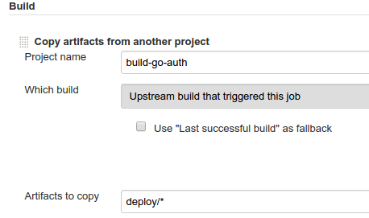](images/rancher_blog_copy_artifacts_deploy_job.png)

Lastly, we need to add the *Execute Shell* build step with the Rancher

compose up command that we specified earlier. Note that you will also

need to setup rancher-compose on Jenkins ahead of time and make it

available to your build on the system path. We are setting up our job to

reinstall compose every time for the sake of simplicity. You will need

to specify the Rancher API key, Rancher API Secret and your Rancher

server URL as part of the execution script. As before you may use the

Parameterized build option or the [Masked Passwords](https://wiki.jenkins-ci.org/display/JENKINS/Mask+Passwords+Plugin)

plugin to avoid exposing your secret or having to enter it every time.

The complete contents of the execute shell step looks like the snippet

shown below. Note that unless if you have multiple Rancher compose nodes

the load balancer containers may launch on different host and hence your

route 53 record-set may need to be updated.

```
cd deploy
wget https://github.com/rancher/rancher-compose/releases/download/v0.5.1/rancher-compose-linux-amd64-v0.5.1.tar.gz -O - | tar -zx
mv rancher-compose-v0.5.1/rancher-compose .
rm -rf rancher-compose-v0.5.1

./rancher-compose --project-name messenger-int 
 --url http://YOUR_RANCHER_SERVER:PORT/v1/   
 --access-key <API_KEY>                      
 --secret-key <SECRET_KEY>                   
 -- verbose up -d --force-upgrade --pull --confirm-upgrade auth-service
```

With our two new Jenkins jobs the Pipeline we started in the [Docker Based Build Pipelines](https://rancher.com/docker-based-build-pipelines-part-1-continuous-integration-and-testing/) article,

now looks like the image shown below. Every check-in to our sample

application now gets compiled to make sure there are not syntax errors

and that the automated tests pass. That change then gets packaged, and

tested with integration testes and finally deployed for manual testing.

The five steps below provide a good baseline template for any build

pipeline and helps predictably move code from development to testing and

deployment stages. Having a continuous deployment pipeline ensures that

all code is not only tested by automated systems but is available for

human testers quickly. It also serves as a model for production

deployment automation and can test the operations tooling and code to

deploy your application on a continual basis.

[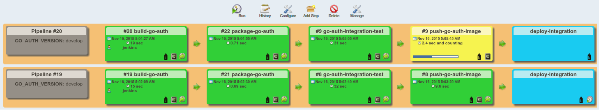](images/rancher_blog_complete_pipeline_jenkins1.png)

### **Releasing and deploying a new version**

Once we have deployed our code to a persistent testable environment we

will let QA (Quality Assurance) team test the changes for a period of

time. Once they certify that the code is ready, we can create a release

which will subsequently be deployed to production. The way releases work

with git-flow is similar to how feature branches (which we talked about

in the [previous article](https://rancher.com/docker-based-build-pipelines-part-1-continuous-integration-and-testing/) work.

We start a release using the *git flow release start [Release Name]*

command (shown below). This will create a new named release branch. In

this branch we will perform house-keeping actions such as incrementing

version numbers and making any last minute changes.

```
git flow release start v1
Switched to a new branch 'release/v1'
Summary of actions:
- A new branch 'release/v1' was created, based on 'develop'
- You are now on branch 'release/v1'
Follow-up actions:
- Bump the version number now!
- Start committing last-minute fixes in preparing your release
- When done, run:
git flow release finish 'v1'
```

Once done we can we can run the *release finish* command to merge the

release branch into the master branch. This way master always reflects

the latest released code. Further each release is tagged so that we have

a historical record of what went into each release. Since we don’t want

any other changes to go in, let’s finalize the release.

```
Switched to branch 'master'
Merge made by the 'recursive' strategy.
 README.md | 1 +
 1 file changed, 1 insertion(+)
Deleted branch release/v1 (was 7ae8ca4).
Summary of actions:
- Latest objects have been fetched from 'origin'
- Release branch has been merged into 'master'
- The release was tagged 'v1'
- Release branch has been back-merged into 'develop'
- Release branch 'release/v1' has been deleted
```

The last step here is to push the release to remote repository.

```
git push origin master
git push --tags //pushes the v1 tag to remote repository
```

If you’re using Github for hosting your git repository, you should now

have a new release.

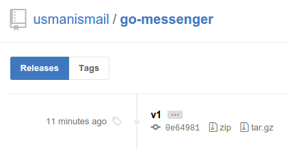

It is also a good idea to push images to DockerHub with a version that

matches the release name. To do so, let’s trigger our CD pipeline by

running the first job. If you recall, we setup [Git Parameter plugin](https://wiki.jenkins-ci.org/display/JENKINS/Git+Parameter+Plugin)

in the previous article to fetch all the tags matching our filter from

git. This normally defaults to *develop* however, when we trigger the

pipeline manually we can choose from git tags. For example in the

section below, we have two releases for our application. Let’s select

one of them and kick off the integration and deployment pipeline.

[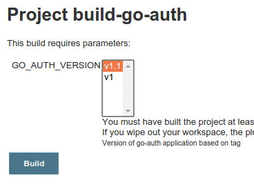](images/rancher_blog_trigger_release.png)

This will go through the following steps and deploy our application with

version 1.1 to our long running integration environment all with a

couple of clicks:

1. Fetch the selected release from git
2. Build the application and run unit tests
3. Create a new image with tag v1.1 (e.g., usman/go-auth:v1.1)
4. Run integration tests
5. Push the image (usman/go-auth:v1.1) to DockerHub
6. Deploy this version to our integration environment

In today’s article we covered creating a continuous deployment

pipeline which can put our sample application on an integration

environment. We also looked at integrating DNS and HTTPS support in

order to create a more secure and usable environment with which clients

can integrate. In the next article we will look at running production

environments. Deploying to production environments presents it’s own

set of challenges as we will be expected to deploy under-load, with

little (ideally zero) downtime. Furthermore, Production environments

present challenges as they have to scale out to meet load while also

scaling back to control cost. Lastly, we take a more comprehensive look

at DNS management in order to provide automatic fail over and high

availability. In subsequent articles we will look at operations

management of docker environments in production as well as different

types of work-loads for example state-full connected services. To get

the entire series, please download our [eBook: Continous Integration and Deployment with Docker and Rancher](https://info.rancher.com/cicd-with-docker-ebook). You can also

join us for this months online Rancher meetup to learn more about

building docker-based operations processes.

*Usman and Bilal are server and infrastructure engineers, with experience in building large scale distributed services on top of various cloud platforms. You can read more of their work at [techtraits.com](http://techtraits.com/), or follow them on twitter [@usman\_ismail](http://twitter.com/usman_ismail) and [@mbsheikh](https://twitter.com/mbsheikh) respectively.*Build a CI/CD Pipeline with Kubernetes and RancherRecorded Online Meetup of best practices and tools for building pipelines with containers and kubernetes. [Watch the training](https://rancher.com/events/2018/2018-08-07-onlinemeetup-building-a-cicd-pipeline-with-k8s/)
