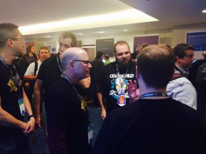
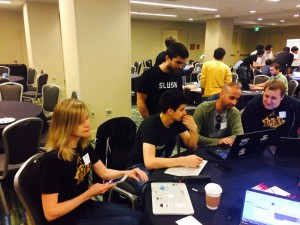

Our
team just spent the last 4 days in San Francisco attending the Dockercon
conference and participating in the Hackathon. We decided to send the
entire Rancher Labs engineering team to the conference. I’m so glad we
did. There was big news and great new Docker capabilities. It gave us a
chance to meet so many Rancher friends and users at one time. First
there’s the city, the venue, the party, and the food. The foodies on our
team were raving about the quality of lunch and snacks, which was a
pleasant departure from the usual conference food. Kudos to the
organizers for their attention to detail. You rock. You understood food
for developers, and took great care of our vegetarian and gluten-free
team members! The Hackathon was a highlight of the show for us. As the
sponsor, we got to interact with hundreds of passionate developers. I
was amazed by their background--from college interns to seasoned
programmers, all eager to code. It’s great to be among peers who code
for the joy of coding. Our [team had a
blast](https://rancher.com/sherdock/), and really enjoyed the 24-hours of
coding and camaraderie. The first day keynote really set the tone for
the entire conference. When Ben Golub established the theme of the
conference as putting “Docker in production,” I was thrilled. This has
been our driving vision since we started Rancher, and it is fantastic to
see how much work is going into making it possible. A great example of
this theme was the work Docker is doing to make infrastructure a first
class capability in Docker. Solomon Hykes elevated nitty-gritty
technical details to a set of key principles, which we fully agreed in.
My favorite was was when he said “the network should be part of the
application, not the other way around.” At Rancher we have intuitively
felt that the type of infrastructure we build is different from the
traditional idea of software-defined infrastructure. Solomon’s statement
captured the essence of what we often call “application-defined
infrastructure,” but when he talked about it as “plumbing” for
application development, I think he made it much simpler to understand.
We are super-excited about Docker’s new plug-in framework. We’ve been
monitoring and contributing to the design of the plug-in framework
closely. We are happy to see it coming to fruition at Dockercon. Rancher
Labs is a Docker plumbing company, and therefore we will be utilizing
and pushing the envelope of the plug-in framework right
away.
It was obvious from the start of the conference, the Docker ecosystem is
stronger than ever. Every major industry leader and startup company
seemed to be represented. Since containers represent a new way to
consume cloud resources, I was excited to see the three major cloud
providers, Amazon Web Services, Google Cloud Platform, and Microsoft
Azure, all had a strong presence at the show. There was a strong sense
that the space would be big enough to create opportunities for everyone.
All conference have rules like “be nice” or “no harassment policy.” I
must say, however, I have never been to a conference where fellow
attendee are more fun, more open, and more helpful. I met a developer
from South Africa who will embark on a cross-country motorcycle ride
after Dockercon. One of our engineers, Sheng Yang, was thrilled to get
to know and have his problems solved on the fly by Docker maintainer
[Vincent Batts](https://twitter.com/vbatts). Our engineers all told me
it was well worth their time to spend two days at Dockercon, talking,
listening and hacking. . While the first day keynote was exciting, the
second day keynote and enterprise customer sessions were the reason
companies like ours are so excited about the market developing around
Docker. An amazing line-up of Docker users shared stories about
deploying Docker. Cool new products were developed. Speakers like [Simon
Eskildsen](https://twitter.com/sirupsen) from Shopify and [Brian
Scott](https://twitter.com/brainscott) and [Patrick
O’Connor](https://twitter.com/dontrebootme) from Disney shared great
insights on how larger organizations are using containers. The Windows
container demo was impressive, as was the demo of container migration. I
particularly loved the Project Orca demo. Project Orca shows Docker is
committed to tying together Docker native container orchestration
technologies like Compose, Swarm, and Machine to form a rich experience
for running containers in production. At Rancher Labs, we’ve had to
build our own Docker compose-based orchestration front-end just to be
able to drive workload into our infrastructure plumbing. Rancher users
love the fact that our own front-end mimics Docker compose but they
would certainly prefer working with the real Docker compose and Docker
Swarm. I have no doubt that, once Project Orca is developed and widely
adopted, the demand for the type of back-end infrastructure built by
Rancher will grow significantly. Docker and its ecosystem partners have
made so much progress in the last 6 months. I can’t wait to see what the
next 6 months will bring. Thanks to everyone who stopped by our booth,
the amount of interest and excitement about Rancher and RancherOS was
more than we had hoped for. We can’t wait to see everyone again at
Dockercon Europe. If you’d like more information on Rancher, please
register for our [beta program](https://info.rancher.com/beta), or
contact us and we’d be happy to walk you through the work we’re
doing.
