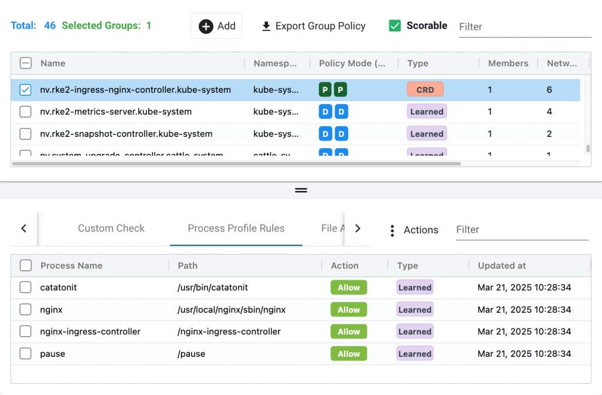
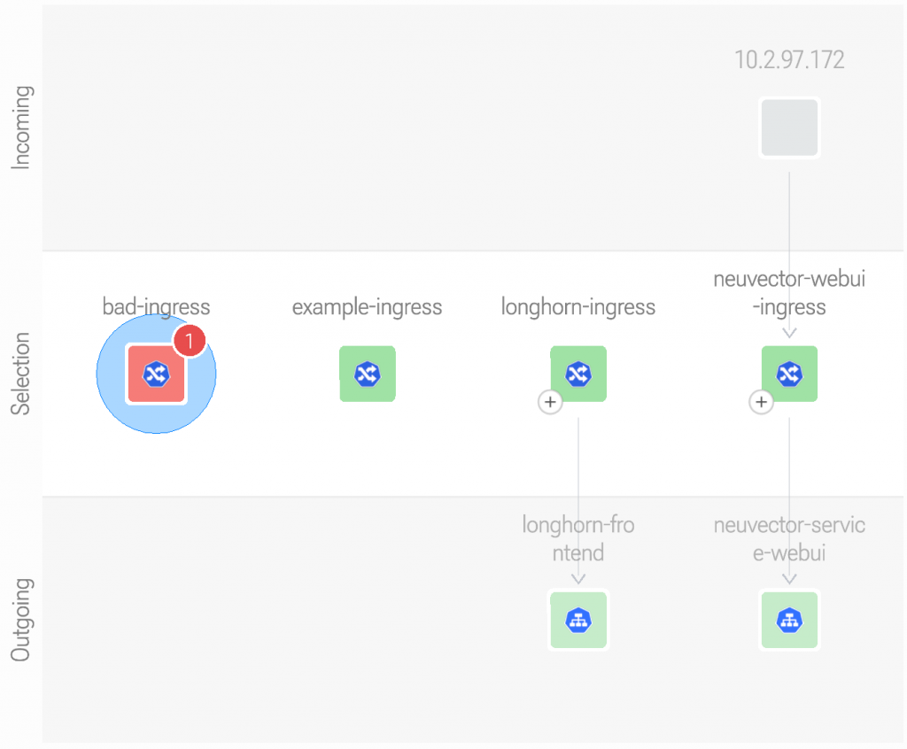
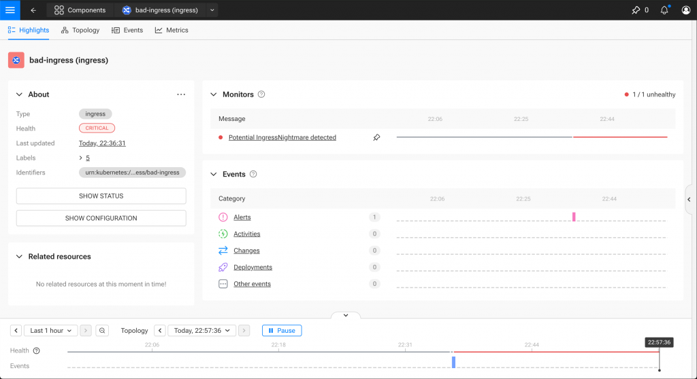

In March 2025, Wiz researchers disclosed a set of critical vulnerabilities in the popular ingress-nginx controller for [Kubernetes](https://kubernetes.io/). Collectively referred to as IngressNightmare, these issues (CVE-2025-1097, CVE-2025-1098, CVE-2025-24513, CVE-2025-24514, and CVE-2025-1974) allow unauthenticated attackers to exploit the Ingress admission controller, potentially achieving remote code execution or escalating privileges in the cluster.

In this post, we’ll walk through how SUSE’s security stack‌ — ‌including [SUSE Security](https://www.suse.com/products/rancher/security/), [KubeWarden‌](https://www.kubewarden.io/) and [Application Collection‌](https://apps.rancher.com/) — ‌can be layered to mitigate both external and internal risks related to this vulnerability. Furthermore, we'll add [SUSE Observability](https://www.suse.com/products/rancher/observability/) to ensure that no misconfigurations are present in your ingress resources.

Before jumping into the solution, let's first recap the IngressNightmare attack chain:

- **CVE-2025-1097 (8.8 High):** configuration injection via unsanitized auth-tls-match-cn annotation. The auth-tls-match-cn Ingress annotation can be used to inject configuration into nginx. This can lead to arbitrary code execution in the context of the ingress-nginx controller, and disclosure of Secrets accessible to the controller.
- **CVE-2025-1098 (8.8 High):** configuration injection via unsanitized mirror annotations. The mirror-target and mirror-host Ingress annotations can be used to inject arbitrary configuration into nginx. This can lead to arbitrary code execution in the context of the ingress-nginx controller, and disclosure of Secrets accessible to the controller.
- **CVE-2025-24514 (8.8 High):** configuration injection via unsanitized auth-url annotation. In ingress-nginx, the auth-url Ingress annotation can be used to inject configuration into nginx. This can lead to arbitrary code execution in the context of the ingress-nginx controller, and disclosure of Secrets accessible to the controller.
- **CVE-2025-24513 (4.8 Medium):** Auth secret file path traversal vulnerability. Attacker-provided data is included in a file name by the ingress-nginx Admission Controller feature, resulting in directory traversal within the container. This could result in a denial of service, or when combined with other vulnerabilities, limited disclosure of Secret objects from the cluster.
- **CVE-2025-1974 (9.8 Critical):** RCE escalation. An unauthenticated attacker with access to the pod network can achieve arbitrary code execution in the context of the ingress-nginx controller. This can lead to disclosure of Secrets accessible to the controller. (In the default installation, the controller can access all Secrets cluster-wide.)

Of these 5 vulnerabilities, the 3 configuration injection issues (CVE-2025-1097, CVE-2025-1098, and CVE-2025-24514) can be used as a trampoline to exploit the RCE vulnerability (CVE-2025-1974). This is because the auth-tls-match-cn, mirror-target, mirror-host, and auth-url annotations can be used to inject arbitrary configuration into the NGINX controller, which can then be leveraged to execute arbitrary code.

## First line of defense with SUSE Security

IngressNightmare takes advantage of the fact that the ingress-nginx validating admission webhook can be accessed from inside the cluster by any workload. If an attacker can reach the ingress-nginx admission controller, they can exploit the vulnerabilities to inject malicious configuration into the NGINX controller, which could spin up a reverse shell process, allowing the attacker to execute arbitrary code in the context of the ingress-nginx controller.

In order to stop them in their tracks, we utilize the zero trust model from SUSE Security. When we put the ingress-nginx pod into Protect mode, we ensure that it only runs processes which our security rules allow. This means that even if an attacker is able to reach the ingress-nginx admission controller, they will not be able to execute arbitrary code in the context of the ingress-nginx controller, because SUSE Security will stop them in their tracks.


*SUSE Security Protect mode*

As long as there's no rule allowing the execution of a shell process inside the ingress-nginx pod, the attacker will be stopped in their tracks. This is because SUSE Security will block any process that is not explicitly allowed by our security rules.

This is a great first line of defense against the IngressNightmare vulnerabilities, and will prevent the RCE vulnerability from being exploited.

## Protecting against supply chain compromise

Even with network-layer protections, there remains a second, subtle attack vector: a compromised application image, Helm chart or CI/CD pipeline that introduces a malicious workload with permissions to create Kubernetes Ingress resources. The attacker can then leverage the vulnerable webhook to inject malicious configuration, exploiting the configuration injection vulnerabilities (CVE-2025-1097, CVE-2025-1098, and CVE-2025-24514) of IngressNightmare.

In this scenario, the attacker doesn’t bypass the API — they use it legitimately. The malicious Ingress is accepted by the API server and forwarded to the vulnerable webhook, which may lead to configuration injection which can lead to exposing sensitive data such as secrets or certificates available to the ingress controller.

Fear not however, as SUSE’s security stack provides a solution to this threat vector as well.

## Early detection and policy enforcement with KubeWarden

To protect your cluster against this, we can use KubeWarden to enforce policy-as-code admission rules. These policies validate incoming Kubernetes objects—even before the vulnerable webhook is invoked.

Here is an example ClusterAdmissionPolicy that blocks Ingress definitions containing dangerous annotations:

```
apiVersion: policies.kubewarden.io/v1
kind: ClusterAdmissionPolicy
metadata:
  name: ingressnightmare-blocker
spec:
  module: ghcr.io/hierynomus/kw-policies/ingressnightmare-policy:v0.1.0
  rules:
    - apiGroups: ["networking.k8s.io"]
      apiVersions: ["v1"]
      resources: ["ingresses"]
      operations: ["CREATE", "UPDATE"]
  settings:
    allow_config_snippets: false
  mode: protect
```

This policy is powered by a Rust-based WebAssembly (WASM) module that inspects Ingress annotations and rejects any Ingress containing the vulnerable annotations:

- nginx.ingress.kubernetes.io/auth-url
- nginx.ingress.kubernetes.io/auth-tls-match-cn
- nginx.ingress.kubernetes.io/mirror-target
- nginx.ingress.kubernetes.io/mirror-host

Next to that, if configured, it can also block the following annotations that are known for injecting random NGINX configuration:

- nginx.ingress.kubernetes.io/configuration-snippet
- nginx.ingress.kubernetes.io/server-snippet
- nginx.ingress.kubernetes.io/auth-snippet

Once this policy is applied, trying to create an Ingress resource with any of the above annotations will result in a rejection:

```
> kubectl apply -f ingress-nightmare.yaml
Error from server: error when creating "ingress-nightmare.yaml": 
admission webhook "clusterwide-ingressnightmare-blocker.kubewarden.admission" denied the request: 
Blocked dangerous ingress annotation: nginx.ingress.kubernetes.io/auth-url
```

This policy ensures KubeWarden receives and evaluates Ingress resources, and any policy failure results in a rejection of the ingress resource. This effectively blocks the exploitation of CVE-2025-1097, CVE-2025-1098, and CVE-2025-24514.

So far, we have secured the network layer with SUSE Security and the API layer with KubeWarden. But SUSE also offers a way to secure the software supply chain.

## Securing the Software Supply Chain with SUSE Application Collection

Security doesn’t start at runtime, it starts at the source.

To further reduce the risk of supply-chain based attacks, SUSE provides the [Application Collection](https://apps.rancher.io/): a curated repository of trusted, SLSA-attested application packages. Every application in the collection includes:

- SLSA Level 3 provenance and verification
- Cryptographic signatures
- Continuous Vulnerability scanning
- Regularly patched Helm charts and images

When combined with SUSE Security and KubeWarden, the Application Collection ensures that what you deploy is what you expect, no tampering, no surprises.

## Checking for Misconfigurations with SUSE Observability

SUSE Security can block the RCE attack once it’s occurring. KubeWarden can block the creation or update of Ingress resources with dangerous annotations, preventing the exploitation of CVE-2025-1097, CVE-2025-1098, and CVE-2025-24514. The Application Collection can ensure that only trusted workloads are deployed in the first place.

But what if a misconfiguration is already present in your cluster? What if an attacker has already deployed a malicious Ingress resource?

To monitor for this, we can use SUSE Observability to detect any misconfigurations in your ingress resources. By monitoring the ingress resources in your cluster, you can detect any unauthorized changes or suspicious activity.


*SUSE Observability detecting misconfigurations*

For this, we've created a specialized Monitor that can detect any ingress resources with the dangerous annotations. Applying this monitor to your SUSE Observability instance will allow you to detect any ingress resources with the dangerous annotations.


*SUSE Observability specialized Monitor*

The IngressNightmare Monitor can be found [here](https://github.com/hierynomus/ingressnightmare-policy/blob/main/monitor/ingressnightmare-monitor.yaml).

You can apply it to your SUSE Observability instance using the sts CLI:

```
git clone https://github.com/hierynomus/ingressnightmare-policy
sts monitor apply -f ingressnightmare-policy/monitor/ingressnightmare-monitor.yaml
```

## Conclusion

IngressNightmare is a wake-up call for defense-in-depth. With SUSE's Open Source [Kubernetes security](https://www.suse.com/c/best-practices-for-keeping-kubernetes-secure/) and observability stack, teams can:

- Prevent unauthorized process execution with SUSE Security
- Block unsafe resources at the API level with KubeWarden
- Deploy only trusted workloads from a verified supply chain using the Application Collection
- Monitor any ingress resources to detect misconfigurations with SUSE Observability

By combining these tools, platform engineers and security teams gain visibility, control and peace of mind.

Of course, none of these tools are a silver bullet, the best way to prevent IngressNightmare is to upgrade your ingress-nginx controller to the latest version.

To learn more, visit [KubeWarden](https://kubewarden.io/), [SUSE Security](https://www.suse.com/products/rancher/security/), [SUSE Observability](https://www.suse.com/products/rancher/observability/) and [Application Collection](https://apps.rancher.io/).

Stay secure. Stay ahead.
