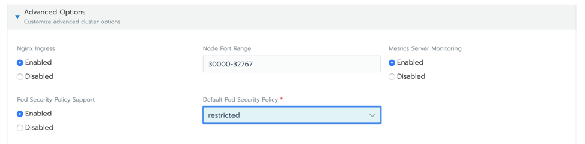
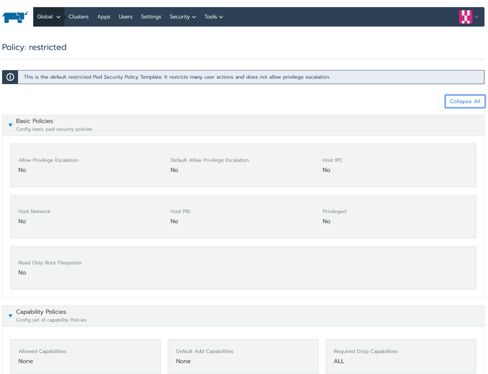

Attend the Master Class:Prevention in Kubernetes: Getting started with Pod Security Policies and best practices running them in production [Join here](https://info.rancher.com/prevention-in-kubernetes-getting-started-with-pod-security-policies-and-best-practices-running-them-in-production)

## What is a Pod Security Policy?

Kubernetes Pod Security Policies (PSPs) are a critical component of the Kubernetes security puzzle. Pod Security Policies are clusterwide resources that control **security sensitive attributes** of pod specification and are a mechanism to harden the security posture of your Kubernetes workloads. Kubernetes platform teams or cluster operators can leverage them to control pod creation and limit the capabilities available to specific users, groups or applications.

As a quick example, using PSPs you can:

- Prevent privileged pods from starting and control privilege escalation.
- Restrict access to the host namespaces, network and filesystem the pod can access.
- Restrict the users/groups a pod can run as.
- Limit the volumes a pod can access.
- Restrict other parameters like runtime profiles or read-only root filesystems.

In this article, we’ll show you how to harden your Kubernetes security posture by enabling a simple Pod Security Policy in your Rancher environment.

## Do Pod Security Policies Harden Kubernetes Security?

Yes, Pod Security Policies do harden [Kubernetes security](https://www.suse.com/c/best-practices-for-keeping-kubernetes-secure/). They provide a Kubernetes-native control mechanism to prevent threats without impacting performance, unlike agents that have to intercept every action on the host.

If you don’t enable PSPs in your cluster (or an equivalent way to perform admission control), a Kubernetes user could spawn overprivileged pods. This is the exact tactic that a malicious actor could leverage to escalate privileges, breakout container isolation and access other pods/services.

Without a mechanism to restrict the pod spec privileges, the attacker can do anything the docker command could: running a privileged container, using node resources, etc.

For a quick proof of concept, you can [run this script](https://gist.github.com/jjo/5169651d450be8cdcd95f3ba6bfe9959) (not on a production cluster, please).

```
❯ ./kubectl-root-in-host.sh
bash-4.4# whoami
root
bash-4.4# hostname
sudo--alvaro-rancher-rancheragent-0-all
```

You get instant root access to the **Kubernetes node**. Pretty scary, right?

By following the concept of **least privilege**, you can safely implement PSPs in your cluster and ensure that no Kubernetes pod or workload has unwanted permissions. Beyond a core philosophy of Kubernetes security, this principle of least privilege is also a universal security good practice that is a core requirement of compliance standards such as PCI, SOC2 or HIPAA.

To summarize:

- PSPs will provide secure-by-default constraints over the security capabilities granted to the pods that any user creates on your clusters
- PSPs will also help you validate compliance by meeting requirements of specific compliance benchmarks

**Least privilege is the concept and practice of restricting access rights for users, accounts, and computing processes to only those resources absolutely required to perform routine, legitimate activities.**

## Enabling Pod Security Policies in Your Cluster

Pod Security Policies are implemented as an Admission Controller in Kubernetes. To enable PSPs in your cluster, make sure to include `PodSecurityPolicy` in the `enable-admission-plugins` list that is passed as a parameter to your Kubernetes API configuration:

```
--enable-admission-plugins=...,PodSecurityPolicy
```

Cloud providers that offer managed Kubernetes clusters (where you do not have direct access to the API configuration), typically provide advanced settings to enable PSPs clusterwide. In other cases, you might need to edit the /etc/kubernetes/manifests/kube-apiserver.yaml file and add it in the corresponding command arguments.

In Rancher, you enable PSPs by simply editing the cluster from the UI:



Enabling PSPs in Rancher

You can choose what Pod Security Policy to apply by default. In this case, we selected **restricted**.

The advantage of using an Admission controller to enable PSPs is that it provides an immediate prevention mechanism, stopping a deployment of an over-privileged pod before it is even scheduled. The drawback is that once you enable a PSP, every single pod needs to be explicitly approved by a PSP, making their deployment and transition steep.

## Walkthrough of a Basic Pod Security Policy in Rancher

In this section, we’ll walk through enabling Pod Security Policies (PSPs) in the cluster from the Rancher dashboard, using *restricted* policy by default and see how this prevents the creation of privileged pods.

The PSP object itself is a list of requirements and constraints that will be applied over the pod specs. A PSP YAML looks like this:

```
apiVersion: policy/v1beta1
kind: PodSecurityPolicy
metadata:
  name: example
spec:
  allowedCapabilities:
    - NET_ADMIN
    - IPC_LOCK
  allowedHostPaths:
    - pathPrefix: /dev
    - pathPrefix: /run
    - pathPrefix: /
  fsGroup:
    rule: RunAsAny
  hostNetwork: true
  seLinux:
    rule: RunAsAny
  supplementalGroups:
    rule: RunAsAny
  privileged: true
  runAsUser:
    rule: RunAsAny
  volumes:
    - hostPath
    - secret
```

The PSP above, in particular, is very permissive. For example:

- It allows the pod to run with additional Linux capabilities like NET\_ADMIN and IPC\_LOCK.
- It allows mounting sensitive paths from the host.
- The pod can run as privileged, etc.

Explore the Kubernetes documentation for a [full list of the available PSP controls](https://kubernetes.io/docs/concepts/policy/pod-security-policy/) and their default values.

Let’s see an example of how you can prevent privileged pods from running in your cluster.

Once PSPs are enabled in your cluster, try to deploy any pod like this:

*deploy-not-privileged.yaml*

```
apiVersion: apps/v1
kind: Deployment
metadata:
  labels:
    app: not-privileged-deploy
  name: not-privileged-deploy
spec:
  replicas: 1
  selector:
    matchLabels:
      app: not-privileged-deploy
  template:
    metadata:
      labels:
        app: not-privileged-deploy
    spec:
      containers:
        - image: alpine
          name: alpine
          stdin: true
          tty: true
          securityContext:
            runAsUser: 1000
            runAsGroup: 1000
```

It will work out of the box because we told Rancher to enable PSP with **restricted** security policy, which allows non-privileged pods like the one above to run without any problem.

Check what is in the default PSP like this:

`$ kubectl get psp restricted-psp -o yaml`

```
apiVersion: policy/v1beta1
kind: PodSecurityPolicy
metadata:
  annotations:
    serviceaccount.cluster.cattle.io/pod-security: restricted
    serviceaccount.cluster.cattle.io/pod-security-version: "1960"
  creationTimestamp: "2020-03-04T19:56:10Z"
  labels:
    cattle.io/creator: norman
  name: restricted-psp
  resourceVersion: "2686"
  selfLink: /apis/policy/v1beta1/podsecuritypolicies/restricted-psp
  uid: 40957380-1d44-4e43-9333-91610e3fc079
spec:
  allowPrivilegeEscalation: false
  fsGroup:
    ranges:
      - max: 65535
        min: 1
    rule: MustRunAs
  requiredDropCapabilities:
    - ALL
  runAsUser:
    rule: RunAsAny
  seLinux:
    rule: RunAsAny
  supplementalGroups:
    ranges:
      - max: 65535
        min: 1
    rule: MustRunAs
  volumes:
    - configMap
    - emptyDir
    - projected
    - secret
    - downwardAPI
    - persistentVolumeClaim
```

Or check in Rancher in **Global** view. Select **Security > Pod Security Policies** and click on the *restricted one*.



Checking the Pod Security Policies in Rancher

This PSP should allow any pod as long as it runs as a standard user (not root) and does not require any special privilege or capability.

There are some additional details about PSPs and RBAC that we will dig into later. For the sake of simplicity, we will skip that part for now, as Rancher sets the required bindings for you. Let’s try to deploy a privileged pod, like the one from the `kubectl-root-in-host.sh` script:

*deploy-privileged.yaml*

```
apiVersion: apps/v1
kind: Deployment
metadata:
  labels:
    app: privileged-deploy
  name: privileged-deploy
spec:
  replicas: 1
  selector:
    matchLabels:
      app: privileged-deploy
  template:
    metadata:
      labels:
        app: privileged-deploy
    spec:
      containers:
        - image: alpine
          name: alpine
          stdin: true
          tty: true
          securityContext:
            privileged: true
      hostPID: true
      hostNetwork: true
```

The pod will not be admitted into the cluster:

```
 Warning  FailedCreate  2s (x12 over 13s)  replicaset-controller  Error creating: pods "privileged-deploy-7569b9969d-" is forbidden: unable to validate against any pod security policy: [spec.securityContext.hostNetwork: Invalid value: true: Host network is not allowed to be used spec.securityContext.hostPID: Invalid value: true: Host PID is not allowed to be used spec.containers[0].securityContext.privileged: Invalid value: true: Privileged containers are not allowed]
```

The PodSecurityPolicy admission controller will not allow the creation of this pod, as no existing PSPs allow for “hostPID”, “hostNetwork” or “privileged”.

## Coming Up in Part 2

To recap, in part 1 of this blog series, we hardened your Kubernetes security posture by enabling a simple Pod Security Policy in your Rancher environment. By using the default *restricted* PSP, we ensured that a pod can only run as long as it doesn’t require extended security privileges. Finally, we tried to deploy an overly permissive pod and saw it fail because the existing PSP prevented it from being scheduled on the cluster.

[In Part 2](/blog/2020/pod-security-policies-part-2), we’ll dig deeper into more advanced concepts of role-based access control (RBAC) and walk through how to set up specific roles and grant them access to both privileged and permissive Pod Security Policies. We’ll also cover how tools like Sysdig Secure and Rancher can help you simplify adoption of PSPs in your RKE clusters.

## Don’t Miss the Master Class

To learn more, sign up for our free Master Class – [Prevention in Kubernetes: Getting started with Pod Security Policies](https://info.rancher.com/prevention-in-kubernetes-getting-started-with-pod-security-policies-and-best-practices-running-them-in-production). We’ll show you how to get started with PSPs best practices, and show live demos and more advanced PSP use cases.Attend the Master Class:Prevention in Kubernetes: Getting started with Pod Security Policies and best practices running them in production [Join here](https://info.rancher.com/prevention-in-kubernetes-getting-started-with-pod-security-policies-and-best-practices-running-them-in-production)
