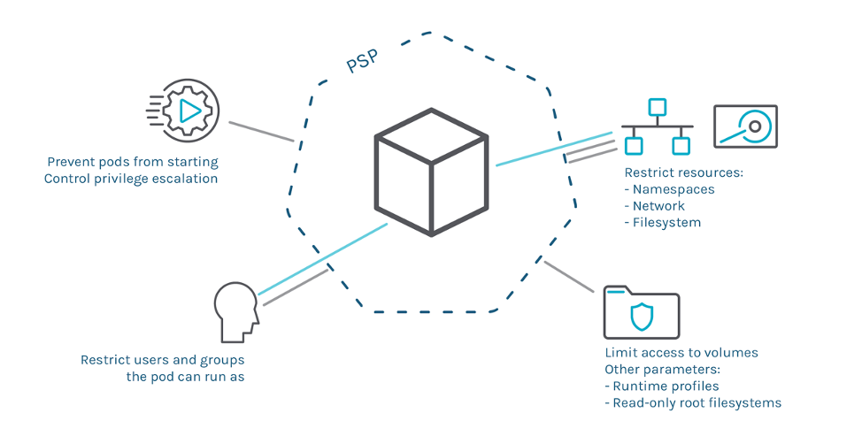
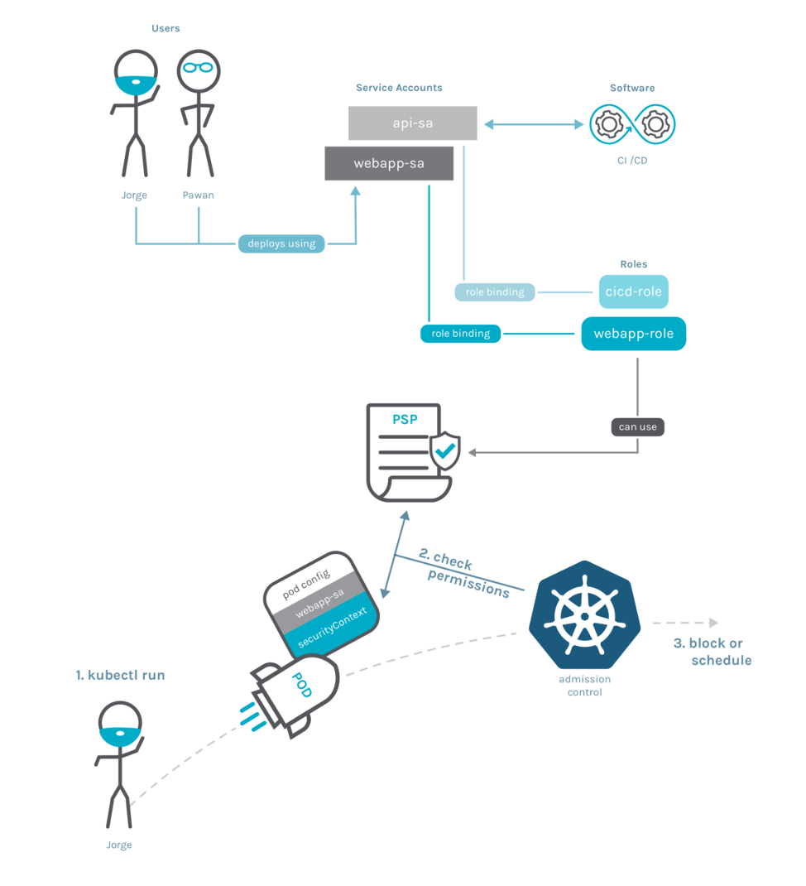
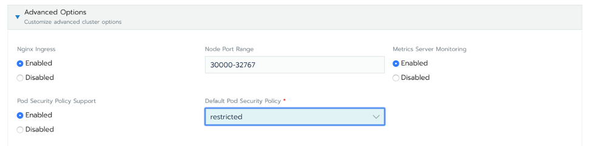
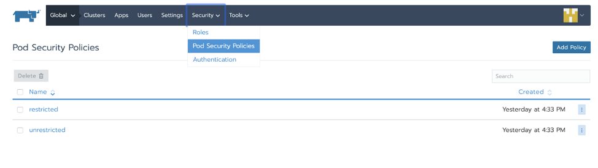
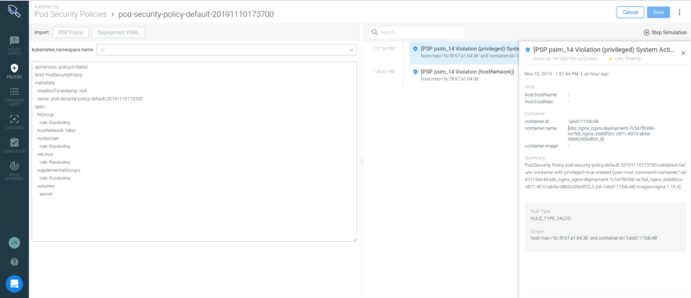

In Part 1 of this series, we demonstrated how to enable PSPs in Rancher, using restricted PSP policy as default. We also showed how this prevented a privileged pod from being admitted to the cluster.



Enforcement capabilities of a Pod Security Policy

We intentionally omitted particular details about role-based access control (RBAC) and how to link pods with specific PSPs. Let’s move on and dig in more on PSPs.

## Matching Pods with PSPs

You may have noticed that the PSP schema is not associated with any Kubernetes Namespace, Service Account or pod in particular. Actually, PSPs are clusterwide resources. So, how do we specify which pods should be governed by which PSPs? The following diagram shows all the implied actors, resources and how the admission flow works.



We know this may sound complex at first. So let’s get into the details.

When a pod is deployed, the admission controller applies policies depending who is requesting the deployment.

The pod itself doesn’t have any associated Policy – it’s the service account performing the deployment that has it. In the diagram above, Jorge is deploying the pod using the ***webapp-sa*** **service account**.

A RoleBinding associates a **service account** with **Roles** (or **ClusterRoles**), which is the resource that specifies the PSPs that can be used (*use* verb in the *podsecuritypolicies* resource). In the diagram, *webapp-sa* is associated with *webapp-role*, which provides the use permission to the specific PSP resource. The pods will be checked against the *webapp-sa* PSP when it deploys. In fact, a **service account** can use multiple PSPs and it is enough that one of them validates the Pod. You can see the details in the [official documentation](https://kubernetes.io/docs/concepts/policy/pod-security-policy/#policy-order).

The **admission control** then decides if the pod complies with any of the PSPs. If the pod complies, the admission control will schedule the pod; if the pod doesn’t comply, it will block the deployment.

In summary:

- Pod identity is determined by its **service account**.
  - If no **service account** is declared in the spec, the default will be used.
- You need to allow the ***use*** of a PSP declaring a **Role** or **ClusterRole**.
- Finally, there needs to be a **RoleBinding** that associates the **Role** (and thereby allowing access to use the PSP) with the **service account** declared in the pod spec.

Let’s illustrate that with some examples.

## Real Example with RBAC

Assuming you have a cluster with PSPs enabled, a common approach for adopting PSPs to create a restrictive PSP that **can be used by any pod**. Then you would add more specific PSPs with additional privileges that are **binded to specific service accounts**. Having a default, safe and restrictive policy **facilitates management of the cluster** because most pods require no special privileges or capabilities and will run by default. Then, in case some of your workloads require additional privileges, we can create a custom PSP and bind the specific service account of that workload to the less restrictive PSP.

But how can we bind a pod to a specific PSP instead of the default restricted one? And how can we do that with a vanilla Kubernetes cluster, where RoleBindings are not added automatically?

Let’s go through a complete example where we define some safe defaults (a restricted PSP that any service account in the cluster can use), and then provide additional privileges to a single service account, for a specific deployment that requires it.

First, we manually create a new namespace. It won’t be managed by Rancher, so no RoleBindings will be created automatically. Then we try to deploy a **restricted** Pod in there:

```
$ kubectl create ns psp-test
$ cat deploy-not-privileged.yaml
apiVersion: apps/v1
kind: Deployment
metadata:
 labels:
   app: not-privileged-deploy
 name: not-privileged-deploy
spec:
 replicas: 1
 selector:
   matchLabels:
     app: not-privileged-deploy
 template:
   metadata:
     labels:
       app: not-privileged-deploy
   spec:
     containers:
     - image: alpine
       name: alpine
       stdin: true
       tty: true
       securityContext:
         runAsUser: 1000
         runAsGroup: 1000
$ kubectl -n psp-test apply -f deploy-not-privileged.yaml
$ kubectl -n psp-test describe rs
...
  Warning  FailedCreate  4s (x12 over 15s)  replicaset-controller  Error creating: pods "not-privileged-deploy-684696d5b5-" is forbidden: unable to validate against any pod security policy: []
```

As there is no RoleBinding in the namespace psp-test binding to a role that allows using any PSP, the pod cannot be created. We are going to fix this by creating clusterwide ClusterRole and ClusterRoleBinding to allow any service account to use restricted-psp by default. Rancher created the restricted-psp when enabling PSPs in Part 1.

```
$ cat clusterrole-use-restricted.yaml
apiVersion: rbac.authorization.k8s.io/v1
kind: ClusterRole
metadata:
  name: use-restricted-psp
rules:
- apiGroups: ['policy']
  resources: ['podsecuritypolicies']
  verbs:     ['use']
  resourceNames:
  - restricted-psp
---
apiVersion: rbac.authorization.k8s.io/v1
kind: ClusterRoleBinding
metadata:
  name: restricted-role-bind
roleRef:
  apiGroup: rbac.authorization.k8s.io
  kind: ClusterRole
  name: use-restricted-psp
subjects:
- apiGroup: rbac.authorization.k8s.io
  kind: Group
  name: system:serviceaccounts
$ kubectl apply -f clusterrole-use-restricted.yaml
```

Once we apply these changes, the **not-privileged** deploy should work correctly.

However, if we need to deploy a privileged Pod, it won’t be allowed with the existing policies:

```
$ cat deploy-privileged.yaml
apiVersion: v1
kind: ServiceAccount
metadata:
  name: privileged-sa
  namespace: psp-test
---
apiVersion: apps/v1
kind: Deployment
metadata:
  labels:
    app: privileged-deploy
  name: privileged-deploy
  namespace: psp-test
spec:
  replicas: 1
  selector:
    matchLabels:
      app: privileged-deploy
  template:
    metadata:
      labels:
        app: privileged-deploy
    spec:
      containers:
      - image: alpine
        name: alpine
        stdin: true
        tty: true
        securityContext:
          privileged: true
      hostPID: true
      hostNetwork: true
      serviceAccountName: privileged-sa

$ kubectl -n psp-test apply -f deploy-privileged.yaml
$ kubectl -n psp-test describe rs privileged-deploy-7569b9969d
Name:           privileged-deploy-7569b9969d
Namespace:      default
Selector:       app=privileged-deploy,pod-template-hash=7569b9969d
Labels:         app=privileged-deploy
...
Events:
  Type     Reason        Age                From                   Message
  ----     ------        ----               ----                   -------
  Warning  FailedCreate  4s (x14 over 45s)  replicaset-controller  Error creating: pods "privileged-deploy-7569b9969d-" is forbidden: unable to validate against any pod security policy: [spec.securityContext.hostNetwork: Invalid value: true: Host network is not allowed to be used spec.securityContext.hostPID: Invalid value: true: Host PID is not allowed to be used spec.containers[0].securityContext.privileged: Invalid value: true: Privileged containers are not allowed]
```

In this case, there are PSPs that the pod can use, because we created a *ClusterRoleBinding*, but the *restricted-psp* won’t validate the pod, as it requires *privileged, hostNetwork*, etc.

We already saw the restricted-psp policy in [Part 1](https://https://rancher.com/blog/2020/pod-security-policies-part-1). Let’s check the details of default-psp, which Rancher creates when enabling PSPs to allow these kinds of privileges:

```
$ kubectl get psp default-psp -o yaml

apiVersion: policy/v1beta1
kind: PodSecurityPolicy
metadata:
  annotations:
    seccomp.security.alpha.kubernetes.io/allowedProfileNames: '*'
  creationTimestamp: "2020-03-10T08:45:08Z"
  name: default-psp
  resourceVersion: "144774"
  selfLink: /apis/policy/v1beta1/podsecuritypolicies/default-psp
  uid: 1f83b803-bbee-483c-8f66-bfa65feaef56
spec:
  allowPrivilegeEscalation: true
  allowedCapabilities:
  - '*'
  fsGroup:
    rule: RunAsAny
  hostIPC: true
  hostNetwork: true
  hostPID: true
  hostPorts:
  - max: 65535
    min: 0
  privileged: true
  runAsUser:
    rule: RunAsAny
  seLinux:
    rule: RunAsAny
  supplementalGroups:
    rule: RunAsAny
  volumes:
  - '*'
```

You can appreciate this is a quite permissive policy. In particular, we allow **privileged, hostNetwork, hostPID, hostIPC, hostPorts** and **running as root** among other capabilities.

We just need to **explicitly allow this pod to use that PSP**. We do it by creating a ClusterRole analog to the existing *restricted-clusterrole*, but allowing **use** of the *default-psp* resource, and then creating a RoleBinding for our *psp-test* namespace binding the *privileged-sa* ServiceAccount to that ClusterRole:

```
$ cat clusterrole-use-privileged.yaml
---
apiVersion: rbac.authorization.k8s.io/v1
kind: ClusterRole
metadata:
  name: use-privileged-psp
rules:
- apiGroups: ['policy']
  resources: ['podsecuritypolicies']
  verbs:     ['use']
  resourceNames:
  - default-psp
---
  apiVersion: rbac.authorization.k8s.io/v1
  kind: RoleBinding
  metadata:
    name: privileged-role-bind
    namespace: psp-test
  roleRef:
    apiGroup: rbac.authorization.k8s.io
    kind: ClusterRole
    name: use-privileged-psp
  subjects:
  - kind: ServiceAccount
    name: privileged-sa
$ kubectl -n psp-test apply -f clusterrole-use-privileged.yaml
```

After a few moments, the privileged Pod should be created.

You noticed that *restricted-psp* and *default-psp* existed out of the box. Let’s talk about that.

## Default PSPs on Rancher

Enable PSP admission controller in Rancher by editing the cluster settings (as we did in Part 1), and select one of the defined PSPs as the default:



Rancher will create a couple of PSP resources in the cluster:

- restricted-psp - in case you selected restricted as the default PSP.
- default-psp - a default PSP that allows the creation of privileged pods.

Apart from the *restricted-psp* and *default-psp*, Rancher creates a ClusterRole named *restricted-clusterrole*:

```
$ kubectl get clusterrole restricted-clusterrole -o yaml
apiVersion: rbac.authorization.k8s.io/v1
kind: ClusterRole
metadata:
  annotations:
    serviceaccount.cluster.cattle.io/pod-security: restricted
  creationTimestamp: "2020-03-10T08:44:39Z"
  labels:
    cattle.io/creator: norman
  name: restricted-clusterrole
rules:
- apiGroups:
  - extensions
  resourceNames:
  - restricted-psp
  resources:
  - podsecuritypolicies
  verbs:
  - use
```

This ClusterRole allows the **usage** of the *restricted-psp* policy. And where is the Binding to allow the pod ServiceAccount to be granted the usage?

The good news is that for namespaces that belong to projects in Rancher, it will also setup RoleBinding configuration for you in those namespaces:

```
$ kubectl -n default get rolebinding default-default-default-restricted-clusterrole-binding -o yaml
apiVersion: rbac.authorization.k8s.io/v1
kind: RoleBinding
metadata:
  annotations:
    podsecuritypolicy.rbac.user.cattle.io/psptpb-role-binding: "true"
    serviceaccount.cluster.cattle.io/pod-security: restricted
  labels:
    cattle.io/creator: norman
  name: default-default-default-restricted-clusterrole-binding
  namespace: default
...
roleRef:
  apiGroup: rbac.authorization.k8s.io
  kind: ClusterRole
  name: restricted-clusterrole
subjects:
- kind: ServiceAccount
  name: default
  namespace: default
```

The name of the resource (default-default-default-restricted-clusterrole-binding) might be confusing, but it is composed as:

default-***serviceaccountname-namespace***-restricted-clusterrole-binding

And in case you create a new service account like *myserviceaccount*, a new RoleBinding will be created automatically:

```
$ kubectl create sa myserviceaccount
serviceaccount/myserviceaccount created
$ kubectl get rolebinding
NAME                                                              AGE
---
default-default-default-restricted-clusterrole-binding            13m
default-myserviceaccount-default-restricted-clusterrole-binding   4s
```

Thanks to this magic, you can forget about RBAC configuration for safe pods that don’t require any elevated privileges.

## Creating Your Own PSPs in Rancher

PSPs are standard Kubernetes resources, named *PodSecurityPolicy* or just *PSP* for short, so you can work with them using the Kubernetes API or *kubectl* CLI.

You could create your custom PSPs policies by defining them in a YAML file and then use *kubectl* to create the resource in the cluster. Just check the [official documentation](https://kubernetes.io/docs/concepts/policy/pod-security-policy/) to get an idea of all the available controls. Once you define the set of controls in the YAML, you can run…

```
$ kubectl create psp my-custom-psp
```

…to create the PSP resource.

With Rancher, you can also view, edit and add new policies directly from the UI:



## PSPs are Powerful – But it Looks Complex

Yes, you’re right. Configuring Pod Security Policy is a tedious process. Once you enable PSPs in your Kubernetes cluster, any Pod that you want to deploy must be allowed by one of the configured PSPs.

Implementing strong security policies can be time consuming. Generating a policy for every deployment of each application is a burden; if your policy is too permissive, you are not enforcing a least privilege access approach. However, if it is too restrictive, you can break your applications, as Pods won’t successfully run in Kubernetes. Being able to automatically generate a Pod Security Policy with the minimum set of access requirements will help you onboard PSPs more easily. You can’t just deploy them in production without verifying that your application still works, and going through that manual testing is tedious and inefficient. What if you could validate the PSP against the runtime behavior of your Kubernetes workload?

## How to Simplify PSP Adoption in Production

kube-psp-advisor

Kubernetes Pod Security Policy Advisor (a.k.a kube-psp-advisor) is an [open-source tool](https://github.com/sysdiglabs/kube-psp-advisor) from Sysdig, like [Sysdig Inspect](https://sysdig.com/blog/sysdig-inspect/) or [Falco](http://falco.org/). kube-psp-advisor scans the existing security context from Kubernetes resources like deployments, daemonsets, replicasets, etc. taken as the reference model we want to enforce and then automatically generates the Pod Security Policy for all the resources in the entire cluster. kube-psp-advisor looks at different attributes to create the recommended Pod Security Policy:

- allowPrivilegeEscalation
- allowedCapabilities
- allowedHostPaths
- hostIPC
- hostNetwork
- hostPID
- Privileged
- readOnlyRootFilesystem
- runAsUser
- Volume

Check this [kube-psp-advisor tutorial](https://sysdig.com/blog/enable-kubernetes-pod-security-policy/) for further details on how it works.

## Automate PSP Generation with Sysdig Secure

[Sysdig Secure Kubernetes Policy Advisor](https://sysdig.com/blog/psp-in-production/) assists users in both creating and validating Pod Security Policies.

The first step is to set up a new PSP simulation. You can have multiple simulations for different policies over different scopes (like a Kubernetes namespace).

Sysdig analyzes the requirements of the Pod spec in your Deployment definition and creates the least privilege PSP for your application. This controls if you allow privileged pods, users to run as the container, volumes, etc. You can fine tune the PSP and define the namespace against which you will run the simulation:



The policy on the left would break the application because the nginx Deployment is a privileged Pod and has Host network access. You must decide whether to broaden the PSP to allow this behavior or elect to reduce the privileges of the Deployment to fit the policy. Regardless, you are detecting this before applying the PSP that would block your Pods from running and create a fracture on the application deployment.

## Conclusion

As these examples demonstrate, PSP enables you to apply fine grain control over pods and containers running in Kubernetes, either by granting or denying access to specific resources. These policies are relatively easy to create and deploy, and should be useful components of any [Kubernetes security](https://www.suse.com/c/best-practices-for-keeping-kubernetes-secure/) strategy.

Watch the on-demand Master Class: [Getting started with Pod Security Policies and Best Practices Running Them in Production](https://info.rancher.com/prevention-in-kubernetes-getting-started-with-pod-security-policies-and-best-practices-running-them-in-production-sysdig) to start using PSPs and learn about challenges, best practices and how Sysdig Secure or other tools can help you adopt PSPs in your environment.
