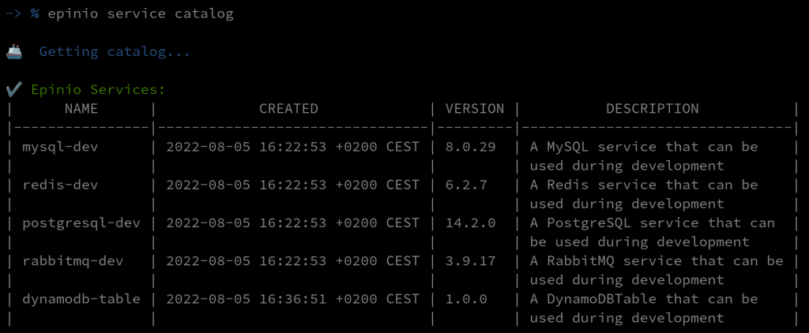
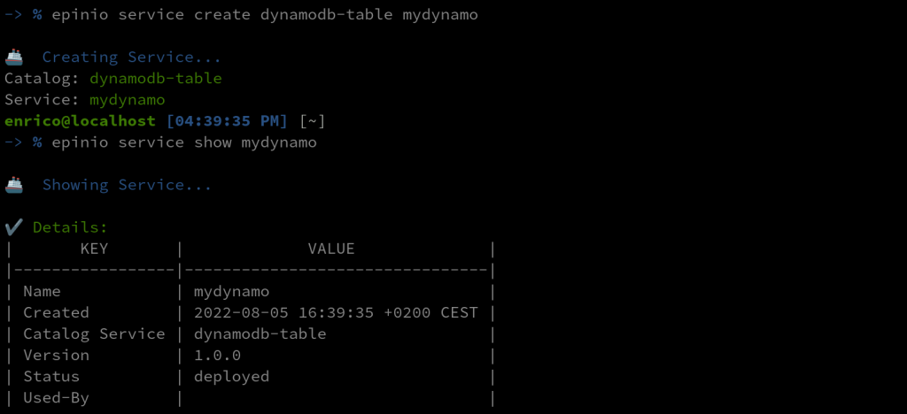
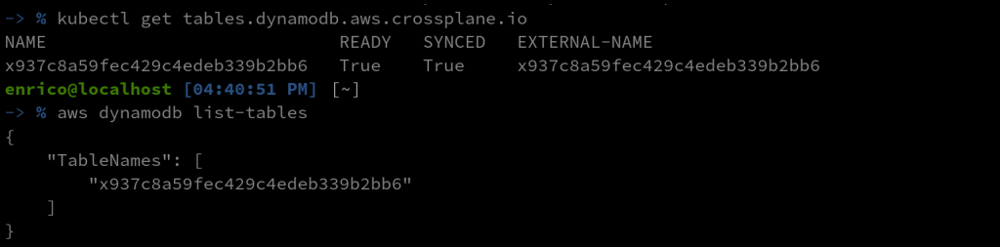
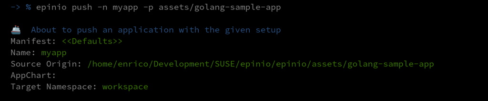
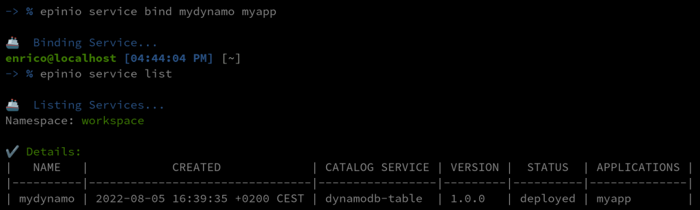
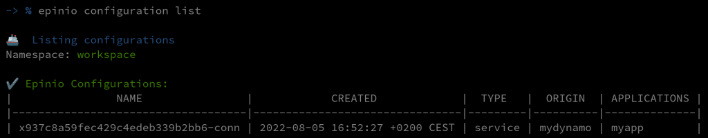
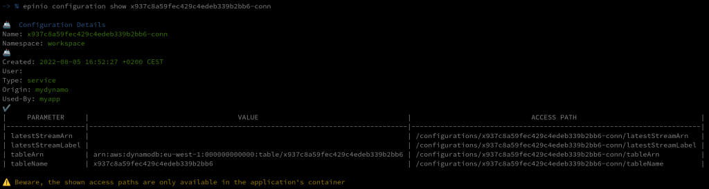
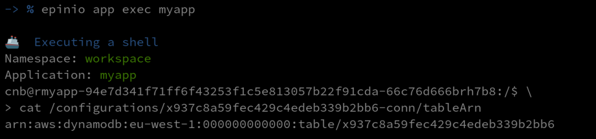

One of the greatest challenges that operators and developers face is infrastructure provisioning: it should be resilient, reliable, reproducible and even audited. This is where Infrastructure as Code (IaC) comes in.

In the last few years, we have seen many tools that tried to solve this problem, sometimes offered by the cloud providers (AWS CloudFormation) or vendor-agnostic solutions like Terraform and Pulumi. However, Kubernetes is becoming the standard for application deployment, and that's where [Crossplane](https://crossplane.io/) fits in the picture. Crossplane is an open source Kubernetes add-on that transforms your cluster into a universal control plane.

The idea behind Crossplane is to leverage Kubernetes manifests to build custom control planes that can compose and provision multi-cloud infrastructure from any provider.

If you're an operator, its highly flexible approach gives you the power to create custom configurations, and the control plane will track any change, trying to keep the state of your infrastructure as you configured it.

On the other side, developers don't want to bother with the infrastructure details. They want to focus on delivering the best product to their customers, possibly in the fastest way. Epinio is a tool from SUSE that allows you to go from code to URL in just one push without worrying about all the intermediate steps. It will take care of building the application, packaging your image, and deploying it into your cluster.

This is why these two open source projects fit perfectly - provisioning infrastructure and deploying applications inside your Kubernetes platform!

Let's take a look at how we can use them together:

```
# Push our app 
-> % epinio push -n myapp -p assets/golang-sample-app 

# Create the service 
-> % epinio service create dynamodb-table mydynamo 

# Bind the two 
-> % epinio service bind mydynamo myapp 
```

That was easy! With just three commands, we have:

1. Deployed our application
2. Provisioned a DynamoDB Table with Crossplane
3. Bound the service connection details to our application

Ok, probably too easy, but this was just the developer's perspective. And this is what Epinio is all about: simplifying the developer experience.

Let's look at how to set up everything to make it work!

## **Prerequisites**

I'm going to assume that we already have a Kubernetes cluster with Epinio and Crossplane installed. To install Epinio, you can refer to our [documentation](https://docs.epinio.io/). This was tested with the latest Epinio version v1.1.0, Crossplane v.1.9.0 and the provider-aws v0.29.0.

Since we are using the `enable-external-secret-stores` alpha feature of Crossplane to enable it, we need to provide the `args={--enable-external-secret-stores}` value during the Helm installation:

```
-> % helm install crossplane \
    --create-namespace --namespace crossplane-system \
    crossplane-stable/crossplane \
    --set args={--enable-external-secret-stores}
```

 

Also, provide the same argument to the [AWS Provider](https://github.com/crossplane-contrib/provider-aws) with a custom `ControllerConfig`:

```
apiVersion: pkg.crossplane.io/v1alpha1
kind: ControllerConfig
metadata:
  name: aws-config
spec:
  args:
  - --enable-external-secret-stores
---
apiVersion: pkg.crossplane.io/v1
kind: Provider
metadata:
  name: crossplane-provider-aws
spec:
  package: crossplane/provider-aws:v0.29.0
  controllerConfigRef:
    name: aws-config
```

## **Epinio services**

To use Epinio and Crossplane together, we can leverage the [Epinio Services](https://docs.epinio.io/references/services). They provide a flexible way to add custom resources using Helm charts. The operator can prepare a Crossplane Helm chart to claim all resources needed. The Helm chart can then be added to the Epinio Service Catalog. Finally, the developers will be able to consume the service and have all the needed resources provisioned.

## **Prepare our catalog**

We must prepare and publish our Helm chart to add our service to the catalog.

In our example, it will contain only a simple DynamoDB Table. In a real scenario, the operator will probably define a claim to a Composite Resource, but for simplicity, we are using some Managed Resource directly.

For a deeper look, I'll invite you to take a look at the Crossplane documentation about [composition](https://crossplane.io/docs/v1.9/concepts/composition.html).

We can see that this resource will "publish" its connection details to a secret defined with the `publishConnectionDetailsTo` attribute (this is the alpha feature that we need). The secret and the resource will have the app.kubernetes.io/instance label with the Epinio Service instance name. We can correlate the two with this label as Epinio services and configurations.

```
apiVersion: dynamodb.aws.crossplane.io/v1alpha1
kind: Table
metadata:
  name: {{ .Release.Name | quote }}
  namespace: {{ .Release.Namespace | quote }}
  labels:
    app.kubernetes.io/instance: {{ .Release.Name | quote }}
spec:
  publishConnectionDetailsTo:
    name: {{ .Release.Name }}-conn
    metadata:
      labels:
        app.kubernetes.io/instance: {{ .Release.Name | quote }}
      annotations:
        kubed.appscode.com/sync: "kubernetes.io/metadata.name={{ .Release.Namespace }}"
  providerConfigRef:
    name: aws-provider-config
  forProvider:
    region: eu-west-1
    tags:
    - key: env
      value: test
    attributeDefinitions:
    - attributeName: Name
      attributeType: S
    - attributeName: Surname
      attributeType: S
    keySchema:
    - attributeName: Name
      keyType: HASH
    - attributeName: Surname
      keyType: RANGE
    provisionedThroughput:
      readCapacityUnits: 7
      writeCapacityUnits: 7
```

> **Note:**You can see a kubed annotation in this Helm chart. This is because the generated secrets need to be in the same namespace as the services and applications. Since we are using directly a managed resource then the secret will be in the namespace defined in the default StoreConfig (the crossplane-system  namespace). We are using kubed to copy this secret in the release namespace.  
> <https://github.com/crossplane/crossplane/blob/master/design/design-doc-external-secret-stores.md#secret-configuration-publishconnectiondetailsto>

We can now package and publish this Helm chart to a repository and add it to the Epinio Service Catalog by applying a service manifest containing the information on where to fetch the chart.

The application, .epinio.io/catalog-service-secret-types, define the list of the secret types that Epinio should look for. Crossplane will generate the secrets with their own secret type, so we need to explicit it.

```
apiVersion: application.epinio.io/v1
kind: Service
metadata:
  name: dynamodb-table
  namespace: epinio
  annotations:
    application.epinio.io/catalog-service-secret-types: connection.crossplane.io/v1alpha1
spec:
  name: dynamodb-table
  shortDescription: A simple DynamoDBTable that can be used during development
  description: A simple DynamoDBTable that can be used during development
  chart: dynamodb-test
  chartVersion: 1.0.0
  appVersion: 1.0.0
  helmRepo:
    name: reponame
    url: https://charts.example.com/reponame
  values: ""
```

 

Now we can see that our custom service is available in the catalog:

```
-> % epinio service catalog
```

[](images/1-service-catalog.png)

## **Create and bind a service**

Now that our service is available in the catalog, the developers can use it to provision DynamoDBTables with Epinio:

```
-> % epinio service create dynamodb-table mydynamo
```

[](images/2-service-create-show.png)

We can check that a dynamo table resource was created and that the corresponding table is available on AWS:

```
-> % kubectl get tables.dynamodb.aws.crossplane.io
-> % aws dynamodb list-tables
```

[](images/3-get-tables.png)

We can now create an app with the epinio push command. Once deployed, we can bind it to our service with the epinio service bind:

```
-> % epinio push -n myapp -p assets/golang-sample-app
-> % epinio service bind mydynamo myapp
-> % epinio service list
```

[](images/4-push-app.png)[](images/5-service-bind-list.png)

And that's it! We can see that our application was bound to our service!

The bind command did a lot of things. It fetched the secrets generated by Crossplane and labeled them as Configurations. It also redeployed the application mounting these configurations inside the container.

We can check this with some Epinio commands:

```
-> % epinio configuration list
```

[](images/6-configuration-list.png)

```
-> % epinio configuration show x937c8a59fec429c4edeb339b2bb6-conn
```

[](images/7-configuration-show.png)

The shown access path is available in the application container. We can use exec in the app and see the content of that files:

```
-> % epinio app exec myapp
```

[](images/8-app-exec.png)

##

## **Conclusion**

In this blog post, I've shown you it's possible to create an Epinio Service that will use Crossplane to provide external resources to your Epinio application. We have seen that once the heavy lifting is done, the provision of a resource is just a matter of a couple of commands.

While some of these features are not ready, the Crossplane team is working hard on them, and I think they will be available soon!

## **Next Steps: Learn More at the Global Online Meetup on Epinio**

Join our Global Online Meetup: Epinio on Wednesday, September 14th, 2022, at 11 AM EST. Dimitris Karakasilis and Robert Sirchia will discuss the Epinio GA 1.0 release and how it delivers applications to Kubernetes faster, along with a live demo! [Sign up here.](https://more.suse.com/global_online_meetup_epinio_developer_platform.html)
