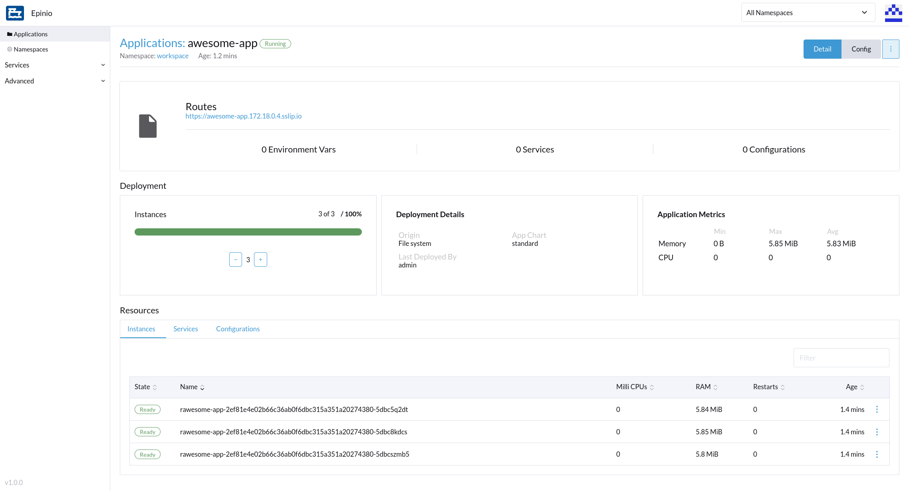
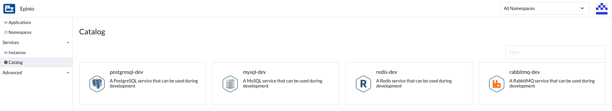

Epinio is a Platform as a Service (PaaS) that allows developers to go from the application source to a URL in one step.

Try Epinio today or try it tomorrow -- but make sure you try it. We just released our first stable version (Epinio v1.0.0) and we think you are going to love it. Let me tell you why.

## Simple installation

All you need to get started is a Kubernetes cluster, local or not. You install Epinio with Helm like you would with any other Helm chart. You don’t need 100 VMs -- your laptop will do. Start [here](https://docs.epinio.io/installation/install_epinio).

## Awesome GUI

Many developers love working from the console; others enjoy using Graphical User Interfaces. If you are the GUI type of person, you’ll find yourself right at home with Epinio’s Web UI. There are still some things that can only be done using the CLI but for the most part, CLI or Web UI is just a matter of preference.



## One-command deployment

Do you have your application’s source code? You don’t need to worry how this can be deployed to your Kubernetes cluster. All you need to do is run this command from the root directory of your application:
> ```
> epinio push
> ```

Epinio is using paketo buildpacks behind the scenes to create a container image for your application and deploy that to your Kubernetes cluster. Learn more about supported applications [here](https://docs.epinio.io/references/supported_applications).

## Application day-2 ops

You got your application deployed, now what? Epinio makes it easy for you to:

- Read application logs (staging and runtime)
- Scale your application up and down
- Get a shell to your application’s container to debug
- Forward a port to your application’s container
- Restage your application quickly using build caches
- Restart your application
- Export your application’s Helm chart and values (e.g. to deploy to another cluster without Epinio)
- Set environment variables

## Routes

Accessing your deployed application couldn’t be easier. Epinio sets up a default route for each application. You can add as many routes as you want (e.g. using your application’s custom domain). Epinio will still ensure TLS certificates are generated and used for the custom routes you add. It’s all documented [here](https://docs.epinio.io/howtos/custom_routes).

## Services

Every real-world application uses some kind of external service (e.g. a database) -- yours probably does, too. Epinio’s got you covered. By default, you get access to a marketplace with four different services. These are meant to be used during development but adding more services to the marketplace is a breeze. Check out [the docs](https://docs.epinio.io/howtos/create_custom_service).



## Configurations

Is the service marketplace not for you? Do you prefer to manage services on your favorite cloud provider instead? You can still allow your Epinio applications to access those services using “Configurations”. Create a configuration with the service details, bind it to an app, done. Docs are [here](https://docs.epinio.io/references/configurations).

## Namespaces

Do you work in teams? Do you want to limit what resources users have access to? Epinio namespaces ensure that users can only access resources in the namespaces that have been assigned to them. Learn more [here](https://docs.epinio.io/references/authorization).

## Application deployment templates

Epinio deploys your applications on Kubernetes using Helm behind the scenes. The default deployment may not suit your needs (or your operator’s preferences). That’s all fine. You can add custom application templates to Epinio. This allows teams to use different deployment methods. Read more about custom application charts [here](https://docs.epinio.io/references/customization/appcharts).

## API based

You don’t have to worry about users messing up your Kubernetes cluster. Epinio is accessed over an authenticated http API. Users don’t need direct access to the Kubernetes cluster, just access to the Epinio endpoint.

## Getting started with Epinio

There is a lot more to talk about, but I hope this is enough to intrigue you. If you want to know more, here are some useful links:

[Documentation](https://docs.epinio.io/)

[Slack channel](https://slack.rancher.io/) (#epinio channel)

[Epinio GitHub org](https://github.com/epinio/)

[Epinio team email](mailto:team@epinio.io)

 

The Epinio team is looking forward to hearing your comments or suggestions, so don’t think twice, drop us a line!
