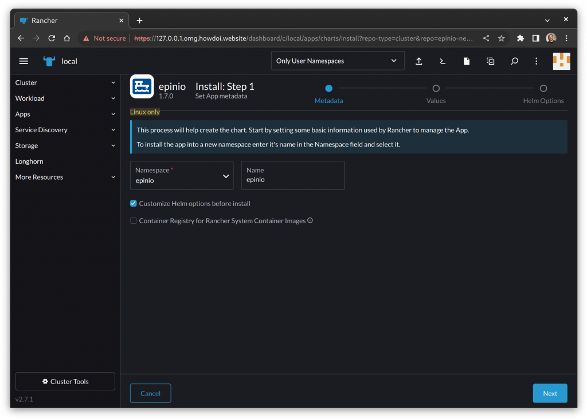
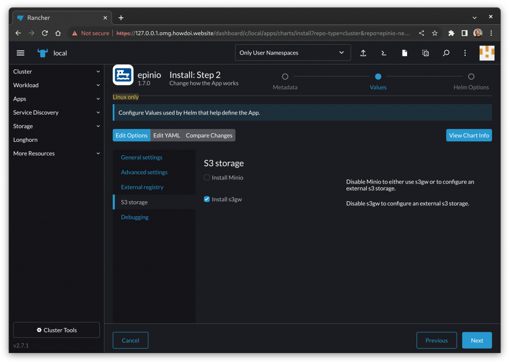

Since the very first version, [Epinio](https://epinio.io/) has made use of an internal S3 endpoint to store the user's projects in the form of aggregated tarballs. Those objects are then downloaded and staged by the internal engine's pipeline and, finally, they are deployed into the Kubernetes cluster as consumable applications. 

Epinio makes use of S3 as an internal private service. In this scenario, S3 can be thought of as an internal ephemeral cache with the purpose of storing temporary objects. For these needs, advanced redundancy measures are not necessary. Should the S3 backend experience a failure of any kind, software, or hardware; there would be no data loss, since Epinio has the ability to reconstruct the data of a project at any time. 

Prior to 1.7.0, Epinio could use only [Minio](https://min.io/) as S3 service. Starting from that version, we have since enabled the chart to also use the S3 Gateway (s3gw) project. 

[s3gw](https://s3gw.io/) is a lightweight s3-compatible service that can be backed by any PVC within a Kubernetes environment, with a preference for [Longhorn](https://longhorn.io/) as the backing service. As said before, since we do not need an advanced redundancy strategy with Epinio, we can safely rely on a PVC provided by the default storage class deployed on the cluster. 

If you are installing Epinio through the Rancher UI, enable the *Customize Helm options before install* checkbox: 

 

In the next page, click on the *S3 storage* section and disable the *Install Minio* checkbox*.*

You can now enable the *Install s3gw* checkbox. 

 

 

This is the simplest way to make Epinio work with s3gw. 

For a more advanced customization, you can edit the Epinio chart's values.yaml file: 

```
s3gw: 

  enabled: false 

  ingress: 

    enabled: false 

  serviceName: s3gw 

  storageClass: 

    create: false 

    name: '' 

  storageSize: 2Gi 

  ui: 

    enabled: false 

  useExistingSecret: true 
```

 

If you want, you can, for example, change the s3gw.storageClass.name used by s3gw to create its PVC to persist the data. Leaving this field empty makes the s3gw use the default storage class in the cluster. Furthermore, you can set the s3gw.storageSize value to the appropriate size based on your need. 

Embedding s3gw inside Epinio has been beneficial for both projects because it significantly evolved the respective ability to integrate with other technologies. 

Thanks to this, s3gw has made huge progress in areas such as TLS management and chart consistency. 

s3gw was born in 2022 and that year we defined the project's foundations. As for 2023, the team has ambitious plans that will bring the project to a brand-new level. We are already confident the tool is good enough to start integrating with vibrant projects like Epinio and are planning to make s3gw even simpler to integrate in the future. 

Stay tuned!
