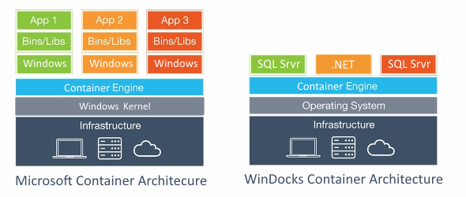
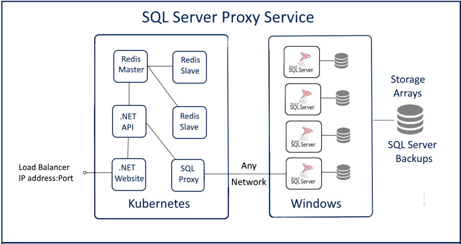

Support for relational databases is a growing focus for Kubernetes users, and the release of Windows Server 2019 is expanding options for .NET applications and SQL Server. SQL Server workloads, however, often rely on Active Directory and Windows Auth, and storage arrays, which will not be supported by SQL Server containers on Windows Server 2019. Fortunately, a new Rancher Labs partner, Windocks, offers new options for SQL Server on Kubernetes and Rancher.

## Near real-time database cloning and SQL Server Proxy

Windocks launched as an independent port of Docker’s source to Windows in early 2016, with support for all editions of SQL Server 2008 onward. Windocks subsequently added database cloning with storage arrays or Windows Virtual Hard Drives, for delivery of secure read/write databases that scale to multi-terabytes, in seconds, with minimal storage consumption.

This month Windocks is launching support for near real-time incrementally updated database clones. A Windows Virtual Hard Drive (VHD) image is built using a Full backup that can be updated daily, hourly, or more frequently with Differential or Transaction Log backups, indefinitely. Security through data masking, encryption, and other provisions is built into the image. The result is near real-time access to secure production database environments for dev/test, reporting, and other uses. Windocks supports database clone delivery to conventional SQL Server instances and containers, for a complete database refresh and delivery solution.

Windocks SQL Server support for Kubernetes uses a SQL Server proxy service now available in the Rancher Labs catalog, offering hybrid cloud support for creating, managing, and exposing SQL Server databases as a Kubernetes service. The combination of SQL Server containers with a proxy service provides freedom to host SQL Server containers where it makes best sense, with support for existing security policies, Windows Auth, and infrastructure.

## SQL Server containers as “named instances”

Windocks SQL Server containers are created by cloning a locally-installed SQL Server instance, with containers delivered as conventional SQL Server named instances, with Active Directory, Windows Auth, and other support associated with named instances. Microsoft’s SQL Server containers include a significant Windows OS footprint (images are >10 GB), and do not support Windows auth. Microsoft seems focused on Linux for SQL Server container support, and existing Windows SQL Server images have not been updated in the past 18 months.

Windocks also supports SQL Server containers that run as a Windows service, with support for the SQL Server database engine and Report Services (SSRS), and Linked Server support. SSRS containers are growing in popularity for support of AWS RDS and SQL Azure, neither of which include SSRS support.

## Kubernetes for cross platform support

It’s exciting to see Kubernetes becoming the defacto standard for combined Linux and Windows application development. Windocks shares growing interest in Redis caching for SQL Server, as one example. Tthe majority of Windocks customers run Windows SQL Server containers with Linux and .NET core front-ends. Windocks also supports delivery of database clones to the new Linux SQL Server containers.

## How to learn more?

Join us for a Kubernetes Master Class to learn more about new SQL Server and Kubernetes support options.

[Book your spot](https://info.rancher.com/managing-sql-servers-with-kubernetes-windocks) in the Rancher and Windocks joint Master Class scheduled for October 1, 2019. All registrants will receive the recording and slides, to revisit the training anytime.
