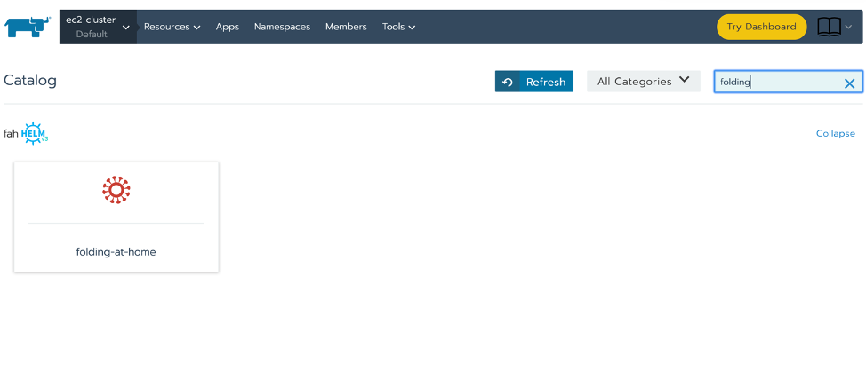
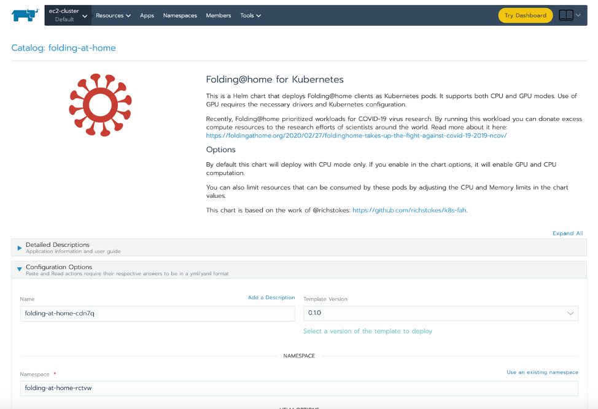
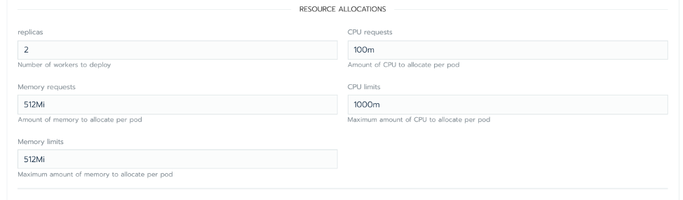

Recently the leadership at Rancher Labs challenged all of us to think about ways we can contribute to the community during this current crisis. Coming up with ways to help in such an overwhelming situation is quite daunting. Since most needs are medical related, finding ways to apply software isn’t obvious.

When I heard about Folding@home’s (FAH) efforts to [reprioritize their computing resources toward COVID-19 research](https://foldingathome.org/2020/02/27/foldinghome-takes-up-the-fight-against-covid-19-2019-ncov/), I was immediately curious. I participated in a similar computing project a few years ago with spare hardware I had running at home. It was incredibly easy to do and was a good way to experiment with methods for recapturing excess compute that would otherwise go to waste. Plus, donating to a good cause is rewarding and adds meaning to my work as an engineer.

With the challenge in mind, I thought about the tens of thousands of Kubernetes clusters that are currently managed by Rancher and wondered: what if some of those users also wanted to help and had excess compute cycles in their cluster that weren’t being used? I quickly found that [the open source community had done the groundwork](https://github.com/richstokes/k8s-fah) to create container images for the FAH client. I turned that into a Rancher catalog app so this technology can be deployed to any Kubernetes cluster with as little effort as possible. Reducing the effort required to help seemed like a great way to amplify the possible contributions to an important project like virus modeling. This app is now published in Rancher’s community catalog and available to all open source and commercial users of Rancher around the world to install.

You can find the Folding@home client in the Rancher catalog by searching “folding”

One thing we’ve started to do at Rancher Labs is run this on our demo environments. Rancher maintains a fleet of Kubernetes clusters for the purpose of showing people how the technology works. As you might expect, these clusters largely sit idle most of the time. It’s a perfect opportunity to donate compute time to an important cause.

## Take the Folding@Home Challenge

I’ll turn the challenge I received now over to you, the reader. Have you been looking for ways to contribute to the cause? Do you have excess compute available in your cluster you can donate? If so, take a look at the newly published catalog application. You’ll find that you can configure resource limits on the deployment to donate only the amount of CPU and memory that you can spare. This shouldn’t require any additional compute costs.

According to Google’s [Borg paper](https://research.google/pubs/pub43438/), Kubernetes was actually built around the idea of running low-priority containers that would only run if nothing else needed the hardware. Most clusters today are underutilized, so if we all just donate a little bit of that unused capacity, it will go a long way. However, please only do this in a cluster where you have permission or authority – there is no need to do this in a renegade manner.

The chart options allow you to specify CPU and memory you are willing to donate

I feel privileged to work at a company that values service to our customers and community in all aspects – not just the technical. Special thanks to the leadership of Rancher Labs for encouraging us, and the open source community that built the container images and Kubernetes spec that made this possible. During this unique time, I hope you are all able to appreciate the small things a bit more, and that you’re all doing everything you can to stay safe and help others do so, too.

**Get the Folding@home client in the Rancher catalog – just search “folding.”**
