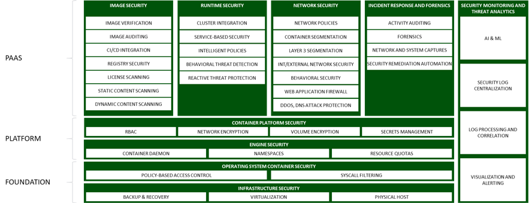
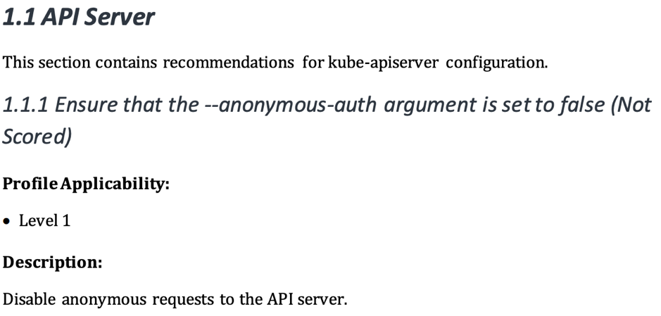
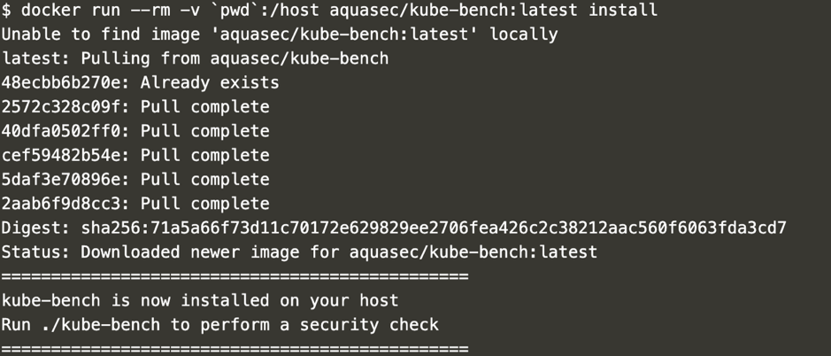
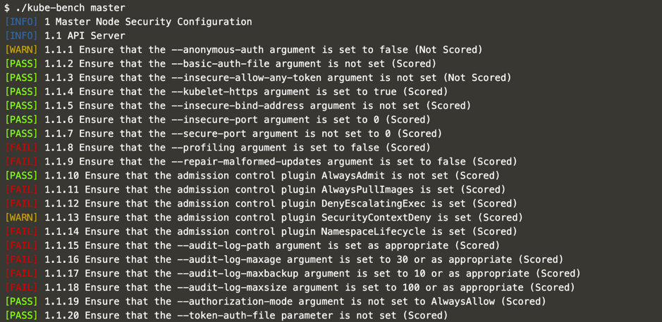
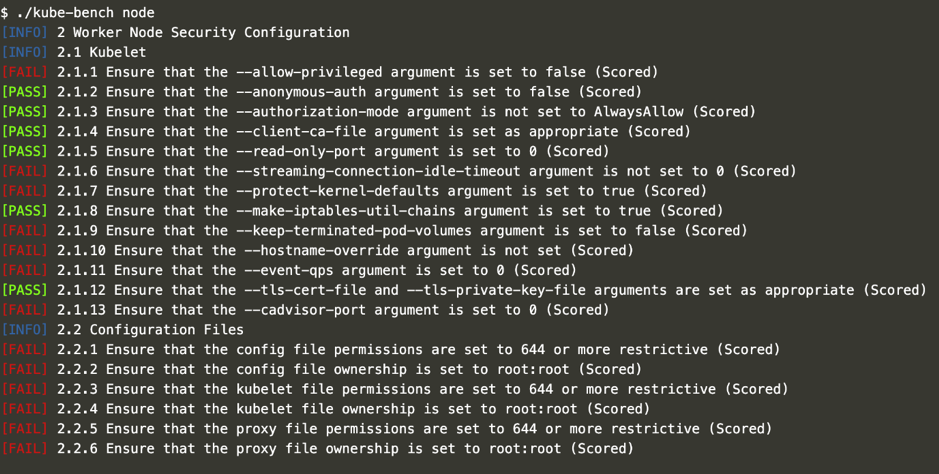
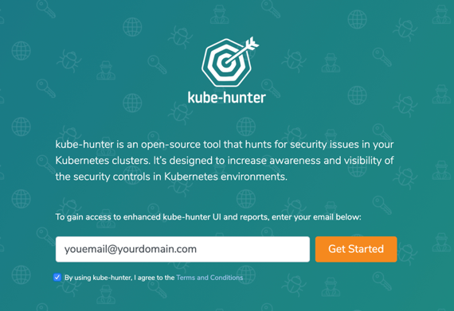
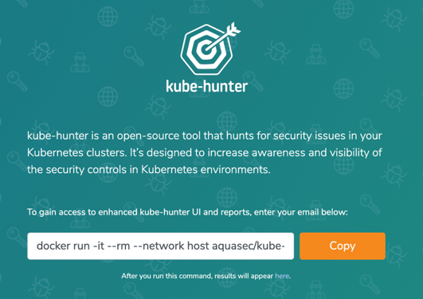
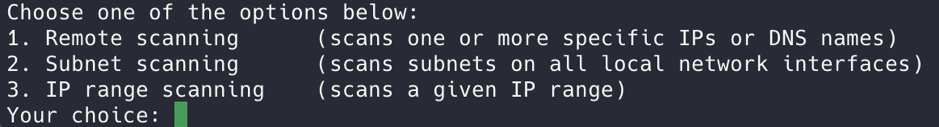
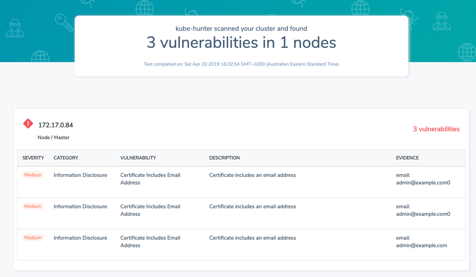

Securing Your Production-Grade Kubernetes Clusters Using RancherJoin the Online Meetup to get the latest on security challenges in an Enterprise Kubernetes Strategy and the security-related features in Rancher.[Join here](https://info.rancher.com/online-meetup-securing-production-k8s-clusters)Security is one of the most talked-about topics for Kubernetes users. Google “Kubernetes security” and you’ll find a huge number of articles, blogs and more. The reason is simple: you need to align your container and Kubernetes security with your organization’s existing security profile.
Kubernetes has some strong security best practices for your cluster—authentication and authorization, encryption in secrets and objects in the etcd database—to name a few. However, you need to be aware of other risks, such as privilege escalation and secrets obtained.
The Center of Internet Security’s (CIS) comprehensive [Kubernetes Benchmark](https://www.cisecurity.org/benchmark/kubernetes/) provides prescriptive guidance for establishing a secure configuration posture for Kubernetes.
When you look at Kubernetes and your existing security landscape, consider how well your practices align. In particular, keep in mind:

- Environment hardening and alignment with CIS benchmarks
- Vulnerabilities that might be used for exploitation

The following represents a framework for Kubernetes security. This article focuses on areas within the Runtime and Platform security.

There are some great tools available that leverage the CIS benchmark to provide visibility into potential security risks within your current Kubernetes environment and alignment to your security practices. In this article, we’ll explore two of those.

## Introducing kube-bench and kube-hunter

Aqua Security’s open-source tools, [kube-bench](https://github.com/aquasecurity/kube-bench) and [kube-hunter](https://kube-hunter.aquasec.com/), find security issues in Kubernetes clusters. They differ in their approach to analyzing your security posture within the Kubernetes infrastructure stack. kube-bench focuses on your alignment to the CIS, while kube-hunter looks at vulnerabilities you’re exposing. Together they provide a great view of in terms of determining your compliance and awareness.
Let’s start with kube-bench, which checks whether Kubernetes is deployed according to CIS security best practices. kube-bench can run locally or distributed as a container within your Kubernetes environment. Once deployed, kube-bench provides you with several configuration files for either master or nodes, depending on the tests you want to perform, as well as different Kubernetes versions. Notably, the configuration files are written in Yaml. That means you can adjust them to align with your own tests (should you wish) or as the CIS or Kubernetes exposes more tests.
The following CIS benchmark excerpt highlights information that you can obtain, test against and remediate. kube-bench does this for you by running tests that align to the benchmark. Then you get summary information, as well as remediation advice if required. For example, if you have authentication turned off on your API Server, the advice explains how to enable authentication. Once you’ve performed any remediation, run the tool again (and again) until you’ve met your own standards.

Source: 1 CIS Security Benchmark for Kubernetes – Page 14

## Running kube-bench

kube-bench shows you how your environment aligns and conforms with your organization’s best practices—either against the CIS benchmark or your container lifecycle (as I described earlier).
Start by logging into your Kubernetes server, where you’ll run the kube-bench scan and install kube-bench directly. Deploy the container within your environment by running a Docker command: “docker run –rm -v `pwd`:/host aquasec/kube-bench:latest install”, as shown here.

Once this has deployed, it will install kube-bench to run on the Kubernetes server. Determine which test you want to run and what information you want to present on the screen. It presents a lot of information by default, so you can set several flags to show only the information you need, as shown here.

Below is an output of running “./kube-bench node”

## Running kube-hunter

Aqua’s second tool, kube-hunter, runs scans inside or outside your environment to give you visibility into security vulnerabilities in your Kubernetes platform. kube-hunter can run as a container on any machine inside or outside your cluster—of course, you should only run on clusters you own. Once you enter the cluster DNS or IP, kube-hunter starts to review your current open ports, run tests and look for any exposures. Then you’ll get a raft of information that you can use to determine your next steps.
kube-hunter’s default state is “passive,” which means it looks for things like email addresses in kubeneretes SSL certificates and checks for open ports, proxy services and dashboards. In the “active” state, kube-hunter looks for additional weaknesses and uses any exploits it finds to explore further vulnerabilities—so it’s extremely powerful. While kube-hunter doesn’t look inside container images (there are other tools for that) it can run a test that might expose data leaks or compromised email addresses.
[Here’s a full list](https://kube-hunter.aquasec.com/) of passive and active tests you can perform with kube-hunter.
You can install and run kube-hunter in a few ways:
- Local Machine: via Python script, which allows you to perform remote scanning
- Container: via a Docker-based container that you can run inside your Kubernetes cluster
- Pod: this gives you a view of a potential compromised pod
For this article, we’ll leverage the container method. To start, register at [Aqua](http://kube-hunter.aquasec.com/) to receive a token to install a Docker container and run a remote scan.

You’ll get a Docker command to run.

There are three options for scanning (noted below). You can modify the information presented (logging based) depending on what you want to see, such as debug, info (which is default) and the standard warning.

Next, you’ll get a list of vulnerabilities, with severity, details of the user environment and URLs that you can share with your organization.

## Conclusion

In this article, we looked at two powerful tools, kube-bench and kube-hunter, that give you visibility into your [Kubernetes security](https://www.suse.com/c/best-practices-for-keeping-kubernetes-secure/). In terms of your overall security landscape, these tools are just the beginning. You also need to address other aspects of your container lifecycle (as shown above). There are several tools within the CNCF that you can use to build a well-rounded security landscape for Kubernetes and the services within it.
In future posts in this series, I’ll explore other tools. Let me know what you’d like to hear about.Securing Your Production-Grade Kubernetes Clusters Using RancherJoin the Online Meetup to get the latest on security challenges in an Enterprise Kubernetes Strategy and the security-related features in Rancher.[Join here](https://info.rancher.com/online-meetup-securing-production-k8s-clusters)
