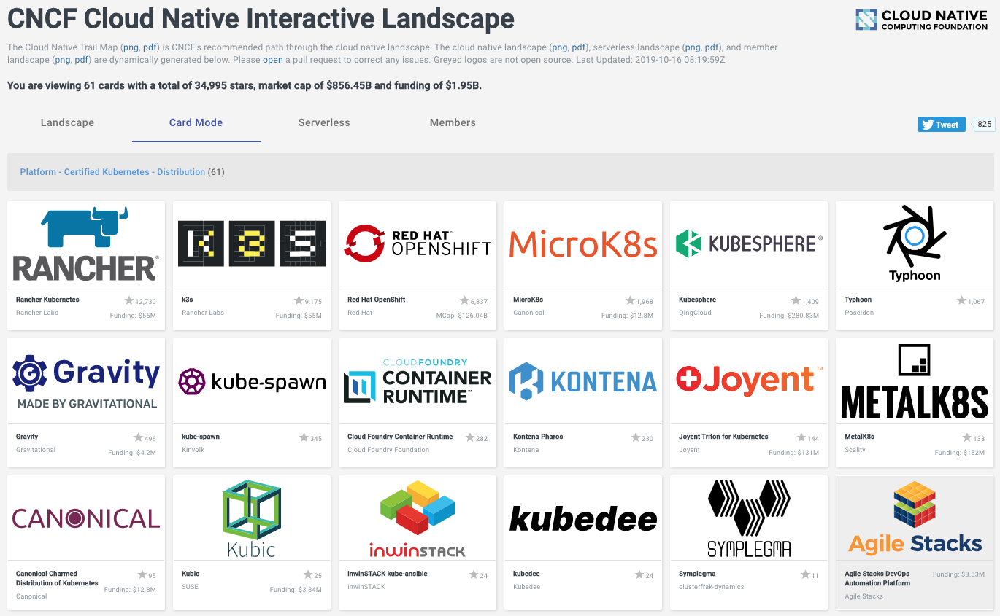
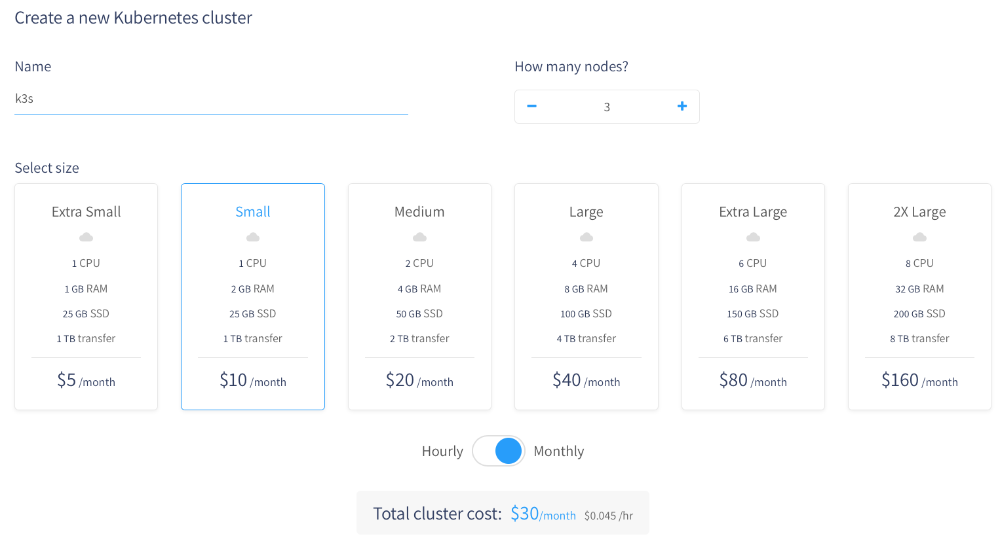
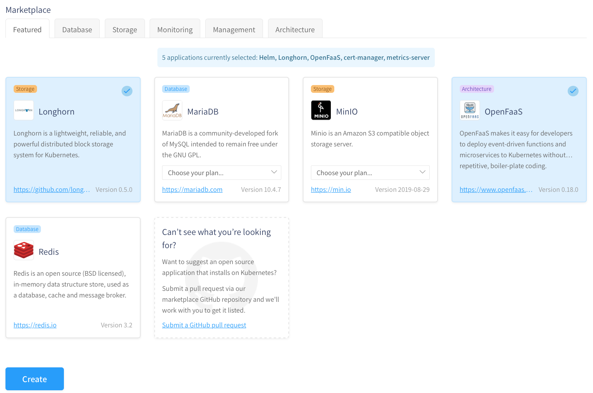
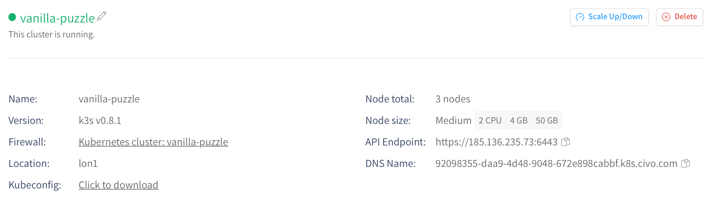
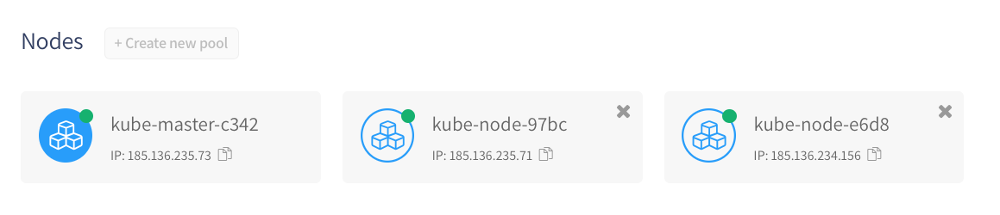
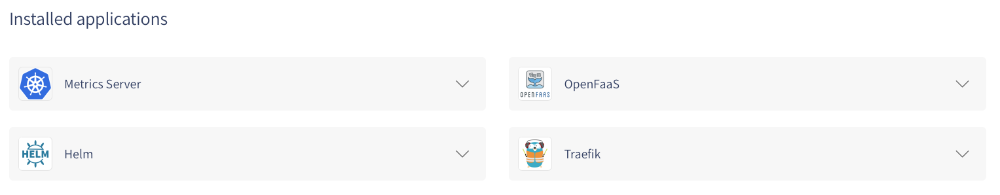
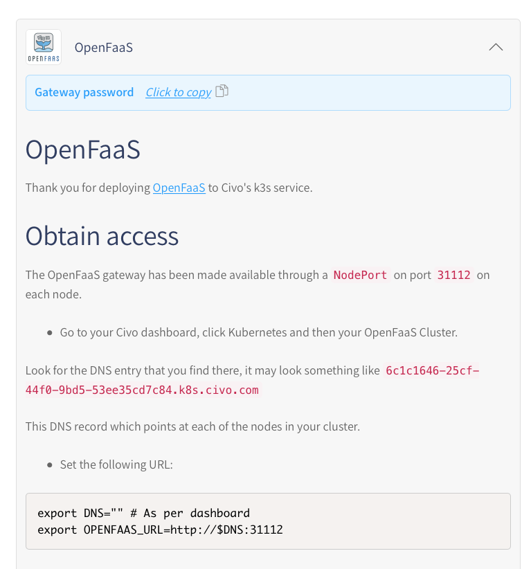
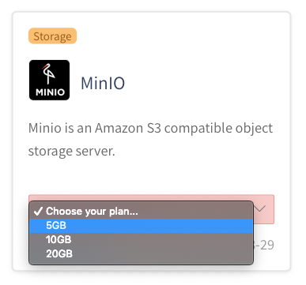

The k3s project was started by Darren Shepherd, Chief Architect at Rancher 7 months ago and has already become one of the most popular Kubernetes options on the CNCF Landscape by number of GitHub stars.

To put this into context, k3s is more popular than OpenShift by IBM/Red Hat and only Rancher Kubernetes itself is more popular than k3s. Now stars are indicative of interest and popularity only and that should be noted.



Source: CNCF Interactive Landscape https://landscape.cncf.io

In 2018 DigitalOcean released their own Kubernetes service (DOKS), which was followed by Kapsule from Scaleway, it was only natural that IaaS providers would offer [managed Kubernetes](https://www.suse.com/c/ensuring-high-availability-with-cloud-managed-kubernetes/) for developers. What we see in this post is how Civo, a home-grown cloud computing company in the UK decided to build their managed platform on k3s instead of using upstream.

## Why k3s?

Since the launch, Civo have written a comparison on k3s vs k8s and why they decided to build with this option.
> K3s is designed to be a single binary of less than 40MB that completely implements the Kubernetes API. In order to achieve this, they removed a lot of extra drivers that didn’t need to be part of the core and are easily replaced with add-ons.  
> K3s is a fully CNCF (Cloud Native Computing Foundation) certified Kubernetes offering. This means that you can write your YAML to operate against a regular “full-fat” Kubernetes and they’ll also apply against a k3s cluster.  
> Due to its low resource requirements, it’s possible to run a cluster on anything from 512MB of RAM machines upwards. This means that we can allow pods to run on the master, as well as nodes.  
> And of course, because it’s a tiny binary, it means we can install it in a fraction of the time it takes to launch a regular Kubernetes cluster! We generally achieve sub-two minutes to launch a k3s cluster with a handful of nodes, meaning you can be deploying apps to learn/test at the drop of a hat.

Andy Jeffries, CTO @ Civo

I think that’s a pretty compelling reason. To read more, see Andy’s blog post: [K8s vs k3s](https://www.civo.com/blog/k8s-vs-k3s)

## What is Managed K3s anyway?

T

his may be an unpopular opinion, but I believe that the term “managed” is loaded and means different things to every team and customer.

For me, these are important parts of a Kubernetes offering:

- Quick provisioning time with API, CLI and UI dashboard
- Upstream compatibility
- Portability between clouds
- Low cost
- Integration with storage and networking
- Elastic compute
- High availability

Now with Civo’s initial offering the first three points are well covered and the last three are going to be added later.

So whilst we can find offerings like AWS EKS — which has a ambient cost of 150 USD / mo, and covers all of above, the likes of Civo can offer managed k3s with slightly fewer features at a much lower cost.



Pictured: Civo UI, creating a new cluster.

A 3-node cluster using small Instances would be around 30 USD / mo.

## Create the cluster

The cluster can be created in three ways:

1) Via the UI as pictured above, during this time you can also pick from a number of applications which are maintained by the community. Each application corresponds to either a YAML manifest file or a helm chart.



Pictured: selecting apps from the marketplace

In the picture above I’m installing a few of the provided applications:

- OpenFaaS — for compute and horizontal auto-scaling of functions/microservices
- Longhorn — this provides a software-based Volume provisioner, since k3s doesn’t ship with one built-in
- Helm — as a backing dependency to install other charts
- cert-manager — for TLS certificates
- metrics-server — to monitor the cluster

Each of the applications is maintained in an open GitHub repo with instructions on how to submit your own. At time of writing, there are 5 contributors and the number is growing.

See the repo: https://github.com/civo/kubernetes-marketplace

2) The second way to create a cluster is my favourite, and it’s via the Civo CLI.

Now the CLI is actually written in Ruby rather than Go, so it was a bit surprising, but the team assures me this is because their strengths are in Ruby. A Golang SDK is planned for the future.

What I really liked about the CLI was that I can type in a single command and forget about every other parameter, my biggest gripe with other managed Kubernetes service is that the CLI requires me to look up an abundance of configuration options from host type, to billing plan, to image OS ID, to the code for the region.

This is how Civo does it:

`civo k8s create --save --wait`

Yes, it really is that simple. It will create a 3-node cluster and then update my `KUBECONFIG` file.

If I want to install an app or two, I can specify them at the install time:

`civo k8s create --save --wait --applications openfaas`

It really doesn’t get much simpler than this, I only wish Civo would bring the same experience to a portable CLI so that I can use this with my local k3s or k3d clusters.
> In that light, I started to create an OSS project called k3sup (‘ketchup’) which can create a k3s cluster. It can also install OpenFaaS and the metrics-server to any Kubernetes cluster you have a KUBECONFIG for.

3) You can also create a cluster using Civo’s REST API.

For hints on how to use the REST API, see the documentation https://api.civo.com/ or checkout the source code for the Ruby CLI which is also open-source.

https://github.com/civo/cli

## Using the cluster

One of the highlights for me is the dashboard or UI that Civo has built. The team employ a full-time UX designer and go through multiple iterations to get things right.



We have a cluster summary which also includes a DNS record that we can CNAME and point at a custom domain. The DNS record maps to each of the nodes in the cluster and is useful for running services using host ports.



Each node is listed, and you’ll notice that we do see the master node and there is only one.

At time of writing Civo’s k3s is not HA or backed up, that means that you

will lose all your data if the master crashes. For development and testing, maybe even for staging I think I’d be happy to take that risk.

Longer term, Darren is working on ways to make k3s HA-ready for the 1.0 release and I know that Andy at Civo has some ideas about backing up the master. Expect to see this develop over the coming months.



Once again we see our installed apps, and can add new ones from the same page.

As the author of the OpenFaaS app for Civo, I was able to set up a special parameter for the generated password. Now, this makes OpenFaaS easier to use on Civo’s platform than on a regular Kubernetes cluster because at any time I can get the password by opening this dialog and clicking the button below.

If we use our own Kubernetes cluster, then we’d have to type in:

```
echo $(kubectl get secret -n openfaas basic-auth -o jsonpath=”{.data.basic-auth-password}” | base64 — decode; echo)
```

It’s not a big deal, but I like the fact that Civo have made the developer-experience even smoother.



Note this works the same way with Minio and other tools that use credentials.

Not all applications are stateless and k3s doesn’t come with anything to handle provisioning volumes for Kubernetes. Luckily Rancher have thought of this already with the Longhorn project. The Civo team have integrated Longhorn and you can select what size of PersistentVolume you want to create when adding software.



## Doing real work

I wrote a detailed review of my experiences setting up OpenFaaS, cert-manager, adding a TLS certificate, scaling the cluster and monitoring with the metrics-server. To read up on that checkout my blog post: The World’s First Managed k3s

## Wrapping up

I’ve been working with Civo as a client of OpenFaaS Ltd since June and I’ve been consistently impressed with the attention to detail, developer-experience and the reactiveness to feedback.

I believe that the key to creating a great product is solving a pain-point for customers and a great way to do that is by building a community and seeking feedback. Civo’s new Slack community is open to all those who have early-access and is a hive of activity, there’s even been half a dozen blog posts written by the growing community.

To wrap up, here’s a demo of setting up a cluster via the CLI:
If you’d like to try Civo’s Managed k3s offering, you can apply for early-access to their `#KUBE100` program, and whilst you wait.

Register your interest here: https://www.civo.com/kube100

Whilst you wait, you may also like to try k3s on your laptop or on a Civo VM Instance:

- [Install k3s to your Raspberry Pi cluster](https://blog.alexellis.io/test-drive-k3s-on-raspberry-pi/)
- [Run k3s in a Docker container with k3d](https://github.com/rancher/k3d)
- [Install k3s using k3sup to any](https://k3sup.dev/) VM (including Civo, DigitalOcean, Scaleway, Packet.com), vagrant, or Raspberry Pi
