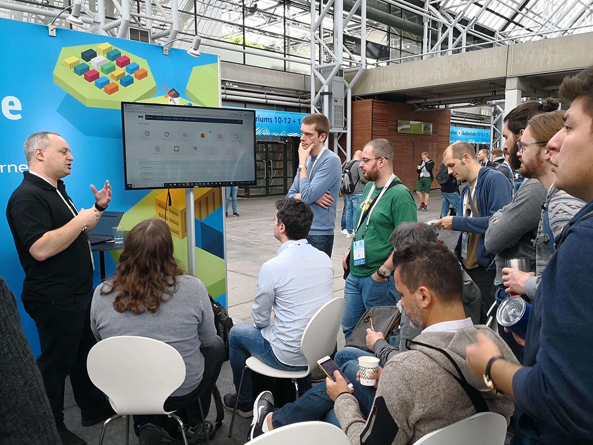
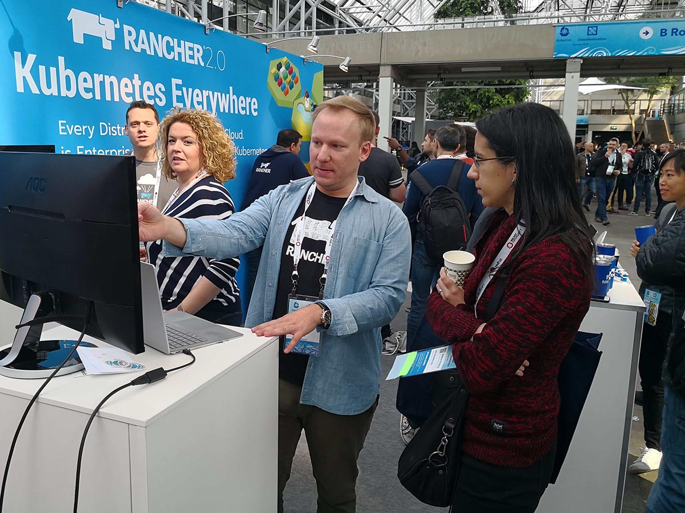
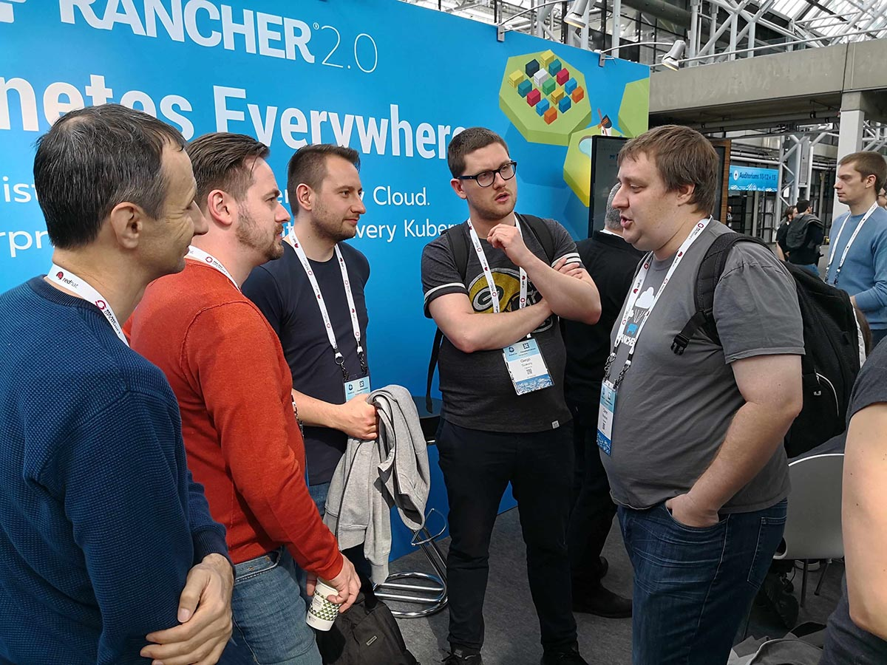
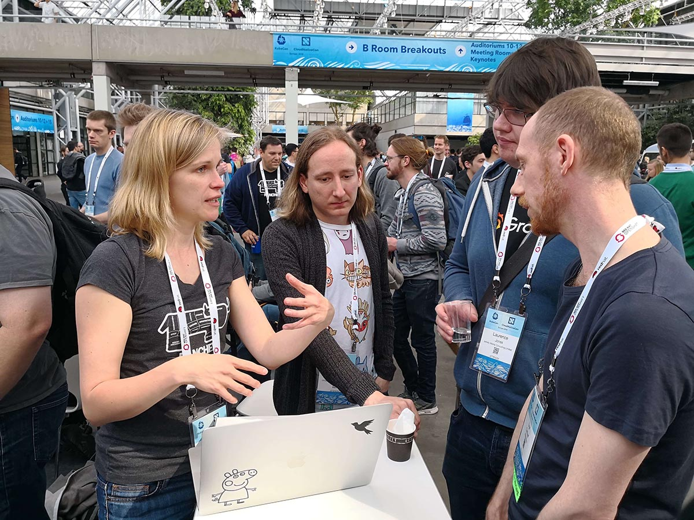
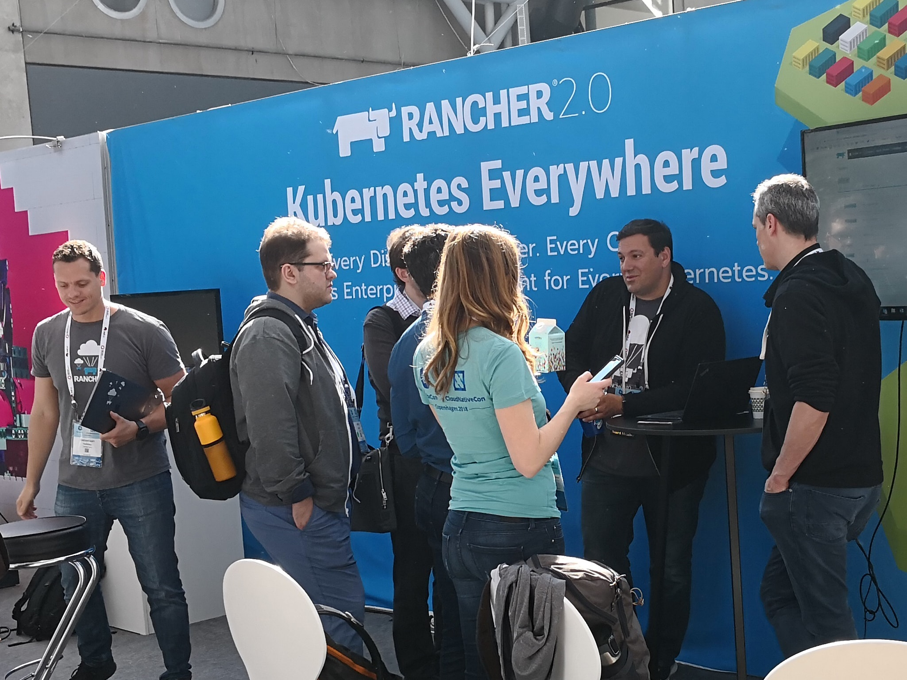

Expert Training in Kubernetes and RancherJoin our free online training sessions to learn more about Kubernetes, containers, and Rancher. [Sign up here](https://rancher.com/training/) After a fantastic week at KubeCon in Europe, I spent Monday morning commuting into the office and reflecting on some of the interesting discussions I had over three surprisingly sunny days in Copenhagen. It was an important event for us at Rancher, we rolled out [Rancher 2.0 to general availability](https://rancher.com/what-is-rancher/overview/), and met with hundreds of Kubernetes users who were attending the event trying to learn about the latest approaches to leveraging Kubernetes to adopt cloud native architectures.

I’ve been lucky enough to attend every KubeCon since the first event in San Francisco in 2015, and what stood out in Copenhagen was how the audience had evolved from individual teams looking to use Kubernetes, to larger IT organizations focused on delivering Kubernetes as a global platform for innovation. This thread was reflected through a number of interesting conversations I had over the week.

#### Kubecon 2018

## The number of Kubernetes clusters in many organizations is growing rapidly.

Two years ago, users at the first European KubeCon in London were interested in any tool that could help deploy and upgrade their Kubernetes clusters. Today, tools like [Kubespray](https://github.com/kubernetes-incubator/kubespray), [RKE](https://github.com/rancher/rke), [Kops](https://github.com/kubernetes/kops), and [Kubeadm](https://kubernetes.io/docs/setup/independent/create-cluster-kubeadm/), along with commercial tools and hosted Kubernetes services from Google, Azure and other cloud providers have made provisioning clusters simple and common.

One result of this has been a rapid expansion in the number of Kubernetes clusters running in many companies. One team at a large media company that stopped by our booth talked about the challenge they were facing managing more than 60 Kubernetes clusters running across the organization. Between different versions of Kubernetes, turnover in the teams that had deployed the clusters, and concerns about efficiency, they had begun a project to look at addressing what they called “KubeSprawl.”

As Kubernetes adoption expands, the need for central management of lots of clusters is going to continue to increase. It’s something we’ve been working on with Rancher 2.0, and it certainly felt like an emerging requirement as Kubernetes’ adoption continues to expand.

#### Kubecon 2018

## There is a competitive market around Kubernetes security tools developing

Several people I spoke to shared how they were using or looking into dedicated Kubernetes security tools. Neuvector, Twistlock, Sysdig Secure, and Aqua all came up in different conversations, and many users had already put these tools into production.

One large German company shared how they were rolling out Neuvector with Rancher for network inspection, and raved about how smoothly the deployment had gone, and how they had been able to leverage it to debug networking issues. Two different teams told me about how they were using Aqua, and only had good things to say. I’m hoping later this year to host an online meetup and invite these companies to talk about their unique value propositions.

#### Kubecon 2018

## Kubernetes may be becoming an alternative to private IaaS clouds

One architect from a university in Germany shared a story of how his team was considering replacing a large OpenStack deployment that is used by researchers with a new Kubernetes service. The key driver would be to reduce the overall costs of managing the platform and improving the utilization of massive amounts of bare metal infrastructure.

One challenge the architect shared was the need to still provide some virtual machines to users. While most users would be able to use containers to run their workloads, there would be some need to provision VMs using Kubernetes. We talked about the latest release of [RancherVM](https://rancher.com/blog/2018/2018-04-27-ranchervm-now-available-on-kubernetes/), which runs on Kubernetes, and how it might be a possible solution for using Kubernetes as a platform for running both VMs and containers.

#### Kubecon 2018

## Cloud-hosted Kubernetes is coming on strong

Most Kubernetes users I spoke with are still running Kubernetes themselves, even when they are running it in the cloud. However, I saw a marked increase in the number of companies using Google’s hosted Kubernetes service (GKE), and there was a ton of users who mentioned they were eager to try Amazon’s new hosted Kubernetes service (EKS), when it comes out of beta later this year.

Azure, Oracle, Tencent, Huawei, Alibaba and many other cloud providers have already rolled out Kubernetes services in the last year or two. At the conference Digital Ocean announced early access to their new [hosted Kubernetes service](https://blog.digitalocean.com/introducing-digitalocean-kubernetes/), and we had a half dozen people stop by the Rancher booth asking how soon we’d add support for it.

It may still be early, but we are heading toward a future where getting Kubernetes from your cloud provider is going to be as simple as spinning up a VM or disk.

#### Kubecon 2018

## How many people should we expect for KubeCon in Seattle?

Finally, KubeCon in Europe drew more than 4,300 people this year, which got several CNCF board members discussing how many people we might see in Seattle for KubeCon North America in December. Last year’s KubeCon in Austin drew 4,100 people, and it seems the current over/under for Seattle is around 7,000 people. Based on the enthusiasm in Copenhagen, I’m taking the over and would bet on just over 7,400. If you haven’t already, [register now](https://events.linuxfoundation.org/events/kubecon-cloudnativecon-north-america-2018/) and I look forward to seeing you in Seattle.Expert Training in Kubernetes and RancherJoin our free online training sessions to learn more about Kubernetes, containers, and Rancher. [Sign up here](https://rancher.com/training/)
