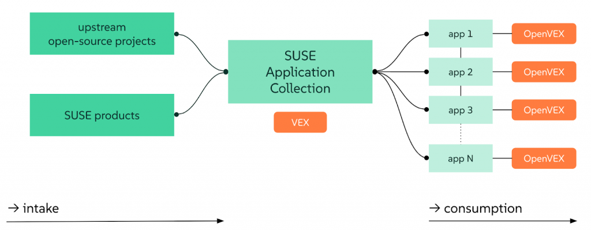
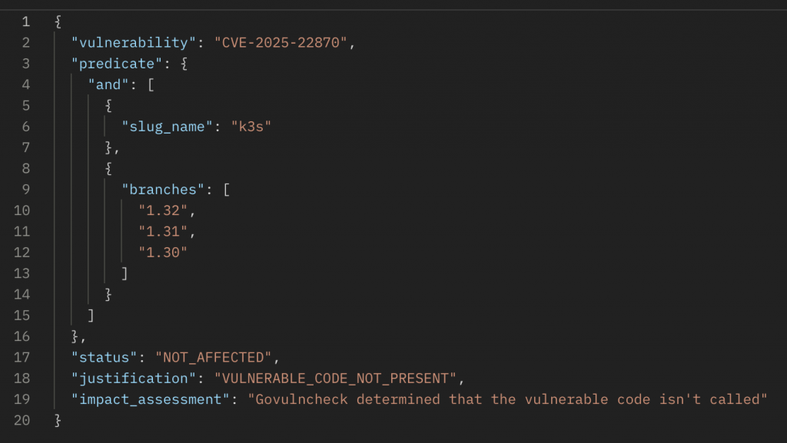
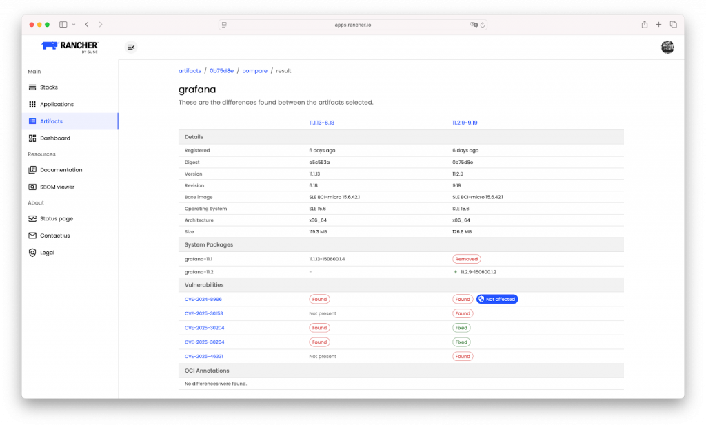
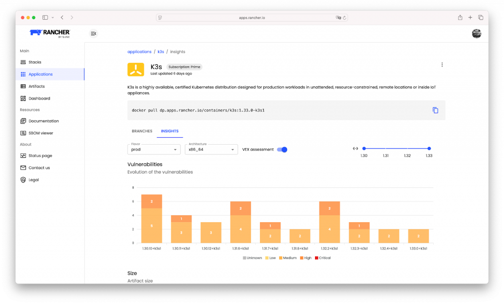
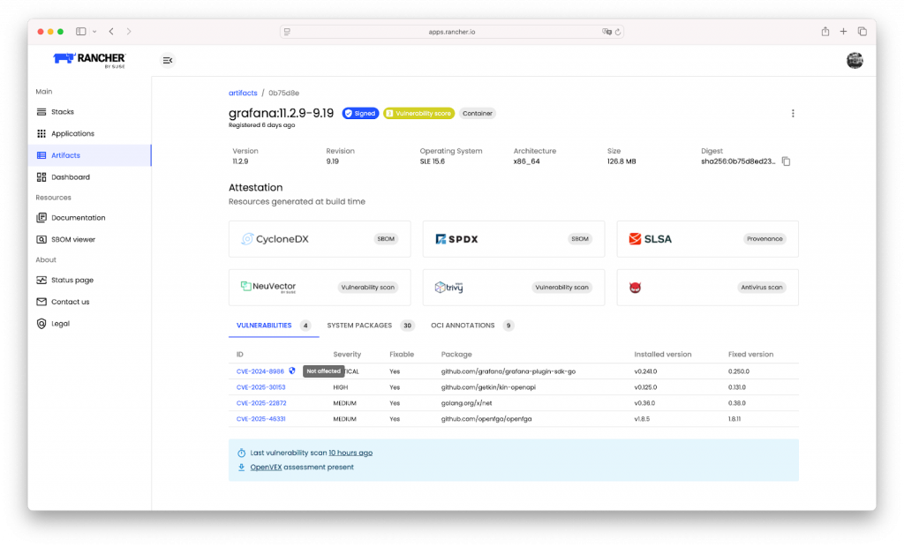

## Introduction: the CVE Overload Is Real

If you’re working with containers, SBOMs or any kind of vulnerability scan, you know the drill. Every scan lights up like a Christmas tree. Critical, high, medium and low vulnerabilities. It feels that the list will always go on.

The goal is always zero CVEs. And while that sounds great, it’s not realistic. They come at such a high pace, and sometimes they are really hard to resolve. Teams are spending time chasing vulnerabilities that don’t matter. False positives, unreachable code, packages that are technically vulnerable, but not in the way they’re used.

So the big question is: how do you know which CVEs are worth your time?

## CVE Counts Don’t Equal Real Risk

Let’s be honest. A high CVE count doesn’t always mean high risk. Many teams get stuck in endless patching cycles for vulnerabilities that have no real impact on how the application runs or how it can be attacked.

Some examples:

- A CVE is present, but the affected function is never called
- A vulnerable library is included, but sandboxed or not exposed
- The app uses a patched fork that default scanners do not recognize

Without context, all CVEs look urgent. And that leads to:

- Burned time
- Frustrated teams
- Slower releases

[embed]https://www.youtube.com/watch?v=BG4uEbkIHnY[/embed]

## The Solution: Vulnerability Exploitability Exchange

That’s where VEX comes in. VEX is a standard that gives extra information about whether a vulnerability affects a component. It helps clarify:

- Is the CVE really exploitable in this app?
- Has the issue been fixed upstream?
- Is the vulnerable code even being used?

SUSE has adopted the **OpenVEX** format to make this real and practical.

## How VEX Fits into SUSE Application Collection

Here’s how it works:

- [SUSE Application Collection](https://apps.rancher.io) pulls in upstream open source software and SUSE maintained packages
- As part of the build process, we scan for vulnerabilities
- We also check for available OpenVEX statements
- Each app gets tagged with that context, so you know whether a CVE‌ matters

We don’t hide anything. We give you the full picture, including CVEs that are not exploitable. That’s a big difference.

## Powered by a Fine-Grained, Real-Time VEX Engine

This isn’t just some tagging on the side. The VEX engine behind SUSE Application Collection is:

- **API-driven** so it fits into your existing workflows
- **Fine-grained** down to component, branch, version‌ and digest
- **Real-time** with ongoing scans and updates

Here’s what you can see:

- Vulnerability ID (like CVE-2025-22870)
- Which branches or versions are affected
- Justification (e.g., "vulnerable code not present")
- Status (like "Not Affected")

***VEX output for a CVE***

## Where You See It in the UI

***Artifact comparator: Spot which vulnerabilities changed and whether their impact changed too***

***Insights page: Toggle VEX on or off to filter out non-actionable CVEs***

***Artifact detail page: See the shield icon next to CVEs with VEX context***

## Real Impact for Real Teams

- **Developers** can stop getting blocked by false alarms
- **Platform teams** can patch only what really needs it
- **Security** gets fewer false positives to triage
- **Compliance** sees a clearer story regarding audits

This changes the game from "just fix everything" to "fix what matters."

## What’s Next

VEX support is now fully integrated into [SUSE Application Collection](https://apps.rancher.io). We’re continuing to expand coverage as more upstream projects release OpenVEX metadata. Coming soon: exportable VEX data together with SBOMs, so you can use it in your own tooling.

## Try It Out

If you’re already using [SUSE Application Collection](https://apps.rancher.io), try enabling VEX in the UI today. You'll instantly get a cleaner, more useful view of your software landscape. Because you don’t need fewer CVEs. You need to know which ones matter.
