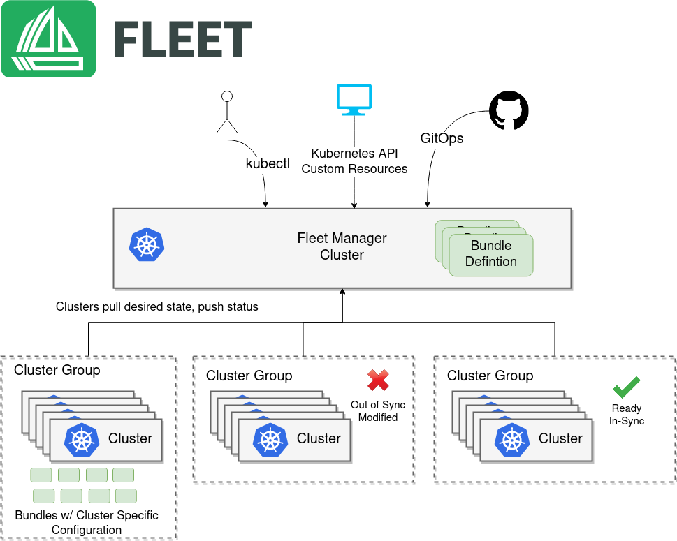

Today I’m excited to announce [Fleet](https://github.com/rancher/fleet), a new open source project from the team at Rancher focused on managing fleets of Kubernetes clusters. Ever since Rancher 1.0 shipped in 2016, Rancher has provided a central control plane for managing multiple clusters. As pioneers of Kubernetes multi-cluster management, we have seen firsthand how users have consistently increased the number of clusters under management. More recently, with the success of projects like [K3s](https://k3s.io), users are starting to deploy standalone Kubernetes clusters by the thousands to edge locations such as branch offices and retail stores. We are already seeing interest from users who want to manage tens of thousands or even millions of clusters in the near future, and I’m convinced that the need to manage Kubernetes clusters at scale will continue to grow.

## The Demand for Scale

With this ever-increasing demand for scale, we needed to look at new architectures for multi-cluster management. Fleet represents the next evolution of [cluster management](https://www.suse.com/c/understanding-cluster-management-for-kubernetes/). Traditionally, Kubernetes clusters were treated as pets. Fleet represents a transition to managing clusters as cattle.

In order to scale the number of clusters under management, we can no longer focus so much attention and effort on managing each individual cluster. Just like Kubernetes has shifted the focus away from individual computing nodes, we want to do the same with clusters themselves. Following the model of how Kubernetes deploys pods, we define Bundles that are then targeted at clusters based on selectors. The Kubernetes pod deployment model can not be copied exactly, however. Unique to the idea of deploying across clusters is that resources will need to be configured differently per cluster. Fleet provides a built-in mechanism to customize bundles per target cluster using industry-standard tools such as Helm and Kustomize. Once bundles are deployed across clusters, Fleet actively monitors that resources are both ready and have not been modified.

## Building on K3s and Rancher

The scalability of Fleet comes from a lot of work we have done to scale both Rancher and K3s. While K3s is targeted toward smaller deployments, the storage technology K3s is built on allows Kubernetes to manage much larger datasets than is currently possible with etcd. Additional optimizations have been built in order to reduce the chattiness typically seen from Kubernetes controllers. From all of the learning we have from managing thousands of clusters in Rancher, we are confident this next architecture will get us to millions. As we continue to prove out the architecture and test the scale, we will be sure to share our findings with the community.

We refer to the units that Fleet deploys as bundles and not applications. The reason for this is that not only can we manage application deployments, but more importantly, we can manage anything that can be described as a Kubernetes resource. As the industry moves to more and more Kubernetes-native tooling, this expands what we can manage.

Right now one of the primary use cases beyond application deployments is managing security tools and policies. Tools such as OPA or Falco have native Kubernetes APIs so Fleet can ensure all of your clusters are consistent and secure. Going a step further, we have been pursuing efforts with K3s, K3OS, and our System Update Controller that we think could allow us to even manage the underlying cluster and operating system using Kubernetes resources.

## Fleet Management: You Asked For It

Over the last year, we’ve been hearing requests for fleet management from the K3s community as they pushed it out into more and more distributed use cases. We decided to name this project **Fleet** because it best captured the use cases so many of our users were describing. However, those of you who have been working on containers for a few years will remember that one of the foundational projects in this space was also called [Fleet](https://github.com/coreos/fleet). That project was an early container orchestrator built by the team at CoreOS. That project has been archived and is no longer under development, but I was always a big fan of it. So I hope reusing this name will also be seen as a tip of the cap to one of the fantastic early projects in our space.

We are excited to embark on this evolution in Kubernetes management. Fleet 0.1 is currently pre-Alpha prototype-quality software, and [available today on GitHub](https://github.com/rancher/fleet). Please [join us on April 15](https://info.rancher.com/online-meetup-hands-on-with-rancher-2-4-take-hybrid-cloud-kubernetes-to-the-edge) for the technical Online Meetup, ‘Take Kubernetes from Cloud to Edge.’
