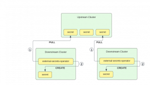

Fleet, also known as “Continuous Delivery” in Rancher, deploys application workloads across multiple clusters. However, most applications need configuration and credentials. In Kubernetes, we store confidential information in secrets. For Fleet’s deployments to work on downstream clusters, we need to create these secrets on the downstream clusters themselves.
> When planning multi-cluster deployments, our users ask themselves: “I won’t embed confidential information in the Git repository for security reasons. However, managing the Kubernetes secrets manually does not scale as it is error prone and complicated. Can Fleet help me solve this problem?”

To ensure Fleet deployments work seamlessly on downstream clusters, we need a streamlined approach to create and manage these secrets across clusters.

A wide variety of tools exists for Kubernetes to manage secrets, e.g., the SOPS operator and the external secrets operator.

A previous blog post showed [how to use the external-secrets operator (ESO) together with the AWS secret manager](https://www.suse.com/c/rancher_blog/managing-sensitive-data-in-kubernetes-with-sealed-secrets-and-external-secrets-operator-eso/) to create sealed secrets.

ESO supports a wide range of secret stores, from Vault to Google Cloud Secret Manager and Azure Key Vault. This article uses the Kubernetes secret store on the control plane cluster to create derivative secrets on a number of downstream clusters, which can be used when we deploy applications via Fleet. That way, we can manage secrets without any external dependency.

We will have to deploy the external secrets operator on each downstream cluster. We will use Fleet to deploy the operator, but each operator needs a secret store configuration. The configuration for that store could be deployed via Fleet, but as it contains credentials to the upstream cluster, we will create it manually on each cluster.



As a prerequisite, we need to gather the control plane’s API server URL and certificate.

Let us assume the API server is reachable on “YOUR-IP.sslip.io”, e.g., “192.168.1.10.sslip.io:6443”. You might need a firewall exclusion to reach that port from your host.

```
export API_SERVER=https://192.168.1.10.sslip.io:6443
```

### **Deploying the External Secrets Operator To All Clusters**

> Note: Instead of pulling secrets from the upstream cluster, an alternative setup would install ESO only once and use [PushSecrets](https://external-secrets.io/v0.8.3/provider/kubernetes/#pushsecret) to write secrets to downstream clusters. That way we would only install one External Secrets Operator and give the upstream cluster access to each downstream cluster's API server.

Since we don’t need a git repository for ESO, we’re installing it directly to the downstream Fleet clusters in the fleet-default namespace by creating a bundle.

Instead of creating the bundle manually, we convert the Helm chart with the [Fleet CLI](https://github.com/rancher/fleet/releases/download/v0.6.0/fleet-linux-amd64). Run these commands:

```
cat > targets.yaml <<EOF
targets:
- clusterSelector: {}
EOF

mkdir app
cat > app/fleet.yaml <<EOF
defaultNamespace: external-secrets
helm:
  repo: https://charts.external-secrets.io
  chart: external-secrets
EOF

fleet apply --compress --targets-file=targets.yaml -n fleet-default -o - external-secrets app > eso-bundle.yaml
```

Then we apply the bundle:

```
kubectl apply -f eso-bundle.yaml
```

Each downstream cluster now has one ESO installed.

Make sure you use a [cluster selector in targets.yaml](https://fleet.rancher.io/gitrepo-targets#target-matching), that matches all clusters you want to deploy to.

### **Create a Namespace for the Secret Store**

We will create a namespace that holds the secrets on the upstream cluster. We also need a service account with a role binding to access the secrets. We use the role from the [ESO documentation](https://external-secrets.io/v0.8.3/provider/kubernetes/#authentication).

```
kubectl create ns eso-data
kubectl apply -n eso-data -f - <<EOF
apiVersion: rbac.authorization.k8s.io/v1
kind: Role
metadata:
  name: eso-store-role
rules:
- apiGroups: [""]
  resources:
  - secrets
  verbs:
  - get
  - list
  - watch
- apiGroups:
  - authorization.k8s.io
  resources:
  - selfsubjectrulesreviews
  verbs:
  - create
EOF
kubectl create -n eso-data serviceaccount upstream-store
kubectl create -n eso-data rolebinding upstream-store --role=eso-store-role --serviceaccount=eso-data:upstream-store
token=$( kubectl create -n eso-data token upstream-store )
```

### **Add Credentials to the Downstream Clusters**

We could use a Fleet bundle to distribute the secret to each downstream cluster, but we don’t want credentials outside of k8s secrets. So, we use kubectl on each cluster manually. The token was added to the shell's environment variable so we don’t leak it in the host's process list when we run:

```
for ctx in downstream1 downstream2 downstream3; do 
  kubectl --context "$ctx" create secret generic upstream-token --from-literal=token="$token"
done
```

Assuming we have the given kubectl contexts in our kubeconfig. You can check with `kubectl config get-contexts`.

### **Configure the External Secret Operators**

We need to configure the ESOs to use the upstream cluster as a secret store. We will also provide the CA certificate to access the API server. We create another Fleet bundle and re-use the target.yaml from before.

```
mkdir cfg
ca=$( kubectl get cm -n eso-data kube-root-ca.crt -o go-template='{{index .data "ca.crt"}}' )
kubectl create cm --dry-run=client upstream-ca --from-literal=ca.crt="$ca" -oyaml > cfg/ca.yaml

cat > cfg/store.yaml <<EOF
apiVersion: external-secrets.io/v1beta1
kind: SecretStore
metadata:
  name: upstream-store
spec:
  provider:
    kubernetes:
      remoteNamespace: eso-data
      server:
        url: "$API_SERVER"
        caProvider:
          type: ConfigMap
          name: upstream-ca
          key: ca.crt
      auth:
        token:
          bearerToken:
            name: upstream-token
            key: token
EOF

fleet apply --compress --targets-file=targets.yaml -n fleet-default -o - external-secrets cfg > eso-cfg-bundle.yaml
```

Then we apply the bundle:

```
kubectl apply -f eso-cfg-bundle.yaml
```

### **Request a Secret from the Upstream Store**

We create an example secret in the upstream cluster's secret store namespace.

```
kubectl create secret -n eso-data generic database-credentials --from-literal username="admin" --from-literal password="$RANDOM"
```

On any of the downstream clusters, we create an ExternalSecret resource to copy from the store. This will instruct the External-Secret Operator to copy the referenced secret from the upstream cluster to the downstream cluster.

Note: We could have included the ExternalSecret resource in the cfg bundle.

```
kubectl apply -f - <<EOF
apiVersion: external-secrets.io/v1beta1
kind: ExternalSecret
metadata:
  name: database-credentials
spec:
  refreshInterval: 1m
  secretStoreRef:
    kind: SecretStore
    name: upstream-store
  target:
    name: database-credentials
  data:
  - secretKey: username
    remoteRef:
      key: database-credentials
      property: username
  - secretKey: password
    remoteRef:
      key: database-credentials
      property: password
EOF
```

This should create a new secret in the default namespace. You can check the k8s event log for problems with `kubectl get events`.

 

We can now use the generated secrets to [pass credentials as helm values into Fleet multi-cluster deployments](https://fleet.rancher.io/gitrepo-content#using-valuesfrom), e.g., to use a database or an external service with our workloads.
