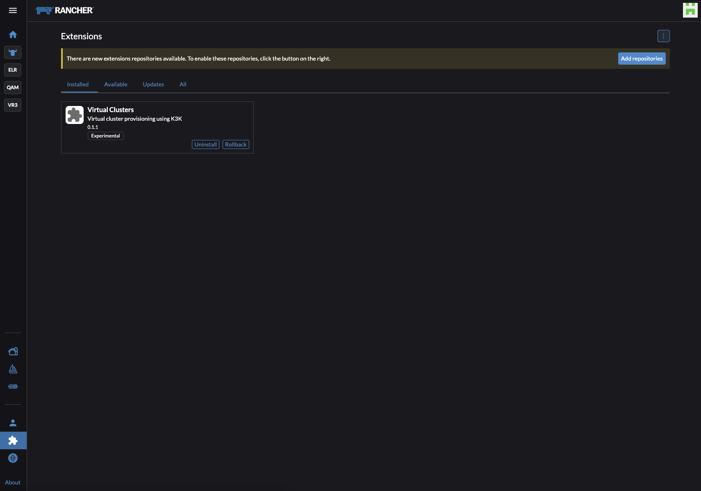
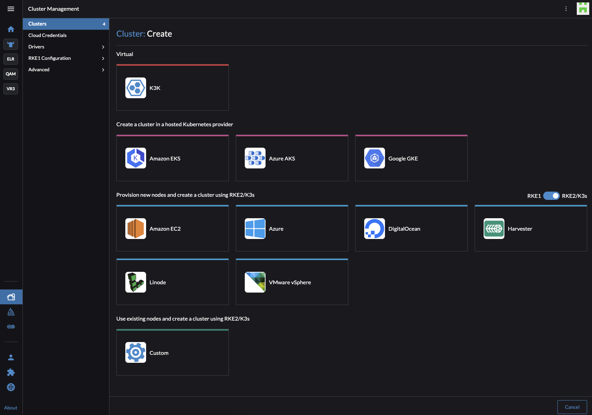
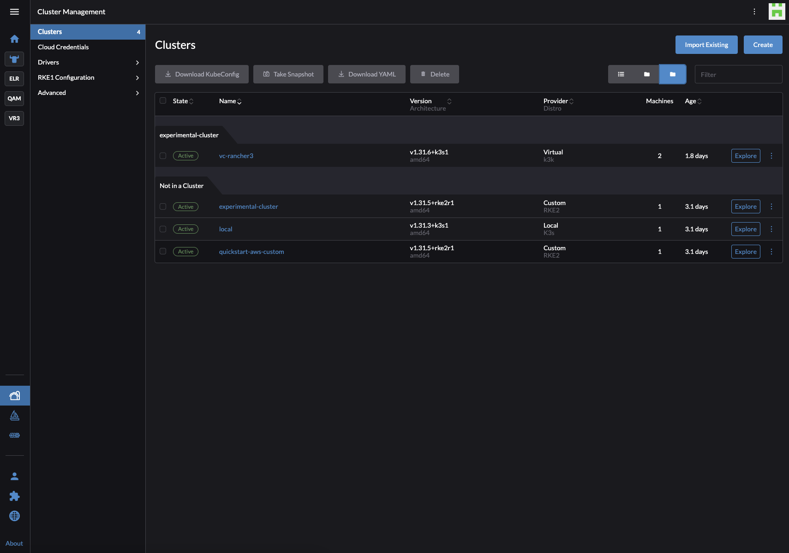

# From Conflicts to Control: The Case for Virtual Clusters in Kubernetes

Managing multiple teams in Kubernetes can feel like juggling too many balls at once. Have you ever struggled with resource conflicts, security risks‌ or simply keeping everything running smoothly when everyone shares the same cluster? If so, you're not alone. Let's dive into how virtual clusters can transform this chaos into a well-orchestrated symphony.

## Challenges platform engineering teams face managing multiple teams on their clusters

**Resource Conflicts:**When multiple teams share a single Kubernetes cluster, they often end up competing for the same resources, like CPU or memory. For example, one team might deploy a resource-heavy application, which could starve another team's project of the resources it needs to run efficiently.

**Security Risks:**Sharing a cluster can also raise security concerns. If one team's application has a vulnerability, it could potentially affect the entire cluster. For instance, a misconfiguration in one team's deployment could expose sensitive data, risking the integrity of other teams' applications.

**Limited Flexibility:**Teams may also feel restricted by the limitations of a shared cluster. For example, one team might need a specific Kubernetes version or custom configuration that isn't compatible with the rest of the cluster. This lack of flexibility can slow down progress and innovation.

**Noise Pollution:**

When teams share a single Kubernetes cluster, one team’s activity can easily interfere with another. This happens when certain resources‌ — ‌like Kubernetes Operators or custom controllers‌ — ‌go beyond the boundaries of a namespace. For example, installing a cluster-wide operator for one project can unintentionally affect workloads from another team. This lack of isolation creates noise and instability, making it harder to guarantee reliable environments for everyone.

## K3k Virtual clusters solve these problems

Teams are finding solutions around these problems. Virtual clusters are one of them, powered by K3s, segmentation is possible! These are ‌game-changers for solving the challenges of single Kubernetes clusters. SUSE Virtual Clusters are especially helpful for platform engineers who manage large environments with hundreds of developers. They offer separate environments that reduce resource conflicts and security risks. This open source solution is easy to try and perfect for streamlining operations, making life easier for platform teams and developers alike.

*K3k is an experimental tool that allows you to create and manage isolated K3s clusters within an existing Kubernetes environment. It supports both "shared" and "virtual" modes:*

- ***Shared Mode****: Optimizes resource utilization by running multiple K3s clusters on the same physical host, maximizing infrastructure efficiency.*

- ***Virtual Mode****: Provides complete isolation with dedicated K3s server pods for each cluster, ensuring robust resource isolation.*

*K3k integrates seamlessly with Rancher, simplifying the management of these embedded clusters:*

- Virtual Clusters extension is available for installation

- Virtual Clusters option is available when creating a new cluster

- Virtual Clusters have a distinct `Provider` named `Virtual / K3k`

## Benefits of using virtual clusters

If resource conflicts and security risks are slowing your teams down, it's time to explore virtual clusters! They provide enhanced isolation, letting teams work independently without conflicts. Let’s take a closer look at how SUSE Virtual Clusters will help you out in 4 different ways.

- **More freedom, less risk:** Virtual clusters give each team their own space. Think of it as having separate rooms in one building. Each team can set up their own tools and resources without disturbing others. This lets teams innovate and experiment freely while keeping everything under control.

- **Save resources and money:** Instead of giving each team their own separate infrastructure, virtual clusters let teams share resources like hardware and servers. This means you use fewer resources overall, which saves money and makes everything easier to manage.

- **Easy management for different teams:** Virtual clusters simplify managing multiple projects or teams. Each team can have its own workspace, and administrators can oversee everything from a single tool (like Rancher). This keeps management straightforward and consistent, even with many teams.

- **Faster development and easy testing:** Creating and removing virtual clusters is quick and simple, making them ideal for testing new ideas. Teams can quickly spin up temporary environments to experiment safely or test new things without risk, speeding up innovation.

## Conclusion and get started yourself

K3k brings clarity and control to the chaos of shared Kubernetes clusters. Whether you're a platform engineer juggling multiple teams or a developer looking for more freedom to build and test, virtual clusters are a smart step forward. And since K3k is open source and still evolving, this is the perfect time to get involved.

Head over to the [K3k GitHub repository](https://github.com/rancher/k3k), and give it a try.
