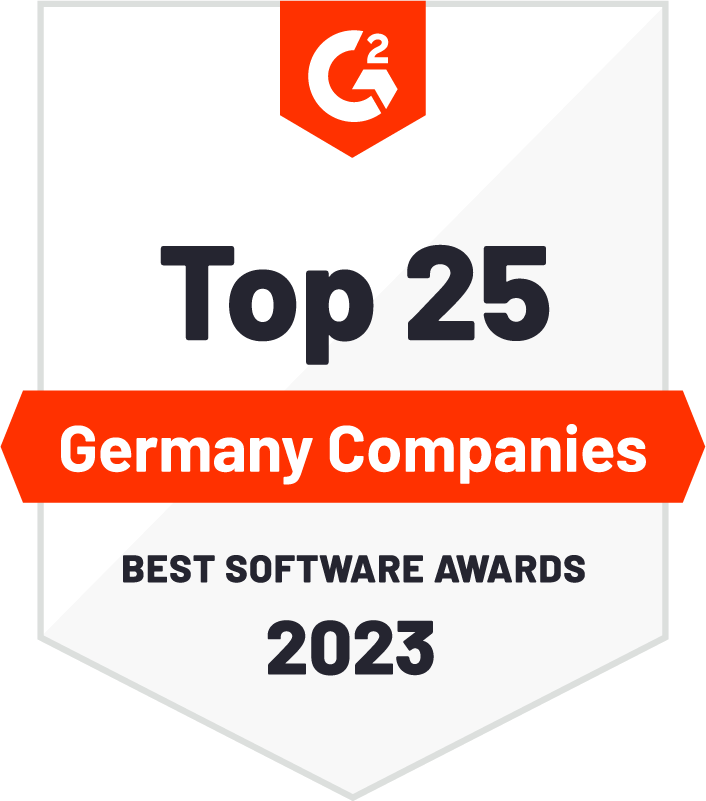

I am thrilled to announce that SUSE has been recognized by [G2](https://www.g2.com/sellers/suse), the world's largest and most trusted software marketplace, as one of the Top 25 German Companies in their “Best Software Awards” for 2023.

At SUSE, we have always been dedicated to providing our customers with the best possible software solutions and services. This award by G2 is a testament to the hard work and dedication of our entire team. It is also a recognition of the trust and confidence that our customers have placed in us.
This is not the first time G2 has recognized SUSE for delivering excellence to our customers. G2 recently [awarded SUSE 15 badges](https://www.suse.com/c/suse-receives-15-badges-winter-g2-report/) across its [product portfolio](https://www.suse.com/products/).
 
Here’s what some of our German customers say about how SUSE's products have impacted their business:

*“To exploit the great potential for innovation in agriculture, our IT must be able to operate with agility. SUSE solutions help us deliver new digital services quickly — without compromising stability and availability.”*
Jan Ove Steppat
Open Source Infrastructure Architect
[CLAAS KGaA mbH](https://www.suse.com/success/claas/)

*“Rancher Prime brings all the functionality we need to deploy, manage and monitor Kubernetes clusters from a central interface, and it’s completely automated. Using OKD, on the other hand, would have required an entire ecosystem of additional solutions, adding further cost and complexity.”*
Ronny Becker
Product Owner Platforms
[R+V](https://www.suse.com/success/rundv/)

*“In the last 12 months, we have achieved an availability of exactly 99.99878% for the SAP HANA environment with our platform and have thus been able to support our global business very reliably even in this challenging year. In terms of availability, we thus far exceed the service level agreements that an external service provider could assure us.”*
David Kaiser
SAP Manager
[REHAU Industries SE & Co](https://www.suse.com/success/rehau/)

*“From our point of view, Rancher Prime is clearly the most advanced and comprehensive management tool for managing multiple Kubernetes clusters, especially in an environment with high security requirements.”*
Frank Bayer
Senior Architect for Operating Systems and Container Services
[IT System House, Federal Employment Agency (Bundesagentur für Arbeit)](https://www.suse.com/success/bundesagentur_fuer_arbeit/)

 
We are grateful to the open source communities and to our employees who work tirelessly every day to make our company a success. A big thank you to our customers, who provided us with valuable feedback and reviews to help us continually improve our product solutions.
I’m excited about the future, and at SUSE we look forward to cooperating with you for many years to come. Thank you again, and here's to another successful year.
