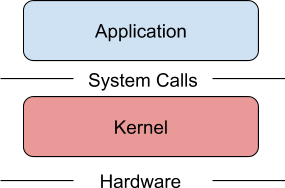
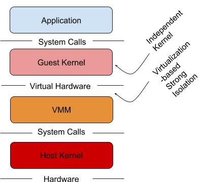
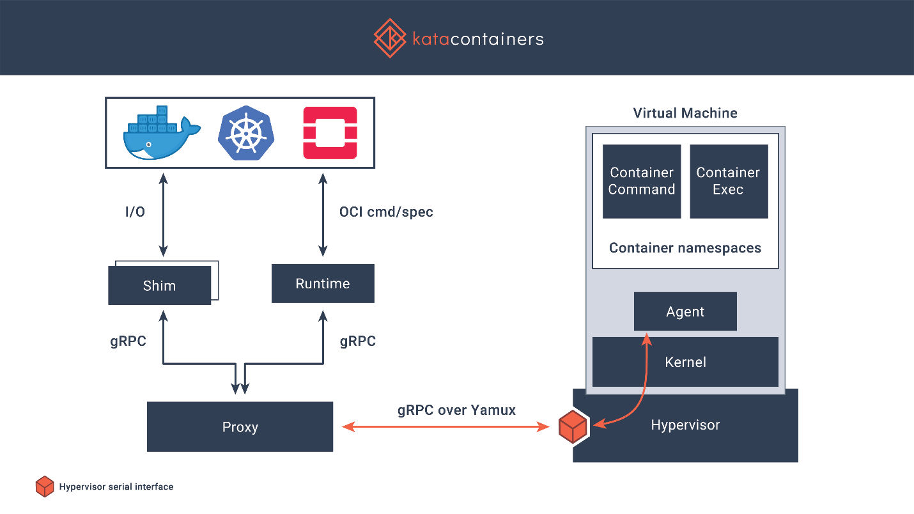
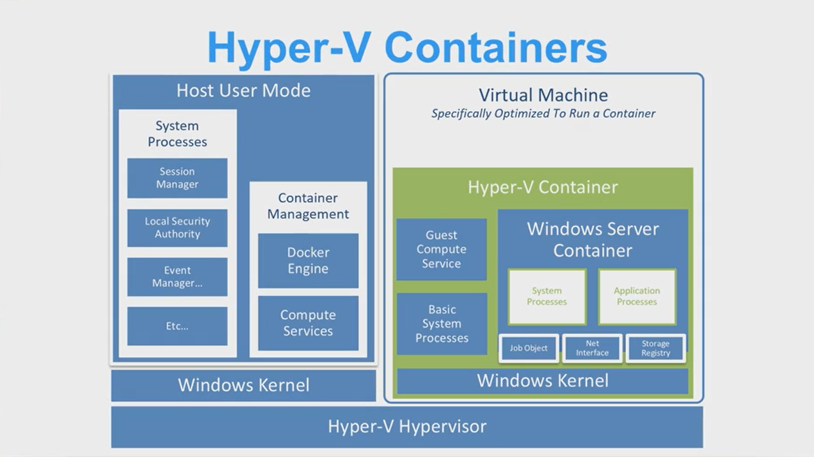
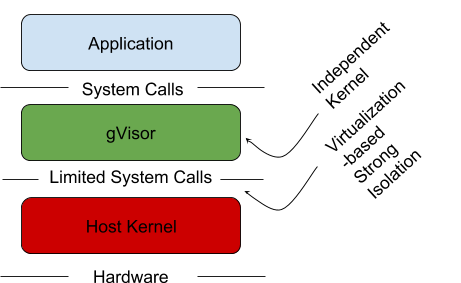

Like many of us in the Kubernetes space, I’m excited to check out the
shiny new thing. To be fair, we’re all working with an amazing product
that is younger than my pre-school aged daughter. The shiny new thing at
KubeCon Europe was a new container runtime authored by Google named
gVisor. Like a cat to catnip, I had to check this out and share it with
you.

## What is gVisor?

gVisor is a sandboxed container runtime, that acts as a user-space
kernel. During KubeCon Google announced that they open-sourced it to the
community. Its goal is to use paravirtualization to isolate
containerized applications from the host system, without the heavy
weight resource allocation that comes with virtual machines.

## Do I Need gVisor?

No. If you’re running production workloads, don’t even think about it!
Right now, this is a metaphorical science experiment. That’s not to say
you may not want to use it as it matures. I don’t have any problem with
the way it’s trying to solve process isolation and I think it’s a good
idea. There are also alternatives you should take the time to explore
before adopting this technology in the future.

That being said, if you want to learn more about it, when you’ll want to
use it, and the problems it seeks to solve, keep reading.

## Where might I want to use it?

As an operator, you’ll want to use gVisor to isolate application
containers that aren’t entirely trusted. This could be a new version of
an open source project your organization has trusted in the past. It
could be a new project your team has yet to completely vet or anything
else you aren’t entirely sure can be trusted in your cluster. After all,
if you’re running an open source project you didn’t write (all of us),
your team certainly didn’t write it so it would be good security and
good engineering to properly isolate and protect your environment in
case there may be a yet unknown vulnerability.

## What is Sandboxing Software?

Sandboxing is a software management strategy that enforces isolation
between software running on a machine, the host operating system, and
other software also running on the machine. The purpose is to constrain
applications to specific parts of the host’s memory and file-system and
not allow it to breakout and affect other parts of the operating system.

#### Source: https://cloudplatform.googleblog.com/2018/05/Open-sourcing-gVisor-a-sandboxed-container-runtime.html, pulled 17 May 2018

## Current Sandboxing Methods

The virtual machine (VM) is a great way to isolate applications from the
underlying hardware. An entire hardware stack is virtualized to protect
applications and the host kernel from malicious applications.

#### Source: https://cloudplatform.googleblog.com/2018/05/Open-sourcing-gVisor-a-sandboxed-container-runtime.html, pulled 17 May 2018

As stated before, the problem is that VMs are heavy. The require set
amounts of memory and disk space. If you’ve worked in enterprise IT, I’m
sure you’ve noticed the resource waste.

Some projects are looking to solve this with lightweight OCI-compliant
VM implementations. Projects like Kata containers are bringing this to
the container space on top of runV, a hypervisor based runtime.

#### Source: https://katacontainers.io/, pulled 17 May 2018

Microsoft is using a similar technique to isolate workloads using a
very-lightweight Hyper-V virtual machine when using Windows Server
Containers with Hyper-V isolation.

#### Source: partial screenshot, https://channel9.msdn.com/Blogs/containers/DockerCon-16-Windows-Server-Docker-The-Internals-Behind-Bringing-Docker-Containers-to-Windows, timestamp 31:02 pulled 17 May 2018

This feels like a best-of-both worlds approach to isolation. Time will
tell. Most of the market is still running docker engine under the
covers. I don’t see this changing any time soon. Open containers and
container runtimes certainly will begin taking over a share of the
market. As that happens, adopting multiple container runtimes will be an
option for the enterprise.

## Sandboxing with gVisor

gVisor intends to solve this problem. It acts as a kernel in between the
containerized application and the host kernel. It does this through
various mechanisms to support syscall limits, file system proxying, and
network access. These mechanisms are a paravirtualization providing a
virtual-machine like level of isolation, without the fixed resource cost
of each virtual machine.

#### Source: partial screenshot, https://channel9.msdn.com/Blogs/containers/DockerCon-16-Windows-Server-Docker-The-Internals-Behind-Bringing-Docker-Containers-to-Windows, timestamp 31:02 pulled 17 May 2018

## runsc

gVisor the runtime is a binary named runsc (run sandboxed container) and
is an alternative to runc or runv if you’ve worked with kata containers
in the past.

## Other Alternatives to gVisor

gVisor isn’t the only way to isolate your workloads and protect your
infrastructure. Technologies like SELinux, seccomp and Apparmor solve a
lot of these problems (as well as others). It would behoove you as an
operator and an engineer to get well acquainted with these technologies.
It’s a lot to learn. I’m certainly no expert, although I aspire to be.
Don’t be a lazy engineer. Learn your tools, learn your OS, do right by
your employer and your users. If you want to know more go read the man
pages and follow [Jessie
Frazelle](https://blog.jessfraz.com/post/containers-security-and-echo-chambers/).
She is an expert in this area of computing and has written a treasure
trove on it.

## Using gVisor with Docker

As docker supports multiple runtimes, it will work with runsc. To use it
one must build and install the runsc container runtime binary and
configured docker’s /etc/docker/daemon.json file to support the gVisor
runtime. From there a user may run a container with the runsc runtime by
utilizing the –runtime flag of the docker run command.

docker run –runtime=runsc hello-world

## Using gVisor with Kubernetes

Kubernetes support for gVisor is experimental and implemented via the
CRI-O CRI implementation. CRI-O is an implementation of the Kubernetes
Container Runtime Interface. Its goal is to allow Kubernetes to use any
OCI compliant container runtime (such as runc and runsc). To use this
one must install runsc on the Kubernetes , then configure cri-o to use
runsc to run untrusted workloads in cri-o’s /etc/crio/crio.conf file.
Once configured, any pod without the io.kubernetes.cri-o.TrustedSandbox
annotation (or the annotation set to false), will be run with runsc.
This would be as an alternative to using the Docker engine powering the
containers inside Kubernetes pods.

## Will my application work with gVisor

It depends. Currently gVisor only supports single-container pods. Here
is a list of known working applications that have been tested with
gVisor.

Ultimately support for any given application will depend on whether the
syscalls used by the application are supported.

## How does it affect performance?

Again, this depends. gVisor’s “Sentry” process is responsible for
limting syscalls and requires a platform to implement context switching
and memory mapping. Currently gVisor supports Ptrace and KVM, which
implement these functions differently, are configured differently, and
support different node configurations to operate effectively. Either
would affect performance differently than the other.

The architecture of gVisor suggests it would be able to enable greater
application density over VMM based configurations but may suffer higher
performance penalties in sycall-rich applications.

### Networking

A quick note about network access and performance. Network access is
achieved via an L3 userland networking stack subproject called netstack.
This functionality can be bypassed in favor of the host network to
increase performance.

## Can I use gVisor with Rancher?

Rancher currently cannot be used to provision CRI-O backed Kubernetes
clusters as it relies heavily on the docker engine. However, you
certainly manage CRI-O backed clusters with Rancher. Rancher will manage
any Kubernetes server as we leverage the Kubernetes API and our
components are Kubernetes Custom Resources.

We’ll continue to monitor gVisor as it matures. As such, we’ll add more
support for gVisor with Rancher as need arises. Like the evolution of
Windows Server Containers in Kubernetes, soon this project will become
part of the fabric of Kubernetes in the Enterprise.
