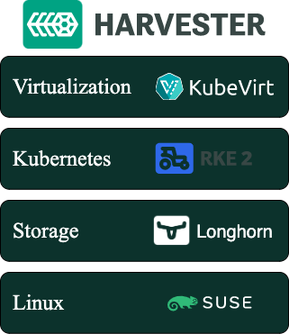
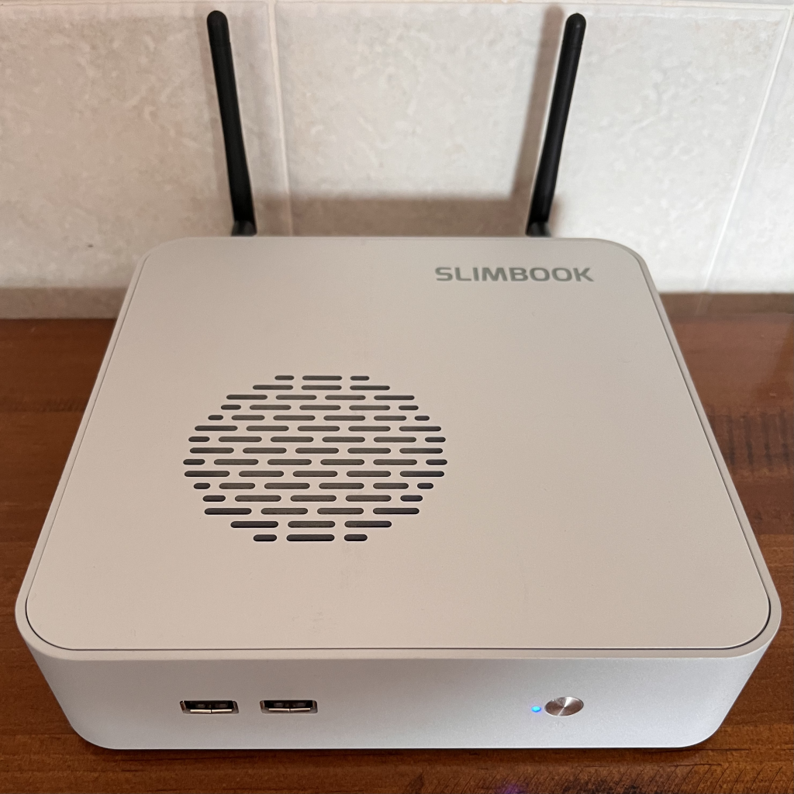
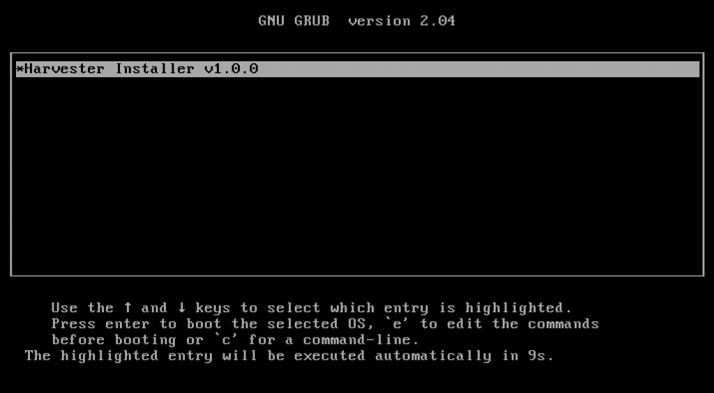
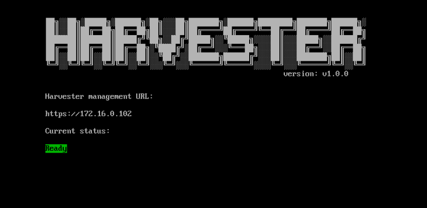
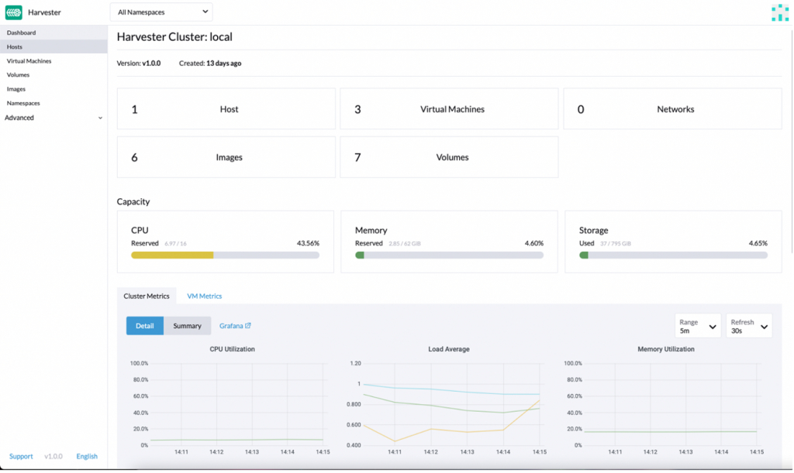
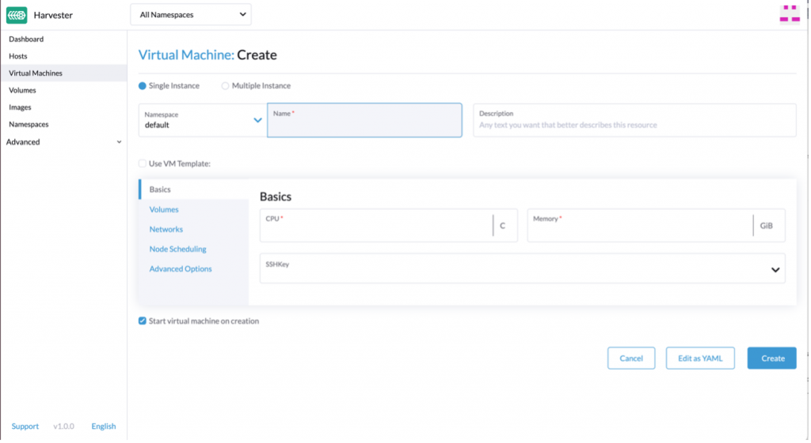

When I left Red Hat to join SUSE as a Technical Marketing Manager at the end of 2021, I heard about Harvester, a new Hyperconverged Infrastructure ([HCI](https://en.wikipedia.org/wiki/Hyper-converged_infrastructure)) solution with Kubernetes under the hood. When I started looking at it, I immediately saw use cases where Harvester could really help IT operators and DevOps engineers. There are solutions that offer similar capabilities but there’s nothing else on the market like Harvester. In this blog, I’ll give an overview of getting started with Harvester and what you need for a lab implementation.­

 

First, let me bring you up to speed on Harvester. This HCI solution from SUSE takes advantage of your existing hardware with cutting edge open source technology, and, as always with SUSE, offers flexibility and freedom without locking you in with expensive and complex solutions.

Figure 1 shows, at a glance, what Harvester is and the main technologies that compose it.

 

Fig. 1 – Harvester stack 

 

The base of the solution is the Linux operating system. Longhorn provides lightweight and easy-to-use distributed block storage system for Kubernetes -- in this case for the VMs running on the cluster. RKE2 provides the Kubernetes layer where KubeVirt runs, providing virtualization capabilities using KVM on Kubernetes. The concept is simple: like in Kubernetes, there are pods running in a cluster. The big difference is that there are VMs inside those pods. 

To learn more about the tech under the hood and technical specs, check out [this blog post](https://www.suse.com/c/harvester-ga-technical/) from Sheng Yang introducing Harvester technical details.

## The lab

I set up a home lab based on a [Slimbook One](https://slimbook.es/one/) node with an AMD Ryzen 7 processor, with 8 cores and 16 threads, 64GB of RAM and 1TB NVMe SSD -- this is twice the minimum requirements for Harvester. In case you don’t know Slimbook, it is a brand focused on hardware oriented for Linux and open source software. You’ll need an ethernet connection for Harvester to boot, so if you don’t have a dedicated switch to connect your server, just connect it to the router from your ISV.

  

Fig. 2 – Slimbook One 

 

## The installation

The installation was smooth and easy since Harvester ships as an appliance. Download [the ISO image](https://github.com/harvester/harvester/releases) and install it on a USB drive or use PXE for the startup. In this process, you’ll be asked some basic questions to configure Harvester during the installation process. 

Fig. 3 – ISO Install

 

As part of the initial set up you can create a token that can be used later to add nodes to the cluster. Adding more nodes to the cluster is easy; you just start another node with the appliance and provide the token so the new node can join to the Kubernetes cluster. This is similar for what you do with RKE2 and K3s when [adding nodes to a cluster](https://docs.rke2.io/install/quickstart/#agent-worker-node-installation). After you provide all the information for the installation process, you’ll have to wait approximately 10 minutes for Harvester to finish the set up. The Harvester configuration is stored as a yaml file and can be sourced from a URL during the installation to make the installation repeatable and easy to keep on a git repository.

 

Once the installation is finished, on the screen you’ll see the IP/DNS to connect Harvester and whether Harvester is ready or not. Once ready, you can log into the UI using the IP/DNS. The UI is very similar to Rancher and gives you the possibility to use a secure password in the first login. 

 

Fig. 4 – Harvester installation finished & ready screen 

 

## The first login and dashboard

When you log in for the first time, you’ll see that it is easy to navigate.  Harvester benefits from a clean UI; it’s easy to use and completely oriented toward virtualization users and operators. Harvester offers the same kind of experience that IT operators would expect of a virtualization platform like oVirt. 

 

Fig. 5 – Harvester dashboard 

 

The first thing you’ll find once logged in is the dashboard, which allows you to see all the basic information about your cluster, like hosts, VMs, images, cluster metrics and VM metrics. If you navigate down the dashboard, you’ll find an event manager that shows you all the events segregated by kind of object.

 

When you dig further into the UI, you´ll find not only the traditional virtualization items but also Kubernetes options, like managing namespaces. When we investigate further, we find some namespaces are already created but we can create more in order to take advantage of Kubernetes isolation. Also, we find a fleet-local namespace which gives us a clue about how Kubernetes objects are managed inside the local cluster. [Fleet](https://fleet.rancher.io/) is a GitOps-based deployment engine created by Rancher to simplify and improve cluster control. In the Rancher UI it’s referred to as ‘Continuous Deployment.’

## Creating your first VM

Before creating your first VM you need to upload the image you’ll use to create it.  Harvester can use qcow2, raw and ISO images which can be uploaded from the Images tab using a URL or importing them from your local machine. Before uploading the images, you have the option to select which namespace you want them in, and you can assign labels (yes, Kubernetes labels!) to use them from the Kubernetes cluster. Once you have images uploaded you can create your first VM.

The VM assistant feels like any other [virtualization software](https://www.suse.com/c/understanding-virtualization-software-types-benefits-and-best-features/) out there: you select CPU, RAM, storage, networking options, etc.

 

Fig. 6 – VM creation

 

However, there are some subtle differences. First, you must select a namespace where to deploy the VM, and you have the possibility to see all the VM options as yaml code. This means your VMs can be defined as managed as code and integrated with Fleet. This is a real differentiator from more traditional virtualization platforms. Also, you can select the node where the VM will be running, use the Kubernetes scheduler to place the VM on the best node, apply scheduling rules or select specific nodes that do not support live migration. Finally, there is the option to use containers alongside VMs in the same pod; the container image you select is a sidecar for the VM. This sidecar container is added as a disk from the Harvester UI. Cloud config is supported out of the box to configure the VMs during the first launch as you could expect from solutions like OpenStack or oVirt. 

## Conclusion

Finding Kubernetes concepts on a virtualization solution might be a little awkward at the beginning. However, finding things like Grafana, namespace isolation and sidecar containers in combination with a virtualization platform really helps to get the best of both worlds. As far as use cases where Harvester can be of use, it is perfect for the Edge, where it takes advantage of the physical servers you already have in your organization since it doesn’t need a lot of resources to run. Another use case is as an on-prem HCI solution, offering a perfect way to integrate VMs and containers in one platform. The integration with Rancher offers even more capabilities. Rancher provides a unified management layer for hybrid cloud environments, offering central RBAC management for multi-tenancy support; a single pane of glass to manage VMs, containers and clusters; or deploying your Kubernetes clusters in Harvester or on most of the cloud providers in the market. 

We may be in a cloud native world now, but VMs are not going anywhere. Solutions like Harvester ease the integration of both worlds, making your life easier. 

To get started with Harvester, head over to the [quick start documentation](https://rancher.com/docs/rancher/v2.6/en/virtualization-admin/). 

You can also access this informative on-line session which provides a comprehensive recap of all the essential details needed to evaluate Harvester in your very own local environment:
[embed]https://www.youtube.com/watch?v=tYSsJmqKws4[/embed]

Join the [SUSE & Rancher community](https://community.suse.com/) to learn more about [Harvester](https://community.suse.com/posts/19142043?utm_source=manual) and other [SUSE open source projects](https://opensource.suse.com/).
