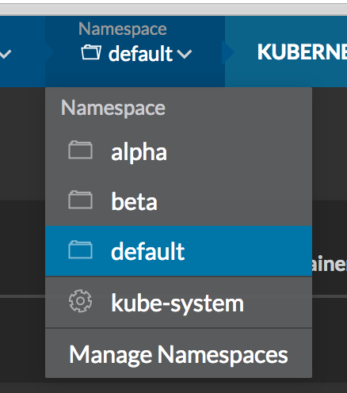

Most people running Docker in production use it as a way to build and
move deployment artifacts. However, their deployment model is still very
monolithic or comprises of a few large services. The major stumbling
block in the way of using true containerized microservices is the lack
of clarity on how to manage and orchestrate containerized workloads at
scale. Today we are going to talk about building a Kubernetes based
microservice deployment. [Kubernetes](http://kubernetes.io/) is the open
source successor to Google’s long running Borg project, which has been
running such workloads at scale for about a decade. While there are
still some rough edges, Kubernetes represents one of the most mature
container orchestration systems available today.

### [[Launching Kubernetes Environment ]]

[[You can take a look at the
]][Kubernetes
Documentation](http://kubernetes.io/docs/getting-started-guides/docker-multinode/)
for instructions on how launch a Kubernetes cluster in various
environments. In this post, I’m going to focus on launching [Rancher’s
distribution of Kubernetes](https://rancher.com/kubernetes) as an
environment within the [Rancher container management
platform](https://rancher.com/rancher). We’ll start by setting up
a Rancher server as described
[here](https://docs.rancher.com/rancher/v1.2/en/quick-start-guide/) and
select *Environment/Default > Manage Environments > Add Environment*.
Select *Kubernetes* from Container Orchestration options and create your
environment. Now select *Infrastructure > Hosts > Add Host* and launch
a few nodes for Kubernetes to run on. Note: we recommend adding at least
3 hosts, which will run the Rancher agent container. Once the hosts come
up, you should see the following screen, and in a few minutes your
cluster should be up and ready.

There are lots of advantages to running Kubernetes within Rancher.
Mostly, it just makes the deployment and management dramatically easier
for both users and the IT team. Rancher automatically implements an HA
implementation of etcd for the Kubernetes backend, and deploys all of
the necessary services onto any hosts you add into this environment. It
sets up access controls, and can tie into existing LDAP and AD
infrastructure easily. Rancher also automatically implements container
networking and load balancing services for Kubernetes. Using Rancher,
you should have an HA implementation of Kubernetes in a few minutes.

[](images/rancher_blog_Screen-Shot-2016-07-16-at-8.31.03-AM.png)

### **Namespaces**

Now that we have our cluster running, let’s jump in and start going
through some basic Kubernetes resources. You can access the Kubernetes
cluster either directly through the kubectl CLI, or through the Rancher
UI. Rancher’s access management layer controls who can access the
cluster, so you’ll need to generate an API key from the Rancher UI
before accessing the CLI.

The first Kubernetes resource we are going to look at is namespaces.
Within a given namespace, all resources must have unique names. In
addition, labels used to link resources are scoped to a single
namespace. This is why namespaces can be very useful for creating
isolated environments on the same Kubernetes cluster. For example, you
may want to create an Alpha, Beta and Production environment for your
application so that you can test latest changes without impacting real
users. To create a namespace, copy the following text into a file called
namespace.yaml and run the `kubectl create -f namespace.yaml` command to
create a namespace called beta.

```
kind: Namespace
apiVersion: v1
metadata:
  name: beta
  labels:
    name: beta
```

You can also create, view and select namespaces from the Rancher UI by
using the Namespace menu on the top menu bar.
[](images/rancher_blog_Screen-Shot-2016-08-13-at-5.35.48-AM.png)

You can use the following command to set the namespace in for CLI
interactions using kubectl:

```
$ kubectl config set-context Kubernetes --namespace=beta.
```

To verify that the context was set currently, use the config view
command and verify the output matches the namespace you expect.

```
$ kubectl config view | grep namespace command
namespace: beta
```

### **Pods**

Now that we have our namespaces defined, let’s start creating
resources. The first resource we are going to look at is a Pod. A group
of one or more containers is referred to by Kubernetes as a pod.
Containers in a pod are deployed, started, stopped, and replicated as a
group. There can only be one pod of a given type on each host, and all
containers in the pod are run on the same host. Pods share network
namespace and can reach each other via the localhost domain. Pods are
the basic unit of scaling and cannot span across hosts, hence it’s
ideal to make them as close to single workload as possible. This will
eliminate the side-effects of scaling a pod up or down as well as
ensuring we don’t create pods that are too resource intensive for our
underlying hosts.

Lets define a very simple pod named *mywebservice* which has one
container in its spec named *web-1-10* using the *nginx* container image
and exposing the port 80. Add the following text into a file called
pod.yaml.

```
apiVersion: v1
kind: Pod
metadata:
  name: mywebservice
spec:
  containers:
  - name: web-1-10
    image: nginx:1.10
    ports:
    - containerPort: 80
```

Run the kubectl create command to create your pod. If you set your
namespace above using the set-context command then the pods will be
created in the specified namespace. You can verify the status of your
pod by running the *get pods* command. Once you are done we can delete
the pod by running the kubectl delete command.

```
$ kubectl create -f ./pod.yaml
pod "mywebservice" created
$ kubectl get pods
NAME           READY     STATUS    RESTARTS   AGE
mywebservice   1/1       Running   0          37s
$ kubectl delete -f pod.yaml
pod "mywebservice" deleted
```

You should also be able see your pod in the Rancher UI by selecting
*Kubernetes > Pods* from the top menu bar.

[](images/rancher_blog_Screen-Shot-2016-08-13-at-5.52.20-AM.png)

### **Replica Sets**

Replica Sets, as the name implies, define how many replicas of each pod
will be running. They also monitor and ensure the required number of
pods are running, replacing pods that die. Note that replica sets are a
replacement for **Replication Controllers -** however, for most
use-cases you will not use Replica Sets directly but instead use
**Deployments**. Deployments wrap replica sets and add the the
functionality to do rolling updates to your application.

### **Deployments**

Deployments are a declarative mechanism to manage rolling updates of
your application. With this in mind, let’s define our first deployment
using the pod definition above. The only difference is that we take out
the name parameter, as a name for our container will be auto-generated
by the deployment. The text below shows the configuration for our
deployment; copy it to a file called deployment.yaml.

```
apiVersion: extensions/v1beta1
kind: Deployment
metadata:
  name: mywebservice-deployment
spec:
  replicas: 2 # We want two pods for this deployment
  template:
    metadata:
      labels:
        app: mywebservice
    spec:
      containers:
      - name: web-1-10
        image: nginx:1.10
        ports:
        - containerPort: 80
```

Launch your deployment using the kubectl create command and then verify
that the deployment is up using the get deployments command.

```
$ kubectl create -f ./deployment.yaml
deployment "mywebservice-deployment" create
$ kubectl get deployments
NAME                      DESIRED   CURRENT   UP-TO-DATE   AVAILABLE   AGE
mywebservice-deployment   2         2         2            2           7m
```

You can get details about your deployment using the describe deployment
command. One of the useful items output by the describe command is a set
of events. A truncated example of the output from the describe command
is shown below. Currently your deployment should have only one event
with the message: `Scaled up replica set ... to 2.`

```
$ kubectl describe deployment mywebservice
Name:                  mywebservice-deployment
Namespace:             beta
CreationTimestamp:     Sat, 13 Aug 2016 06:26:44 -0400
Labels:                app=mywebservice
.....
..... Scaled up replica set mywebservice-deployment-3208086093 to 2
```

### Scaling Deployments

You can modify the scale of the deployment by updating the
deployment.yaml file from earlier to replace **replicas: 2**
with **replicas: 3** and run the apply command shown below. If you run
the describe deployment command again you will see a second event with
the message:
`Scaled up replica set mywebservice-deployment-3208086093 to 3`.

```
$ kubectl apply -f deployment.yaml
deployment "mywebservice-deployment" configured
```

### Updating Deployments

You can also use the apply command to update your application by
changing the image version. Modify the deployment.yaml file from earlier
to replace **image: nginx:1.10** to **image: nginx:1.11** and run the
kubectl apply command. If you run the describe deployment command again
you will see new events whose messages are shown below. You can see how
the new deployment (2303032576) was scaled up and the old deployment
(3208086093) was scaled down and the in steps. The total number of pods
across both deployments is kept constant however the pods are gradually
moved from the old to the new deployments. This allows us to run
deployments under load without service interruption.

```
Scaled up replica set mywebservice-deployment-2303032576 to 1
Scaled down replica set mywebservice-deployment-3208086093 to 2
Scaled up replica set mywebservice-deployment-2303032576 to 2
Scaled down replica set mywebservice-deployment-3208086093 to 1
Scaled up replica set mywebservice-deployment-2303032576 to 3
Scaled down replica set mywebservice-deployment-3208086093 to 0
```

If during or after the deployment you realize something is wrong and the
deployment has caused problems you can use the rollout command to undo
your deployment change. This will apply the reverse operation to the one
above and move load back to the previous version of the container.

```
$ kubectl rollout undo deployment/mywebservice-deployment
deployment "mywebservice-deployment" rolled back
```

### Health check

With deployments we have seen how to scale our service up and down, as
well as how to do deployments themselves. However, when running services
in production, it’s also important to have live monitoring and
replacement of service instances when they go down. Kubernetes provides
health checks to address this issue. Update the deployment.yaml file
from earlier by adding a livenessProbe configuration in the spec
section. There are three types of liveness probes, *http*, *tcp* and
*container exec*. The first two will check whether Kubernetes is able to
make an http or tcp connection to the specified port. The container exec
probe runs a specified command inside the container and asserts a zero
response code. In the snippet shown below, we are using the http probe
to issue a GET request to port 80 at the root URL.

```
apiVersion: extensions/v1beta1
kind: Deployment
metadata:
  name: mywebservice-deployment
spec:
  replicas: 3
  template:
    metadata:
      labels:
        app: mywebservice
    spec:
      containers:
      - name: web-1-11
        image: nginx:1.11
        ports:
        - containerPort: 80
        livenessProbe:
          httpGet:
            path: /
            port: 80
          initialDelaySeconds: 30
          timeoutSeconds: 1
```

If you recreate your deployment with the additional helthcheck and run
describe deployment, you should see that Kubernetes now tells you that 3
of your replicas are unavailable. If you run describe again after the
initial delay period of 30 seconds, you will see that the replicas are
now marked as available. This is a good way to make sure that your
containers are healthy and to give your application time to come up
before Kubernetes starts routing traffic to it.

```
$ kubectl create -f deployment.yaml
deployment "mywebservice-deployment" created
$ kubectl describe deployment mywebservice
...
Replicas: 3 updated | 3 total | 0 available | 3 unavailable
```

### Service

Now that we have a monitored, scalable deployment which can be updated
under load, it’s time to actually expose the service to real users.
Copy the following text into a file called service.yaml. Each node in
your cluster exposes a port which can route traffic to the replicas
using the Kube Proxy.

```
apiVersion: v1
kind: Service
metadata:
  name: mywebservice
  labels:
    run: mywebservice
spec:
  type: NodePort
  ports:
  - port: 80
    protocol: TCP
    name: http
  selector:
    app: mywebservice
```

With the service.yaml file we create service using the create command
and then we can lookup the NodePort using the describe service command.
For example, in my service I can access the application on port 31673 on
any of my Kubernetes/Rancher agent nodes. Kubernetes will route traffic
to available nodes automatically if nodes are scaled up and down, become
unhealthy or are relaunched.

```
$ kubectl create -f service.yaml
service "mywebservice" created
$ kubectl describe service mywebservice | grep NodePort
NodePort:              http       31673/TCP
```

In today’s article, we looked some basic Kubernetes resources including
Namespaces, Pods, Deployments and Services. We looked at how to scale
our application up and down manually as well as how to perform rolling
updates of our application. Lastly, we looked at configuring services in
order to expose our application externally. In subsequent articles, we
will be looking at how to use these together to orchestrate a more
realistic deployment. We will look at the resources covered today in
more detail, including how to setup SSL/TLS termination, multi-service
deployments, service discovery and how the application would react to
failures scenarios.

*Note: [Part
2](https://rancher.com/creating-microservices-deployments-on-kubernetes-with-rancher-part-2/)
of this series is now available!*
