Autoscaling the resources and services in your [Kubernetes](https://kubernetes.io/) cluster is essential if your system is going to meet variable workloads. You can’t rely on manual scaling to help the cluster handle unexpected load changes.

While cluster autoscaling certainly allows for faster and more efficient deployment, the practice also reduces resource waste and helps decrease overall costs. When you can scale up or down quickly, your applications can be optimized for different workloads, making them more reliable. And a reliable system is always cheaper in the long run.

This tutorial introduces you to Kubernetes’s [Cluster Autoscaler](https://github.com/kubernetes/autoscaler). You’ll learn how it differs from other types of autoscaling in Kubernetes, as well as how to implement Cluster Autoscaler using [Rancher](https://www.rancher.com/).

## The differences between different types of Kubernetes autoscaling

By monitoring utilization and reacting to changes, Kubernetes autoscaling helps ensure that your applications and services are always running at their best. You can accomplish autoscaling through the use of a [Vertical Pod Autoscaler (VPA)](https://github.com/kubernetes/autoscaler/tree/master/vertical-pod-autoscaler), [Horizontal Pod Autoscaler (HPA)](https://kubernetes.io/docs/tasks/run-application/horizontal-pod-autoscale/) or [Cluster Autoscaler (CA)](https://github.com/kubernetes/autoscaler/blob/master/cluster-autoscaler/FAQ.md).

**VPA** is a Kubernetes resource responsible for managing individual pods' resource requests. It's used to automatically adjust the resource requests and limits of individual pods, such as CPU and memory, to optimize resource utilization. VPA helps organizations maintain the performance of individual applications by scaling up or down based on usage patterns.

**HPA** is a Kubernetes resource that automatically scales the number of replicas of a particular application or service. HPA monitors the usage of the application or service and will scale the number of replicas up or down based on the usage levels. This helps organizations maintain the performance of their applications and services without the need for manual intervention.

**CA** is a Kubernetes resource used to automatically scale the number of nodes in the cluster based on the usage levels. This helps organizations maintain the performance of the cluster and optimize resource utilization.

The main difference between VPA, HPA and CA is that VPA and HPA are responsible for managing the resource requests of individual pods and services, while CA is responsible for managing the overall resources of the cluster. VPA and HPA are used to scale up or down based on the usage patterns of individual applications or services, while CA is used to scale the number of nodes in the cluster to maintain the performance of the overall cluster.

Now that you understand how CA differs from VPA and HPA, you're ready to begin implementing cluster autoscaling in Kubernetes.

## Prerequisites

There are many ways to demonstrate how to implement CA. For instance, you could install Kubernetes on your local machine and set up everything manually using the `kubectl` command-line tool. Or you could set up a user with sufficient permissions on Amazon Web Services (AWS), Google Cloud Platform (GCP) or Azure to play with Kubernetes using your favorite managed cluster provider. Both options are valid; however, they involve a lot of configuration steps that can distract from the main topic: the Kubernetes Cluster Autoscaler.

An easier solution is one that allows the tutorial to focus on understanding the inner workings of CA and not on time-consuming platform configurations, which is what you'll be learning about here. This solution involves only two requirements: a [Linode account](https://www.linode.com/) and [Rancher](https://www.rancher.com/).

For this tutorial, you'll need a running [Rancher Manager server](https://ranchermanager.docs.rancher.com/). Rancher is perfect for demonstrating how CA works, as it allows you to deploy and manage Kubernetes clusters on any provider conveniently from its powerful UI. Moreover, you can [deploy it using several providers](https://ranchermanager.docs.rancher.com/pages-for-subheaders/deploy-rancher-manager), including these popular options:

- **[K3s](https://k3s.io/):** If you already have a K3s installation running on your local machine, you can [install Rancher with Helm](https://ranchermanager.docs.rancher.com/getting-started/quick-start-guides/deploy-rancher-manager/helm-cli).
- **[Docker](https://www.docker.com/):** Another option is to [install Rancher on a single node using Docker](https://ranchermanager.docs.rancher.com/pages-for-subheaders/rancher-on-a-single-node-with-docker).
- **[Rancher Desktop](https://rancherdesktop.io/):** This is an excellent choice for developers as it installs a single-node K3s cluster with Helm and metrics server, and it sets up the `kubectl` command-line tool on your local machine. Once ready, you can install [Rancher on Rancher Desktop](https://docs.rancherdesktop.io/how-to-guides/rancher-on-rancher-desktop/) either using Docker or Helm.
- **Cloud installation:** Another option is to [install Rancher on a Kubernetes cluster](https://ranchermanager.docs.rancher.com/pages-for-subheaders/install-upgrade-on-a-kubernetes-cluster) using your favorite cloud provider.
- **Linode account:** Linode is a popular cloud provider that makes it easy to demonstrate how CA scales up and down Kubernetes clusters. All you need is to [create a personal access token](https://www.linode.com/docs/products/tools/api/guides/manage-api-tokens/) so that Rancher can integrate [Linode Kubernetes Engine (LKE)](https://www.linode.com/docs/api/linode-kubernetes-engine-lke/) into its Cluster Management Dashboard. If you don't have a Linode account, you can [sign up for free on their website](https://www.linode.com/docs/guides/getting-started/).

If you are curious about a more advanced implementation, we suggest reading the Rancher documentation, which describes [how to install Cluster Autoscaler on Rancher using Amazon Elastic Compute Cloud (Amazon EC2) Auto Scaling groups](https://ranchermanager.docs.rancher.com/how-to-guides/new-user-guides/manage-clusters/install-cluster-autoscaler/use-aws-ec2-auto-scaling-groups). However, please note that implementing CA is very similar on different platforms, as all solutions leverage [Kubernetes Cluster API](https://cluster-api.sigs.k8s.io/) for their purposes. Something that will be addressed in more detail later.

## What is Cluster API, and how does Kubernetes CA leverage it

Cluster API is an open source project for building and managing Kubernetes clusters. It provides a declarative API to define the desired state of Kubernetes clusters. In other words, Cluster API can be used to extend the Kubernetes API to manage clusters across various cloud providers, bare metal installations and virtual machines.

In comparison, Kubernetes CA leverages Cluster API to enable the automatic scaling of Kubernetes clusters in response to changing application demands. CA detects when the capacity of a cluster is insufficient to accommodate the current workload and then requests additional nodes from the cloud provider. CA then provisions the new nodes using Cluster API and adds them to the cluster. In this way, the CA ensures that the cluster has the capacity needed to serve its applications.

Because Rancher supports CA and [RKE2](https://docs.rke2.io/), and K3s works with Cluster API, their combination offers the ideal solution for automated Kubernetes lifecycle management from a central dashboard. This is also true for any other cloud provider that offers support for Cluster API.

Link to the Cluster API blog

## Implementing CA in Kubernetes

Now that you know what Cluster API and CA are, it's time to get down to business. Your first task will be to deploy a new Kubernetes cluster using Rancher.

### Deploying a new Kubernetes cluster using Rancher

Begin by navigating to your Rancher installation. Once logged in, click on the hamburger menu located at the top left and select **Cluster Management**:

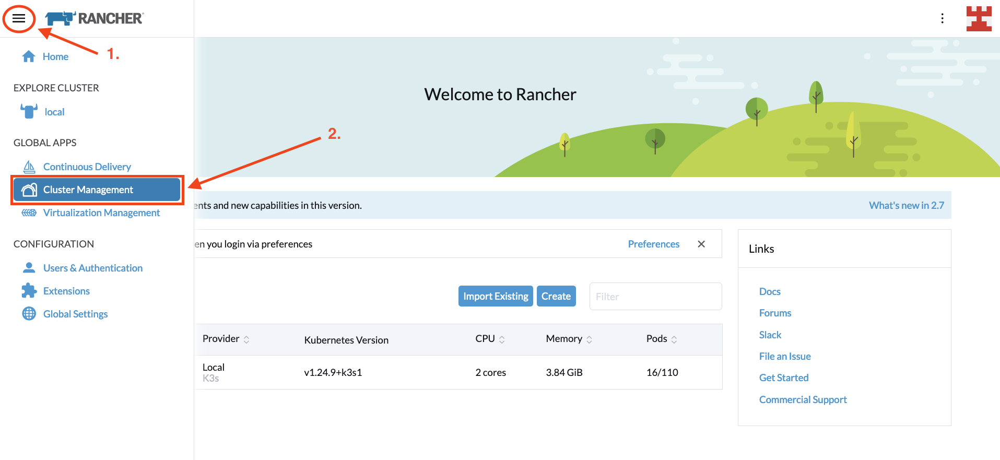

On the next screen, click on **Drivers**:

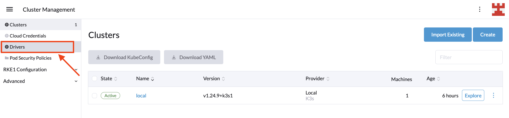

Rancher uses [cluster drivers](https://ranchermanager.docs.rancher.com/how-to-guides/new-user-guides/authentication-permissions-and-global-configuration/about-provisioning-drivers/manage-cluster-drivers#activatingdeactivating-cluster-drivers) to create Kubernetes clusters in hosted cloud providers.

For Linode LKE, you need to activate the specific driver, which is simple. Just select the driver and press the **Activate** button. Once the driver is downloaded and installed, the status will change to **Active**, and you can click on **Clusters** in the side menu:

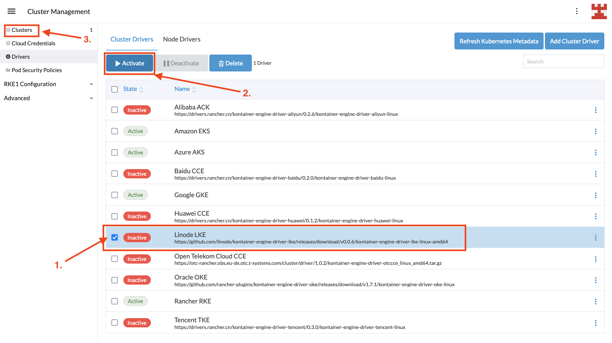

With the cluster driver enabled, it's time to create a new Kubernetes deployment by selecting **Clusters | Create**:

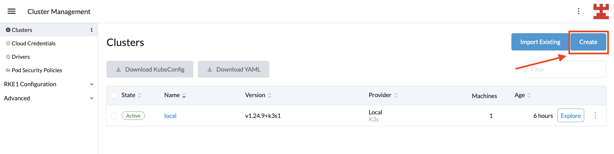

Then select **Linode LKE** from the list of hosted Kubernetes providers:

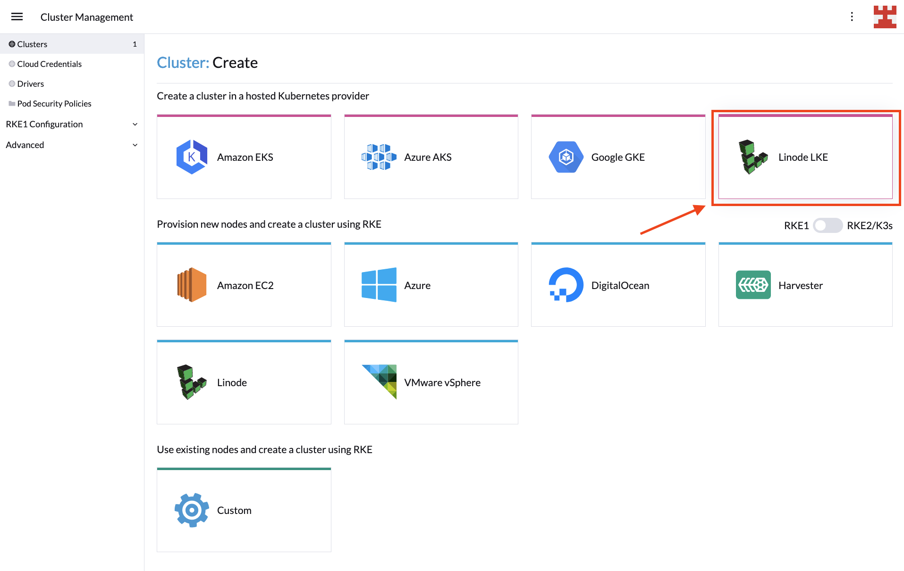

Next, you'll need to enter some basic information, including a name for the cluster and the personal access token used to authenticate with the Linode API. When you've finished, click **Proceed to Cluster Configuration** to continue:

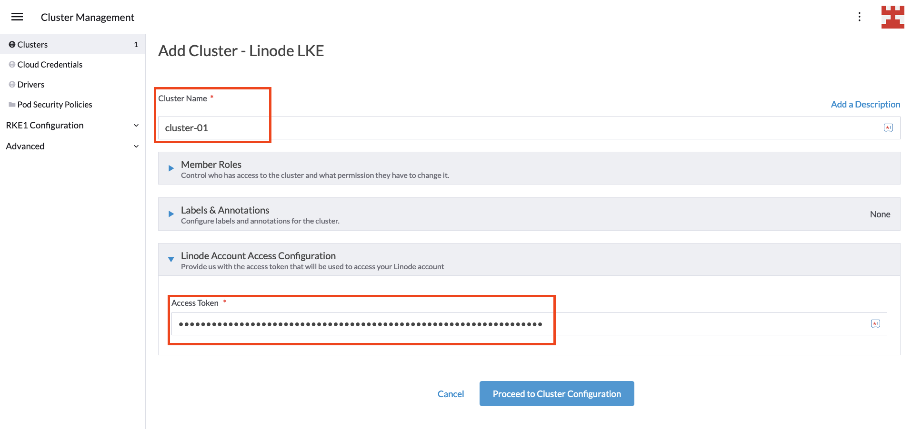

If the connection to the Linode API is successful, you'll be directed to the next screen, where you will need to choose a region, Kubernetes version and, optionally, a tag for the new cluster. Once you're ready, press **Proceed to Node pool selection**:

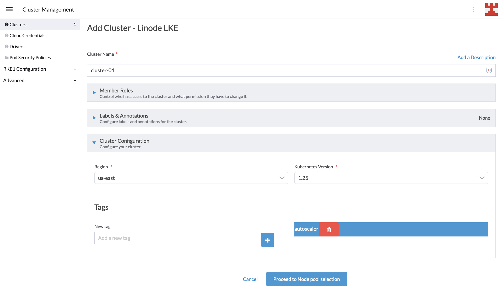

This is the final screen before creating the LKE cluster. In it, you decide how many node pools you want to create. While there are no limitations on the number of node pools you can create, the implementation of [Cluster Autoscaler for Linode](https://github.com/kubernetes/autoscaler/blob/master/cluster-autoscaler/cloudprovider/linode/README.md) does impose two restrictions, which are listed here:

1. Each LKE Node Pool must host a single node (called Linode).
2. Each Linode must be of the same type (*eg* 2GB, 4GB and 6GB).

For this tutorial, you will use two node pools, one hosting 2GB RAM nodes and one hosting 4GB RAM nodes. Configuring node pools is easy; select the type from the drop-down list and the desired number of nodes, and then click the **Add Node Pool** button. Once your configuration looks like the following image, press **Create**:

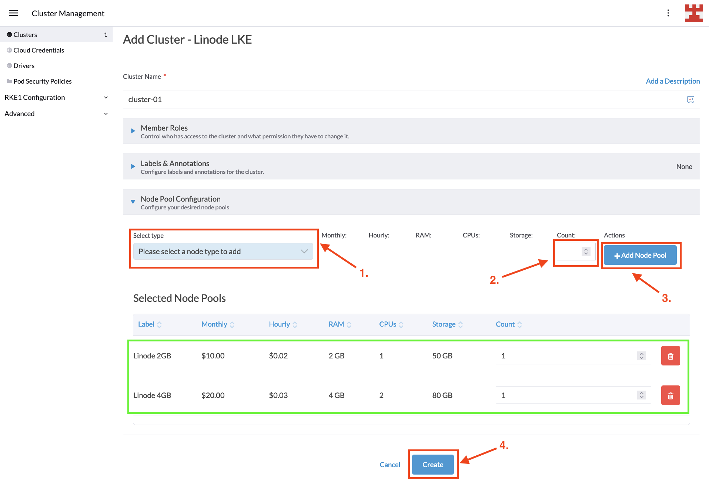

You'll be taken back to the **Clusters** screen, where you should wait for the new cluster to be provisioned. Behind the scenes, Rancher is leveraging the Cluster API to configure the LKE cluster according to your requirements:

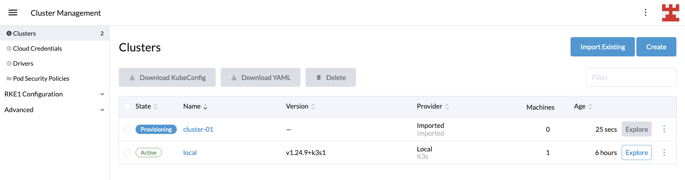

Once the cluster status shows as active, you can review the new cluster details by clicking the **Explore** button on the right:

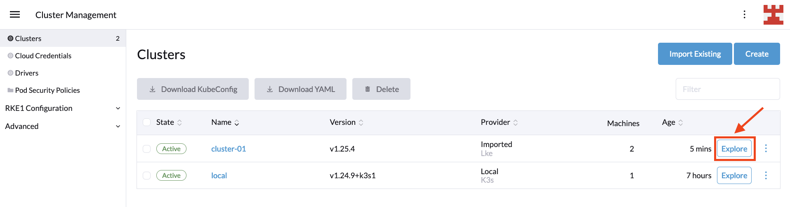

At this point, you've deployed an LKE cluster using Rancher. In the next section, you'll learn how to implement CA on it.

### Setting up CA

If you're new to Kubernetes, implementing CA can seem complex. For instance, the [Cluster Autoscaler on AWS documentation](https://github.com/kubernetes/autoscaler/blob/master/cluster-autoscaler/cloudprovider/aws/README.md) talks about how to set permissions using Identity and Access Management (IAM) policies, OpenID Connect (OIDC) Federated Authentication and AWS security credentials. Meanwhile, the [Cluster Autoscaler on Azure documentation](https://github.com/kubernetes/autoscaler/blob/master/cluster-autoscaler/cloudprovider/azure/README.md) focuses on how to implement CA in Azure Kubernetes Service (AKS), Autoscale VMAS instances and Autoscale VMSS instances, for which you will also need to spend time setting up the correct credentials for your user.

The objective of this tutorial is to leave aside the specifics associated with the authentication and authorization mechanisms of each cloud provider and focus on what really matters: How to implement CA in Kubernetes. To this end, you should focus your attention on these three key points:

1. CA introduces the concept of *node groups*, also called by some vendors *autoscaling groups*. You can think of these groups as the node pools managed by CA. This concept is important, as CA gives you the flexibility to set node groups that scale automatically according to your instructions while simultaneously excluding other node groups for manual scaling.
2. CA adds or removes Kubernetes nodes following certain parameters that you configure. These parameters include the previously mentioned node groups, their minimum size, maximum size and more.
3. CA runs as a Kubernetes deployment, in which secrets, services, namespaces, roles and role bindings are defined.

The supported versions of CA and Kubernetes may vary from one vendor to another. The way node groups are identified (using flags, labels, environmental variables, etc.) and the permissions needed for the deployment to run may also vary. However, at the end of the day, all implementations revolve around the principles listed previously: auto-scaling node groups, CA configuration parameters and CA deployment.

With that said, let's get back to business. After pressing the **Explore** button, you should be directed to the **Cluster Dashboard**. For now, you're only interested in looking at the nodes and the cluster's capacity.

The next steps consist of defining node groups and carrying out the corresponding CA deployment. Start with the simplest and follow some best practices to create a namespace to deploy the components that make CA. To do this, go to **Projects/Namespaces**:

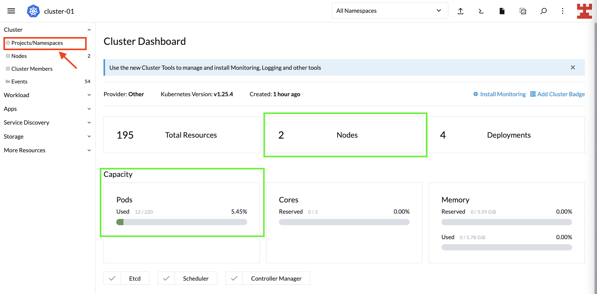

On the next screen, you can manage [Rancher Projects and namespaces](https://ranchermanager.docs.rancher.com/how-to-guides/new-user-guides/manage-clusters/projects-and-namespaces#about-projects). Under **Projects: System**, click **Create Namespace** to create a new namespace part of the **System** project:

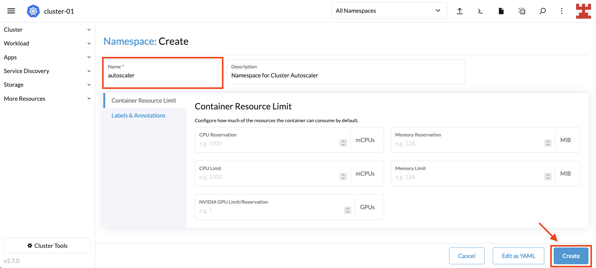

Give the namespace a name and select **Create**. Once the namespace is created, click on the icon shown here (*ie* import YAML):

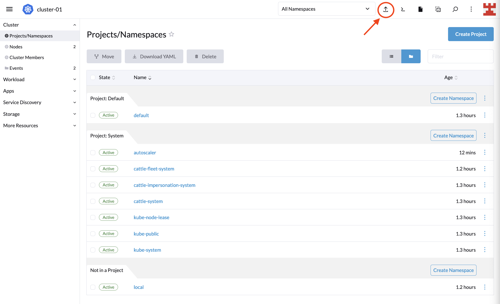

One of the many advantages of Rancher is that it allows you to perform countless tasks from the UI. One such task is to import local YAML files or create them on the fly and deploy them to your Kubernetes cluster.

To take advantage of this useful feature, copy the following code. Remember to replace `<PERSONAL_ACCESS_TOKEN>` with the Linode token that you created for the tutorial:

```
---
apiVersion: v1
kind: Secret
metadata:
  name: cluster-autoscaler-cloud-config
  namespace: autoscaler
type: Opaque
stringData:
  cloud-config: |-
    [global]
    linode-token=<PERSONAL_ACCESS_TOKEN>
    lke-cluster-id=88612
    defaut-min-size-per-linode-type=1
    defaut-max-size-per-linode-type=5
    do-not-import-pool-id=88541

    [nodegroup "g6-standard-1"]
    min-size=1
    max-size=4

    [nodegroup "g6-standard-2"]
    min-size=1
    max-size=2
```

Next, select the namespace you just created, paste the code in Rancher and select **Import**:

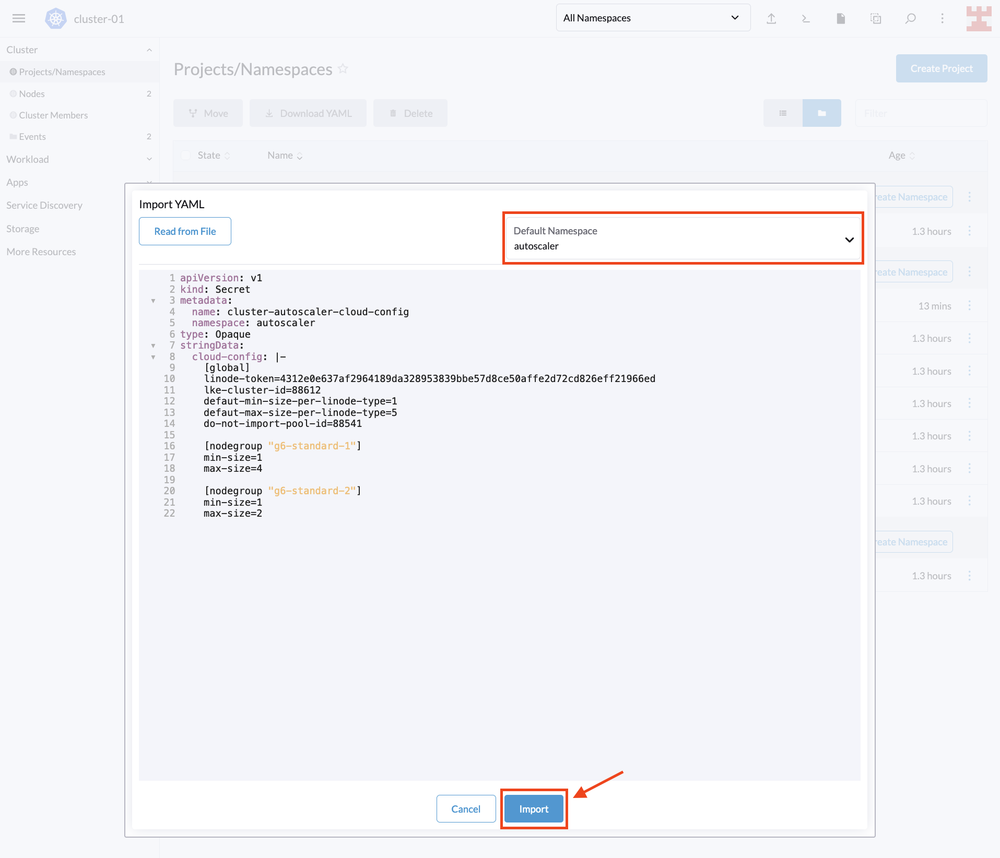

A pop-up window will appear, confirming that the resource has been created. Press **Close** to continue:

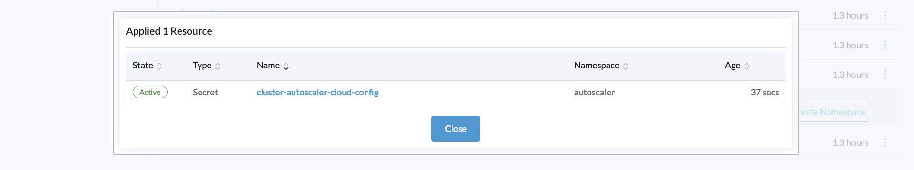

The secret you just created is how Linode implements the node group configuration that CA will use. This configuration defines several parameters, including the following:

- **`linode-token`:** This is the same personal access token that you used to register LKE in Rancher.
- **`lke-cluster-id`:** This is the unique identifier of the LKE cluster that you created with Rancher. You can get this value from the Linode console or by running the command `curl -H "Authorization: Bearer $TOKEN" https://api.linode.com/v4/lke/clusters`, where `STOKEN` is your Linode personal access token. In the output, the first field, `id`, is the identifier of the cluster.
- **`defaut-min-size-per-linode-type`:** This is a global parameter that defines the minimum number of nodes in each node group.
- **`defaut-max-size-per-linode-type`:** This is also a global parameter that sets a limit to the number of nodes that Cluster Autoscaler can add to each node group.
- **`do-not-import-pool-id`:** On Linode, each node pool has a unique ID. This parameter is used to exclude specific node pools so that CA does not scale them.
- **`nodegroup` (`min-size` and `max-size`):** This parameter sets the minimum and maximum limits for each node group. The CA for Linode implementation forces each node group to use the same node type. To get a list of available node types, you can run the command `curl https://api.linode.com/v4/linode/types`.

This tutorial defines two node groups, one using `g6-standard-1` linodes (2GB nodes) and one using `g6-standard-2` linodes (4GB nodes). For the first group, CA can increase the number of nodes up to a maximum of four, while for the second group, CA can only increase the number of nodes to two.

With the node group configuration ready, you can deploy CA to the respective namespace using Rancher. Paste the following code into Rancher (click on the **import YAML** icon as before):

```
---
apiVersion: v1
kind: ServiceAccount
metadata:
  labels:
    k8s-addon: cluster-autoscaler.addons.k8s.io
    k8s-app: cluster-autoscaler
  name: cluster-autoscaler
  namespace: autoscaler
---
apiVersion: rbac.authorization.k8s.io/v1
kind: ClusterRole
metadata:
  name: cluster-autoscaler
  labels:
    k8s-addon: cluster-autoscaler.addons.k8s.io
    k8s-app: cluster-autoscaler
rules:
  - apiGroups: [""]
    resources: ["events", "endpoints"]
    verbs: ["create", "patch"]
  - apiGroups: [""]
    resources: ["pods/eviction"]
    verbs: ["create"]
  - apiGroups: [""]
    resources: ["pods/status"]
    verbs: ["update"]
  - apiGroups: [""]
    resources: ["endpoints"]
    resourceNames: ["cluster-autoscaler"]
    verbs: ["get", "update"]
  - apiGroups: [""]
    resources: ["nodes"]
    verbs: ["watch", "list", "get", "update"]
  - apiGroups: [""]
    resources:
      - "namespaces"
      - "pods"
      - "services"
      - "replicationcontrollers"
      - "persistentvolumeclaims"
      - "persistentvolumes"
    verbs: ["watch", "list", "get"]
  - apiGroups: ["extensions"]
    resources: ["replicasets", "daemonsets"]
    verbs: ["watch", "list", "get"]
  - apiGroups: ["policy"]
    resources: ["poddisruptionbudgets"]
    verbs: ["watch", "list"]
  - apiGroups: ["apps"]
    resources: ["statefulsets", "replicasets", "daemonsets"]
    verbs: ["watch", "list", "get"]
  - apiGroups: ["storage.k8s.io"]
    resources: ["storageclasses", "csinodes"]
    verbs: ["watch", "list", "get"]
  - apiGroups: ["batch", "extensions"]
    resources: ["jobs"]
    verbs: ["get", "list", "watch", "patch"]
  - apiGroups: ["coordination.k8s.io"]
    resources: ["leases"]
    verbs: ["create"]
  - apiGroups: ["coordination.k8s.io"]
    resourceNames: ["cluster-autoscaler"]
    resources: ["leases"]
    verbs: ["get", "update"]
---
apiVersion: rbac.authorization.k8s.io/v1
kind: Role
metadata:
  name: cluster-autoscaler
  namespace: autoscaler
  labels:
    k8s-addon: cluster-autoscaler.addons.k8s.io
    k8s-app: cluster-autoscaler
rules:
  - apiGroups: [""]
    resources: ["configmaps"]
    verbs: ["create","list","watch"]
  - apiGroups: [""]
    resources: ["configmaps"]
    resourceNames: ["cluster-autoscaler-status", "cluster-autoscaler-priority-expander"]
    verbs: ["delete", "get", "update", "watch"]

---
apiVersion: rbac.authorization.k8s.io/v1
kind: ClusterRoleBinding
metadata:
  name: cluster-autoscaler
  labels:
    k8s-addon: cluster-autoscaler.addons.k8s.io
    k8s-app: cluster-autoscaler
roleRef:
  apiGroup: rbac.authorization.k8s.io
  kind: ClusterRole
  name: cluster-autoscaler
subjects:
  - kind: ServiceAccount
    name: cluster-autoscaler
    namespace: autoscaler

---
apiVersion: rbac.authorization.k8s.io/v1
kind: RoleBinding
metadata:
  name: cluster-autoscaler
  namespace: autoscaler
  labels:
    k8s-addon: cluster-autoscaler.addons.k8s.io
    k8s-app: cluster-autoscaler
roleRef:
  apiGroup: rbac.authorization.k8s.io
  kind: Role
  name: cluster-autoscaler
subjects:
  - kind: ServiceAccount
    name: cluster-autoscaler
    namespace: autoscaler

---
apiVersion: apps/v1
kind: Deployment
metadata:
  name: cluster-autoscaler
  namespace: autoscaler
  labels:
    app: cluster-autoscaler
spec:
  replicas: 1
  selector:
    matchLabels:
      app: cluster-autoscaler
  template:
    metadata:
      labels:
        app: cluster-autoscaler
      annotations:
        prometheus.io/scrape: 'true'
        prometheus.io/port: '8085'
    spec:
      serviceAccountName: cluster-autoscaler
      containers:
        - image: k8s.gcr.io/autoscaling/cluster-autoscaler-amd64:v1.26.1
          name: cluster-autoscaler
          resources:
            limits:
              cpu: 100m
              memory: 300Mi
            requests:
              cpu: 100m
              memory: 300Mi
          command:
            - ./cluster-autoscaler
            - --v=2
            - --cloud-provider=linode
            - --cloud-config=/config/cloud-config
          volumeMounts:
            - name: ssl-certs
              mountPath: /etc/ssl/certs/ca-certificates.crt
              readOnly: true
            - name: cloud-config
              mountPath: /config
              readOnly: true
          imagePullPolicy: "Always"
      volumes:
        - name: ssl-certs
          hostPath:
            path: "/etc/ssl/certs/ca-certificates.crt"
        - name: cloud-config
          secret:
            secretName: cluster-autoscaler-cloud-config
```

In this code, you're defining some labels; the namespace where you will deploy the CA; and the respective ClusterRole, Role, ClusterRoleBinding, RoleBinding, ServiceAccount and Cluster Autoscaler.

The difference between cloud providers is near the end of the file, at `command`. Several flags are specified here. The most relevant include the following:

- Cluster Autoscaler version `v`.
- `cloud-provider`; in this case, Linode.
- `cloud-config`, which points to a file that uses the secret you just created in the previous step.

Again, a cloud provider that uses a minimum number of flags is intentionally chosen. For a complete list of available flags and options, read the [Cloud Autoscaler FAQ](https://github.com/kubernetes/autoscaler/blob/master/cluster-autoscaler/FAQ.md).

Once you apply the deployment, a pop-up window will appear, listing the resources created:

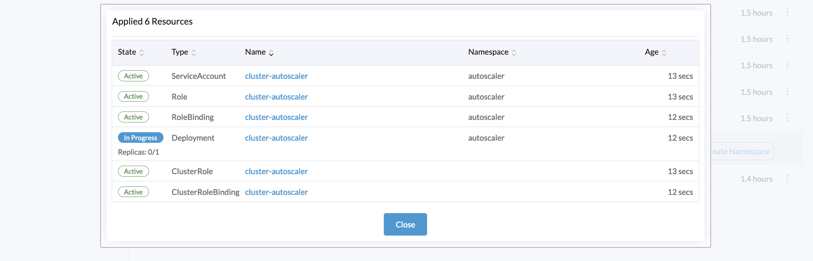

You've just implemented CA on Kubernetes, and now, it's time to test it.

## CA in action

To check to see if CA works as expected, deploy the following dummy workload in the `default` namespace using Rancher:

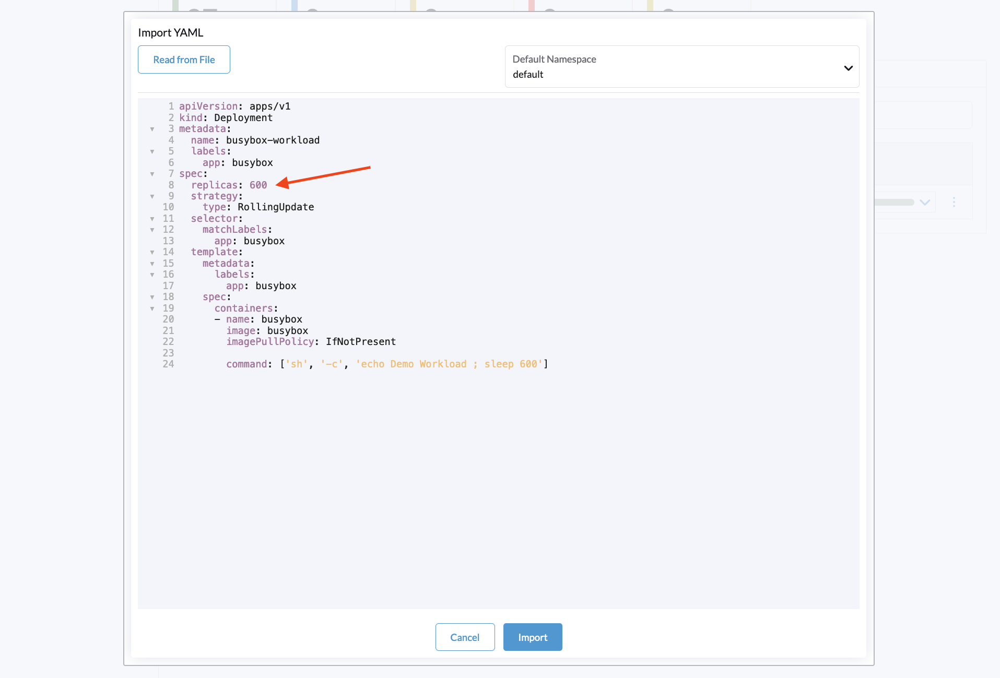

Here's a review of the code:

```
apiVersion: apps/v1
kind: Deployment
metadata:
  name: busybox-workload
  labels:
    app: busybox
spec:
  replicas: 600
  strategy:
    type: RollingUpdate
  selector:
    matchLabels:
      app: busybox
  template:
    metadata:
      labels:
        app: busybox
    spec:
      containers:
      - name: busybox
        image: busybox
        imagePullPolicy: IfNotPresent

        command: ['sh', '-c', 'echo Demo Workload ; sleep 600']
```

As you can see, it's a simple workload that generates 600 `busybox` replicas.

If you navigate to the **Cluster Dashboard**, you'll notice that the initial capacity of the LKE cluster is 220 pods. This means CA should kick in and add nodes to cope with this demand:

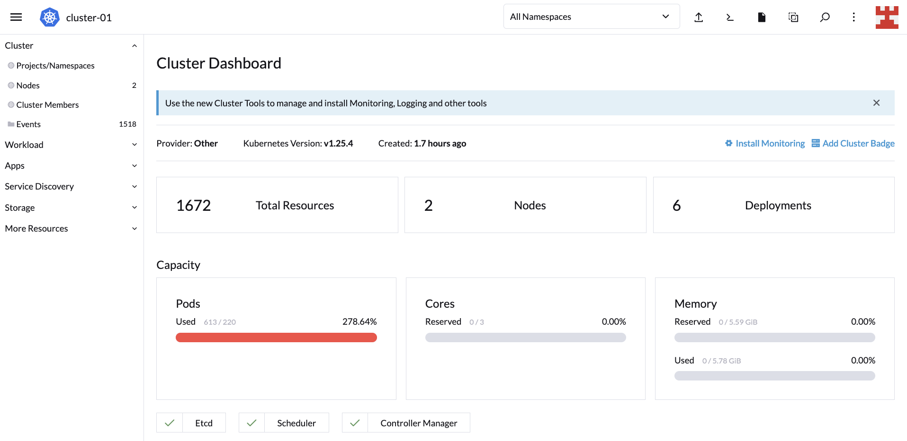

If you now click on **Nodes** (side menu), you will see how the node-creation process unfolds:

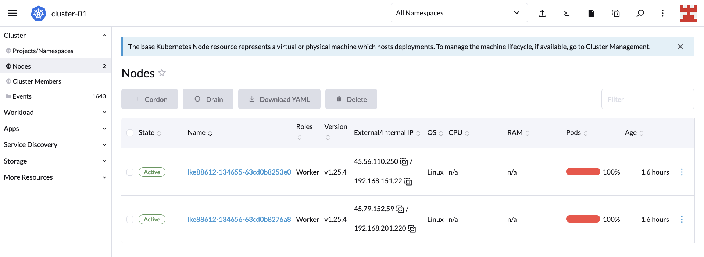

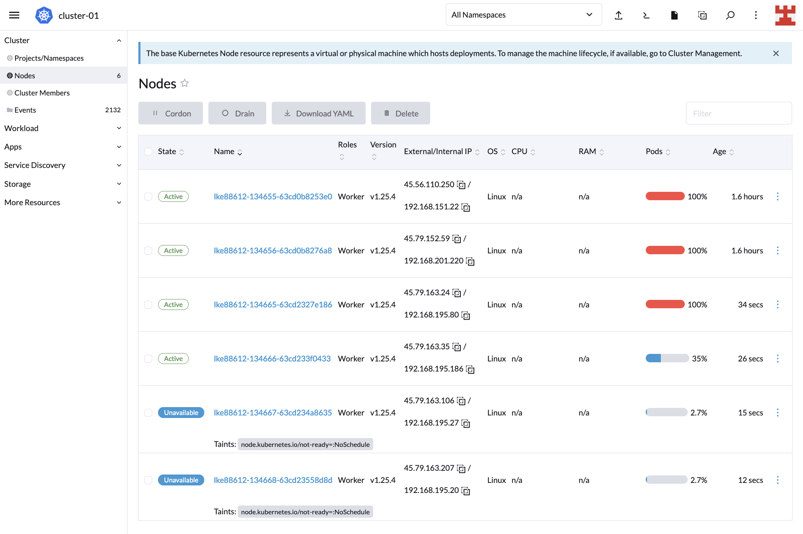

If you wait a couple of minutes and go back to the **Cluster Dashboard**, you'll notice that CA did its job because, now, the cluster is serving all 600 replicas:

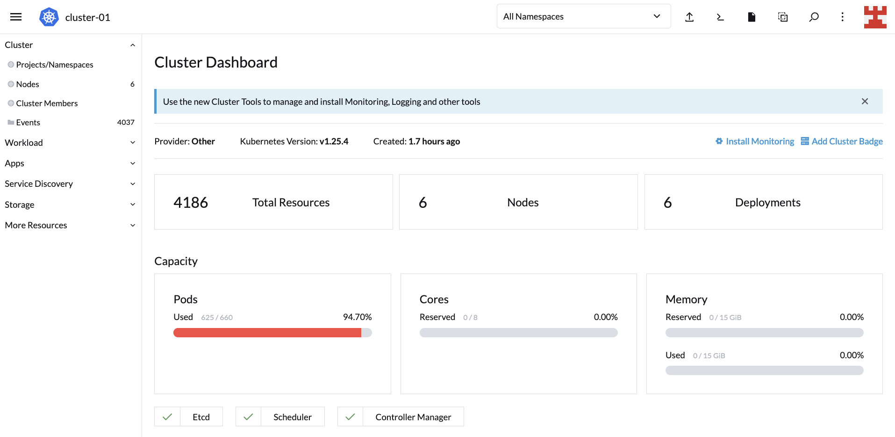

This proves that scaling up works. But you also need to test to see scaling down. Go to **Workload** (side menu) and click on the hamburger menu corresponding to `busybox-workload`. From the drop-down list, select **Delete**:

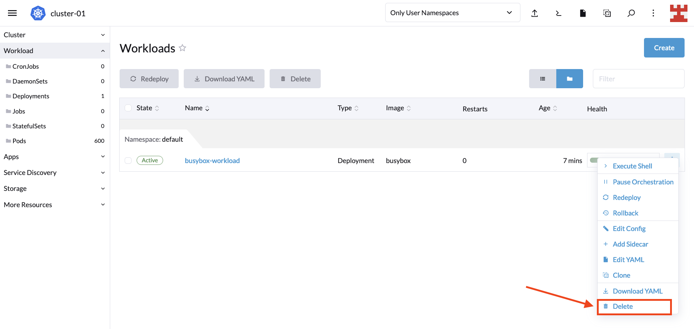

A pop-up window will appear; confirm that you want to delete the deployment to continue:


By deleting the deployment, the expected result is that CA starts removing nodes. Check this by going back to **Nodes**:

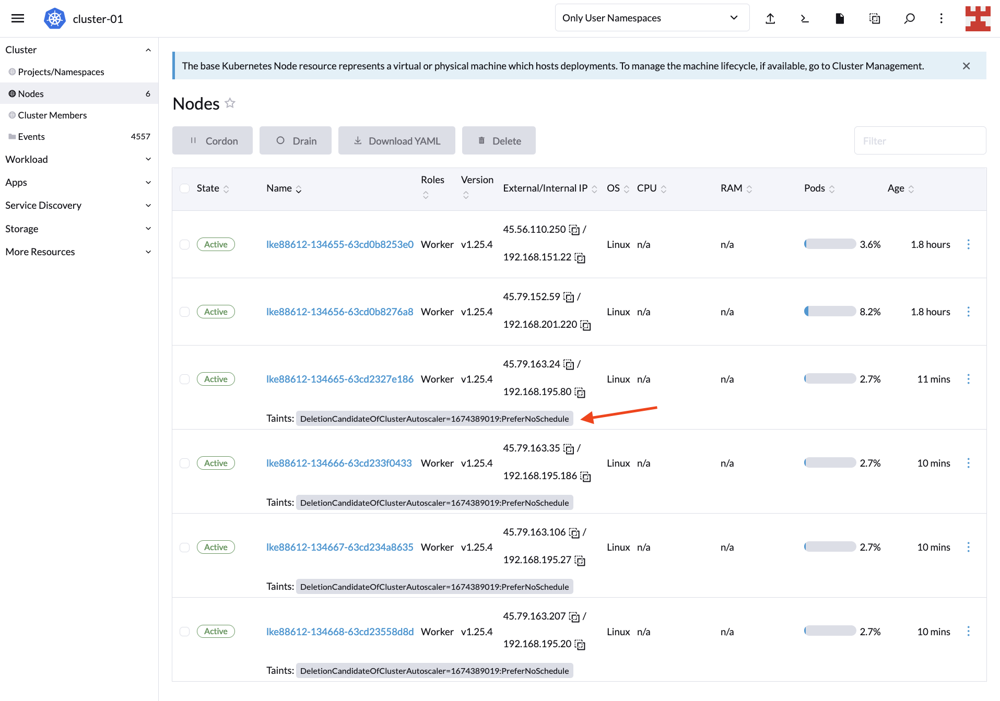

Keep in mind that by default, CA will start removing nodes after 10 minutes. Meanwhile, you will see taints on the **Nodes** screen indicating the nodes that are candidates for deletion. For more information about this behavior and how to modify it, read ["Does CA respect GracefulTermination in scale-down?"](https://github.com/kubernetes/autoscaler/blob/master/cluster-autoscaler/FAQ.md#does-ca-respect-gracefultermination-in-scale-down) in the Cluster Autoscaler FAQ.

After 10 minutes have elapsed, the LKE cluster will return to its original state with one 2GB node and one 4GB node:

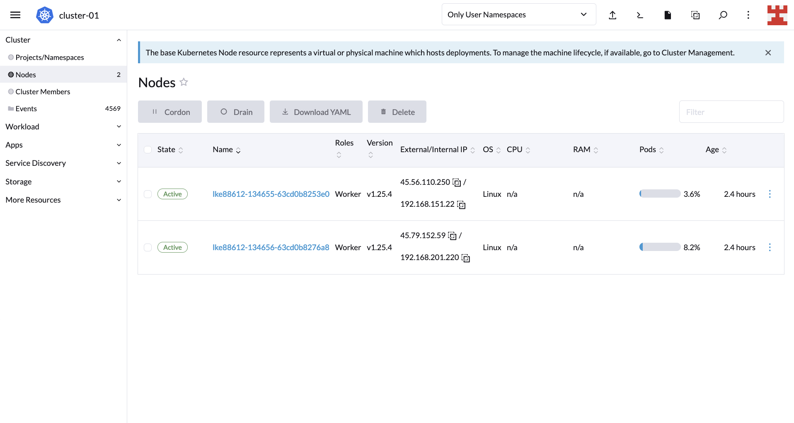

Optionally, you can confirm the status of the cluster by returning to the **Cluster Dashboard**:

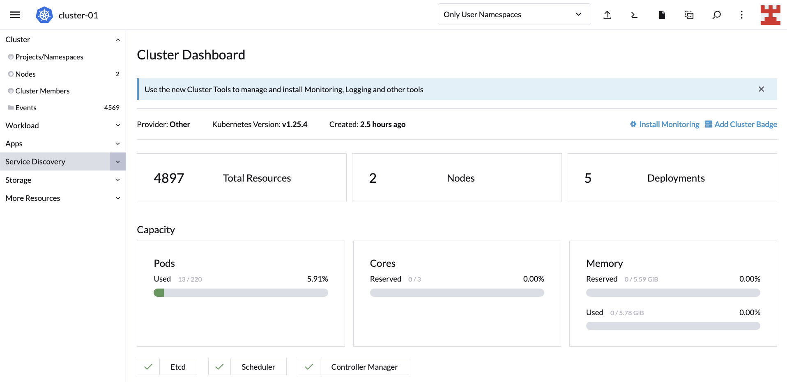

And now you have verified that Cluster Autoscaler can scale up and down nodes as required.

## CA, Rancher and managed Kubernetes services

At this point, the power of Cluster Autoscaler is clear. It lets you automatically adjust the number of nodes in your cluster based on demand, minimizing the need for manual intervention.

Since [Rancher fully supports the Kubernetes Cluster Autoscaler API](https://ranchermanager.docs.rancher.com/pages-for-subheaders/install-cluster-autoscaler), you can leverage this feature on major service providers like AKS, Google Kubernetes Engine (GKE) and Amazon Elastic Kubernetes Service (EKS). Let's look at one more example to illustrate this point.

Create a new workload like the one shown here:

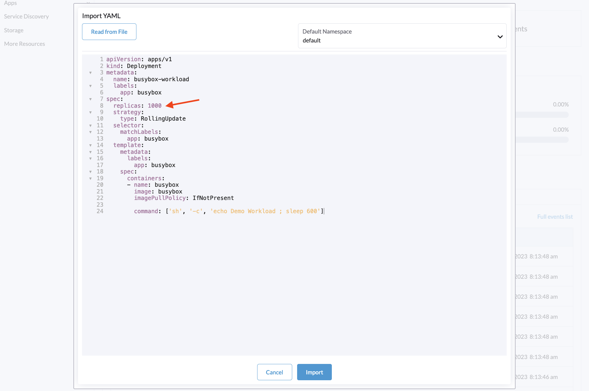

It's the same code used previously, only in this case, with 1,000 `busybox` replicas instead of 600. After a few minutes, the cluster capacity will be exceeded. This is because the configuration you set specifies a maximum of four 2GB nodes (first node group) and two 4GB nodes (second node group); that is, six nodes in total:

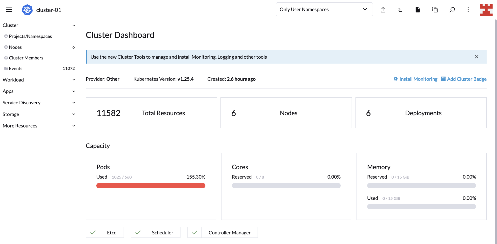

Head over to the **Linode Dashboard** and manually add a new node pool:

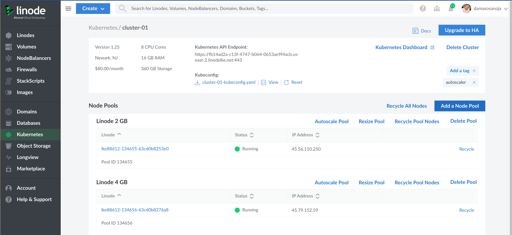

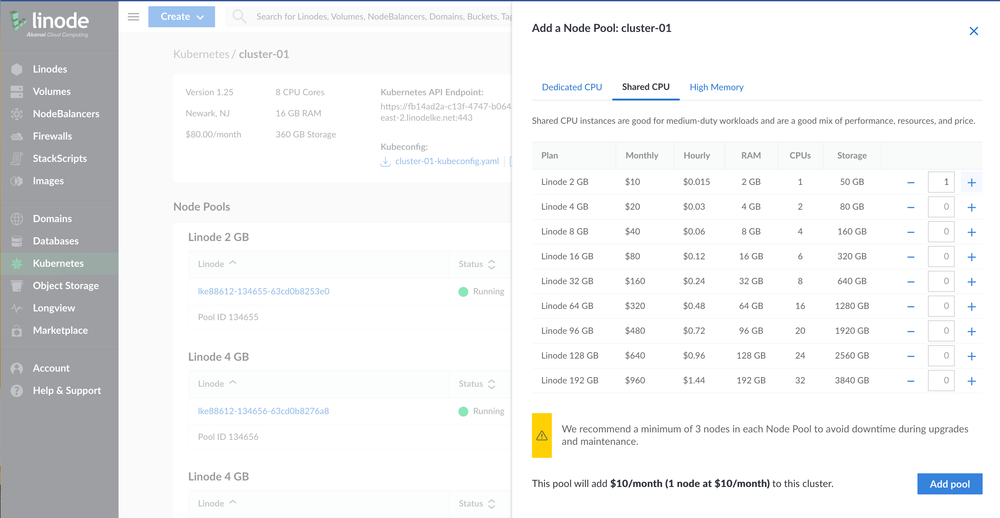

The new node will be displayed along with the rest on **Rancher's Nodes** screen:

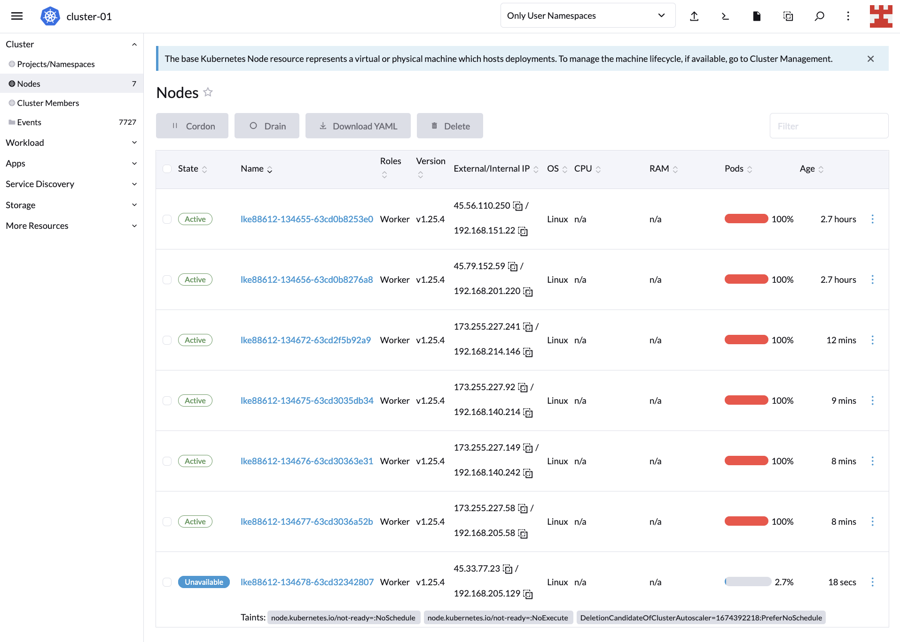

Better yet, since the new node has the same capacity as the first node group (2GB), it will be deleted by CA once the workload is reduced.

In other words, regardless of the underlying infrastructure, Rancher makes use of CA to know if nodes are created or destroyed dynamically due to load.

Overall, Rancher's ability to support Cluster Autoscaler out of the box is good news; it reaffirms Rancher as the ideal Kubernetes multi-cluster management tool regardless of which cloud provider your organization uses. Add to that Rancher's seamless integration with other tools and technologies like [Longhorn](https://www.rancher.com/products/longhorn) and [Harvester](https://www.rancher.com/products/harvester), and the result will be a convenient centralized dashboard to manage your entire hyper-converged infrastructure.

## Conclusion

This tutorial introduced you to Kubernetes Cluster Autoscaler and how it differs from other types of autoscaling, such as Vertical Pod Autoscaler (VPA) and Horizontal Pod Autoscaler (HPA). In addition, you learned how to implement CA on Kubernetes and how it can scale up and down your cluster size.

Finally, you also got a brief glimpse of [Rancher's](https://www.rancher.com/?utm_source=suse&utm_medium=web&utm_campaign=blog-getting-started-with-cluster-autoscaling-in-kubernetes) potential to [manage Kubernetes clusters](https://www.rancher.com/?utm_source=suse&utm_medium=web&utm_campaign=blog-getting-started-with-cluster-autoscaling-in-kubernetes) from the convenience of its intuitive UI. Rancher is part of the rich ecosystem of [SUSE](https://www.suse.com/), the leading open Kubernetes management platform. To learn more about other solutions developed by SUSE, such as Edge 2.0 or NeuVector, [visit their website](https://www.suse.com/).
