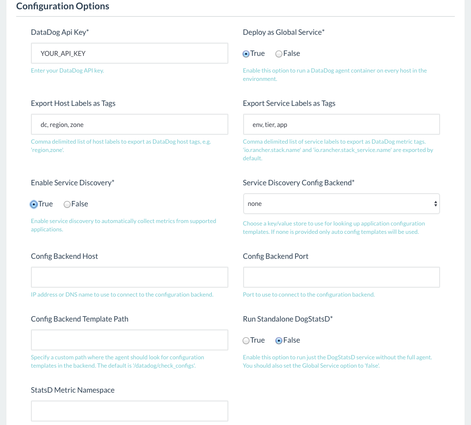
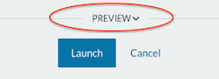

[](images/rancher_blog_jbruder-dd-article.png)
Monitoring your container-based infrastructure is crucial to ensure good
performance, identify issues early and gain the insight necessary to
maximize its efficiency. When you are dealing with a large number of
often short-lived containers spread over multiple hosts and even data
centers, understanding the operational health of your infrastructure
implies the need to aggregate performance data from both physical hosts
as well as the container cluster running on top of it. Ideally, you want
to capture and correlate application performance with the underlying
infrastructure to troubleshoot and identify bottlenecks. Implementing a
monitoring system that satisfies these requirements can be a complex
endeavor. A
[previous](https://rancher.com/comparing-monitoring-options-for-docker-deployments) blog
post compared a number of monitoring options that integrate with Docker.
One of those evaluated is the SaaS-based monitoring platform from
Datadog ([www.datadoghq.com](https://www.datadoghq.com/)). Datadog works
with an agent-based deploy that allows you to capture system resource
metrics as well as key Docker metrics and visualize them in highly
customizable graphs and dashboards. The agent is available as a Docker
image, which is a huge win in terms of ease of deployment. The recent
release of the Datadog Agent introduced the Service Discovery feature,
which facilitates polling of application-level metrics in dynamic,
container-based environments. In this article, I will walk you through
the steps of setting up environment-wide monitoring across all layers of
your stack (ie. host, Docker engine and application) using the Datadog
template from Rancher’s application catalog. In the process, I’ll show
you how adopting a policy of consistent labeling of hosts and services
in Rancher will help you gain maximum visibility into your applications
and infrastructure. I will also give a short insight into how Rancher
Catalog templates work.

## Step 1: Label your hosts and service

Tags assigned to servers and metrics play a crucial role in subsetting
and querying the collected data throughout the Datadog application.
Similarly, Rancher adopts the concept of labels, that is key/value pairs
attached to hosts and services. Rancher not only uses labels to manage
various features when starting services (see
[labels documentation](https://docs.rancher.com/rancher/latest/en/cattle/labels/)),
but also supports user-defined labels conveying metadata about your
hosts and services. To provide better integration between Rancher and
Datadog, the catalog template allows you to specify a list of host and
service labels to convert to Datadog tags. This makes it possible to
leverage an existing labeling scheme for subsetting metrics in Datadog,
instead of having to refer to individual host names or (short-lived)
container and image identifiers. If you aren’t already adopting a
labeling scheme for your hosts and services, this might be a good
occasion to start doing just that. You can use labels to encode any
amount of metadata about hosts and services. Here is a set of labels
that provides a basic amount of metadata about hosts:

- region (*e.g. us-east-1*)
- zone (*e.g. us-east-1b*)
- flavor (*e.g. t2.medium*)

The screenshot below shows an example of 3 hosts I added from Digital
Ocean, labeled with region, zone and droplet size: [](images/rancher_blog_jbruder-rancher-hosts.png)
Here are some attributes you might use as labels for your services:

- env (*e.g. dev|staging|production*)
- tier (*e.g. frontend|backend*)
- app (*e.g. web|database|message-queue*)

The more meaningful metadata you encode in host and service labels, the
easier it will be to aggregate relevant information in Datadog and
create custom dashboards providing not only the big picture but also a
view into the smallest detail. And as an added benefit, a consistent
labeling scheme will also help you to create narrowly scoped container
scheduling rules. *Note:* Host labels can not only be assigned at the
time of creation of the host but also later via the Edit option in the
host’s drop down menu.

## 2: Grab your Datadog API key

Datadog has a free account tier allowing you to use their service
indefinitely with up to 5 hosts. To get started, first sign up for the
free trial on [their website](https://www.datadoghq.com/). Once you are
signed into your account, you will need to grab your API key which can
be found under Integrations =>
[APIs](https://app.datadoghq.com/account/settings#api). Also make sure
to activate the [Docker
integration](https://app.datadoghq.com/account/settings) for your
account.

## Step 3: Configure the Catalog stack

In your Rancher server UI, navigate to Catalog => Library and locate
the entry for the Datadog stack. [](images/rancher_blog_jbruder-catalog-datadog-sm.png)
Click on View Details to open the configuration view and enter a name
for the stack. Next, let’s have a look at the available configuration
options:
[](images/rancher_blog_jbruder-dd-template-config.png)

#### Export Host Labels

Here you can specify which of the labels assigned to your hosts in
Rancher should be used for tagging your hosts in Datadog. Doing so will
allow you to easily track system metrics for groups of hosts that share
a specific attribute (e.g. availability zone) instead of having to refer
to each host individually.

#### Export Service Labels

When the Datadog agent captures metrics from the Docker engine, it will
by default turn the Docker “image name“? and “image tag” attributes
as well as the Rancher stack and service names into tags?. You may enter
one or more user-defined service labels in this field to also be used as
tags. This will later allow you to track metrics matching specific
services or labels in aggregate.

#### Global Service

Global Service means that a Datadog agent container will be scheduled to
run on every host in your current environment. You will normally want
this enabled to monitor system, Docker and application performance
environment-wide. Global Service will also make sure that any instances
added later on will automatically be monitored by Datadog as well.

#### Service Discovery

Besides monitoring system and Docker resources, the Datadog agent can
also poll metrics from applications running in your Docker
containers. When Service Discovery is enabled, the agent watches for
container events, identifies which service a specific container provides
and dynamically reconfigures the checks to capture the metrics exposed
by the application. Enabling the Service Discovery feature is all that
is required in order to monitor the following applications: Apache,
Consul, Couch, Couchbase, Elasticsearch, etcd, Kyoto Tycoon, Memcached,
Redis and Riak. To monitor any of the other [100+
supported](https://www.datadoghq.com/product/integrations) applications
you will need to provide configuration templates for the specific images
in an etcd or Consul store. To do so, first setup the configuration
templates as documented
[here](http://docs.datadoghq.com/guides/servicediscovery/)and then fill
in the information required to connect to the chosen key-value store in
the various Config Backend fields.

#### Standalone DogStatsD

The Datadog image provides a StatsD daemon which can aggregate and
forward application metrics to Datadog. With this option enabled only
the DogStatsD service without the full agent will run in the container.
That is, host or Docker metrics will not be captured at all, but you
will be able to send StatsD metrics to the service from any application
in your environment. You will also want to disable the Global Service
option when this option is enabled. For the purpose of this article
we’ll enable just the Service Discovery option, enter our host and
service labels as well as API key and leave the other options at their
defaults.

## Reviewing the Catalog template

Before we deploy the Datadog service, let’s take a brief look at the
containers that make up the stack.
[](images/rancher_blog_jbruder-datatog-preview-sm.png)
When you click the Preview label located above the Launch button you
will see a docker-compose.yml and rancher-compose.yml file. These files
are the foundation of any template in the Rancher Catalog. Here is a
snippet showing the relevant parts of the docker-compose.yml:

```
 datadog-init:
 image: janeczku/datadog-rancher-init:v1.1
 ...
 volumes:
 - /opt/rancher
 ...
 datadog-agent:
 image: datadog/docker-dd-agent:11.1.580
 ...
 volumes_from:
 - datadog-init
 labels:
 io.rancher.sidekicks: 'datadog-init'
```

As you can see, this stack comprises two containers. The
“datadog-agent” container runs the official Datadog agent image and
mounts a configuration volume exposed by the sidekick container named
“datadog-init“. The purpose of the sidekick container is to configure
the agent for the Rancher environment. In a nutshell, the sidekick
retrieves the name of the host and the host labels from Rancher’s
metadata service and generates a configuration file using the
information provided in the UI. To learn more about creating Rancher
Catalog templates check out [this
article](https://rancher.com/building-rancher-catalog-templates). Let’s
go ahead with launching the stack. After clicking the Launch button,
confirm that the status of the Datadog stack has become Active, meaning
that the containers have been started on all hosts. [](images/rancher_blog_jbruder-datadog-stack.png)

## Leveraging Rancher metadata in Datadog

Once the stack is deployed to your Rancher environment, you should
already see events and metrics flowing into Datadog. Let me show you how
you are now able to refer to Rancher metadata when visualizing
performance of our hosts, containers and applications. When you open the
Infrastructure List in Datadog, notice that the names of the hosts and
their tags correspond to the designated names and host labels in
Rancher. We can now easily scope host performance data using label
attributes or click on individual hosts for a detailed look. The example
below shows how we can now filter and group hosts by region, zone and
instance flavor. [](images/rancher_blog_jbruder-dd-infrastructure-view.png)
Next, navigate to the Docker integration dashboard, which provides an
overview into the status and resource usage of all Docker containers.
Using the Scope drop down you can change the scope of the view based on
stack and service names, host and service labels or Docker image tags.
[](images/rancher_blog_jbruder-dd-docker-dash.png)
Let’s see how we can use Rancher metadata within Datadog to create
custom views into our performance data. In the example below, we query
the CPU usage of all Docker containers that are part of the service
“gitlab” in the stack “ci” grouped by the host’s availability
region: [](images/rancher_blog_jbruder-dd-metric-exp-container.png)
Now let us put the Service Discovery feature to test by launching a
Redis service in Rancher. You can see in the screenshot that I used the
official Redis image from Docker Hub and assigned labels according to
the labeling scheme discussed above. [](images/rancher_blog_jbruder-redis-service-create.png)
Once the service has started, the Datadog agent should automatically
begin to capture application metrics from the Redis container. We can
verify this by opening the Redis integration dashboard in Datadog which
should provide a pre-configured look at the key metrics. [](https://cdn.rancher.com/wp-content/uploads/2016/07/12115047/jbruder-dd-redis-dash.png)
And finally, here is an example for a custom graph correlating Redis
requests per second with the CPU usage of the host it is running on:
[](images/rancher_blog_jbruder-dd-redis-metric-expl.png)
This should provide you with enough inspiration to start creating your
own custom dashboards in Datadog using Rancher metadata provided
by tags. I hope this article gives you an idea about how the Datadog
template in Rancher’s Catalog can help you implement monitoring of your
Rancher environment across all layers of your stack in a matter of
minutes. If you have any questions, please reach out to me
(jan@rancher.com), or contact us on Twitter
[@Rancher\_Labs](http://twitter.com/rancher_labs).
